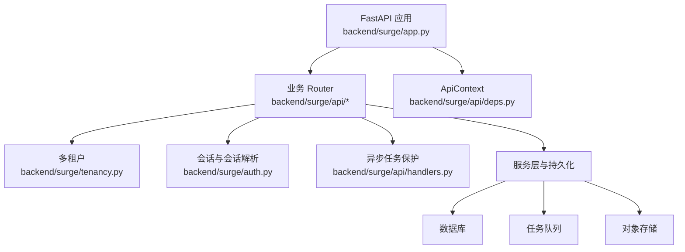
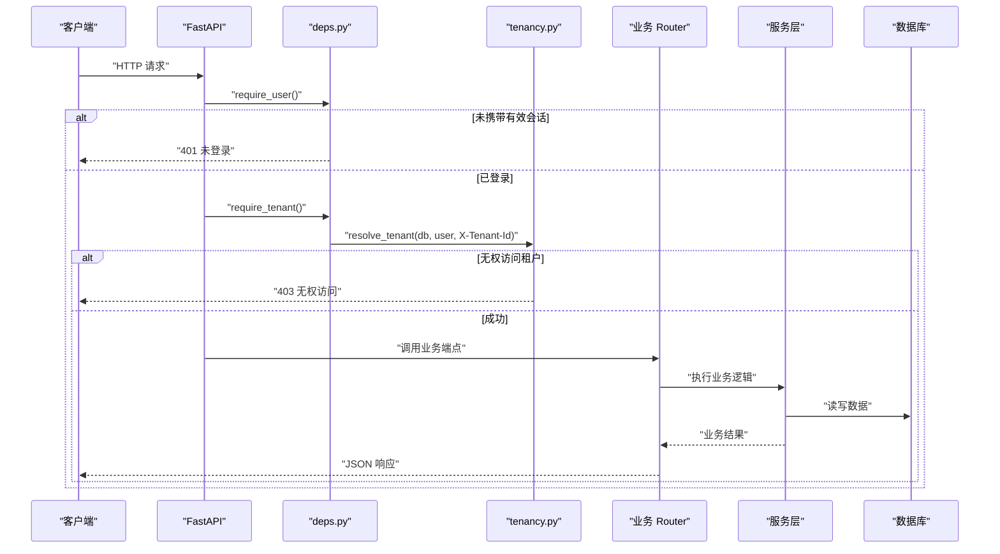
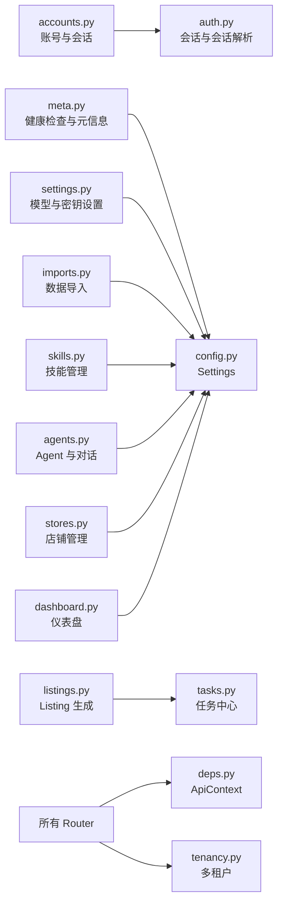

# API 参考

<cite>
**本文引用的文件**   
- [backend/surge/app.py](file://backend/surge/app.py)
- [backend/surge/auth.py](file://backend/surge/auth.py)
- [backend/surge/tenancy.py](file://backend/surge/tenancy.py)
- [backend/surge/api/deps.py](file://backend/surge/api/deps.py)
- [backend/surge/api/handlers.py](file://backend/surge/api/handlers.py)
- [backend/surge/api/accounts.py](file://backend/surge/api/accounts.py)
- [backend/surge/api/meta.py](file://backend/surge/api/meta.py)
- [backend/surge/api/settings.py](file://backend/surge/api/settings.py)
- [backend/surge/api/marketplace.py](file://backend/surge/api/marketplace.py)
- [backend/surge/api/listings.py](file://backend/surge/api/listings.py)
- [backend/surge/api/imports.py](file://backend/surge/api/imports.py)
- [backend/surge/api/tasks.py](file://backend/surge/api/tasks.py)
- [backend/surge/api/agents.py](file://backend/surge/api/agents.py)
- [backend/surge/api/skills.py](file://backend/surge/api/skills.py)
- [backend/surge/api/stores.py](file://backend/surge/api/stores.py)
- [backend/surge/api/dashboard.py](file://backend/surge/api/dashboard.py)
- [backend/surge/config.py](file://backend/surge/config.py)
</cite>

## 目录

1. [引言](#引言)
2. [项目结构](#项目结构)
3. [核心组件](#核心组件)
4. [架构总览](#架构总览)
5. [通用接口与鉴权约定](#通用接口与鉴权约定)
6. [认证授权接口](#认证授权接口)
7. [通用接口](#通用接口)
8. [竞品分析接口](#竞品分析接口)
9. [Listing 管理接口](#listing-管理接口)
10. [数据导入接口](#数据导入接口)
11. [任务管理接口](#任务管理接口)
12. [Agent 管理接口](#agent-管理接口)
13. [技能管理接口](#技能管理接口)
14. [店铺管理接口](#店铺管理接口)
15. [仪表盘接口](#仪表盘接口)
16. [依赖关系分析](#依赖关系分析)
17. [性能与限流](#性能与限流)
18. [故障排查指南](#故障排查指南)
19. [结论](#结论)

## 引言

Surge 后端基于 FastAPI 构建，提供跨境电商 AI 运营相关的 RESTful API。系统围绕“租户 + 角色”的多租户模型组织权限，把账号、邀请令牌、模型密钥、Listing 生成、数据导入、任务执行、Agent 工作流、技能运行、店铺连接和仪表盘聚合为若干按业务域划分的 Router。

本文面向调用方，按模块说明：

- HTTP 方法与 URL 模式
- 请求体或查询参数
- 响应体关键字段
- 状态码与错误语义
- BYOK（Bring Your Own Key）场景下的 `428 api_key_required`
- 异步执行约定 `async_run=true` 与任务轮询机制
- curl 与 Python requests 示例
- 鉴权方式、租户隔离、限流配置、上传大小限制
- OpenAPI/Swagger 文档使用方式

## 项目结构

后端应用入口在 `backend/surge/app.py`，负责装配 FastAPI 实例、数据库、对象存储、任务队列、演示账号、CORS、全局异常处理以及挂载所有业务 Router。业务端点集中在 `backend/surge/api/` 下，每个文件对应一个领域；共享依赖和鉴权逻辑集中在 `api/deps.py`，异步任务外层保护集中在 `api/handlers.py`。



**图表来源**
- [backend/surge/app.py:1-120](file://backend/surge/app.py#L1-L120)
- [backend/surge/api/deps.py:1-120](file://backend/surge/api/deps.py#L1-L120)
- [backend/surge/tenancy.py:1-80](file://backend/surge/tenancy.py#L1-L80)

**章节来源**
- [backend/surge/app.py:1-120](file://backend/surge/app.py#L1-L120)
- [backend/surge/api/deps.py:1-120](file://backend/surge/api/deps.py#L1-L120)

## 核心组件

### ApiContext：Router 的唯一共享依赖

`ApiContext` 是装配后的协作者集合，包含数据库、对象存储、任务队列和加密密钥工厂。Router 不直接访问 FastAPI 的 `app.state`，而是通过 `Depends(get_ctx)` 获取它。它还暴露：

| 能力 | 用途 |
|---|---|
| `tenant_of(request, user)` | 从已认证用户解析 `TenantContext`，支持 `X-Tenant-Id` |
| `rate_limit(user, scope, limit)` | 对已登录身份限流 |
| `rate_limit_identity(identity, scope, limit)` | 对任意 identity（如 IP）限流 |
| `build_user_provider(user)` | 根据用户配置构造 LLM Provider |
| `audit_user(...)` / `audit_context(...)` | 记录审计日志 |
| `secret_box_factory()` | 懒加载加密主密钥 |

**章节来源**
- [backend/surge/api/deps.py:1-200](file://backend/surge/api/deps.py#L1-L200)

### TenantContext：多租户上下文

多租户的核心规则是：

1. 客户端可以传 `X-Tenant-Id` 表示“我想切到哪个租户”，但必须校验该用户确实属于它，否则返回 `403`。
2. 不传时使用用户最早加入的租户，单用户场景无感知。
3. 所有业务查询都带上 `tenant_id`，与 `user_id` 共同构成双重过滤。

角色等级：

| 角色 | 最低权限 |
|---|---|
| viewer | 只读 |
| editor | 创建任务、编辑 Listing、上传数据 |
| admin | 成员管理、数据源、店铺、模型配置 |
| owner | 全部，含删除租户 |

**章节来源**
- [backend/surge/tenancy.py:1-131](file://backend/surge/tenancy.py#L1-L131)

### 会话与会话解析

认证相关要点：

- 密码使用 scrypt 加盐哈希，不存明文。
- 会话令牌是随机字符串，数据库中只存其 SHA-256。
- 默认会话有效期约 7 天。
- 支持 `Authorization: Bearer <token>` 和 `Cookie: cp_session`。
- 公开接口用 `optional_user`，需要登录的接口用 `require_user`。

**章节来源**
- [backend/surge/auth.py:1-200](file://backend/surge/auth.py#L1-L200)
- [backend/surge/api/deps.py:201-282](file://backend/surge/api/deps.py#L201-L282)

## 架构总览



**图表来源**
- [backend/surge/api/deps.py:201-282](file://backend/surge/api/deps.py#L201-L282)
- [backend/surge/tenancy.py:1-131](file://backend/surge/tenancy.py#L1-L131)
- [backend/surge/app.py:120-200](file://backend/surge/app.py#L120-L200)

## 通用接口与鉴权约定

### 通用鉴权头

| 场景 | 头或参数 | 说明 |
|---|---|---|
| 已登录 | `Authorization: Bearer <token>` | 浏览器 Cookie 模式下可省略 |
| 切换租户 | `X-Tenant-Id: <tenant_id>` | 可选；未传时使用用户主租户 |
| 管理员接口 | 同上 | 额外要求 `is_admin=true` |
| 需要写权限 | 同上 | 通常要求 `editor` 及以上 |
| 需要管理权限 | 同上 | 通常要求 `admin` 或 `owner` |

### BYOK 与 `428 api_key_required`

当后端配置了 `SURGE_REQUIRE_API_KEY=true`，且当前用户没有可用的模型密钥时，需要调用大模型的任务不会静默降级为本地规则引擎，而是返回：

| 字段 | 值 |
|---|---|
| `code` | `api_key_required` |
| `action` | `open_settings` |

典型状态码：

| 场景 | 状态码 | 含义 |
|---|---:|---|
| 未登录 | `401` | 会话无效或过期 |
| 租户无权 | `403` | 不是租户成员或角色不足 |
| 缺少 API Key | `428` | 需要配置模型密钥 |
| 请求被限流 | `429` | 超过 `SURGE_RATE_LIMIT_*` |
| 请求体校验失败 | `422` | Pydantic 校验失败 |
| 文件过大 | `413` | 超过 `max_upload_bytes` |
| 资源不存在 | `404` | 任务、报告、Listing、店铺等不存在 |
| 并发冲突 | `409` | 重试条件不满足、重复提交等 |
| 上游厂商不可用 | `503` | Provider 调用失败 |
| 内部错误 | `500` | 未预期异常 |

### 异步执行约定

部分耗时操作支持 `async_run=true`：

1. 立即返回 `{task_id, status: "queued", plan}`。
2. 前端轮询 `/api/tasks/{task_id}`。
3. 最终状态包括 `succeeded`、`failed`、`cancelled`、`waiting_input`、`partial` 等。
4. 取消通过 `/api/tasks/{task_id}/cancel`。
5. 某些任务支持 `/api/tasks/{task_id}/retry`。

**章节来源**
- [backend/surge/api/deps.py:1-120](file://backend/surge/api/deps.py#L1-L120)
- [backend/surge/tenancy.py:1-131](file://backend/surge/tenancy.py#L1-L131)
- [backend/surge/api/listings.py:1-120](file://backend/surge/api/listings.py#L1-L120)
- [backend/surge/api/tasks.py:1-120](file://backend/surge/api/tasks.py#L1-L120)

## 认证授权接口

### GET `/api/auth/status`

检查是否需要初始化、是否已登录、是否允许注册。

- 鉴权：无需登录
- 响应关键字段：
  - `needs_setup`：是否首次初始化
  - `authenticated`：是否已登录
  - `user`：公开用户信息
  - `user_count`：用户总数
  - `allow_registration`：是否开放注册
  - `demo_account`：是否启用演示账号
  - `guest_ttl_hours`：临时账号有效期

**章节来源**
- [backend/surge/api/accounts.py:1-120](file://backend/surge/api/accounts.py#L1-L120)

### POST `/api/auth/demo`

一键体验：创建 24 小时临时账号，独立租户，可保存自己的密钥。

- 鉴权：无需登录
- 限流：按客户端 IP 限流，默认每小时 5 次
- 请求体：可选空对象
- 响应关键字段：
  - `user`：公开用户信息
  - `username`
  - `password`
  - `expires_in_hours`
  - `note`

**curl 示例：**

```bash
curl -X POST https://example.com/api/auth/demo \
  -H "Content-Type: application/json" \
  -d '{}'
```

**Python requests 示例：**

```python
import requests

resp = requests.post("https://example.com/api/auth/demo", json={})
print(resp.json())
```

**章节来源**
- [backend/surge/api/accounts.py:1-120](file://backend/surge/api/accounts.py#L1-L120)
- [backend/surge/config.py:120-200](file://backend/surge/config.py#L120-L200)

### POST `/api/auth/register`

注册账号。若关闭开放注册，除首个用户外必须携带邀请令牌。

- 鉴权：无需登录
- 请求体：
  - `username`：3–32 位字母、数字、下划线、点或短横线
  - `password`：至少 8 位
  - `display_name`：可选
  - `invite_token`：可选
- 响应关键字段：
  - `user`
  - `token`
  - `invited_to`：若通过邀请加入，则返回目标租户 ID

**curl 示例：**

```bash
curl -X POST https://example.com/api/auth/register \
  -H "Content-Type: application/json" \
  -d '{
    "username": "alice",
    "password": "strongpass123",
    "display_name": "Alice"
  }'
```

**章节来源**
- [backend/surge/api/accounts.py:120-220](file://backend/surge/api/accounts.py#L120-L220)
- [backend/surge/auth.py:1-120](file://backend/surge/auth.py#L1-L120)

### POST `/api/auth/login`

登录并建立会话。

- 鉴权：无需登录
- 请求体：
  - `username`
  - `password`
- 响应关键字段：
  - `user`
  - `token`

**curl 示例：**

```bash
curl -X POST https://example.com/api/auth/login \
  -H "Content-Type: application/json" \
  -d '{"username":"alice","password":"strongpass123"}'
```

**章节来源**
- [backend/surge/api/accounts.py:220-300](file://backend/surge/api/accounts.py#L220-L300)
- [backend/surge/auth.py:120-200](file://backend/surge/auth.py#L120-L200)

### POST `/api/auth/logout`

登出并删除会话。

- 鉴权：需要登录
- 响应：确认登出结果

**curl 示例：**

```bash
curl -X POST https://example.com/api/auth/logout \
  -H "Authorization: Bearer $TOKEN"
```

**章节来源**
- [backend/surge/api/accounts.py:300-451](file://backend/surge/api/accounts.py#L300-L451)

### 邀请令牌

邀请令牌用于受控注册。注册流程中：

- 已有关闭开放注册后，非首用户必须提供有效邀请令牌。
- 无效邀请令牌可能返回 `403` 或 `400`，具体取决于注册阶段。
- 邀请成功后会关联目标租户。

**章节来源**
- [backend/surge/api/accounts.py:120-220](file://backend/surge/api/accounts.py#L120-L220)

## 通用接口

### GET `/api/health`

健康检查。未登录时仅返回服务状态；已登录时附加模型 Provider 状态。

- 鉴权：无需登录
- 响应关键字段：
  - `status`
  - `version`
  - `brand`
  - `provider`
  - `requires_api_key`
  - `configured_model`
  - `worker`

**curl 示例：**

```bash
curl https://example.com/api/health
```

**章节来源**
- [backend/surge/api/meta.py:1-120](file://backend/surge/api/meta.py#L1-L120)

### GET `/` 与 SPA 路由

`/` 及 `/workbench`、`/dashboard`、`/tasks`、`/data`、`/agents`、`/skills`、`/stores`、`/settings` 等路径返回前端 HTML 外壳，由前端路由接管。这些路径不包含在 OpenAPI Schema 中。

**章节来源**
- [backend/surge/api/meta.py:1-120](file://backend/surge/api/meta.py#L1-L120)

## 竞品分析接口

竞品分析数据来自 Marketplace Provider。默认是 Mock Provider，所有返回数据带 `is_mock` 标记；真实 SP-API 尚未接入，因此不会显示为已连接。

### GET `/api/marketplace/sources`

查看数据源状态。

- 鉴权：需要登录，租户内 `viewer` 及以上
- 响应关键字段：
  - `items`：各数据域的 Provider、模式、最后同步时间

**curl 示例：**

```bash
curl -H "Authorization: Bearer $TOKEN" \
     -H "X-Tenant-Id: $TENANT_ID" \
     https://example.com/api/marketplace/sources
```

**章节来源**
- [backend/surge/api/marketplace.py:1-120](file://backend/surge/api/marketplace.py#L1-L120)

### GET `/api/marketplace/overview`

市场概览，聚合商品、订单、广告和指标。

- 鉴权：需要登录，租户内 `viewer` 及以上
- 查询参数：
  - `connection_id`：可选，指定店铺连接
  - `range`：默认 `30d`
- 响应关键字段：
  - `connection`
  - `provider`
  - `products`
  - `orders`
  - `ads`
  - `metrics`

**curl 示例：**

```bash
curl -H "Authorization: Bearer $TOKEN" \
     -H "X-Tenant-Id: $TENANT_ID" \
     "https://example.com/api/marketplace/overview?range=7d"
```

**章节来源**
- [backend/surge/api/marketplace.py:120-200](file://backend/surge/api/marketplace.py#L120-L200)

### GET `/api/marketplace/products`

列出商品。

- 鉴权：需要登录，租户内 `viewer` 及以上
- 查询参数：
  - `connection_id`：可选
  - `limit`：默认 20，服务端限制最大 100
- 响应关键字段：
  - `items`
  - `mode`
  - `is_mock`
  - `provider`

**curl 示例：**

```bash
curl -H "Authorization: Bearer $TOKEN" \
     -H "X-Tenant-Id: $TENANT_ID" \
     "https://example.com/api/marketplace/products?limit=10"
```

**章节来源**
- [backend/surge/api/marketplace.py:200-260](file://backend/surge/api/marketplace.py#L200-L260)

### GET `/api/marketplace/orders`

列出订单。

- 鉴权：需要登录，租户内 `viewer` 及以上
- 查询参数：
  - `connection_id`：可选
  - `since`：默认 `30d`
- 响应关键字段：
  - `items`
  - `mode`
  - `is_mock`
  - `provider`

**curl 示例：**

```bash
curl -H "Authorization: Bearer $TOKEN" \
     -H "X-Tenant-Id: $TENANT_ID" \
     "https://example.com/api/marketplace/orders?since=7d"
```

**章节来源**
- [backend/surge/api/marketplace.py:260-300](file://backend/surge/api/marketplace.py#L260-L300)

### GET `/api/marketplace/ads`

列出广告。

- 鉴权：需要登录，租户内 `viewer` 及以上
- 查询参数：`connection_id` 可选
- 响应关键字段：
  - `items`
  - `mode`
  - `is_mock`
  - `provider`

**章节来源**
- [backend/surge/api/marketplace.py:300-360](file://backend/surge/api/marketplace.py#L300-L360)

### GET `/api/marketplace/metrics`

获取聚合指标。

- 鉴权：需要登录，租户内 `viewer` 及以上
- 查询参数：
  - `connection_id`：可选
  - `range`：默认 `30d`
- 响应关键字段：
  - 指标数据
  - `mode`
  - `provider`

**章节来源**
- [backend/surge/api/marketplace.py:360-420](file://backend/surge/api/marketplace.py#L360-L420)

## Listing 管理接口

Listing 生成是典型异步场景：文案生成通常需要数秒到数十秒，因此前端唯一使用的路径是 `async_run=true`。

### POST `/api/listings/generate`

生成 Listing。

- 鉴权：需要登录，租户内 `editor` 及以上
- 查询参数：
  - `async_run`：默认 `false`
    - `false`：同步返回完整 Listing，供脚本或测试使用
    - `true`：立即返回任务，供前端轮询
- 请求体：`ListingGenerationRequest`，包含商品名称、平台、语言、规格、分析报告等
- 同步响应：
  - `listing`
  - `persisted`
  - `duration_ms`
  - `task_id`
- 异步响应：
  - `task_id`
  - `status`：`queued`
  - `plan`
  - `async`：`true`
  - `engine`

BYOK 行为：

- 如果配置要求 API Key，而当前用户没有可用密钥，异步路径应返回 `428 api_key_required`。
- 同步路径在 Provider 不可用时可能返回 `503`，或在其他异常时返回 `502`。

**curl 异步示例：**

```bash
curl -X POST https://example.com/api/listings/generate?async_run=true \
  -H "Authorization: Bearer $TOKEN" \
  -H "X-Tenant-Id: $TENANT_ID" \
  -H "Content-Type: application/json" \
  -d '{
    "product": {
      "name": "Wireless Mouse"
    },
    "marketplace": "amazon_us",
    "language": "zh-CN"
  }'
```

**Python requests 异步示例：**

```python
import requests
import time

payload = {
    "product": {"name": "Wireless Mouse"},
    "marketplace": "amazon_us",
    "language": "zh-CN"
}

resp = requests.post(
    "https://example.com/api/listings/generate?async_run=true",
    headers={
        "Authorization": f"Bearer {TOKEN}",
        "X-Tenant-Id": TENANT_ID,
        "Content-Type": "application/json"
    },
    json=payload
)

if resp.status_code == 428 and resp.json().get("code") == "api_key_required":
    print("请先配置模型密钥")
else:
    task_id = resp.json()["task_id"]
    while True:
        task_resp = requests.get(f"https://example.com/api/tasks/{task_id}")
        task_data = task_resp.json()
        if task_data["task"]["status"] in ("succeeded", "failed", "cancelled"):
            break
        time.sleep(2)
    print(task_data["result"])
```

**章节来源**
- [backend/surge/api/listings.py:1-200](file://backend/surge/api/listings.py#L1-L200)
- [backend/surge/api/handlers.py:1-30](file://backend/surge/api/handlers.py#L1-L30)

### GET `/api/listings`

分页列出 Listing。

- 鉴权：需要登录，租户内 `viewer` 及以上
- 查询参数：
  - `limit`：默认 50
- 响应：Listing 列表及统计信息

**章节来源**
- [backend/surge/api/listings.py:200-334](file://backend/surge/api/listings.py#L200-L334)

## 数据导入接口

数据导入支持一步导入和两步导入：先预览列映射，再提交写入。

### POST `/api/import`

一步导入竞争者数据。

- 鉴权：需要登录，租户内 `editor` 及以上
- 请求体：`multipart/form-data`，字段 `file`
- 文件大小限制：由 `SURGE_MAX_UPLOAD_BYTES` 控制，默认约 5MB
- 响应关键字段：
  - `batch_id`
  - `total_rows`
  - `valid_rows`
  - `errors`
  - `source_format`
  - `task_id`

**curl 示例：**

```bash
curl -X POST https://example.com/api/import \
  -H "Authorization: Bearer $TOKEN" \
  -H "X-Tenant-Id: $TENANT_ID" \
  -F "file=@competitors_sample.csv"
```

**章节来源**
- [backend/surge/api/imports.py:1-120](file://backend/surge/api/imports.py#L1-L120)
- [backend/surge/config.py:120-180](file://backend/surge/config.py#L120-L180)

### POST `/api/import/preview`

预览导入，识别列并返回字段映射建议。

- 鉴权：需要登录，租户内 `editor` 及以上
- 请求体：`multipart/form-data`，字段 `file`，可选 `field_mapping`
- 响应：列识别结果与预览数据

**curl 示例：**

```bash
curl -X POST https://example.com/api/import/preview \
  -H "Authorization: Bearer $TOKEN" \
  -H "X-Tenant-Id: $TENANT_ID" \
  -F "file=@competitors_sample.csv"
```

**章节来源**
- [backend/surge/api/imports.py:120-200](file://backend/surge/api/imports.py#L120-L200)

### POST `/api/import/remap`

重新映射字段，不重传文件。

- 鉴权：需要登录，租户内 `editor` 及以上
- 请求体：
  - `data_source_id`
  - `field_mapping`：字典形式的列到字段映射
- 响应：重新校验结果

**curl 示例：**

```bash
curl -X POST https://example.com/api/import/remap \
  -H "Authorization: Bearer $TOKEN" \
  -H "X-Tenant-Id: $TENANT_ID" \
  -H "Content-Type: application/json" \
  -d '{
    "data_source_id": "abc123",
    "field_mapping": {
      "商品名": "product_name",
      "价格": "price"
    }
  }'
```

**章节来源**
- [backend/surge/api/imports.py:200-260](file://backend/surge/api/imports.py#L200-L260)

### POST `/api/import/commit`

按映射提交导入批次。

- 鉴权：需要登录，租户内 `editor` 及以上
- 请求体：
  - `data_source_id`
  - `field_mapping`：可选，若存在则必须是字典
- 响应：导入结果

**curl 示例：**

```bash
curl -X POST https://example.com/api/import/commit \
  -H "Authorization: Bearer $TOKEN" \
  -H "X-Tenant-Id: $TENANT_ID" \
  -H "Content-Type: application/json" \
  -d '{
    "data_source_id": "abc123",
    "field_mapping": {
      "商品名": "product_name",
      "价格": "price"
    }
  }'
```

**章节来源**
- [backend/surge/api/imports.py:260-286](file://backend/surge/api/imports.py#L260-L286)

## 任务管理接口

任务中心提供列表、详情、取消和重试。

### GET `/api/tasks`

列出任务。

- 鉴权：需要登录，租户内 `viewer` 及以上
- 查询参数：
  - `status`：可选
  - `q`：可选搜索关键词
  - `limit`：默认 50，最大 200
- 响应关键字段：
  - `items`
  - `stats`

**curl 示例：**

```bash
curl -H "Authorization: Bearer $TOKEN" \
     -H "X-Tenant-Id: $TENANT_ID" \
     "https://example.com/api/tasks?status=succeeded&limit=10"
```

**章节来源**
- [backend/surge/api/tasks.py:1-80](file://backend/surge/api/tasks.py#L1-L80)

### GET `/api/tasks/{task_id}`

获取任务详情，包含步骤、结果块和关联报告或 Listing。

- 鉴权：需要登录，租户内 `viewer` 及以上
- 响应关键字段：
  - `task`
  - `steps`
  - `result.plan`
  - `result.summary`
  - `result.checks`
  - `result.quality`
  - `result.degraded`
  - `result.degraded_reason`
  - `result.engine`
  - `result.report`
  - `result.listing`
  - `result.skill`
  - `pending`

**curl 示例：**

```bash
curl -H "Authorization: Bearer $TOKEN" \
     -H "X-Tenant-Id: $TENANT_ID" \
     https://example.com/api/tasks/$TASK_ID
```

**章节来源**
- [backend/surge/api/tasks.py:80-160](file://backend/surge/api/tasks.py#L80-L160)

### POST `/api/tasks/{task_id}/cancel`

取消任务。

- 鉴权：需要登录，租户内 `editor` 及以上
- 响应关键字段：
  - `ok`
  - `detail`
  - `task`

**curl 示例：**

```bash
curl -X POST https://example.com/api/tasks/$TASK_ID/cancel \
  -H "Authorization: Bearer $TOKEN" \
  -H "X-Tenant-Id: $TENANT_ID"
```

**章节来源**
- [backend/surge/api/tasks.py:160-220](file://backend/surge/api/tasks.py#L160-L220)

### POST `/api/tasks/{task_id}/retry`

重试 Agent 工作流任务。

- 鉴权：需要登录，租户内 `editor` 及以上
- 查询参数：
  - `resume`：默认 `true`，复用上次成功步骤
- 请求体：可选 `RetryRequest`，包含 `overrides`
- 响应：新任务信息

**curl 示例：**

```bash
curl -X POST https://example.com/api/tasks/$TASK_ID/retry?resume=true \
  -H "Authorization: Bearer $TOKEN" \
  -H "X-Tenant-Id: $TENANT_ID" \
  -H "Content-Type: application/json" \
  -d '{"overrides":{"own_specs":"补充规格"}}'
```

**章节来源**
- [backend/surge/api/tasks.py:220-320](file://backend/surge/api/tasks.py#L220-L320)

## Agent 管理接口

Agent 相关接口包括会话、审计、审批和 Agent 运行。对外表现为任务 ID，内部编排真实业务。

### 会话接口

| 方法 | 路径 | 权限 | 说明 |
|---|---|---|---|
| GET | `/api/conversations` | viewer+ | 列出会话 |
| POST | `/api/conversations` | editor+ | 创建会话 |
| GET | `/api/conversations/{conversation_id}` | viewer+ | 获取会话详情 |
| PUT | `/api/conversations/{conversation_id}` | editor+ | 重命名会话 |
| DELETE | `/api/conversations/{conversation_id}` | editor+ | 归档会话 |

**curl 示例：**

```bash
curl -H "Authorization: Bearer $TOKEN" \
     -H "X-Tenant-Id: $TENANT_ID" \
     https://example.com/api/conversations
```

**章节来源**
- [backend/surge/api/agents.py:1-120](file://backend/surge/api/agents.py#L1-L120)

### 审计接口

GET `/api/audit`

- 鉴权：需要登录，租户内 `admin` 或 `owner`
- 查询参数：
  - `action`：可选
  - `actor_id`：可选
  - `limit`：默认 100，最大 200
- 响应：审计日志列表

**curl 示例：**

```bash
curl -H "Authorization: Bearer $TOKEN" \
     -H "X-Tenant-Id: $TENANT_ID" \
     "https://example.com/api/audit?action=auth.login&limit=20"
```

**章节来源**
- [backend/surge/api/agents.py:120-200](file://backend/surge/api/agents.py#L120-L200)

### 审批接口

| 方法 | 路径 | 权限 | 说明 |
|---|---|---|---|
| GET | `/api/approvals` | viewer+ | 列出审批 |
| GET | `/api/approvals/{approval_id}` | viewer+ | 获取审批详情 |
| POST | `/api/approvals` | editor+ | 发起审批 |

**章节来源**
- [backend/surge/api/agents.py:200-320](file://backend/surge/api/agents.py#L200-L320)

## 技能管理接口

技能通过统一入口执行，避免每个能力各自实现一遍任务记录、BYOK、审计和落库。

### GET `/api/skills`

列出当前租户可见的技能。

- 鉴权：需要登录，租户内 viewer+
- 响应：`items`

**curl 示例：**

```bash
curl -H "Authorization: Bearer $TOKEN" \
     -H "X-Tenant-Id: $TENANT_ID" \
     https://example.com/api/skills
```

**章节来源**
- [backend/surge/api/skills.py:1-80](file://backend/surge/api/skills.py#L1-L80)

### GET `/api/skills/catalog`

给 Agent 使用的轻量目录，不含参数正文。

- 鉴权：需要登录，租户内 viewer+
- 响应：轻量条目列表

**章节来源**
- [backend/surge/api/skills.py:80-120](file://backend/surge/api/skills.py#L80-L120)

### POST `/api/skills/discover`

按自然语言目标选择技能，命中后才加载 SKILL.md 正文。

- 鉴权：需要登录，租户内 editor+
- 请求体：
  - `goal`
  - `limit`：可选
  - `load_body`：可选
- 响应：技能发现结果

**curl 示例：**

```bash
curl -X POST https://example.com/api/skills/discover \
  -H "Authorization: Bearer $TOKEN" \
  -H "X-Tenant-Id: $TENANT_ID" \
  -H "Content-Type: application/json" \
  -d '{"goal":"分析竞品评价","limit":3}'
```

**章节来源**
- [backend/surge/api/skills.py:120-200](file://backend/surge/api/skills.py#L120-L200)

### GET `/api/skills/{skill_key}`

获取技能详情。

- 鉴权：需要登录，租户内 viewer+
- 响应：技能视图

**curl 示例：**

```bash
curl -H "Authorization: Bearer $TOKEN" \
     -H "X-Tenant-Id: $TENANT_ID" \
     https://example.com/api/skills/computer_analysis
```

**章节来源**
- [backend/surge/api/skills.py:200-240](file://backend/surge/api/skills.py#L200-L240)

### POST `/api/skills/import`

导入一份 SKILL.md。

- 鉴权：需要登录，租户内 admin 或 owner
- 请求体：`content`
- 响应：导入成功的技能视图

**curl 示例：**

```bash
curl -X POST https://example.com/api/skills/import \
  -H "Authorization: Bearer $TOKEN" \
  -H "X-Tenant-Id: $TENANT_ID" \
  -H "Content-Type: application/json" \
  -d '{"content":"...SKILL.md 内容..."}'
```

**章节来源**
- [backend/surge/api/skills.py:240-320](file://backend/surge/api/skills.py#L240-L320)

### POST `/api/skills`

创建租户自定义技能。

- 鉴权：需要登录，租户内 admin 或 owner
- 请求体：技能定义
- 响应：新建技能视图

**章节来源**
- [backend/surge/api/skills.py:320-400](file://backend/surge/api/skills.py#L320-L400)

### 技能执行

统一执行入口通常为 `POST /api/skills/{skill_key}/run`。执行顺序固定：

1. 登录
2. 角色校验
3. 技能存在性校验
4. 参数校验
5. 依赖校验
6. 限流
7. 执行

产出过大的技能（如竞品分析、Listing 生成）只返回 ID，完整数据走报告或 Listing 接口。

**章节来源**
- [backend/surge/api/skills.py:1-120](file://backend/surge/api/skills.py#L1-L120)

## 店铺管理接口

店铺连接目前仅提供 Mock 连接器；真实 SP-API 尚未接入。凭据通过 `SecretBox` 加密存储，接口从不回传明文。

### GET `/api/stores`

列出店铺连接。

- 鉴权：需要登录，租户内 viewer+
- 响应关键字段：
  - `items`
  - `capabilities.mock`
  - `capabilities.live`
  - `capabilities.note`

**curl 示例：**

```bash
curl -H "Authorization: Bearer $TOKEN" \
     -H "X-Tenant-Id: $TENANT_ID" \
     https://example.com/api/stores
```

**章节来源**
- [backend/surge/api/stores.py:1-80](file://backend/surge/api/stores.py#L1-L80)

### POST `/api/stores`

创建 Mock 店铺连接。

- 鉴权：需要登录，租户内 editor+
- 请求体：
  - `platform`
  - `marketplace`
  - `shop_name`
  - `mode`
- 响应：连接信息

**curl 示例：**

```bash
curl -X POST https://example.com/api/stores \
  -H "Authorization: Bearer $TOKEN" \
  -H "X-Tenant-Id: $TENANT_ID" \
  -H "Content-Type: application/json" \
  -d '{
    "platform": "amazon",
    "marketplace": "US",
    "shop_name": "Demo Store"
  }'
```

**章节来源**
- [backend/surge/api/stores.py:80-140](file://backend/surge/api/stores.py#L80-L140)

### GET `/api/stores/{connection_id}`

获取店铺连接详情。

- 鉴权：需要登录，租户内 viewer+
- 响应：连接信息

**curl 示例：**

```bash
curl -H "Authorization: Bearer $TOKEN" \
     -H "X-Tenant-Id: $TENANT_ID" \
     https://example.com/api/stores/$CONNECTION_ID
```

**章节来源**
- [backend/surge/api/stores.py:140-180](file://backend/surge/api/stores.py#L140-L180)

### POST `/api/stores/{connection_id}/test`

测试店铺连接。

- 鉴权：需要登录，租户内 editor+
- 响应：测试结果

**curl 示例：**

```bash
curl -X POST https://example.com/api/stores/$CONNECTION_ID/test \
  -H "Authorization: Bearer $TOKEN" \
  -H "X-Tenant-Id: $TENANT_ID"
```

**章节来源**
- [backend/surge/api/stores.py:180-210](file://backend/surge/api/stores.py#L180-L210)

### POST `/api/stores/{connection_id}/sync`

同步店铺数据。

- 鉴权：需要登录，租户内 editor+
- 响应：同步结果

**curl 示例：**

```bash
curl -X POST https://example.com/api/stores/$CONNECTION_ID/sync \
  -H "Authorization: Bearer $TOKEN" \
  -H "X-Tenant-Id: $TENANT_ID"
```

**章节来源**
- [backend/surge/api/stores.py:210-260](file://backend/surge/api/stores.py#L210-L260)

### GET `/api/stores/{connection_id}/products`

获取店铺商品。

- 鉴权：需要登录，租户内 viewer+
- 响应：`items` 和 `is_mock`

**curl 示例：**

```bash
curl -H "Authorization: Bearer $TOKEN" \
     -H "X-Tenant-Id: $TENANT_ID" \
     https://example.com/api/stores/$CONNECTION_ID/products
```

**章节来源**
- [backend/surge/api/stores.py:260-300](file://backend/surge/api/stores.py#L260-L300)

### GET `/api/stores/{connection_id}/orders`

获取店铺订单。

- 鉴权：需要登录，租户内 viewer+
- 响应：`items` 和 `is_mock`

**curl 示例：**

```bash
curl -H "Authorization: Bearer $TOKEN" \
     -H "X-Tenant-Id: $TENANT_ID" \
     https://example.com/api/stores/$CONNECTION_ID/orders
```

**章节来源**
- [backend/surge/api/stores.py:300-340](file://backend/surge/api/stores.py#L300-L340)

### DELETE `/api/stores/{connection_id}`

断开店铺连接。

- 鉴权：需要登录，租户内 editor+
- 响应：连接信息

**curl 示例：**

```bash
curl -X DELETE https://example.com/api/stores/$CONNECTION_ID \
  -H "Authorization: Bearer $TOKEN" \
  -H "X-Tenant-Id: $TENANT_ID"
```

**章节来源**
- [backend/surge/api/stores.py:340-380](file://backend/surge/api/stores.py#L340-L380)

### POST `/api/stores/{connection_id}/credential`

保存加密凭据。

- 鉴权：需要登录，租户内 admin 或 owner
- 请求体：`secret`
- 响应：凭据引用与掩码，不回传明文

**curl 示例：**

```bash
curl -X POST https://example.com/api/stores/$CONNECTION_ID/credential \
  -H "Authorization: Bearer $TOKEN" \
  -H "X-Tenant-Id: $TENANT_ID" \
  -H "Content-Type: application/json" \
  -d '{"secret":"store_secret_value"}'
```

**章节来源**
- [backend/surge/api/stores.py:380-450](file://backend/surge/api/stores.py#L380-L450)

## 仪表盘接口

### GET `/api/dashboard`

工作台聚合数据，包括任务统计、近期记录、14 天趋势和数据源状态。

- 鉴权：需要登录，租户内 viewer+
- 响应关键字段：
  - `stats.running`
  - `stats.awaiting_approval`
  - `stats.succeeded`
  - `stats.failed`
  - `stats.total`
  - `stats.reports`
  - `stats.listings`
  - `stats.stores`
  - `stats.approvals`
  - `recent_tasks`
  - `recent_reports`
  - `recent_listings`
  - `daily_tasks`
  - `data_sources`

**curl 示例：**

```bash
curl -H "Authorization: Bearer $TOKEN" \
     -H "X-Tenant-Id: $TENANT_ID" \
     https://example.com/api/dashboard
```

**章节来源**
- [backend/surge/api/dashboard.py:1-99](file://backend/surge/api/dashboard.py#L1-L99)

### GET `/api/demo/dataset`

内置虚构数据集，用于体验流程。

- 鉴权：无需登录
- 响应：演示数据集，全部带 `is_demo` 标记

**curl 示例：**

```bash
curl https://example.com/api/demo/dataset
```

**章节来源**
- [backend/surge/api/dashboard.py:70-99](file://backend/surge/api/dashboard.py#L70-L99)

## 依赖关系分析



**图表来源**
- [backend/surge/api/accounts.py:1-120](file://backend/surge/api/accounts.py#L1-L120)
- [backend/surge/api/meta.py:1-120](file://backend/surge/api/meta.py#L1-L120)
- [backend/surge/api/settings.py:1-120](file://backend/surge/api/settings.py#L1-L120)
- [backend/surge/api/listings.py:1-120](file://backend/surge/api/listings.py#L1-L120)
- [backend/surge/api/imports.py:1-120](file://backend/surge/api/imports.py#L1-L120)
- [backend/surge/api/skills.py:1-120](file://backend/surge/api/skills.py#L1-L120)
- [backend/surge/api/agents.py:1-120](file://backend/surge/api/agents.py#L1-L120)
- [backend/surge/api/stores.py:1-120](file://backend/surge/api/stores.py#L1-L120)
- [backend/surge/api/dashboard.py:1-60](file://backend/surge/api/dashboard.py#L1-L60)
- [backend/surge/api/deps.py:1-120](file://backend/surge/api/deps.py#L1-L120)
- [backend/surge/tenancy.py:1-80](file://backend/surge/tenancy.py#L1-L80)
- [backend/surge/config.py:1-120](file://backend/surge/config.py#L1-L120)

**章节来源**
- [backend/surge/app.py:1-120](file://backend/surge/app.py#L1-L120)
- [backend/surge/api/deps.py:1-120](file://backend/surge/api/deps.py#L1-L120)

## 性能与限流

### 限流配置

| 环境变量 | 默认值 | 说明 |
|---|---:|---|
| `SURGE_RATE_LIMIT_ENABLED` | `true` | 是否启用限流 |
| `SURGE_RATE_LIMIT_TASKS_PER_HOUR` | `10` | 每账号每小时任务数 |
| `SURGE_RATE_LIMIT_KEY_TESTS_PER_HOUR` | `5` | 每账号每小时密钥测试次数 |
| `SURGE_RATE_LIMIT_GUEST_PER_HOUR` | `5` | 一键体验按 IP 每小时限制 |

被限流时返回 `429`，并携带 `Retry-After` 头。

### 上传大小限制

`SURGE_MAX_UPLOAD_BYTES` 控制文件上传上限，默认约 5MB。超过限制时返回 `413`。

### 异步任务执行器

| 环境变量 | 默认值 | 说明 |
|---|---|---|
| `SURGE_TASK_QUEUE` | `thread` | `thread` 或 `arq` |
| `SURGE_REDIS_URL` | `redis://127.0.0.1:6379/0` | arq 后端 Redis 地址 |
| `SURGE_MAX_JOBS` | `4` | thread 后端同时执行任务上限 |
| `SURGE_FORCE_SYNC_TASKS` | `false` | Serverless 部署时强制同步执行 |

**章节来源**
- [backend/surge/config.py:120-264](file://backend/surge/config.py#L120-L264)
- [backend/surge/api/deps.py:120-200](file://backend/surge/api/deps.py#L120-L200)

## 故障排查指南

### 常见状态码与原因

| 状态码 | 常见原因 | 排查建议 |
|---:|---|---|
| `401` | 未登录或会话过期 | 检查 `Authorization` 或 `cp_session` Cookie |
| `403` | 租户无权或角色不足 | 检查 `X-Tenant-Id` 和用户角色 |
| `409` | 并发冲突、重复提交或重试条件不满足 | 检查任务当前状态 |
| `413` | 上传文件过大 | 调整 `SURGE_MAX_UPLOAD_BYTES` 或缩小文件 |
| `422` | 请求体校验失败 | 检查字段类型、必填项和 JSON 格式 |
| `428` | 缺少 API Key | 进入设置页配置模型密钥 |
| `429` | 触发限流 | 等待 `Retry-After` 秒后重试 |
| `503` | 上游 Provider 不可用 | 检查密钥、网络、模型名和 base_url |
| `500` | 内部错误或加密密钥不可用 | 检查 `SURGE_SECRET_KEY`、数据库和日志 |

### 异步任务永远停在 running

可能原因：

1. 部署到 Serverless 但未开启 `SURGE_FORCE_SYNC_TASKS=true`。
2. 使用了 `thread` 任务队列，但进程被冻结或重启。
3. 前端未在 `async_run=true` 后轮询 `/api/tasks/{task_id}`。
4. 任务被取消或失败，但前端未判断终态。

**章节来源**
- [backend/surge/api/handlers.py:1-30](file://backend/surge/api/handlers.py#L1-L30)
- [backend/surge/config.py:180-264](file://backend/surge/config.py#L180-L264)

### OpenAPI/Swagger 文档使用方式

FastAPI 自动暴露以下文档路径：

| 路径 | 说明 |
|---|---|
| `/docs` | Swagger UI |
| `/redoc` | ReDoc |
| `/openapi.json` | OpenAPI JSON |

注意：

- SPA 页面路由不在 Schema 中。
- 部分公开元信息端点可能因实现策略不同而不参与业务 Schema。
- 实际行为应以本参考文档和后端源码为准。

**章节来源**
- [backend/surge/app.py:1-120](file://backend/surge/app.py#L1-L120)
- [backend/surge/api/meta.py:1-120](file://backend/surge/api/meta.py#L1-L120)

## 结论

Surge 后端 API 以 FastAPI Router 为单位组织，通过 `ApiContext` 统一装配依赖，通过 `tenancy.py` 强制租户隔离，通过 `auth.py` 维护会话与会话令牌。对于需要调用外部模型的 BYOK 场景，系统在必要时返回 `428 api_key_required`，而不是静默降级；对于耗时任务，系统采用 `async_run=true` 配合 `/api/tasks/{task_id}` 轮询；对于上传、限流、Provider 连通性等边界情况，均给出明确的状态码和人类可读的错误消息。

调用方应优先遵循：

1. 先调用 `/api/auth/login` 或 `/api/auth/register` 获取 token。
2. 后续请求携带 `Authorization: Bearer <token>`。
3. 多租户场景携带 `X-Tenant-Id`。
4. 需要调用大模型的任务先配置模型密钥。
5. 异步任务提交后立即轮询任务详情。
6. 遇到 `428` 跳转设置页，遇到 `429` 遵守 `Retry-After`。