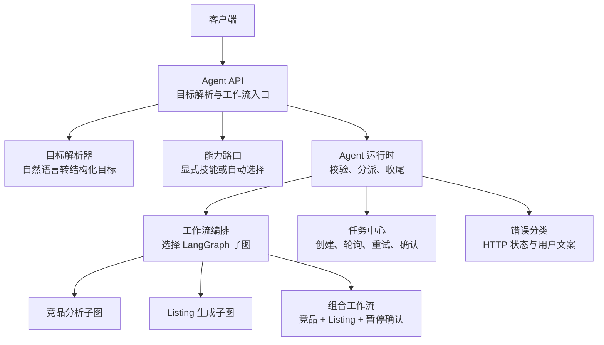
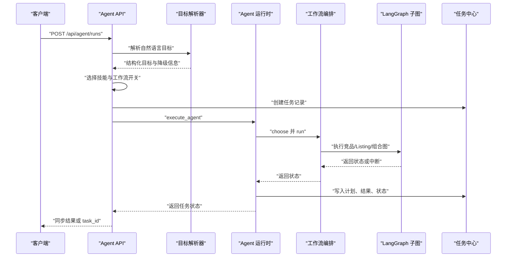
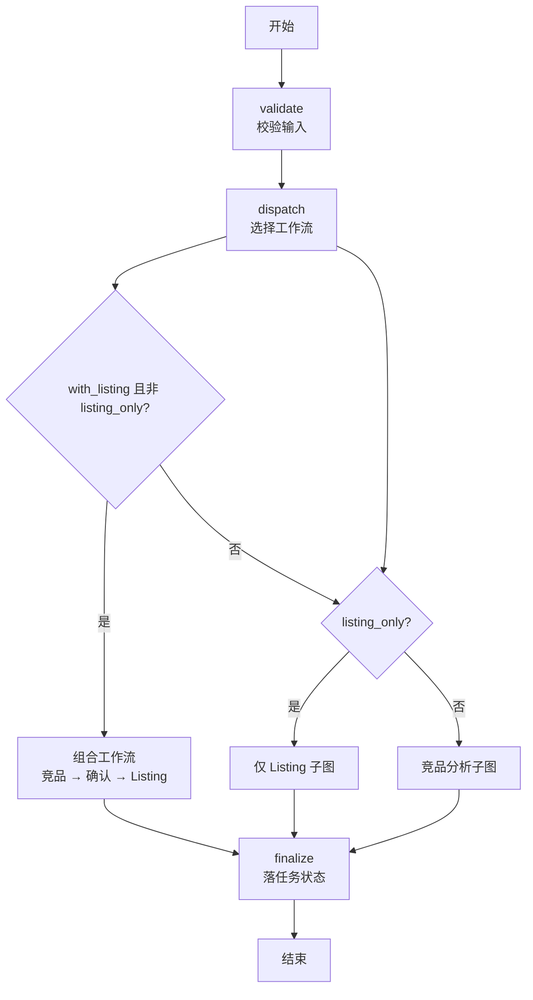
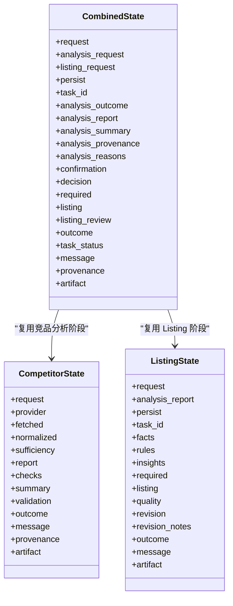
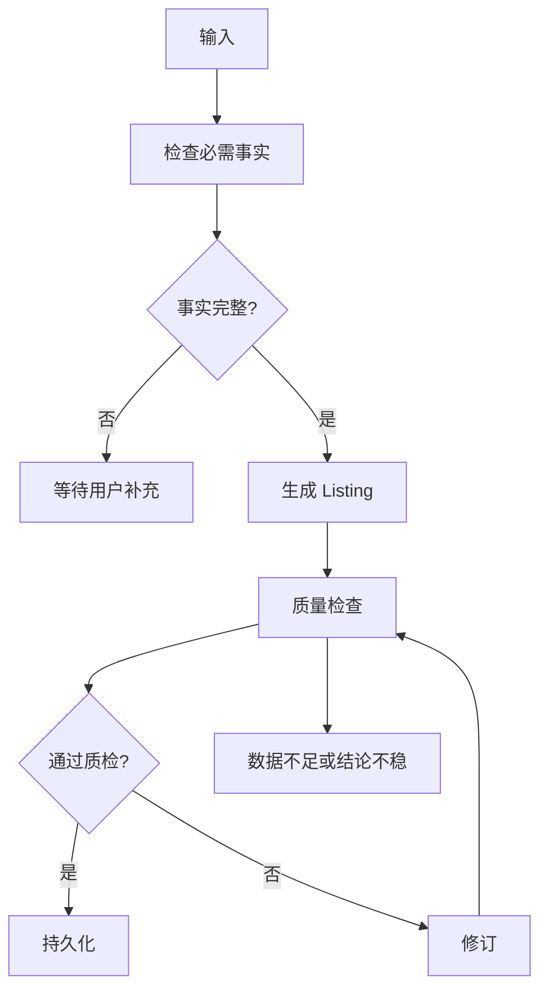
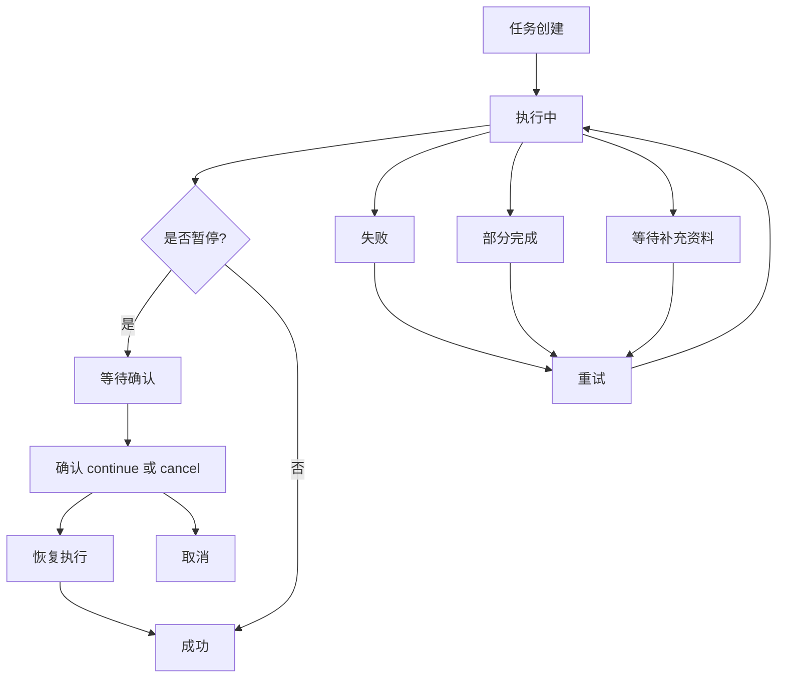
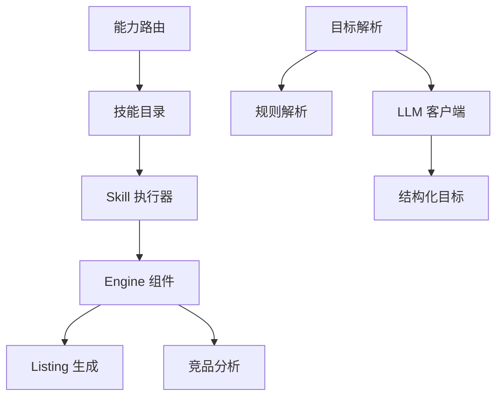

# Agent 工作流 API

<cite>
**本文引用的文件**   
- [backend/surge/api/agents.py](file://backend/surge/api/agents.py)
- [backend/surge/api/tasks.py](file://backend/surge/api/tasks.py)
- [backend/surge/agent/runtime.py](file://backend/surge/agent/runtime.py)
- [backend/surge/agent/workflows.py](file://backend/surge/agent/workflows.py)
- [backend/surge/agent/planner.py](file://backend/surge/agent/planner.py)
- [backend/surge/agent/state.py](file://backend/surge/agent/state.py)
- [backend/surge/agent/schemas.py](file://backend/surge/agent/schemas.py)
- [backend/surge/agent/errors.py](file://backend/surge/agent/errors.py)
- [backend/surge/agent/routing.py](file://backend/surge/agent/routing.py)
- [backend/surge/agent/registry.py](file://backend/surge/agent/registry.py)
</cite>

## 目录
1. [文档目标与适用范围](#文档目标与适用范围)
2. [整体架构](#整体架构)
3. [API 参考](#api-参考)
4. [Agent 运行流程](#agent-运行流程)
5. [LangGraph 驱动的工作流](#langgraph-驱动的工作流)
6. [状态、计划与完整性检查](#状态计划与完整性检查)
7. [长时间运行任务与重试恢复](#长时间运行任务与重试恢复)
8. [Skill、Engine 与 LLM 复用](#skillengine-与-llm-复用)
9. [典型调用示例](#典型调用示例)
10. [调试指南](#调试指南)
11. [错误处理与故障排查](#错误处理与故障排查)
12. [结论](#结论)

## 文档目标与适用范围

本文面向使用 Surge Agent 工作流的调用方和后端维护者，说明以下能力：

- 通过自然语言或结构化参数发起 Agent 执行。
- 查看规划阶段的结构化目标、降级原因和执行计划。
- 查询任务列表、任务详情、执行步骤和调试轨迹。
- 在组合工作流暂停点确认继续或取消。
- 理解 LangGraph 节点执行、状态流转、中断恢复和失败分类。
- 了解 Agent 如何复用 Skill、Engine、LLM 和竞品数据 Provider。
- 掌握长时间运行任务的创建、轮询、取消和重试语义。

本说明以 `backend/surge/api/agents.py`、`backend/surge/api/tasks.py`、`backend/surge/agent/runtime.py`、`backend/surge/agent/workflows.py` 和 `backend/surge/agent/planner.py` 为核心依据，并补充路由、状态契约、错误分类、注册表和 Schema 的上下文。

**章节来源**
- [backend/surge/api/agents.py:1-835](file://backend/surge/api/agents.py#L1-L835)
- [backend/surge/api/tasks.py:1-504](file://backend/surge/api/tasks.py#L1-L504)
- [backend/surge/agent/runtime.py:1-297](file://backend/surge/agent/runtime.py#L1-L297)
- [backend/surge/agent/workflows.py:1-550](file://backend/surge/agent/workflows.py#L1-L550)
- [backend/surge/agent/planner.py:1-261](file://backend/surge/agent/planner.py#L1-L261)

## 整体架构

Surge 的 Agent 工作流不是“一个把所有业务塞进一张图”的实现，而是分层协作：

| 层级 | 主要职责 | 关键文件 |
|---|---|---|
| HTTP API 层 | 接收请求、鉴权、限流、审计、构造结果 | `api/agents.py`、`api/tasks.py` |
| 目标解析与路由 | 把自然语言变成结构化目标，选择技能与工作流 | `planner.py`、`routing.py` |
| 运行时入口 | 校验、分派、收尾、异常分类、任务状态落库 | `runtime.py` |
| 工作流编排 | 选择 LangGraph 子图、构造输入、统一收尾 | `workflows.py` |
| 状态契约 | 定义竞品、Listing、组合工作流的状态键和结局 | `state.py` |
| 请求响应模型 | 定义 Agent 请求、响应、重试、确认等结构 | `schemas.py` |
| 错误分类 | 把异常映射为可展示的错误类别和处置策略 | `errors.py` |
| 注册表 | 登记 Agent、Skill、Tool 元数据 | `registry.py` |



**图表来源**
- [backend/surge/api/agents.py:200-593](file://backend/surge/api/agents.py#L200-L593)
- [backend/surge/api/tasks.py:1-504](file://backend/surge/api/tasks.py#L1-L504)
- [backend/surge/agent/planner.py:1-261](file://backend/surge/agent/planner.py#L1-L261)
- [backend/surge/agent/routing.py:1-176](file://backend/surge/agent/routing.py#L1-L176)
- [backend/surge/agent/runtime.py:1-297](file://backend/surge/agent/runtime.py#L1-L297)
- [backend/surge/agent/workflows.py:1-550](file://backend/surge/agent/workflows.py#L1-L550)

**章节来源**
- [backend/surge/api/agents.py:1-835](file://backend/surge/api/agents.py#L1-L835)
- [backend/surge/api/tasks.py:1-504](file://backend/surge/api/tasks.py#L1-L504)
- [backend/surge/agent/runtime.py:1-297](file://backend/surge/agent/runtime.py#L1-L297)
- [backend/surge/agent/workflows.py:1-550](file://backend/surge/agent/workflows.py#L1-L550)
- [backend/surge/agent/planner.py:1-261](file://backend/surge/agent/planner.py#L1-L261)

## API 参考

### 目标解析端点

| 项目 | 说明 |
|---|---|
| 方法 | `POST` |
| 路径 | `/api/agent/resolve` |
| 认证 | 需要租户写权限 |
| 请求体 | `GoalResolveRequest` |
| 响应 | `GoalResolveResponse` |
| 用途 | 只解析自然语言目标，不执行工作流 |
| 降级行为 | 模型不可用时返回规则解析结果，并标记 `degraded` |

#### 请求结构

| 字段 | 类型 | 必填 | 说明 |
|---|---|---:|---|
| `goal` | 字符串 | 是 | 自然语言目标，例如“帮我分析一款美国站 Amazon 的无线耳机” |
| 其他字段 | — | — | 该请求模型禁止额外字段 |

#### 响应结构

| 字段 | 类型 | 说明 |
|---|---|---|
| `spec` | 对象 | 结构化目标，包含商品名、平台、站点、品类、是否生成 Listing、文案语言、关键词和备注 |
| `degraded` | 布尔值 | 是否使用规则解析而非模型解析 |
| `reason` | 字符串 | 降级原因，例如模型不可用或解析结果不完整 |
| `missing` | 数组 | 无法从自然语言推断出的关键字段 |

#### 典型请求

```json
{
  "goal": "请分析亚马逊美国站的无线蓝牙耳机，不要生成 Listing"
}
```

#### 典型响应

```json
{
  "spec": {
    "product_name": "无线蓝牙耳机",
    "platform": "amazon",
    "marketplace": "US",
    "with_listing": false,
    "listing_language": "en-US"
  },
  "degraded": false,
  "reason": "",
  "missing": []
}
```

如果模型不可用，`degraded` 会变为 `true`，`reason` 会提示参数是按文本推测的，需要核对后再执行。

**章节来源**
- [backend/surge/api/agents.py:200-593](file://backend/surge/api/agents.py#L200-L593)
- [backend/surge/agent/planner.py:1-261](file://backend/surge/agent/planner.py#L1-L261)
- [backend/surge/agent/schemas.py:1-217](file://backend/surge/agent/schemas.py#L1-L217)

### Agent 运行端点

| 项目 | 说明 |
|---|---|
| 方法 | `POST` |
| 路径 | `/api/agent/runs` |
| 认证 | 需要租户写权限 |
| 请求体 | `AgentRunRequest` |
| 响应 | `AgentRunResponse` |
| 同步模式 | `async_run=false`（默认）时直接返回任务状态 |
| 异步模式 | `async_run=true` 时立即返回 `task_id`，由后台执行器运行 |

#### 请求结构

| 字段 | 类型 | 必填 | 说明 |
|---|---|---:|---|
| `agent_key` | 字符串 | 否 | Agent 标识，默认为 `main` |
| `goal` | 字符串 | 二选一 | 自然语言目标；与 `product_name` 至少提供一个 |
| `product_name` | 字符串 | 二选一 | 结构化商品名 |
| `platform` | 枚举 | 否 | 平台，默认 `amazon` |
| `marketplace` | 字符串 | 否 | 站点，默认 `US` |
| `category` | 字符串 | 否 | 品类 |
| `brand` | 字符串 | 否 | 品牌 |
| `own_specs` | 对象 | 否 | 商品规格 |
| `own_key_features` | 数组 | 否 | 核心卖点 |
| `certifications` | 数组 | 否 | 认证 |
| `own_price` | 数值 | 否 | 价格，必须非负 |
| `target_audience` | 字符串 | 否 | 目标人群 |
| `banned_terms` | 数组 | 否 | 禁用词 |
| `competitors` | 数组 | 条件必填 | 竞品数据；未提供且非 `listing_only` 时会走导入 Provider |
| `import_batch_id` | 字符串 | 二选一 | 从数据资产读取竞品批次 |
| `keywords` | 数组 | 否 | 关键词指标 |
| `with_listing` | 布尔值 | 否 | 是否运行组合流程 |
| `listing_only` | 布尔值 | 否 | 只生成 Listing，不要求竞品 |
| `skill_key` | 字符串 | 否 | 显式选择的技能 |
| `listing_language` | 字符串 | 否 | Listing 文案语言 |
| `data_source` | 字符串 | 否 | 数据来源 |
| `conversation_id` | 字符串 | 否 | 关联会话 |
| `async_run` | 布尔值 | 否 | 是否异步执行 |

#### 响应结构

| 字段 | 类型 | 说明 |
|---|---|---|
| `task_id` | 字符串 | 任务 ID |
| `status` | 字符串 | 当前任务状态 |
| `plan` | 数组 | 执行计划骨架 |
| `report` | 对象或空 | 分析报告 |
| `listing` | 对象或空 | Listing 草稿 |
| `summary` | 对象或空 | 分析摘要 |
| `checks` | 对象或空 | 完整性检查 |
| `quality` | 对象或空 | 质量检查结果 |
| `conversation_id` | 字符串或空 | 关联会话 |
| `engine` | 对象或空 | 本次使用的引擎信息 |
| `degraded` | 布尔值 | 目标解析是否降级 |
| `degraded_reason` | 字符串 | 降级原因 |
| `pending` | 对象或空 | 暂停时的待确认内容 |
| `selected_skills` | 数组 | 实际选中的技能 |
| `routing` | 对象或空 | 路由决策 |

#### 典型请求：自然语言目标

```json
{
  "goal": "分析亚马逊美国站的一款无线蓝牙耳机，同时生成英文 Listing"
}
```

#### 典型请求：结构化参数

```json
{
  "product_name": "无线蓝牙耳机",
  "platform": "amazon",
  "marketplace": "US",
  "competitors": [
    {
      "asin": "B0EXAMPLE1",
      "title": "竞品标题",
      "price": 29.99,
      "rating": 4.3
    }
  ],
  "with_listing": true,
  "listing_language": "en-US"
}
```

#### 典型响应：同步成功

```json
{
  "task_id": "任务ID",
  "status": "succeeded",
  "plan": ["validate", "dispatch", "...", "finalize"],
  "report": {},
  "listing": {},
  "summary": {},
  "checks": {},
  "quality": {},
  "engine": {}
}
```

#### 典型响应：暂停等待确认

```json
{
  "task_id": "任务ID",
  "status": "waiting_for_review",
  "plan": ["validate", "dispatch", "...", "finalize"],
  "pending": {
    "kind": "partial_analysis_confirmation",
    "question": "是否继续？",
    "reasons": [],
    "affected_conclusions": [],
    "risks": [],
    "metrics": {},
    "confirmation_token": "确认令牌",
    "options": ["continue", "cancel"]
  }
}
```

**章节来源**
- [backend/surge/api/agents.py:200-593](file://backend/surge/api/agents.py#L200-L593)
- [backend/surge/agent/schemas.py:1-217](file://backend/surge/agent/schemas.py#L1-L217)
- [backend/surge/agent/workflows.py:1-550](file://backend/surge/agent/workflows.py#L1-L550)

### 任务中心端点

| 方法 | 路径 | 说明 |
|---|---|---|
| `GET` | `/api/tasks` | 列出任务，支持按状态和关键词过滤 |
| `GET` | `/api/tasks/{task_id}` | 获取任务详情、步骤、结果块和待确认内容 |
| `POST` | `/api/tasks/{task_id}/cancel` | 取消任务 |
| `POST` | `/api/tasks/{task_id}/retry` | 重试失败、已取消、等待补充资料或待复核的任务 |
| `POST` | `/api/tasks/{task_id}/confirm` | 确认组合工作流暂停点 |
| `GET` | `/api/tasks/{task_id}/trace` | 获取执行轨迹、步骤耗时和 LLM 调用明细 |

#### 任务详情响应重点字段

| 字段 | 类型 | 说明 |
|---|---|---|
| `task` | 对象 | 任务基础记录 |
| `steps` | 数组 | 任务步骤时间线 |
| `result.plan` | 数组 | 执行计划 |
| `result.report` | 对象或空 | 报告 |
| `result.listing` | 对象或空 | Listing |
| `result.summary` | 对象或空 | 摘要 |
| `result.checks` | 对象或空 | 完整性检查 |
| `result.quality` | 对象或空 | 质量检查 |
| `result.degraded` | 布尔值 | 是否降级 |
| `result.degraded_reason` | 字符串 | 降级原因 |
| `result.analysis_outcome` | 字符串或空 | 竞品分析结局 |
| `result.provenance` | 对象 | 数据来源追踪 |
| `result.message` | 字符串 | 面向用户的结论 |
| `pending` | 对象或空 | 暂停时待确认内容 |

#### 重试响应重点字段

| 字段 | 类型 | 说明 |
|---|---|---|
| `ok` | 布尔值 | 是否接受重试请求 |
| `task_id` | 字符串 | 新任务 ID |
| `retry_of` | 字符串 | 原任务 ID |
| `status` | 字符串 | 通常返回 `queued` |
| `resumed_steps` | 数组 | 复用的步骤名称 |
| `reuse_skipped_reason` | 字符串 | 未复用中间结果的原因 |

#### 确认响应重点字段

| 字段 | 类型 | 说明 |
|---|---|---|
| `task_id` | 字符串 | 任务 ID |
| `status` | 字符串 | 确认后最终状态 |
| `decision` | 字符串 | `continue` 或 `cancel` |
| `analysis_outcome` | 字符串或空 | 竞品分析结局 |
| `message` | 字符串 | 面向用户的结论 |

**章节来源**
- [backend/surge/api/tasks.py:1-504](file://backend/surge/api/tasks.py#L1-L504)

## Agent 运行流程

Agent 的一次运行分为四层：

1. **HTTP 层**：验证 Agent、限流、解析自然语言目标、选择技能、拉取竞品数据。
2. **运行时层**：校验输入、选择工作流、设置超时、执行 LangGraph、收尾任务状态。
3. **工作流层**：根据 `with_listing` 和 `listing_only` 选择竞品分析、仅 Listing 或组合工作流。
4. **LangGraph 子图层**：执行具体节点、保存 checkpoint、支持中断和恢复。



**图表来源**
- [backend/surge/api/agents.py:200-593](file://backend/surge/api/agents.py#L200-L593)
- [backend/surge/agent/planner.py:1-261](file://backend/surge/agent/planner.py#L1-L261)
- [backend/surge/agent/runtime.py:1-297](file://backend/surge/agent/runtime.py#L1-L297)
- [backend/surge/agent/workflows.py:1-550](file://backend/surge/agent/workflows.py#L1-L550)
- [backend/surge/api/tasks.py:1-504](file://backend/surge/api/tasks.py#L1-L504)

**章节来源**
- [backend/surge/api/agents.py:200-593](file://backend/surge/api/agents.py#L200-L593)
- [backend/surge/agent/runtime.py:1-297](file://backend/surge/agent/runtime.py#L1-L297)
- [backend/surge/agent/workflows.py:1-550](file://backend/surge/agent/workflows.py#L1-L550)

## LangGraph 驱动的工作流

### 工作流种类

| 工作流 | 触发条件 | 主要步骤 | 是否需要 LLM | 超时 |
|---|---|---|---:|---:|
| 竞品分析 | `with_listing=false` 且非 `listing_only` | 校验、解析数据源、抓取竞品、归一化、检查充分性、市场分析、校验、部分结果、总结、持久化 | 否 | 120 秒 |
| 组合工作流 | `with_listing=true` 且非 `listing_only` | 分析、事实检查、用户输入判断、准备确认、确认、取消、生成 Listing、结算 | 是 | 240 秒 |
| 仅 Listing | `listing_only=true` | 校验、事实解析、规则加载、洞察加载、必需事实检查、用户输入判断、生成、质检、修订、草稿持久化、审核判断 | 是 | 180 秒 |

主图本身只做三件事：

1. `validate`：确认产品名、竞品或非 Listing 场景所需输入存在。
2. `dispatch`：按 `with_listing` 和 `listing_only` 选择工作流。
3. `finalize`：把工作流结局翻译成任务状态。

这种设计避免把带 `interrupt` 的组合子图作为普通节点嵌入父图后，恢复时重复执行竞品分析和 Listing 的问题。



**图表来源**
- [backend/surge/agent/workflows.py:1-550](file://backend/surge/agent/workflows.py#L1-L550)
- [backend/surge/agent/runtime.py:1-297](file://backend/surge/agent/runtime.py#L1-L297)

### 节点执行与状态流转

LangGraph 子图的状态键由 `state.py` 明确定义，包括：

- `CompetitorState`：竞品分析输入、数据提供方、抓取结果、归一化结果、充分性、报告、检查、摘要、验证、结局、来源追踪、产物。
- `ListingState`：请求、竞品分析摘要、持久化标志、任务 ID、事实、规则、洞察、必需字段、Listing、质量检查、修订次数、修订备注、结局、消息、产物。
- `CombinedState`：请求拆分、竞品分析阶段、暂停确认、Listing 阶段、结局、任务状态、消息、来源追踪、产物。

状态只保存 JSON 可序列化的值，复杂对象在节点内临时构造，避免 checkpoint 序列化问题。



**图表来源**
- [backend/surge/agent/state.py:1-173](file://backend/surge/agent/state.py#L1-L173)

**章节来源**
- [backend/surge/agent/workflows.py:1-550](file://backend/surge/agent/workflows.py#L1-L550)
- [backend/surge/agent/state.py:1-173](file://backend/surge/agent/state.py#L1-L173)

## 状态、计划与完整性检查

### 工作流版本与输入指纹

工作流版本用于防止旧中间结果被错配到新版本的节点结构。输入指纹参与判断重试时能否复用已成功步骤的输出。指纹排除自然语言目标、会话 ID、执行方式和降级标记，因为这些变化不应导致重新计算。

### 计划生成

计划由目标解析和工作流选择共同决定：

- 目标解析阶段输出结构化 `GoalSpec`。
- 路由阶段决定使用哪些技能。
- 工作流阶段根据 `with_listing` 和 `listing_only` 确定步骤骨架。
- 最终计划包含主图三阶段和工作流内部步骤。

### 完整性检查

完整性检查主要由竞品分析和 Listing 子图完成：

- 竞品分析检查数据是否充分，不足时返回 `partial`。
- Listing 子图检查必需事实是否齐全，缺失时进入 `needs_user_input`。
- 质量检查对 Listing 内容进行校验，不合格时可修订一次。



**图表来源**
- [backend/surge/agent/workflows.py:1-550](file://backend/surge/agent/workflows.py#L1-L550)
- [backend/surge/agent/state.py:1-173](file://backend/surge/agent/state.py#L1-L173)

**章节来源**
- [backend/surge/agent/workflows.py:1-550](file://backend/surge/agent/workflows.py#L1-L550)
- [backend/surge/agent/planner.py:1-261](file://backend/surge/agent/planner.py#L1-L261)
- [backend/surge/agent/state.py:1-173](file://backend/surge/agent/state.py#L1-L173)

## 长时间运行任务与重试恢复

### 任务生命周期

Agent 运行通过任务承载，常见状态包括：

| 状态 | 含义 |
|---|---|
| `running` | 正在执行 |
| `queued` | 已入队，等待执行器 |
| `succeeded` | 成功完成 |
| `partial` | 部分完成，例如竞品数据不足 |
| `waiting_for_input` | 缺少商品资料，可补充后重试 |
| `waiting_for_review` | 组合工作流暂停，等待用户确认 |
| `cancelled` | 已取消 |
| `failed` | 失败 |

### 重试语义

重试端点允许对失败、已取消、等待补充资料或部分完成的任务进行重试：

- 默认 `resume=true`：复用原任务已成功步骤的输出。
- `resume=false`：从头重跑。
- 可选 `overrides`：补充或修改资料类字段。
- 若输入指纹或工作流版本不一致，不复用旧中间结果。
- 持久化和收尾节点不会复用，避免跳过保存和状态更新。

### 确认语义

组合工作流暂停时，任务进入 `waiting_for_review`。确认接口做四道校验：

1. 任务归属校验。
2. 任务状态必须是 `waiting_for_review`。
3. `confirmation_token` 必须与暂停时一致。
4. checkpoint 必须可恢复。

确认后原子抢占任务，避免双击重复恢复。



**图表来源**
- [backend/surge/api/tasks.py:1-504](file://backend/surge/api/tasks.py#L1-L504)
- [backend/surge/agent/runtime.py:1-297](file://backend/surge/agent/runtime.py#L1-L297)
- [backend/surge/agent/workflows.py:1-550](file://backend/surge/agent/workflows.py#L1-L550)

**章节来源**
- [backend/surge/api/tasks.py:1-504](file://backend/surge/api/tasks.py#L1-L504)
- [backend/surge/agent/runtime.py:1-297](file://backend/surge/agent/runtime.py#L1-L297)
- [backend/surge/agent/workflows.py:1-550](file://backend/surge/agent/workflows.py#L1-L550)

## Skill、Engine 与 LLM 复用

### Skill 复用

Agent 并不直接实现所有业务能力，而是复用 Skill 目录中的能力：

- `competitor_analysis`：竞品分析。
- `listing_generation`：Listing 生成。
- `market_summary`：市场总结。
- `review_mining`：评论挖掘。
- `data_validation`：数据校验。

路由优先级如下：

1. 显式 `skill_key`。
2. 显式 `listing_only` 或 `with_listing`。
3. 自动从技能目录选择。

未被 Agent 图直接支持的 Skill 会返回明确的提示信息，引导调用方去技能广场运行。

### Engine 复用

目标解析优先使用 LLM，不可用时降级到规则解析。任务结果中的 `engine` 字段如实标注本次使用的是模型还是规则引擎，界面必须显示这一信息。

### LLM 复用

LLM 主要用于：

- 从自然语言目标中提取结构化参数。
- 技能发现与自动路由。
- Listing 生成与质量相关逻辑。

当 LLM 不可用、限流、网络错误或返回非法 JSON 时，错误分类会把异常映射为 `model_timeout`、`rate_limited`、`provider_unavailable`、`model_output_invalid` 等类别，而不是直接暴露原始异常。



**图表来源**
- [backend/surge/agent/planner.py:1-261](file://backend/surge/agent/planner.py#L1-L261)
- [backend/surge/agent/routing.py:1-176](file://backend/surge/agent/routing.py#L1-L176)
- [backend/surge/agent/registry.py:1-526](file://backend/surge/agent/registry.py#L1-L526)
- [backend/surge/agent/errors.py:1-423](file://backend/surge/agent/errors.py#L1-L423)

**章节来源**
- [backend/surge/agent/planner.py:1-261](file://backend/surge/agent/planner.py#L1-L261)
- [backend/surge/agent/routing.py:1-176](file://backend/surge/agent/routing.py#L1-L176)
- [backend/surge/agent/registry.py:1-526](file://backend/surge/agent/registry.py#L1-L526)
- [backend/surge/agent/errors.py:1-423](file://backend/surge/agent/errors.py#L1-L423)

## 典型调用示例

### 示例一：输入自然语言目标并执行

1. 调用 `/api/agent/resolve` 预填参数面板。
2. 用户确认或调整参数。
3. 调用 `/api/agent/runs`，`async_run=true`。
4. 前端轮询 `/api/tasks/{task_id}`。
5. 如果返回 `waiting_for_review`，调用 `/api/tasks/{task_id}/confirm`。
6. 完成后查看 `result.report`、`result.listing`、`result.summary`、`result.checks`、`result.quality`。

### 示例二：查看执行步骤

调用 `/api/tasks/{task_id}`，关注：

- `steps`：步骤时间线。
- `result.plan`：计划骨架。
- `result.degraded` 和 `result.degraded_reason`：目标解析是否降级。
- `pending`：暂停时缺什么、影响什么、确认令牌。

### 示例三：检查结果集

- 竞品分析结果：`result.report`、`result.summary`、`result.checks`。
- Listing 结果：`result.listing`、`result.quality`。
- 数据来源追踪：`result.provenance`。
- 报告或 Listing 引用：`result.report_id`、`result.listing_id`。

### 示例四：调试执行轨迹

调用 `/api/tasks/{task_id}/trace`，关注：

- `chain`：每步的节点名、状态、耗时、是否失败。
- `chain[*].llm_calls`：每个节点的 LLM 调用明细。
- `totals.duration_ms`：总耗时。
- `totals.llm_calls`：LLM 调用次数。
- `totals.tokens`：累计 token。
- `totals.failed_node`：首次失败的节点。
- `error.code` 和 `error.message`：任务级错误分类。

**章节来源**
- [backend/surge/api/agents.py:200-593](file://backend/surge/api/agents.py#L200-L593)
- [backend/surge/api/tasks.py:1-504](file://backend/surge/api/tasks.py#L1-L504)
- [backend/surge/agent/workflows.py:1-550](file://backend/surge/agent/workflows.py#L1-L550)

## 调试指南

### 查看规划阶段

- 调用 `/api/agent/resolve` 查看 `spec` 是否正确提取商品名、平台和站点。
- 检查 `degraded` 是否为 `true`。
- 检查 `reason` 是否说明模型不可用或解析不完整。
- 检查 `missing` 是否包含无法推断的字段。

### 查看节点输入输出

- 调用 `/api/tasks/{task_id}` 查看 `steps`。
- 每条步骤包含 `node`、`name`、`status`、`detail`、`started_at`、`finished_at`、`duration_ms`。
- 对于 LangGraph 子图，重点关注 `validate`、`dispatch`、`finalize` 以及子图内部的 `run_analysis`、`check_listing_facts`、`needs_user_input`、`generate_listing`、`validate_listing` 等步骤。

### 查看中断原因

- 如果任务处于 `waiting_for_review`，查看 `pending.question`、`pending.reasons`、`pending.affected_conclusions`、`pending.risks`。
- 检查 `pending.confirmation_token` 是否与确认请求一致。
- 如果确认时报 `confirmation_stale`，说明暂停内容已变化，需要刷新后重新确认。

### 查看 LLM 调用细节

- 调用 `/api/tasks/{task_id}/trace`。
- 查看每个节点的 `llm_calls`。
- 关注 `provider`、`model`、`latency_ms`、`prompt_tokens`、`completion_tokens`、`attempts`、`ok`、`error_code`。

### 常见问题定位

| 现象 | 可能原因 | 建议 |
|---|---|---|
| 目标解析总是降级 | LLM 不可用或返回不合规 | 检查模型配置、查看 `degraded_reason` |
| 始终提示缺少竞品数据 | 未传入 `competitors`，也未导入批次 | 使用 `competitors` 或 `import_batch_id` |
| 任务停在 `waiting_for_review` | 组合工作流命中 partial 确认点 | 调用确认接口，传入正确的 `confirmation_token` |
| 重试没有复用旧步骤 | 输入指纹或工作流版本变化 | 检查是否修改了资料字段或升级了工作流 |
| 报错但看不到原始异常 | 错误分类隐藏了内部异常 | 查看 `error.code`、`error.message` 和任务日志 |

**章节来源**
- [backend/surge/api/agents.py:200-593](file://backend/surge/api/agents.py#L200-L593)
- [backend/surge/api/tasks.py:1-504](file://backend/surge/api/tasks.py#L1-L504)
- [backend/surge/agent/planner.py:1-261](file://backend/surge/agent/planner.py#L1-L261)
- [backend/surge/agent/workflows.py:1-550](file://backend/surge/agent/workflows.py#L1-L550)

## 错误处理与故障排查

### 错误分类体系

系统使用统一的错误分类，而不是直接把 Python 异常抛给前端。主要类别包括：

| 类别 | HTTP 状态 | 是否可重试 | 典型场景 |
|---|---:|---:|---|
| `validation_error` | 422 | 否 | 参数校验失败 |
| `missing_input` | 422 | 否 | 缺少竞品数据或缺少商品资料 |
| `permission_denied` | 403 | 否 | 权限不足 |
| `provider_unavailable` | 503 或其他 | 视情况 | 模型密钥无效、数据源未配置 |
| `rate_limited` | 429 | 是 | 限流 |
| `model_timeout` | 504 或其他 | 是 | 模型超时 |
| `model_output_invalid` | 502 或其他 | 是 | 模型返回非法 JSON |
| `quality_gate_failed` | 422 | 否 | 质量检查未通过 |
| `cancelled` | 409 | 否 | 任务取消 |
| `internal_error` | 500 | 否 | 未预期异常 |

### 错误载荷

分类后的错误包含：

- `code`：细粒度错误码。
- `category`：错误分类。
- `message`：面向用户的中文文案。
- `retryable`：是否可重试。
- `action`：用户应执行的引导动作。
- `detail`：结构化错误详情，例如缺失字段、校验错误项。

### 常见错误定位

| 错误 | 排查方向 |
|---|---|
| `competitors_missing` | 检查是否传入 `competitors` 或 `import_batch_id` |
| `llm_not_configured` | 检查模型密钥和 Provider 配置 |
| `data_provider_not_configured` | 检查竞品数据源是否接入 |
| `database_unavailable` | 检查数据库连接 |
| `skill_not_executable` | 检查 Skill 是否可用或是否需要专属参数 |
| `confirmation_stale` | 刷新任务后重新获取 `confirmation_token` |

**章节来源**
- [backend/surge/agent/errors.py:1-423](file://backend/surge/agent/errors.py#L1-L423)
- [backend/surge/api/agents.py:200-593](file://backend/surge/api/agents.py#L200-L593)
- [backend/surge/api/tasks.py:1-504](file://backend/surge/api/tasks.py#L1-L504)

## 结论

Surge 的 Agent 工作流以“目标解析 + 能力路由 + LangGraph 子图 + 任务中心”的方式组织：

- 自然语言目标先被解析为结构化参数，再映射到固定工作流。
- 工作流分派发生在图级，避免中断恢复时重复执行外部依赖。
- 竞品分析、Listing 生成和组合流程共享同一套状态契约和收尾逻辑。
- 长时间运行通过任务承载，支持轮询、取消、重试和断点恢复。
- 错误分类确保用户看到可操作文案，而不是原始异常。
- 调试时应优先查看规划结果、任务步骤、执行轨迹和 LLM 调用明细。

对外部调用方而言，最实用的接口是：

- `/api/agent/resolve`：预览自然语言解析结果。
- `/api/agent/runs`：发起 Agent 执行。
- `/api/tasks/{task_id}`：查看步骤、结果和待确认内容。
- `/api/tasks/{task_id}/confirm`：处理组合工作流暂停。
- `/api/tasks/{task_id}/retry`：补全资料后重试。
- `/api/tasks/{task_id}/trace`：定位节点、耗时和模型调用问题。