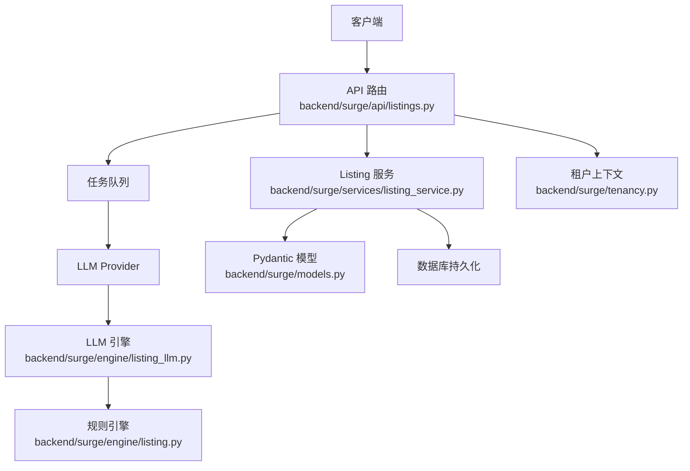
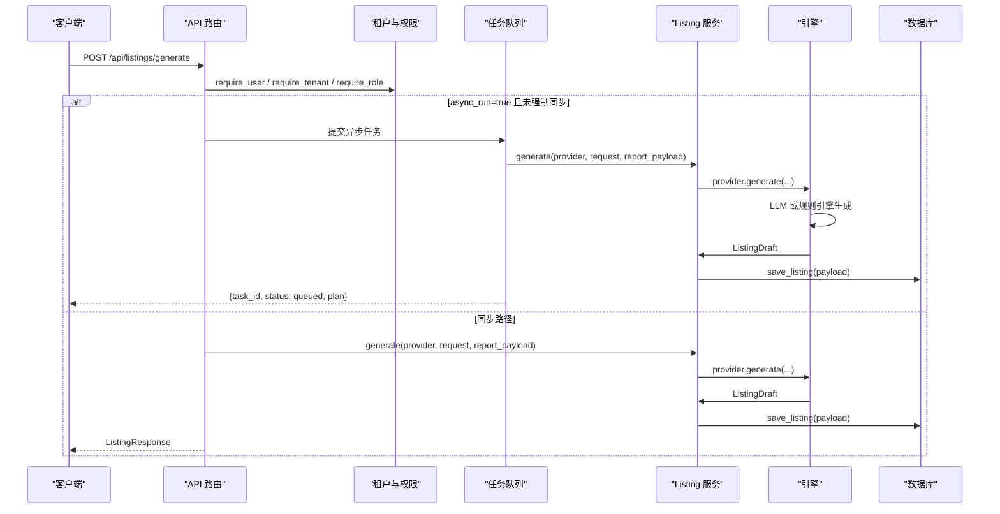
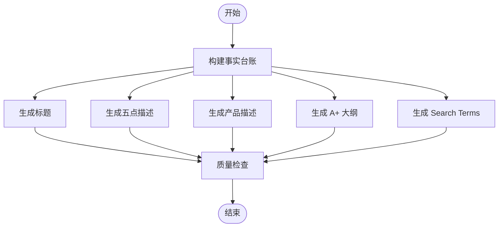
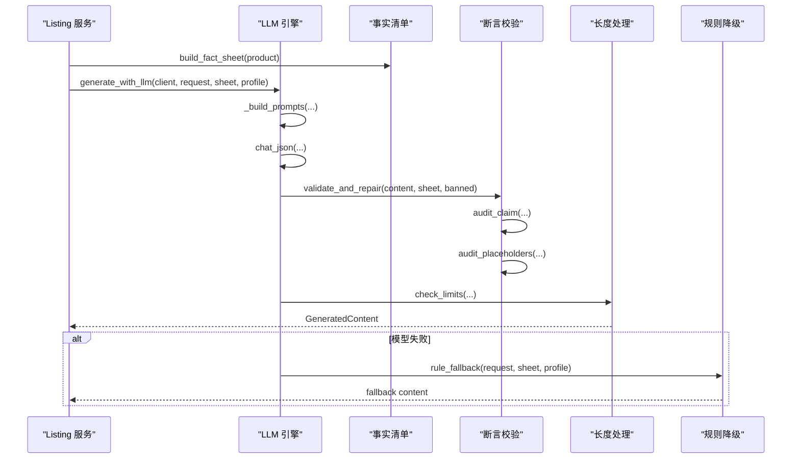
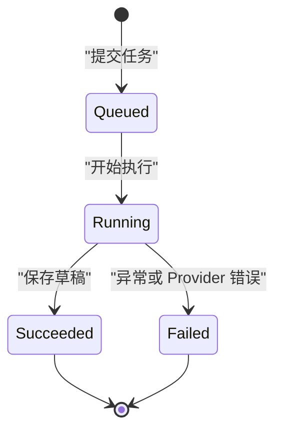

# Listing 管理 API

<cite>
**本文引用的文件**   
- [backend/surge/api/listings.py](file://backend/surge/api/listings.py)
- [backend/surge/engine/listing.py](file://backend/surge/engine/listing.py)
- [backend/surge/engine/listing_llm.py](file://backend/surge/engine/listing_llm.py)
- [backend/surge/models.py](file://backend/surge/models.py)
- [backend/surge/services/listing_service.py](file://backend/surge/services/listing_service.py)
- [backend/surge/tenancy.py](file://backend/surge/tenancy.py)
</cite>

## 目录
1. [简介](#简介)
2. [项目结构](#项目结构)
3. [核心模型](#核心模型)
4. [架构总览](#架构总览)
5. [端点参考](#端点参考)
6. [Listing 生成流程与 LLM 调用路径](#listing-生成流程与-llm-调用路径)
7. [质检问题与 IssueCode](#质检问题与-issuecode)
8. [BYOK、租户隔离与异步任务](#byok租户隔离与异步任务)
9. [版本回滚与差异对比](#版本回滚与差异对比)
10. [导出格式](#导出格式)
11. [故障排查](#故障排查)
12. [结论](#结论)

## 简介
本参考文档说明 Surge 的 Listing 管理 API，覆盖 Listing 草稿创建、事实台账、版本链、质检复检与导出。Listing 生成支持两条路径：
- 同步路径：供脚本和测试使用；Provider 不可用时降级为规则引擎，返回中明确标注实际引擎。
- 异步路径：前端唯一使用的路径，提交后返回 `task_id`，后台队列执行 LLM 生成、质检与草稿保存。

所有 Listing 数据通过 `tenant_id` + `user_id` 双重过滤，确保多租户隔离。

**章节来源**
- [backend/surge/api/listings.py:1-199](file://backend/surge/api/listings.py#L1-L199)
- [backend/surge/tenancy.py:1-131](file://backend/surge/tenancy.py#L1-L131)

## 项目结构
Listing 相关代码按职责分层组织：
- API 层：FastAPI Router 暴露 `/api/listings/*` 端点，负责鉴权、限流、审计、任务记录与响应包装。
- 服务层：`listing_service` 封装 Listing 的生成包装、版本派生、差异比较、复检与导出。
- 引擎层：
  - `engine/listing.py`：规则引擎实现标题、五点描述、产品描述、A+ 大纲、Search Terms 与质检。
  - `engine/listing_llm.py`：LLM 驱动生成，包含事实清单构建、提示词组装、断言校验、长度裁剪与降级策略。
- 模型层：Pydantic 定义输入、输出、证据、质检、枚举等类型。
- 租户层：提供 `TenantContext`、角色校验与成员解析。



**图表来源**
- [backend/surge/api/listings.py:1-199](file://backend/surge/api/listings.py#L1-L199)
- [backend/surge/services/listing_service.py:1-120](file://backend/surge/services/listing_service.py#L1-L120)
- [backend/surge/engine/listing.py:1-80](file://backend/surge/engine/listing.py#L1-L80)
- [backend/surge/engine/listing_llm.py:1-60](file://backend/surge/engine/listing_llm.py#L1-L60)
- [backend/surge/models.py:1-40](file://backend/surge/models.py#L1-L40)
- [backend/surge/tenancy.py:1-60](file://backend/surge/tenancy.py#L1-L60)

**章节来源**
- [backend/surge/api/listings.py:1-334](file://backend/surge/api/listings.py#L1-L334)
- [backend/surge/services/listing_service.py:1-310](file://backend/surge/services/listing_service.py#L1-L310)
- [backend/surge/engine/listing.py:1-941](file://backend/surge/engine/listing.py#L1-L941)
- [backend/surge/engine/listing_llm.py:1-963](file://backend/surge/engine/listing_llm.py#L1-L963)
- [backend/surge/models.py:1-646](file://backend/surge/models.py#L1-L646)
- [backend/surge/tenancy.py:1-131](file://backend/surge/tenancy.py#L1-L131)

## 核心模型
Listing 相关 Pydantic 模型集中在 `models.py`，关键概念如下：

| 模型 | 用途 | 关键字段或约束 |
|---|---|---|
| `OwnProduct` | 自有商品资料输入 | `name`、`brand`、`category`、`specifications`、`key_features`、`materials`、`certifications`、`target_platform`、`marketplace`、`price`、`currency`、`target_audience`、`brand_voice`、`banned_terms`、`differentiators` |
| `ListingGenerationRequest` | Listing 生成请求 | `product`、`language`、`marketplace`、`analysis_report`、`analysis_report_id`、`keywords`、`tone`、`banned_terms`、`target_length_hint`、`data_source`、`revision_notes` |
| `Claim` | 结构化结论 | `statement`、`evidence_kind`、`evidence`、`sample_size`；`fact`/`statistic` 类型必须有依据 |
| `EvidenceKind` | 证据性质枚举 | `fact`、`statistic`、`inference`、`assumption` |
| `IssueCode` | 质检问题代码 | `banned_term`、`unsupported_number`、`unsupported_superlative`、`unsupported_claim`、`unverified_certification`、`unverified_efficacy`、`keyword_stuffing`、`missing_fact`、`over_length`、`empty_section`、`placeholder_text` |
| `QualityCheck` | 质检结果 | `passed`、`issues`、`section_lengths`、`rules_applied`、`policy_disclaimer` |
| `ListingDraft` | Listing 草稿输出 | `listing_id`、`created_at`、`product_name`、`platform`、`marketplace`、`language`、`title`、`bullets`、`description`、`a_plus_outline`、`search_terms`、`keywords_used`、`keyword_layout_notes`、`fact_ledger`、`pending_confirmations`、`quality_check`、`differentiation_used`、`analysis_report_id`、`limitations`、`data_provenance`、`engine`、`engine_version` |
| `BulletPoint` | 五点描述条目 | `headline`、`body`、`character_count`、`supporting_facts` |
| `APlusModule` | A+ 页面模块 | `module_type`、`title`、`purpose`、`content_outline`、`assets_needed` |
| `QualityIssue` | 单条质检问题 | `code`、`severity`、`message`、`location`、`excerpt`、`suggestion` |
| `SectionLength` | 段落长度信息 | `section`、`length`、`limit`、`within_limit` |
| `ListingProvenance` | 数据来源标记 | `data_source`、`is_demo`、`notes` |

`ListingDraft.pending_confirmations` 用于承载缺失商品属性或未验证信息的待确认项；系统不会自动补全事实，而是将缺失信息作为待确认项保留。

**章节来源**
- [backend/surge/models.py:1-200](file://backend/surge/models.py#L1-L200)
- [backend/surge/models.py:200-646](file://backend/surge/models.py#L200-L646)

## 架构总览
Listing 管理 API 的核心控制流如下：



**图表来源**
- [backend/surge/api/listings.py:60-199](file://backend/surge/api/listings.py#L60-L199)
- [backend/surge/services/listing_service.py:40-80](file://backend/surge/services/listing_service.py#L40-L80)
- [backend/surge/engine/listing_llm.py:420-564](file://backend/surge/engine/listing_llm.py#L420-L564)
- [backend/surge/engine/listing.py:1-80](file://backend/surge/engine/listing.py#L1-L80)

**章节来源**
- [backend/surge/api/listings.py:60-199](file://backend/surge/api/listings.py#L60-L199)
- [backend/surge/services/listing_service.py:40-80](file://backend/surge/services/listing_service.py#L40-L80)

## 端点参考

### 创建 Listing
- **方法**：`POST /api/listings/generate`
- **认证**：需要登录用户与租户上下文。
- **权限**：写操作要求 `editor` 及以上角色。
- **请求体**：`ListingGenerationRequest`
- **行为**：
  - `async_run=false`（默认）：同步执行，返回 `ListingResponse`；Provider 不可用时可降级为规则引擎。
  - `async_run=true`：立即返回任务信息，后台异步执行；服务端会解析 BYOK 模型配置并选择 Provider。
- **成功响应**：
  - 异步：`{task_id, status: "queued", plan: ["listing", "quality", "save_listing"], async: true, engine}`
  - 同步：`ListingResponse`，包含 `listing`、`persisted`、`duration_ms`、`task_id`。
- **错误**：
  - 分析报告不存在：404。
  - Provider 不可用：503。
  - 其他异常：502。
  - 角色不足：由租户权限层抛出。

**请求示例**
```text
POST /api/listings/generate?async_run=true
Authorization: Bearer <token>
X-Tenant-Id: <tenant_id>

{
  "product": {
    "name": "不锈钢保温杯",
    "brand": "Surge",
    "category": "家居用品",
    "specifications": {"容量": "500ml", "材质": "304 不锈钢"},
    "key_features": ["长效保温", "防漏设计"],
    "certifications": [],
    "target_platform": "amazon",
    "marketplace": "US",
    "price": 29.99,
    "currency": "USD",
    "target_audience": "户外爱好者",
    "banned_terms": []
  },
  "language": "en-US",
  "marketplace": "US",
  "analysis_report_id": "<report_id>",
  "keywords": [],
  "tone": "专业可靠",
  "target_length_hint": "medium",
  "data_source": "manual"
}
```

**响应示例**
```json
{
  "task_id": "<task_id>",
  "status": "queued",
  "plan": ["listing", "quality", "save_listing"],
  "async": true,
  "engine": {"provider": "<provider>", "model": "<model>"}
}
```

**章节来源**
- [backend/surge/api/listings.py:60-199](file://backend/surge/api/listings.py#L60-L199)
- [backend/surge/models.py:320-420](file://backend/surge/models.py#L320-L420)

### 查询 Listing 列表
- **方法**：`GET /api/listings`
- **参数**：`limit`（默认 50，最大 200）
- **租户隔离**：仅返回当前 `tenant_id` 下可访问的 Listing。
- **响应**：`{items: [...]}`

**章节来源**
- [backend/surge/api/listings.py:200-220](file://backend/surge/api/listings.py#L200-L220)

### 查询单个 Listing
- **方法**：`GET /api/listings/{listing_id}`
- **行为**：根据 `listing_id`、`user_id`、`tenant_id` 查询；若存在元数据则补齐 `version`、`parent_listing_id`、`created_at`。
- **错误**：不存在时返回 404。

**章节来源**
- [backend/surge/api/listings.py:222-242](file://backend/surge/api/listings.py#L222-L242)

### 查看版本列表
- **方法**：`GET /api/listings/{listing_id}/versions`
- **权限**：读操作要求 `viewer` 及以上角色。
- **行为**：列出该 Listing 的版本链；若无版本返回 404。
- **响应**：`{items: [...], current: "<listing_id>"}`

**章节来源**
- [backend/surge/api/listings.py:244-256](file://backend/surge/api/listings.py#L244-L256)

### 创建新版本
- **方法**：`POST /api/listings/{listing_id}/versions`
- **权限**：写操作要求 `editor` 及以上角色。
- **请求体**：允许修改的字段包括 `title`、`bullets`、`description`、`search_terms`、`a_plus_outline`、`pending_confirmations`。
- **行为**：
  - 派生新 `listing_id`，递增 `version`。
  - 不允许修改商品快照、报告引用与事实台账。
  - 编辑后重新执行质检。
  - 无实际修改时返回 400。
- **响应**：`{listing: <new_draft>}`

**请求示例**
```text
POST /api/listings/<listing_id>/versions
Content-Type: application/json

{
  "title": "更新后的标题",
  "bullets": [
    {"headline": "核心卖点", "body": "真实支撑细节", "supporting_facts": ["卖点原文"]}
  ],
  "description": "更新后的产品描述",
  "search_terms": "updated search terms",
  "a_plus_outline": [],
  "pending_confirmations": ["待确认：尺寸"]
}
```

**响应示例**
```json
{
  "listing": {
    "listing_id": "<new_listing_id>",
    "parent_listing_id": "<original_listing_id>",
    "version": 2,
    "title": "更新后的标题",
    "bullets": [...],
    "description": "...",
    "search_terms": "...",
    "quality_check": {...},
    "edited_after_generation": true
  }
}
```

**章节来源**
- [backend/surge/api/listings.py:258-282](file://backend/surge/api/listings.py#L258-L282)
- [backend/surge/services/listing_service.py:120-200](file://backend/surge/services/listing_service.py#L120-L200)

### 查看质检问题
- **方法**：`POST /api/listings/{listing_id}/check`
- **权限**：写操作要求 `editor` 及以上角色。
- **行为**：重新执行事实对齐质检，并将结果写回草稿。
- **成功响应**：`{listing_id, quality_check}`
- **错误**：
  - Listing 不存在：404。
  - 缺少商品快照无法复检：409。
  - 其他业务错误：400。

**响应示例**
```json
{
  "listing_id": "<listing_id>",
  "quality_check": {
    "passed": false,
    "issues": [
      {"code": "banned_term", "severity": "warning", "message": "命中禁用词", "location": "title"}
    ],
    "section_lengths": [],
    "rules_applied": ["platform_rules"],
    "policy_disclaimer": ""
  }
}
```

**章节来源**
- [backend/surge/api/listings.py:284-306](file://backend/surge/api/listings.py#L284-L306)
- [backend/surge/services/listing_service.py:80-120](file://backend/surge/services/listing_service.py#L80-L120)

### 导出 Listing
- **方法**：`GET /api/listings/{listing_id}/export`
- **参数**：`format`，可选 `md`、`markdown`、`json`、`txt`、`text`。
- **权限**：读操作要求 `viewer` 及以上角色。
- **行为**：
  - `json`：返回 JSON 字符串。
  - `md`/`markdown`：返回 Markdown。
  - `txt`/`text`：返回纯文本。
  - 文件名基于 `product_name` 与 `listing_id`。
- **响应**：带附件头部的 HTTP 响应体。

**请求示例**
```text
GET /api/listings/<listing_id>/export?format=md
```

**响应示例（Markdown）**
```markdown
# 不锈钢保温杯

- 商品：不锈钢保温杯
- 平台/站点/语言：amazon / US / en-US
- 版本：v1
- 引擎：rule
- 关联报告：<report_id>

## 五点描述

1. **核心卖点** — 真实支撑细节

## 描述

...

## Search Terms

...

## 质检

通过：否
- [warning] banned_term: 命中禁用词
```

**章节来源**
- [backend/surge/api/listings.py:308-334](file://backend/surge/api/listings.py#L308-L334)
- [backend/surge/services/listing_service.py:200-310](file://backend/surge/services/listing_service.py#L200-L310)

## Listing 生成流程与 LLM 调用路径

### 规则引擎生成路径
规则引擎从 `OwnProduct` 构建事实台账，再分别生成标题、五点描述、产品描述、A+ 大纲与 Search Terms：

- **标题**：品牌 + 商品名 + 前两项规格 + 第一条短卖点 + 关键词重叠词，按平台字符上限裁剪。
- **五点描述**：每条基于真实事实构建；不足 5 条时用“待补充卖点”占位，不编造。
- **产品描述**：场景 + 真实信息 + 使用提示；未提供的参数不填充。
- **A+ 大纲**：主视觉 Banner、利益点图标、痛点对比、规格表、场景图、品牌故事。
- **Search Terms**：去重、剔除已出现词、按 UTF-8 字节限制裁剪。



**图表来源**
- [backend/surge/engine/listing.py:80-200](file://backend/surge/engine/listing.py#L80-L200)
- [backend/surge/engine/listing.py:200-593](file://backend/surge/engine/listing.py#L200-L593)

**章节来源**
- [backend/surge/engine/listing.py:1-200](file://backend/surge/engine/listing.py#L1-L200)
- [backend/surge/engine/listing.py:200-593](file://backend/surge/engine/listing.py#L200-L593)

### LLM 生成路径
LLM 路径在 `listing_llm.py` 中完成：

1. 构建事实清单 `FactSheet`，缺失关键属性进入待确认。
2. 使用 `SYSTEM_PROMPT` 与 `USER_PROMPT_TEMPLATE` 组装提示词。
3. 调用 `DeepSeekClient.chat_json` 获取结构化文案。
4. 对返回内容进行断言校验：数字必须来自事实、认证需有依据、功效与绝对化表述受控、语言一致性检查、占位符拦截。
5. 按平台字符/字节限制裁剪。
6. 组装 `ListingDraft`，附带台账、待确认、质检结果。
7. 若模型不可用，退化为 `rule_fallback`，不做翻译，并在结果中标注不可直接发布。



**图表来源**
- [backend/surge/engine/listing_llm.py:1-120](file://backend/surge/engine/listing_llm.py#L1-L120)
- [backend/surge/engine/listing_llm.py:420-564](file://backend/surge/engine/listing_llm.py#L420-L564)
- [backend/surge/engine/listing_llm.py:564-963](file://backend/surge/engine/listing_llm.py#L564-L963)

**章节来源**
- [backend/surge/engine/listing_llm.py:1-200](file://backend/surge/engine/listing_llm.py#L1-L200)
- [backend/surge/engine/listing_llm.py:200-564](file://backend/surge/engine/listing_llm.py#L200-L564)
- [backend/surge/engine/listing_llm.py:564-963](file://backend/surge/engine/listing_llm.py#L564-L963)

## 质检问题与 IssueCode
`IssueCode` 定义 Listing 质检问题的分类，常见含义如下：

| IssueCode | 含义 | 触发位置 |
|---|---|---|
| `banned_term` | 命中平台或品牌禁用词 | 标题、五点、描述、Search Terms |
| `unsupported_number` | 出现输入资料中没有的数字 | 任意文本段 |
| `unsupported_superlative` | 出现绝对化表述 | 任意文本段 |
| `unsupported_claim` | 未支持的声明或促销/价格类表述 | 任意文本段 |
| `unverified_certification` | 出现认证但未提供证书 | 任意文本段 |
| `unverified_efficacy` | 出现医疗/杀菌等功效承诺 | 任意文本段 |
| `keyword_stuffing` | 关键词堆砌 | Search Terms 与正文布局 |
| `missing_fact` | 事实缺失 | 事实台账与正文不一致 |
| `over_length` | 超过平台字符/字节限制 | 标题、五点、描述、Search Terms |
| `empty_section` | 空段落 | 各内容段 |
| `placeholder_text` | 残留模板占位符 | 标题、五点、描述 |

质检结果包含 `passed`、`issues`、`section_lengths`、`rules_applied`、`policy_disclaimer`。`policy_disclaimer` 通常携带“未核验最新平台政策”的免责声明。

**章节来源**
- [backend/surge/models.py:40-120](file://backend/surge/models.py#L40-L120)
- [backend/surge/engine/listing.py:593-941](file://backend/surge/engine/listing.py#L593-L941)
- [backend/surge/engine/listing_llm.py:200-564](file://backend/surge/engine/listing_llm.py#L200-L564)

## BYOK、租户隔离与异步任务

### BYOK 模型选择
- 异步路径会调用 `api.resolve_llm_provider(user)` 解析用户的 BYOK 模型配置，并返回 `provider`、`config`、`engine_label`。
- 同步路径通过 `api.model_service().effective(...)` 获取有效模型配置，再用 `build_provider` 构建 Provider。
- 如果 Provider 不可用，同步路径抛出 503；异步路径在后台任务中执行，最终保存草稿并返回任务状态。

### 租户隔离
- 所有 Listing 查询、写入、版本、导出均传入 `tenant_id`。
- 租户上下文由 `resolve_tenant` 解析，未传 `X-Tenant-Id` 时使用用户最早加入的租户；传值时必须校验成员关系。
- 写操作要求 `ROLE_WRITE`（即 `editor`），读操作要求 `ROLE_READ`（即 `viewer`）。

### 异步生成任务
- 异步任务状态包括 `queued`、`running`、`succeeded`、`failed`。
- 任务记录包含 `origin="form"`、`payload`（产品名称、站点、语言、是否含规格等）、`tenant_id`。
- 任务完成后回调 `recorder.succeed(result_ref=listing.listing_id, output=_succeed_output(listing))`，输出包含 `listing_id`、`quality_passed`、`issues`、`pending`、`engine`。



**图表来源**
- [backend/surge/api/listings.py:120-199](file://backend/surge/api/listings.py#L120-L199)

**章节来源**
- [backend/surge/api/listings.py:60-199](file://backend/surge/api/listings.py#L60-L199)
- [backend/surge/tenancy.py:1-131](file://backend/surge/tenancy.py#L1-L131)

## 版本回滚与差异对比

### 版本链
- 每个 Listing 草稿具有 `listing_id`、`version`、`parent_listing_id`。
- 创建新版本时，服务层复制基础草稿，分配新 ID，递增 version，并记录父版本。
- 只允许修改文案字段与 `pending_confirmations`；商品快照、报告引用、事实台账不可变。

### 差异对比
- `GET /api/listings/{listing_id}/diff?against=<base_listing_id>`
- 返回字段级差异与统一 diff，包含 `base`、`target`、`fields`、`unified_diff`、`changed_fields`。
- 若未指定 `against`，默认比较父版本。

### 回滚建议
- 后端未提供显式“回滚”端点；可通过差异接口定位旧版本，再以 `create_version` 将旧版本字段派生为新版本。
- 由于商品快照不可修改，回滚只能恢复文案字段与待确认项。

**章节来源**
- [backend/surge/services/listing_service.py:120-200](file://backend/surge/services/listing_service.py#L120-L200)
- [backend/surge/services/listing_service.py:200-310](file://backend/surge/services/listing_service.py#L200-L310)
- [backend/surge/api/listings.py:244-282](file://backend/surge/api/listings.py#L244-L282)

## 导出格式
导出支持三种格式：

| 格式 | 媒体类型 | 内容特点 |
|---|---|---|
| `md` / `markdown` | `text/markdown; charset=utf-8` | 包含标题、五点、描述、Search Terms、质检、待确认 |
| `json` | `application/json; charset=utf-8` | 完整 Listing 草稿对象 |
| `txt` / `text` | `text/plain; charset=utf-8` | 精简纯文本，包含标题、五点、描述、Search Terms |

文件名规则：`<product_name>-<listing_id>.<format>`，其中 `product_name` 最多取前 40 个字符。

**章节来源**
- [backend/surge/services/listing_service.py:200-310](file://backend/surge/services/listing_service.py#L200-L310)

## 故障排查

| 现象 | 可能原因 | 处理建议 |
|---|---|---|
| 生成返回 503 | BYOK Provider 不可用 | 检查模型配置、密钥、网络与 Provider 可用性 |
| 生成返回 502 | Provider 调用异常 | 查看异常类型与消息，确认模型参数与负载 |
| 质检未通过 | 禁用词、未验证认证、绝对化表述、超长等 | 根据 `issues` 中的 `suggestion` 修正文案或补充证书 |
| 复检返回 409 | 历史草稿缺少商品快照 | 重新生成 Listing 或等待历史数据补齐 |
| 版本创建返回 400 | 不支持修改字段、标题为空、bullets 非法、无实际修改 | 检查请求体字段与校验规则 |
| 导出返回 400 | 不支持的 format | 使用 `md`、`json`、`txt` |
| 查询返回 404 | Listing 不存在或无权访问 | 确认 `listing_id`、`tenant_id`、用户权限 |

**章节来源**
- [backend/surge/api/listings.py:60-334](file://backend/surge/api/listings.py#L60-L334)
- [backend/surge/services/listing_service.py:40-120](file://backend/surge/services/listing_service.py#L40-L120)

## 结论
Surge 的 Listing 管理 API 以 Listing 草稿为核心，围绕事实台账、LLM 与规则引擎、质检、版本链与导出形成闭环。系统强调“事实优先、不编造、可追溯”，并通过 `pending_confirmations` 与 `quality_check` 明确标注待确认项与合规风险。BYOK 场景下，异步任务结合租户隔离与任务记录，使多租户、多模型、长耗时生成具备可观测性与可扩展性。对外 API 提供完整的 CRUD 能力，涵盖创建、查询、版本派生、质检复检与 md/json/txt 导出，适合前端与自动化脚本共同使用。