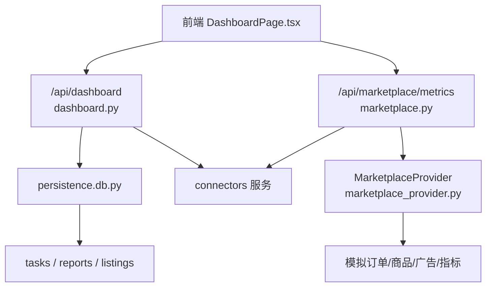
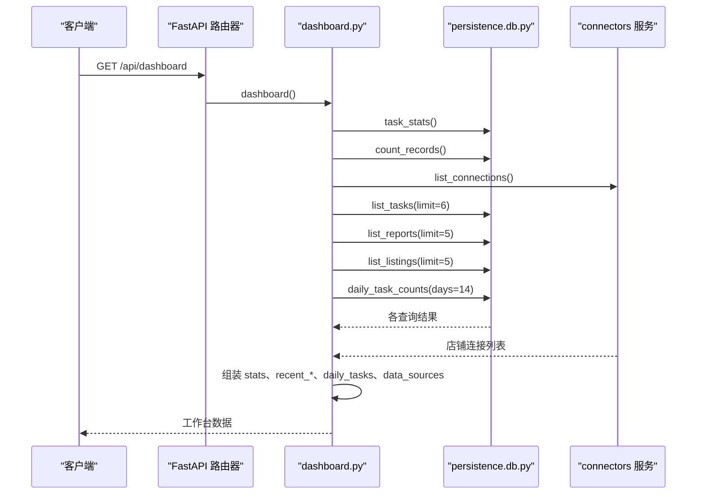
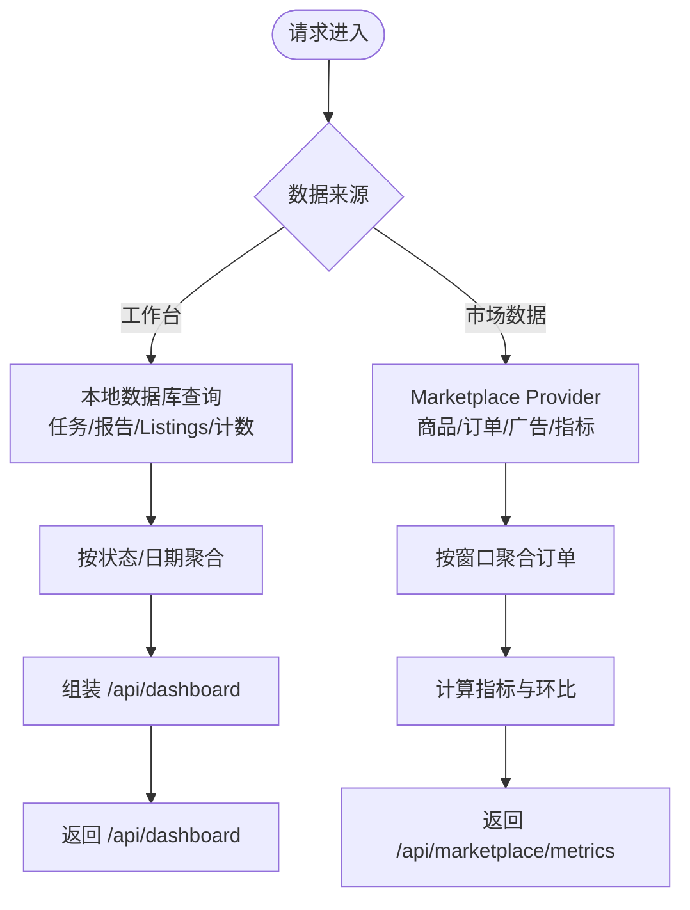
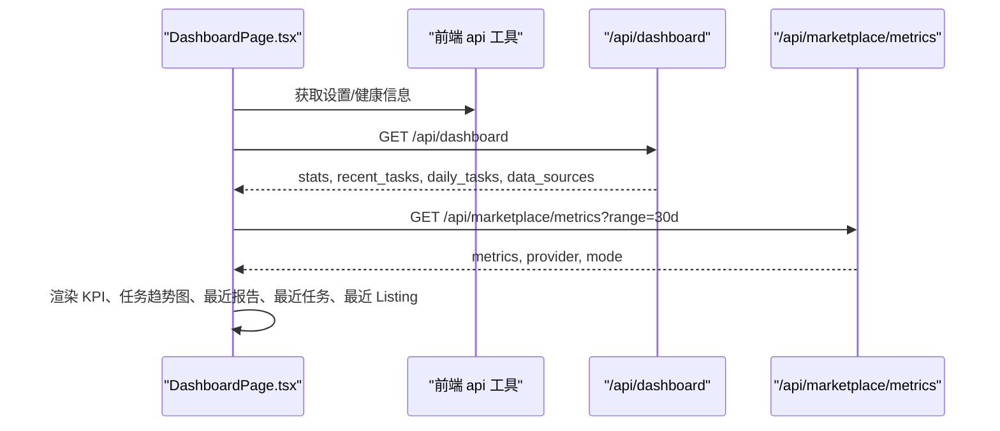

# 仪表盘 API

<cite>
**本文引用的文件**   
- [dashboard.py](file://backend/surge/api/dashboard.py)
- [marketplace.py](file://backend/surge/api/marketplace.py)
- [db.py](file://backend/surge/persistence/db.py)
- [marketplace_provider.py](file://backend/surge/market/marketplace_provider.py)
- [DashboardPage.tsx](file://frontend/src/features/dashboard/DashboardPage.tsx)
</cite>

## 目录
1. [引言](#引言)
2. [项目结构与定位](#项目结构与定位)
3. [API 总览](#api-总览)
4. [工作台端点：业绩与任务趋势](#工作台端点业绩与任务趋势)
5. [市场数据端点：关键指标、订单与商品维度](#市场数据端点关键指标订单与商品维度)
6. [数据来源与聚合逻辑](#数据来源与聚合逻辑)
7. [缺失数据与错误处理](#缺失数据与错误处理)
8. [前端消费模型](#前端消费模型)
9. [curl 示例](#curl-示例)
10. [性能考虑与优化建议](#性能考虑与优化建议)
11. [常见问题排查](#常见问题排查)
12. [结论](#结论)

## 引言
本文面向 Surge 的仪表盘使用者和集成方，说明后台如何暴露“工作台”和“市场数据”两类接口，并解释这些接口如何构成业绩走势、商品订单汇总、单品分析和关键指标查询的数据基础。文档重点覆盖以下方面：

- 接口 URL、必需/可选参数、返回结构。
- 时间粒度：按日聚合的任务趋势、按天数窗口（例如 30d）的市场指标。
- 数据来源：本地任务、报告、Listing、店铺连接，以及 Marketplace Provider 提供的订单、商品和广告数据。
- 缺失数据：无记录时返回 0 或空列表，不会推测数值。
- 前端如何消费 `/api/dashboard` 和 `/api/marketplace/metrics` 渲染图表与 KPI。
- 大数据量下的分页、缓存、重渲染优化建议。

## 项目结构与定位
Surge 的仪表盘由两条后端路由提供数据：

| 层级 | 模块 | 职责 |
|---|---|---|
| API 层 | `backend/surge/api/dashboard.py` | 工作台首屏数据：任务统计、最近任务/报告/Listings、近 14 天任务趋势、数据源状态。 |
| API 层 | `backend/surge/api/marketplace.py` | 市场数据：数据源状态、概览、商品、订单、广告、关键指标；以及店铺经营助手扩展。 |
| 持久化层 | `backend/surge/persistence/db.py` | 从数据库读取任务、报告、Listing、计数和每日任务数。 |
| 市场数据层 | `backend/surge/market/marketplace_provider.py` | 定义 Marketplace Provider 协议，默认使用 Mock 实现生成模拟订单、商品、广告和指标。 |
| 前端页面 | `frontend/src/features/dashboard/DashboardPage.tsx` | 工作台页面，调用 `/api/dashboard` 和 `/api/marketplace/metrics` 渲染 KPI、任务趋势图和最近业务项。 |



**图表来源**
- [dashboard.py:1-99](file://backend/surge/api/dashboard.py#L1-L99)
- [marketplace.py:1-200](file://backend/surge/api/marketplace.py#L1-L200)
- [db.py:706-730](file://backend/surge/persistence/db.py#L706-L730)
- [db.py:981-1006](file://backend/surge/persistence/db.py#L981-L1006)
- [db.py:1751-1775](file://backend/surge/persistence/db.py#L1751-L1775)
- [db.py:1861-1935](file://backend/surge/persistence/db.py#L1861-L1935)
- [marketplace_provider.py:118-145](file://backend/surge/market/marketplace_provider.py#L118-L145)
- [marketplace_provider.py:289-349](file://backend/surge/market/marketplace_provider.py#L289-L349)
- [marketplace_provider.py:488-501](file://backend/surge/market/marketplace_provider.py#L488-L501)
- [DashboardPage.tsx:1-200](file://frontend/src/features/dashboard/DashboardPage.tsx#L1-L200)

**章节来源**
- [dashboard.py:1-99](file://backend/surge/api/dashboard.py#L1-L99)
- [marketplace.py:1-200](file://backend/surge/api/marketplace.py#L1-L200)
- [DashboardPage.tsx:1-200](file://frontend/src/features/dashboard/DashboardPage.tsx#L1-L200)

## API 总览
Surge 当前没有名为“单品分析”的独立 REST 路径；单品相关能力通过 Marketplace Provider 协议扩展，并在经营助手场景中复用商品与订单数据。因此，本文把“单品分析”理解为基于商品、订单、广告和市场指标的聚合视图，而不是一个单独的路径。

| 用途 | URL | 认证要求 | 主要参数 | 输出摘要 |
|---|---|---|---|---|
| 工作台首屏 | `GET /api/dashboard` | 需要登录用户和租户上下文 | 无公开查询参数 | 任务统计、最近任务/报告/Listings、近 14 天任务趋势、数据源描述。 |
| 演示数据集 | `GET /api/demo/dataset` | 未声明鉴权依赖 | 无 | 虚构数据，全部带 `is_demo` 标记。 |
| 市场数据源状态 | `GET /api/marketplace/sources` | 需要读权限 | 无 | 每个数据域使用的 Provider、模式、最后同步信息。 |
| 市场数据概览 | `GET /api/marketplace/overview` | 需要读权限 | `connection_id`、`range` | 店铺信息、Provider、商品、订单、广告、指标。 |
| 商品列表 | `GET /api/marketplace/products` | 需要读权限 | `connection_id`、`limit` | 商品列表、Provider 模式、是否模拟。 |
| 订单列表 | `GET /api/marketplace/orders` | 需要读权限 | `connection_id`、`since` | 订单列表、Provider 模式、是否模拟。 |
| 广告列表 | `GET /api/marketplace/ads` | 需要读权限 | `connection_id` | 广告列表、Provider 模式、是否模拟。 |
| 关键指标 | `GET /api/marketplace/metrics` | 需要读权限 | `connection_id`、`range` | 指标对象、Provider 名称、模式。 |

**章节来源**
- [dashboard.py:1-99](file://backend/surge/api/dashboard.py#L1-L99)
- [marketplace.py:1-200](file://backend/surge/api/marketplace.py#L1-L200)

## 工作台端点：业绩与任务趋势

### URL 与参数
- 路径：`GET /api/dashboard`
- 查询参数：无公开参数。
- 鉴权：需要当前用户和租户上下文。

### 响应结构
该端点一次请求内完成多个数据读取，最终返回如下字段：

| 字段 | 类型 | 含义 |
|---|---|---|
| `stats` | 对象 | 任务统计与资源计数。 |
| `recent_tasks` | 数组 | 最近任务列表，最多 6 条。 |
| `recent_reports` | 数组 | 最近报告列表，最多 5 条。 |
| `recent_listings` | 数组 | 最近 Listing 列表，最多 5 条。 |
| `daily_tasks` | 数组 | 近 N 天的每日任务数量，默认 14 天。 |
| `data_sources` | 数组 | 数据源状态描述。 |

`stats` 包含：

| 字段 | 类型 | 含义 |
|---|---|---|
| `running` | 数字 | 运行中 + 排队中的任务总数。 |
| `awaiting_approval` | 数字 | 等待审批的任务数。 |
| `succeeded` | 数字 | 成功任务数。 |
| `failed` | 数字 | 失败任务数。 |
| `total` | 数字 | 所有任务状态计数之和。 |
| `reports` | 数字 | 报告总数。 |
| `listings` | 数字 | Listing 总数。 |
| `stores` | 数字 | 店铺连接总数。 |
| `approvals` | 数字 | 待审批申请数。 |

`daily_tasks` 是供趋势图直接使用的按日聚合结果，缺失日期会补 0。

### 数据处理流程


**图表来源**
- [dashboard.py:17-99](file://backend/surge/api/dashboard.py#L17-L99)
- [db.py:706-730](file://backend/surge/persistence/db.py#L706-L730)
- [db.py:981-1006](file://backend/surge/persistence/db.py#L981-L1006)
- [db.py:1751-1775](file://backend/surge/persistence/db.py#L1751-L1775)
- [db.py:1861-1935](file://backend/surge/persistence/db.py#L1861-L1935)

**章节来源**
- [dashboard.py:1-99](file://backend/surge/api/dashboard.py#L1-L99)
- [db.py:706-730](file://backend/surge/persistence/db.py#L706-L730)
- [db.py:981-1006](file://backend/surge/persistence/db.py#L981-L1006)
- [db.py:1751-1775](file://backend/surge/persistence/db.py#L1751-L1775)
- [db.py:1861-1935](file://backend/surge/persistence/db.py#L1861-L1935)

## 市场数据端点：关键指标、订单与商品维度

### URL 与参数
| 端点 | 方法 | 参数 | 默认值 |
|---|---|---|---|
| `/api/marketplace/sources` | GET | 无 | — |
| `/api/marketplace/overview` | GET | `connection_id`、`range` | `range=30d` |
| `/api/marketplace/products` | GET | `connection_id`、`limit` | `limit=20` |
| `/api/marketplace/orders` | GET | `connection_id`、`since` | `since=30d` |
| `/api/marketplace/ads` | GET | `connection_id` | — |
| `/api/marketplace/metrics` | GET | `connection_id`、`range` | `range=30d` |

`connection_id` 用于选择具体店铺连接；未指定时，系统取租户下第一个 Mock 连接。如果不存在有效连接，接口返回明确错误。

### 关键指标响应结构
`/api/marketplace/metrics` 返回 Provider 的指标对象，并附加 Provider 元信息：

| 字段 | 类型 | 含义 |
|---|---|---|
| `store_id` | 字符串 | 店铺连接 ID。 |
| `range` | 字符串 | 时间范围参数，例如 `30d`。 |
| `days` | 数字 | 解析后的天数。 |
| `orders` | 数字 | 时间段内订单数。 |
| `units` | 数字 | 时间段内售出单位数。 |
| `revenue` | 数字 | 时间段内收入。 |
| `mode` | 字符串 | Provider 模式，例如 mock。 |
| `provider` | 字符串 | Provider 名称。 |

其他字段由 Provider 实现决定，Mock 实现还包含上一窗口的对比指标。

### 时间粒度
- `/api/marketplace/metrics` 使用 `range` 参数，当前默认 `30d`，表示过去若干天的聚合窗口。
- `/api/marketplace/orders` 使用 `since` 参数，默认 `30d`，用于拉取最近订单明细。
- `/api/dashboard` 的 `daily_tasks` 固定为近 14 天的按日任务数。
- 所有时间都基于 UTC 当天计算。

**章节来源**
- [marketplace.py:1-200](file://backend/surge/api/marketplace.py#L1-L200)
- [marketplace_provider.py:289-349](file://backend/surge/market/marketplace_provider.py#L289-L349)
- [marketplace_provider.py:488-501](file://backend/surge/market/marketplace_provider.py#L488-L501)

## 数据来源与聚合逻辑

### 工作台数据
工作台数据主要来自本地数据库：

| 数据 | 来源表或逻辑 | 聚合方式 |
|---|---|---|
| 任务状态统计 | `tasks` 表 | 按状态分组计数。 |
| 最近任务 | `tasks` 表 | 按创建时间倒序取前 6 条。 |
| 最近报告 | `competitor_reports` 表 | 按创建时间倒序取前 5 条，不包含完整 payload。 |
| 最近 Listing | `listing_drafts` 表 | 按创建时间倒序取前 5 条。 |
| 资源计数 | 多张表联合子查询 | 一次性统计报告、Listing、店铺、待审批数量。 |
| 每日任务数 | `tasks.created_at` | 按日分组，缺失日期补 0，最多支持 60 天。 |

### 市场数据
市场数据来自 Marketplace Provider：

| 数据 | Provider 方法 | 行为 |
|---|---|---|
| 商品 | `list_products` | 返回商品目录，默认限制 8 或 20。 |
| 订单 | `list_orders` | 根据 `since` 天数窗口生成订单明细。 |
| 广告 | `list_ads` | 返回广告列表。 |
| 关键指标 | `metrics` | 对当前窗口和上一个等长窗口分别聚合，计算环比和平均客单价。 |



**图表来源**
- [dashboard.py:17-99](file://backend/surge/api/dashboard.py#L17-L99)
- [db.py:1861-1935](file://backend/surge/persistence/db.py#L1861-L1935)
- [marketplace_provider.py:289-349](file://backend/surge/market/marketplace_provider.py#L289-L349)
- [marketplace_provider.py:488-501](file://backend/surge/market/marketplace_provider.py#L488-L501)

**章节来源**
- [db.py:706-730](file://backend/surge/persistence/db.py#L706-L730)
- [db.py:981-1006](file://backend/surge/persistence/db.py#L981-L1006)
- [db.py:1751-1775](file://backend/surge/persistence/db.py#L1751-L1775)
- [db.py:1861-1935](file://backend/surge/persistence/db.py#L1861-L1935)
- [marketplace_provider.py:289-349](file://backend/surge/market/marketplace_provider.py#L289-L349)
- [marketplace_provider.py:488-501](file://backend/surge/market/marketplace_provider.py#L488-L501)

## 缺失数据与错误处理

### 缺失数据的处理原则
- 工作台注释明确要求：所有数字来自真实记录；没有数据时是 0，不是推测值。
- 任务统计按状态返回计数，缺少某类状态时对应字段为 0。
- 每日任务数在 SQL 分组后会对缺失日期补 0，便于前端趋势图直接使用。
- 市场数据若没有有效店铺连接，则返回明确的 HTTP 错误，不返回假数据。
- Mock Provider 的指标计算中，当订单数为 0 时，平均客单价也返回 0，而不是除以零。

### 典型错误场景
| 场景 | 行为 |
|---|---|
| 未添加店铺且未传 `connection_id` | 返回 409，提示先添加店铺。 |
| 指定了不存在的 `connection_id` | 返回 404。 |
| Live Provider 未配置 | 返回 501，明确说明未配置，不降级到 Mock。 |
| 没有任务但存在历史数据 | 任务统计可能部分状态为 0，趋势图仍显示空态。 |
| 指标窗口为空 | 订单、单位、收入为 0，平均客单价为 0。 |

**章节来源**
- [dashboard.py:1-99](file://backend/surge/api/dashboard.py#L1-L99)
- [marketplace.py:1-200](file://backend/surge/api/marketplace.py#L1-L200)
- [marketplace_provider.py:488-501](file://backend/surge/market/marketplace_provider.py#L488-L501)

## 前端消费模型
前端 Dashboard 页面遵循三条纪律：

1. 所有数字来自 `/api/dashboard` 与 `/api/marketplace/metrics`，前端不推算任何指标。
2. 还没有数据的模块保持空态，不显示推测性指标。
3. 趋势全 0 时不画贴底零线，因为那是空壳图，没有信息价值。

### 数据加载顺序


**图表来源**
- [DashboardPage.tsx:272-292](file://frontend/src/features/dashboard/DashboardPage.tsx#L272-L292)
- [DashboardPage.tsx:362-443](file://frontend/src/features/dashboard/DashboardPage.tsx#L362-L443)

### 前端字段映射
| 前端展示 | 数据来源 | 字段 |
|---|---|---|
| 巨型指标 | `/api/dashboard` | `stats.total`、`stats.running`、`stats.reports`、`stats.listings` |
| 任务趋势图 | `/api/dashboard` | `daily_tasks` |
| 最近报告 | `/api/dashboard` | `recent_reports` |
| 最近任务 | `/api/dashboard` | `recent_tasks` |
| 最近 Listing | `/api/dashboard` | `recent_listings` |
| 经营概览核心指标 | `/api/marketplace/metrics` | `metrics.orders`、`metrics.units`、`metrics.revenue` 等 |

前端还会懒加载 Recharts 图表组件，避免把约 350 KB 的图表库放进首屏。

**章节来源**
- [DashboardPage.tsx:1-200](file://frontend/src/features/dashboard/DashboardPage.tsx#L1-L200)
- [DashboardPage.tsx:272-292](file://frontend/src/features/dashboard/DashboardPage.tsx#L272-L292)
- [DashboardPage.tsx:362-443](file://frontend/src/features/dashboard/DashboardPage.tsx#L362-L443)

## curl 示例
以下示例假设后端服务运行在 `http://localhost:8000`，并且已登录或具备必要权限。实际部署时应替换域名和认证头。

### 工作台数据
```bash
curl -i \
  --header "Authorization: Bearer YOUR_TOKEN" \
  "http://localhost:8000/api/dashboard"
```

预期关键字段包括：`stats`、`recent_tasks`、`recent_reports`、`recent_listings`、`daily_tasks`、`data_sources`。

### 市场数据源状态
```bash
curl -i \
  --header "Authorization: Bearer YOUR_TOKEN" \
  "http://localhost:8000/api/marketplace/sources"
```

### 关键指标：按时间范围
```bash
curl -i \
  --header "Authorization: Bearer YOUR_TOKEN" \
  "http://localhost:8000/api/marketplace/metrics?range=30d"
```

如需指定店铺：
```bash
curl -i \
  --header "Authorization: Bearer YOUR_TOKEN" \
  "http://localhost:8000/api/marketplace/metrics?connection_id=STORE_ID&range=30d"
```

### 商品订单汇总：按平台与商品维度
商品维度可通过商品列表与订单列表组合获得：

```bash
curl -i \
  --header "Authorization: Bearer YOUR_TOKEN" \
  "http://localhost:8000/api/marketplace/products?connection_id=STORE_ID&limit=20"
```

```bash
curl -i \
  --header "Authorization: Bearer YOUR_TOKEN" \
  "http://localhost:8000/api/marketplace/orders?connection_id=STORE_ID&since=30d"
```

### 按时间范围查询订单
```bash
curl -i \
  --header "Authorization: Bearer YOUR_TOKEN" \
  "http://localhost:8000/api/marketplace/orders?since=7d"
```

### 注意事项
- 上述命令中的 `YOUR_TOKEN` 应替换为实际令牌。
- `STORE_ID` 应替换为有效的 `connection_id`。
- 未配置真实 Provider 时，Mock 实现会返回模拟数据，但仍带有 `is_mock` 或 `mode=mock` 标识。
- 未添加店铺时，关键指标和概览接口会返回 409。
- 未配置 Live Provider 时，会返回 501。

**章节来源**
- [dashboard.py:1-99](file://backend/surge/api/dashboard.py#L1-L99)
- [marketplace.py:1-200](file://backend/surge/api/marketplace.py#L1-L200)

## 性能考虑与优化建议

### 现有实现中的性能设计
1. **共享数据库连接**  
   `/api/dashboard` 在一个连接上下文中依次执行任务统计、记录计数、连接列表、最近任务、最近报告、最近 Listing 和每日任务数查询，避免每个数据库方法各自新建连接。
2. **合并计数**  
   报告、Listing、店铺、待审批计数通过一条 SQL 子查询完成，减少远端数据库往返。
3. **限制列表长度**  
   最近任务最多 6 条，最近报告和 Listing 最多 5 条；商品列表默认限制 8 或 20，订单列表默认拉取 30 天。
4. **限制趋势窗口**  
   每日任务数最多允许 60 天，防止过长时间范围导致大量数据。
5. **前端懒加载图表**  
   Recharts 被拆成独立 chunk，首屏先渲染 KPI 和列表，图表随后加载。

### 大数据量下的分页建议
当前接口多为“顶部 N 条”或固定窗口，适合仪表盘首屏。若未来需要更深层浏览：

| 接口 | 现状 | 建议 |
|---|---|---|
| `/api/marketplace/products` | `limit` 最大 100 | 增加 `offset` 或游标分页，避免前端一次性加载过多商品。 |
| `/api/marketplace/orders` | 按 `since` 拉取全部订单 | 改为分页接口，返回 `cursor` 或下一页 URL。 |
| `/api/dashboard/recent_*` | 固定 top-N | 保持轻量；详情页再按需拉取完整列表。 |
| `/api/marketplace/metrics` | 单窗口聚合 | 对超长历史区间提供预聚合或分层粒度：小时、日、周、月。 |

### 缓存策略建议
| 层级 | 建议 |
|---|---|
| 后端缓存 | 对 `/api/marketplace/metrics` 做短期缓存，例如按 `connection_id` + `range` 作为键，TTL 1~5 分钟。 |
| 数据库层 | 对每日任务数和资源计数建立物化视图或定时汇总表，避免每次首屏重复聚合。 |
| CDN/边缘 | 仅对不需要鉴权的静态数据缓存；仪表盘涉及用户和租户隔离，不建议全局缓存。 |
| 前端缓存 | 对短时间内相同参数的指标请求去重；切换时间范围时失效旧缓存。 |

### 前端重渲染优化建议
- 对 `daily_tasks` 这类稳定趋势数据做浅比较，仅在数据变化时更新图表。
- 避免每次 KPI 数字变化就重建整个 SVG 或 Recharts 实例；只更新数据节点。
- 对懒加载图表组件保留挂载状态，避免频繁销毁重建。
- 对空态、骨架屏和真实数据分状态渲染，减少不必要的图表绘制。
- 对大额数值动画使用增量更新，避免整页重新布局。

### 复杂度与瓶颈观察
- `/api/dashboard` 在一次请求中并行多个耗时块，根因注释指出首屏慢的主要原因是远端数据库建连成本，而非单个 SQL 本身。
- 市场数据 Provider 在 Mock 模式下生成订单窗口并对当前窗口和上一窗口分别聚合，时间复杂度大致与窗口大小线性相关。
- 前端评论提到 Recharts 会增加约 350 KB raw 体积，因此采用懒加载。

**章节来源**
- [dashboard.py:17-99](file://backend/surge/api/dashboard.py#L17-L99)
- [db.py:1910-1935](file://backend/surge/persistence/db.py#L1910-L1935)
- [db.py:1875-1909](file://backend/surge/persistence/db.py#L1875-L1909)
- [marketplace.py:168-200](file://backend/surge/api/marketplace.py#L168-L200)
- [marketplace_provider.py:339-349](file://backend/surge/market/marketplace_provider.py#L339-L349)
- [marketplace_provider.py:488-501](file://backend/surge/market/marketplace_provider.py#L488-L501)
- [DashboardPage.tsx:1-200](file://frontend/src/features/dashboard/DashboardPage.tsx#L1-L200)

## 常见问题排查

| 问题 | 可能原因 | 排查步骤 |
|---|---|---|
| 关键指标返回 409 | 未添加店铺，且未传 `connection_id` | 先到“店铺与渠道”添加店铺，或传入有效 `connection_id`。 |
| 关键指标返回 404 | 指定的 `connection_id` 不存在 | 检查连接 ID 是否已被移除或拼写错误。 |
| 关键指标返回 501 | Live Provider 未配置 | 检查 Marketplace Provider 配置，不要期望自动降级为 Mock。 |
| 趋势图为空 | 近 14 天没有任务 | 确认是否有任务创建；前端会在全 0 时不画贴底零线。 |
| 图表加载慢 | Recharts 体积大 | 确认懒加载是否正常；避免首屏同时加载多个重型图表。 |
| 数据延迟 | 外部 Provider 或远端数据库慢 | 关注后端 perf 计时块，如 `marketplace.metrics`、`dashboard.stats`。 |
| 数据不一致 | 模拟数据与真实数据混用 | 检查返回中的 `mode`、`is_mock`、`is_demo` 字段。 |

**章节来源**
- [marketplace.py:1-200](file://backend/surge/api/marketplace.py#L1-L200)
- [dashboard.py:1-99](file://backend/surge/api/dashboard.py#L1-L99)
- [DashboardPage.tsx:1-200](file://frontend/src/features/dashboard/DashboardPage.tsx#L1-L200)

## 结论
Surge 的仪表盘 API 由两条主线组成：

- `/api/dashboard` 提供工作台首屏所需的工作流和业务资产概览，包括任务统计、最近任务和报告、最近 Listing，以及近 14 天按日任务趋势。
- `/api/marketplace/metrics` 提供基于店铺连接的关键指标，支持按 `range` 调整时间窗口，并配合商品、订单、广告接口形成商品与订单维度分析的基础。

当前实现强调真实数据、缺失数据返回 0、避免推测指标，并通过共享数据库连接、合并计数和前端懒加载控制首屏性能。未来若数据规模增长，应在后端引入分页、缓存和预聚合，在前端引入图表增量更新和数据去重，以保持仪表盘的响应速度和可维护性。