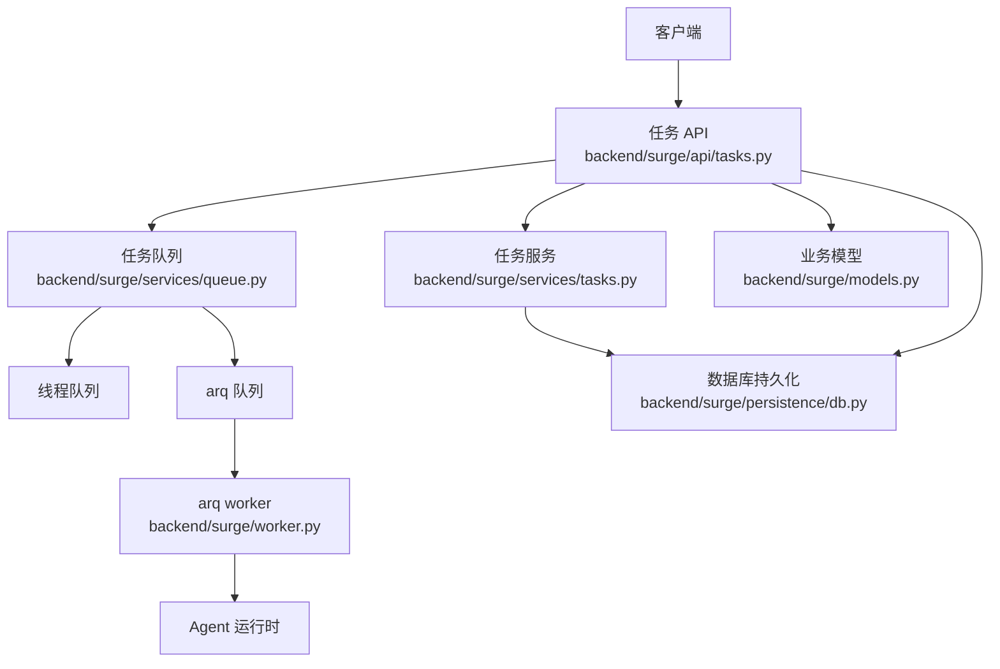
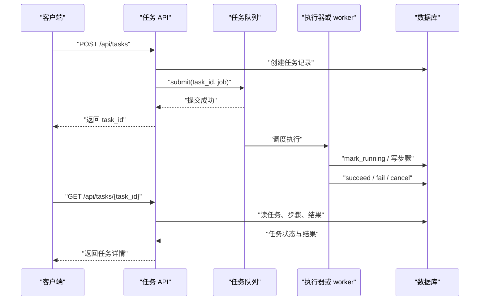
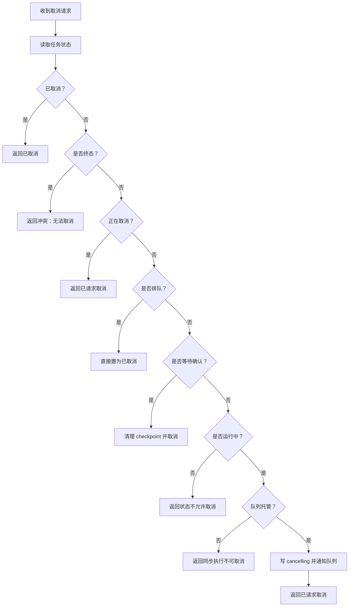
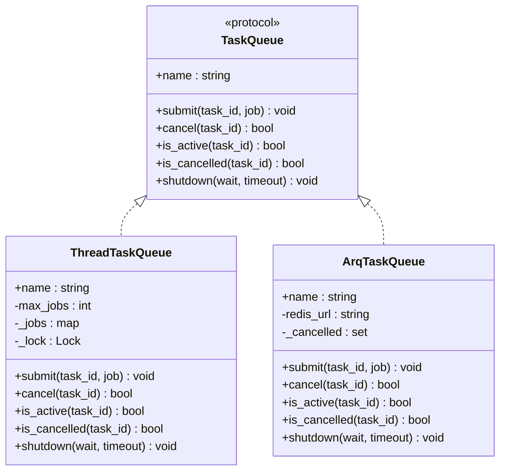
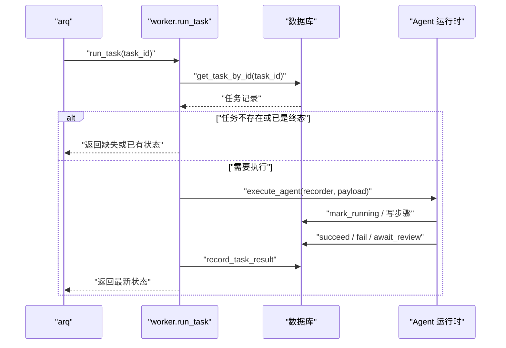
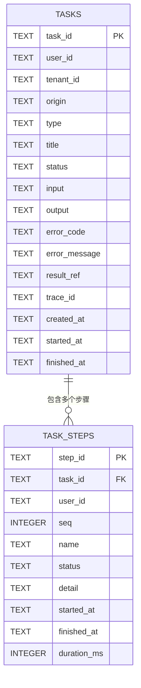
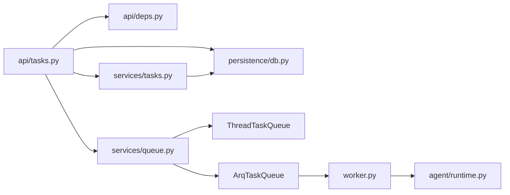
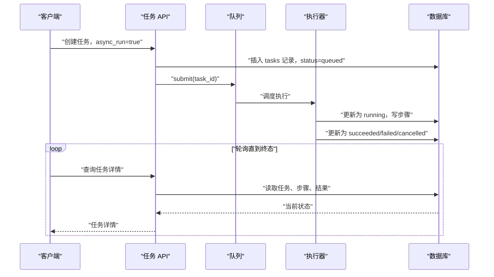
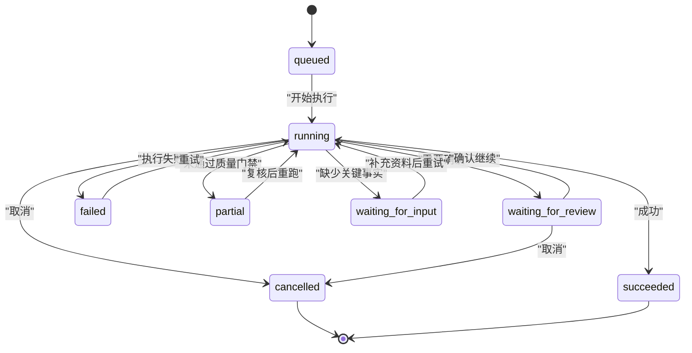
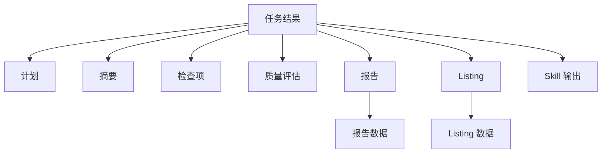

# 任务管理 API

<cite>
**本文引用的文件**   
- [backend/surge/api/tasks.py](file://backend/surge/api/tasks.py)
- [backend/surge/services/tasks.py](file://backend/surge/services/tasks.py)
- [backend/surge/services/queue.py](file://backend/surge/services/queue.py)
- [backend/surge/worker.py](file://backend/surge/worker.py)
- [backend/surge/worker_service.py](file://backend/surge/worker_service.py)
- [backend/surge/app.py](file://backend/surge/app.py)
- [backend/surge/persistence/db.py](file://backend/surge/persistence/db.py)
- [backend/surge/models.py](file://backend/surge/models.py)
</cite>

## 目录
1. [简介](#简介)
2. [项目结构](#项目结构)
3. [核心组件](#核心组件)
4. [架构总览](#架构总览)
5. [详细组件分析](#详细组件分析)
6. [依赖关系分析](#依赖关系分析)
7. [性能与扩展性](#性能与扩展性)
8. [API 参考](#api-参考)
8.1 [创建任务](#创建任务)
8.2 [查询任务列表](#查询任务列表)
8.3 [查询任务详情](#查询任务详情)
8.4 [取消任务](#取消任务)
8.5 [重试任务](#重试任务)
8.6 [确认暂停任务](#确认暂停任务)
8.7 [查看执行链](#查看执行链)
9. [异步执行约定](#异步执行约定)
10. [任务状态机](#任务状态机)
11. [结果对接](#结果对接)
12. [常见问题排查](#常见问题排查)
13. [结论](#结论)

## 简介
本文面向使用 Surge 后端 API 的客户端开发者，聚焦“任务中心”相关接口：创建、查询、取消、重试、确认和历史追踪。Surge 的任务本质是一次 Agent 工作流执行记录，可能触发竞品分析、Listing 生成、Skill 执行等上层能力。对于耗时任务，系统支持异步执行模式：客户端传入 `async_run=true` 后，服务端立即返回任务 ID，客户端通过轮询任务查询接口获取进度和最终结果。

## 项目结构
任务相关代码主要分布在以下位置：
- HTTP 端点：`backend/surge/api/tasks.py`
- 任务持久化与状态机：`backend/surge/services/tasks.py`
- 队列抽象与实现：`backend/surge/services/queue.py`
- arq 独立 worker 入口：`backend/surge/worker.py`
- 同进程健康检查与启动日志：`backend/surge/worker_service.py`
- FastAPI 应用装配、队列初始化、上下文注入：`backend/surge/app.py`
- 数据库模型与任务表结构：`backend/surge/persistence/db.py`
- 业务数据模型（报告、Listing、竞品等）：`backend/surge/models.py`



**图表来源**
- [backend/surge/api/tasks.py:1-120](file://backend/surge/api/tasks.py#L1-L120)
- [backend/surge/services/tasks.py:1-120](file://backend/surge/services/tasks.py#L1-L120)
- [backend/surge/services/queue.py:1-120](file://backend/surge/services/queue.py#L1-L120)
- [backend/surge/worker.py:1-80](file://backend/surge/worker.py#L1-L80)
- [backend/surge/persistence/db.py:1606-1861](file://backend/surge/persistence/db.py#L1606-L1861)

**章节来源**
- [backend/surge/api/tasks.py:1-200](file://backend/surge/api/tasks.py#L1-L200)
- [backend/surge/services/tasks.py:1-120](file://backend/surge/services/tasks.py#L1-L120)
- [backend/surge/services/queue.py:1-120](file://backend/surge/services/queue.py#L1-L120)
- [backend/surge/persistence/db.py:1606-1861](file://backend/surge/persistence/db.py#L1606-L1861)

## 核心组件
- **任务 API 层**：负责鉴权、租户校验、参数校验、调用任务服务与数据库，并返回前端可直接展示的结构化响应。
- **任务服务层**：定义任务状态常量、终态集合、可取消状态、可恢复状态；提供 `TaskRecorder` 用于落库步骤、设置成功/失败/等待输入/待复核/取消；提供 `cancel_task` 统一取消逻辑。
- **队列抽象层**：通过 `TaskQueue` 协议屏蔽线程队列与 arq 队列差异；默认线程队列适合 Render 单实例部署，arq 队列适合多进程分布式场景。
- **arq worker**：独立进程从数据库读取任务输入，重建 Provider 并执行同一张 LangGraph，保证线程执行器与 arq 执行器行为一致。
- **数据库层**：维护 `tasks`、`task_steps` 等表，并提供任务创建、查询、步骤追加、输出复用、统计等能力。

**章节来源**
- [backend/surge/api/tasks.py:1-200](file://backend/surge/api/tasks.py#L1-L200)
- [backend/surge/services/tasks.py:1-120](file://backend/surge/services/tasks.py#L1-L120)
- [backend/surge/services/queue.py:1-120](file://backend/surge/services/queue.py#L1-L120)
- [backend/surge/worker.py:1-80](file://backend/surge/worker.py#L1-L80)
- [backend/surge/persistence/db.py:1606-1861](file://backend/surge/persistence/db.py#L1606-L1861)

## 架构总览
Surge 的任务执行链路可以分成两条路径：
1. **同进程线程队列**：FastAPI 请求直接提交到进程内线程池，适合单机或 Render 免费实例。
2. **arq 分布式队列**：FastAPI 把任务投递给 Redis，由独立 worker 进程拉取并执行，适合需要水平扩展的场景。



**图表来源**
- [backend/surge/api/tasks.py:1-120](file://backend/surge/api/tasks.py#L1-L120)
- [backend/surge/services/tasks.py:120-240](file://backend/surge/services/tasks.py#L120-L240)
- [backend/surge/services/queue.py:120-220](file://backend/surge/services/queue.py#L120-L220)
- [backend/surge/worker.py:40-110](file://backend/surge/worker.py#L40-L110)

**章节来源**
- [backend/surge/app.py:1-120](file://backend/surge/app.py#L1-L120)
- [backend/surge/worker_service.py:1-94](file://backend/surge/worker_service.py#L1-L94)

## 详细组件分析

### 任务服务层：状态机与记录器
任务服务层是任务系统的核心。它定义了任务状态的完整语义，并把“执行过程”建模为可追溯的步骤。

关键设计：
- **状态常量**：包括排队、运行中、等待审批、等待补充资料、等待确认、部分完成、成功、失败、正在取消、已取消。
- **终态集合**：成功、失败、取消、等待补充资料、待复核。这些状态不再自动变化。
- **可取消状态**：排队、运行中、正在取消。
- **可原地恢复状态**：等待确认。该状态有 checkpoint，可通过确认接口继续执行。
- **TaskRecorder**：封装任务的打开、标记运行、步骤开始结束、成功、失败、等待输入、部分完成、等待确认、取消、恢复等生命周期。
- **cancel_task**：根据任务状态决定直接取消、进入取消中、拒绝同步取消或报错；对受队列托管的运行中任务，写入数据库并通过队列取消信号通知执行器。



**图表来源**
- [backend/surge/services/tasks.py:120-240](file://backend/surge/services/tasks.py#L120-L240)
- [backend/surge/services/tasks.py:380-474](file://backend/surge/services/tasks.py#L380-L474)

**章节来源**
- [backend/surge/services/tasks.py:1-120](file://backend/surge/services/tasks.py#L1-L120)
- [backend/surge/services/tasks.py:240-474](file://backend/surge/services/tasks.py#L240-L474)

### 队列抽象层：线程队列与 arq
队列抽象通过 `TaskQueue` 协议统一两种后端：
- **ThreadTaskQueue**：进程内线程池，默认启用。通过 `max_jobs` 限制并发，避免内存耗尽；每个任务一个取消事件；API 提交后立即返回，但实际执行在后台线程。
- **ArqTaskQueue**：将任务 ID 投递给 arq，由独立 worker 从数据库读取完整输入执行。本地无常驻 Redis 时，连接会抛出可展示错误；`cancel` 仅记录取消信号，真实状态变更仍依赖数据库检查点。



**图表来源**
- [backend/surge/services/queue.py:1-200](file://backend/surge/services/queue.py#L1-L200)
- [backend/surge/services/queue.py:200-250](file://backend/surge/services/queue.py#L200-L250)

**章节来源**
- [backend/surge/services/queue.py:1-250](file://backend/surge/services/queue.py#L1-L250)

### arq worker：独立进程执行
arq worker 不依赖 FastAPI，只依赖数据库、Provider、SecretBox 和 Agent 运行时。它的职责是：
- 按 `task_id` 读取任务记录。
- 跳过不存在或已进入终态的任务。
- 使用 `TaskRecorder.resume` 恢复步骤序号。
- 重建用户 Provider 并调用 `execute_agent`。
- 捕获取消、Agent 运行异常和兜底异常，确保任务不会停在运行中。
- 在 finally 中记录对话结果。



**图表来源**
- [backend/surge/worker.py:1-127](file://backend/surge/worker.py#L1-L127)

**章节来源**
- [backend/surge/worker.py:1-127](file://backend/surge/worker.py#L1-L127)

### 数据库层：任务与步骤表
数据库层维护任务主表和步骤子表：
- `tasks`：包含任务 ID、用户、租户、类型、标题、状态、输入、输出、错误码、错误信息、结果引用、trace_id、创建时间、开始时间、结束时间。
- `task_steps`：包含步骤 ID、任务 ID、用户、顺序号、名称、状态、详情、开始时间、结束时间、耗时毫秒。
- 索引：按用户和状态排序、按任务 ID 和顺序排序，便于分页查询和时间线还原。



**图表来源**
- [backend/surge/persistence/db.py:260-340](file://backend/surge/persistence/db.py#L260-L340)

**章节来源**
- [backend/surge/persistence/db.py:260-340](file://backend/surge/persistence/db.py#L260-L340)
- [backend/surge/persistence/db.py:1606-1861](file://backend/surge/persistence/db.py#L1606-L1861)

## 依赖关系分析
任务 API 的依赖方向比较清晰：
- API 层依赖 `ApiContext`，而 `ApiContext` 持有数据库、存储、队列、配置。
- 任务服务依赖数据库，但不直接依赖 HTTP 框架。
- 队列抽象被 API 和 worker 共同依赖，保证两种执行路径行为一致。
- Agent 运行时位于更上层，负责校验、分派、执行、收尾；任务服务负责把运行过程变成可审计的状态和步骤。



**图表来源**
- [backend/surge/api/tasks.py:1-120](file://backend/surge/api/tasks.py#L1-L120)
- [backend/surge/app.py:120-200](file://backend/surge/app.py#L120-L200)
- [backend/surge/services/tasks.py:1-120](file://backend/surge/services/tasks.py#L1-L120)
- [backend/surge/services/queue.py:1-120](file://backend/surge/services/queue.py#L1-L120)
- [backend/surge/worker.py:1-80](file://backend/surge/worker.py#L1-L80)

**章节来源**
- [backend/surge/app.py:120-200](file://backend/surge/app.py#L120-L200)
- [backend/surge/api/deps.py:1-200](file://backend/surge/api/deps.py#L1-L200)

## 性能与扩展性
- **线程队列并发控制**：默认最大并发任务数可调，超出上限的任务在线程内排队，不阻塞 API 提交，但能保护内存不被无限并发撑爆。这对 Render 512MB 实例尤其重要。
- **arq worker 超时**：worker 的 `job_timeout` 设置为 900 秒，防止长时间卡住的任务占用 worker 进程。
- **数据库连接池**：PostgreSQL 连接池大小可配置；未安装连接池时会回退到每次新建连接，首屏明显变慢。
- **健康检查**：`/health` 不查数据库，适合保活；`/health/deep` 检查数据库、Provider、队列后端、存储等。

**章节来源**
- [backend/surge/services/queue.py:60-160](file://backend/surge/services/queue.py#L60-L160)
- [backend/surge/worker.py:100-127](file://backend/surge/worker.py#L100-L127)
- [backend/surge/persistence/db.py:300-420](file://backend/surge/persistence/db.py#L300-L420)
- [backend/surge/worker_service.py:1-94](file://backend/surge/worker_service.py#L1-L94)

## API 参考

### 创建任务
- **方法**：`POST /api/tasks`
- **认证**：需要登录用户和租户上下文。
- **关键参数**：
  - `product_name`：商品名称。
  - `competitors`：竞品列表。
  - `with_listing`：是否同时生成 Listing。
  - `platform`：销售平台。
  - `marketplace`：市场区域。
  - `async_run`：是否异步执行。
- **同步行为**：`async_run=false` 时，任务在服务端同步执行，直到完成、失败或进入等待确认。
- **异步行为**：`async_run=true` 时，服务端立即返回任务 ID，任务进入队列，客户端通过查询接口轮询。
- **返回结构**：同步返回任务详情；异步返回 `task_id`、`status=queued`。

注意：当前仓库中的 `backend/surge/api/tasks.py` 公开了列表、详情、取消、重试、确认、追踪等端点，但未在该文件中看到创建任务端点的完整实现。若你的客户端依赖创建任务，请结合上游路由装配或文档确认创建端点路径；本文其余端点均基于当前文件明确实现。

**章节来源**
- [backend/surge/api/tasks.py:1-120](file://backend/surge/api/tasks.py#L1-L120)

### 查询任务列表
- **方法**：`GET /api/tasks`
- **参数**：
  - `status`：可选，按状态过滤。
  - `q`：可选，模糊查询。
  - `limit`：默认 50，最大 200。
- **返回**：
  - `items`：任务列表。
  - `stats`：统计信息。

示例 curl：
```bash
curl "http://localhost:8000/api/tasks?status=running&limit=20" \
  -H "Authorization: Bearer YOUR_TOKEN" \
  -H "X-Tenant-Id: YOUR_TENANT_ID"
```

**章节来源**
- [backend/surge/api/tasks.py:18-48](file://backend/surge/api/tasks.py#L18-L48)

### 查询任务详情
- **方法**：`GET /api/tasks/{task_id}`
- **返回**：
  - `task`：基础任务记录。
  - `steps`：执行步骤时间线。
  - `result`：聚合结果块，包括计划、摘要、检查项、质量评估、降级标志、引擎、报告、Listing、技能输出等。
  - `pending`：暂停时的待确认内容。

示例 curl：
```bash
curl "http://localhost:8000/api/tasks/TASK_ID" \
  -H "Authorization: Bearer YOUR_TOKEN" \
  -H "X-Tenant-Id: YOUR_TENANT_ID"
```

**章节来源**
- [backend/surge/api/tasks.py:50-110](file://backend/surge/api/tasks.py#L50-L110)

### 取消任务
- **方法**：`POST /api/tasks/{task_id}/cancel`
- **权限**：需要写权限。
- **行为**：
  - 排队任务直接取消。
  - 等待确认任务直接取消并清理 checkpoint。
  - 运行中且受队列托管的任务进入取消中，并在下一个检查点停止。
  - 同步执行的任务返回冲突，提示改用异步模式。
- **返回**：成功消息和最新任务记录。

示例 curl：
```bash
curl -X POST "http://localhost:8000/api/tasks/TASK_ID/cancel" \
  -H "Authorization: Bearer YOUR_TOKEN" \
  -H "X-Tenant-Id: YOUR_TENANT_ID"
```

**章节来源**
- [backend/surge/api/tasks.py:112-150](file://backend/surge/api/tasks.py#L112-L150)
- [backend/surge/services/tasks.py:380-474](file://backend/surge/services/tasks.py#L380-L474)

### 重试任务
- **方法**：`POST /api/tasks/{task_id}/retry`
- **参数**：
  - `resume`：默认 true，尝试复用上次已成功步骤的输出。
  - `body.overrides`：可选，补充或修改资料类字段。
- **前置校验**：
  - 任务必须是失败、已取消、等待补充资料或待复核。
  - 任务类型必须是 Agent 工作流。
  - 原任务必须包含商品名称和竞品。
- **复用策略**：
  - 复用前检查输入指纹和工作流版本。
  - 命中复用的节点不包含持久化和收尾节点。
- **返回**：新任务 ID、重试来源、状态、复用节点列表、未复用原因。

示例 curl：
```bash
curl -X POST "http://localhost:8000/api/tasks/TASK_ID/retry?resume=true" \
  -H "Authorization: Bearer YOUR_TOKEN" \
  -H "X-Tenant-Id: YOUR_TENANT_ID" \
  -H "Content-Type: application/json" \
  -d '{"overrides": {"own_specs": {"color": "red"}}}'
```

**章节来源**
- [backend/surge/api/tasks.py:152-240](file://backend/surge/api/tasks.py#L152-L240)

### 确认暂停任务
- **方法**：POST `/api/tasks/{task_id}/confirm`
- **用途**：组合工作流在确认点暂停时，客户端携带确认令牌继续或取消。
- **校验顺序**：任务归属、状态、确认令牌、checkpoint 可恢复性、原子抢占。
- **决策值**：继续或取消。
- **返回**：任务 ID、状态、决策、分析结果、消息。

示例 curl：
```bash
curl -X POST "http://localhost:8000/api/tasks/TASK_ID/confirm" \
  -H "Authorization: Bearer YOUR_TOKEN" \
  -H "X-Tenant-Id: YOUR_TENANT_ID" \
  -H "Content-Type: application/json" \
  -d '{"decision":"continue","confirmation_token":"TOKEN_FROM_PENDING"}'
```

**章节来源**
- [backend/surge/api/tasks.py:242-360](file://backend/surge/api/tasks.py#L242-L360)

### 查看执行链
- **方法**：`GET /api/tasks/{task_id}/trace`
- **返回**：
  - `chain`：按顺序排列的步骤，每步带耗时、状态、模型调用明细。
  - `totals`：步骤数量、总耗时、LLM 调用次数、尝试次数、token 总量、失败节点。
  - `error`：任务级错误码和消息。
- **隐私**：不返回 prompt 或响应正文，只返回元数据。

示例 curl：
```bash
curl "http://localhost:8000/api/tasks/TASK_ID/trace" \
  -H "Authorization: Bearer YOUR_TOKEN" \
  -H "X-Tenant-Id: YOUR_TENANT_ID"
```

**章节来源**
- [backend/surge/api/tasks.py:362-504](file://backend/surge/api/tasks.py#L362-L504)

## 异步执行约定
当客户端传入 `async_run=true` 时，服务端遵循以下约定：
1. 立即创建任务记录，初始状态为排队。
2. 将任务提交到队列。
3. 立即返回 `task_id`，状态为 `queued`。
4. 客户端轮询 `GET /api/tasks/{task_id}`，直到状态进入终态。
5. 终态包括成功、失败、取消、等待补充资料、待复核。
6. 最终结果可从 `task.output` 和 `result` 字段读取；报告或 Listing 会通过 `report_id`、`listing_id` 关联查询。



**图表来源**
- [backend/surge/api/tasks.py:1-120](file://backend/surge/api/tasks.py#L1-L120)
- [backend/surge/services/tasks.py:120-240](file://backend/surge/services/tasks.py#L120-L240)
- [backend/surge/services/queue.py:120-220](file://backend/surge/services/queue.py#L120-L220)

**章节来源**
- [backend/surge/api/tasks.py:1-120](file://backend/surge/api/tasks.py#L1-L120)
- [backend/surge/services/tasks.py:120-240](file://backend/surge/services/tasks.py#L120-L240)

## 任务状态机
任务状态机由任务服务层集中定义，核心语义如下：
- **queued**：任务已创建，等待执行。
- **running**：任务已开始执行。
- **awaiting_approval**：等待审批。
- **waiting_for_input**：缺少关键事实，不是失败，需要用户补充后重试。
- **waiting_for_review**：工作流停在中断点，可原地恢复。
- **partial**：有产物但未通过质量门禁，需人工复核。
- **succeeded**：成功完成。
- **failed**：失败，带有错误码和错误消息。
- **cancelling**：已请求取消，等待检查点。
- **cancelled**：已取消。



**图表来源**
- [backend/surge/services/tasks.py:1-120](file://backend/surge/services/tasks.py#L1-L120)
- [backend/surge/services/tasks.py:240-380](file://backend/surge/services/tasks.py#L240-L380)

**章节来源**
- [backend/surge/services/tasks.py:1-120](file://backend/surge/services/tasks.py#L1-L120)
- [backend/surge/services/tasks.py:240-380](file://backend/surge/services/tasks.py#L240-L380)

## 结果对接
任务结果通过 `task.output` 和任务详情接口中的 `result` 字段向上层暴露：
- **竞品分析**：通过 `plan`、`summary`、`checks`、`quality`、`analysis_outcome`、`provenance` 等字段表达分析计划和结果。
- **Listing 生成**：通过 `listing_id` 关联 Listing，再通过数据库查询返回结构化 Listing 数据。
- **报告生成**：通过 `report_id` 关联报告，再查询报告详情。
- **Skill 执行**：通过 `skill_key`、`renderer`、`is_demo`、`result_ref`、`output` 标识技能类型、渲染方式和产出。



**图表来源**
- [backend/surge/api/tasks.py:50-110](file://backend/surge/api/tasks.py#L50-L110)
- [backend/surge/models.py:1-200](file://backend/surge/models.py#L1-L200)

**章节来源**
- [backend/surge/api/tasks.py:50-110](file://backend/surge/api/tasks.py#L50-L110)
- [backend/surge/models.py:1-200](file://backend/surge/models.py#L1-L200)

## 常见问题排查
- **任务卡住**：
  - 检查任务状态是否为 `running` 或 `cancelling`。
  - 查看 `trace` 接口的最后一步和 LLM 调用次数，判断是否卡在外部模型调用。
  - 如果是 arq worker 场景，检查 Redis 是否可达、worker 进程是否存活。
  - 如果是线程队列，检查 `SURGE_MAX_JOBS` 是否过小导致排队积压。
- **重复执行**：
  - 线程队列对同一 `task_id` 会抛队列后端错误，说明任务已在执行中。
  - arq worker 会跳过非 `queued` 或 `running` 状态的任务。
  - 重试接口会创建新任务，并用 `retry_of` 指向原任务，避免误判重复。
- **结果未落库**：
  - 检查执行路径是否调用了 `succeed`、`fail`、`await_input`、`partial`、`await_review` 或 `cancel`。
  - 检查 `__exit__` 是否因忘记显式收尾而标记为未完成。
  - 检查是否在暂停分支过早收尾，导致任务状态与工作流断点不一致。
- **取消无效**：
  - 同步执行的任务不能中途取消，应改用异步模式。
  - 如果队列未托管该任务，取消会返回冲突。
  - 等待确认的任务可以直接取消，无需等待 checkpoint。
- **重试没有复用旧结果**：
  - 检查输入指纹是否变化。
  - 检查工作流版本是否升级。
  - 检查是否传入了 `overrides`，覆盖资料类字段会导致重新计算。
- **任务处于等待补充资料**：
  - 这是正常中间状态，不是失败。
  - 客户端应提示用户补充缺失字段，然后调用重试接口。

**章节来源**
- [backend/surge/api/tasks.py:112-504](file://backend/surge/api/tasks.py#L112-L504)
- [backend/surge/services/tasks.py:120-474](file://backend/surge/services/tasks.py#L120-L474)
- [backend/surge/services/queue.py:60-220](file://backend/surge/services/queue.py#L60-L220)
- [backend/surge/worker.py:40-110](file://backend/surge/worker.py#L40-L110)

## 结论
Surge 的任务管理系统以“任务记录 + 步骤时间线 + 状态机 + 队列抽象”为核心，既支持单机线程队列，也支持 arq 分布式 worker。客户端应优先使用异步模式：提交后立即拿到任务 ID，轮询任务详情直到终态。排查问题时，优先看任务状态、错误码、错误消息和执行链；遇到卡住或重复执行，先区分线程队列与 arq worker 的执行边界；遇到结果未落库，重点检查任务收尾逻辑和暂停分支。