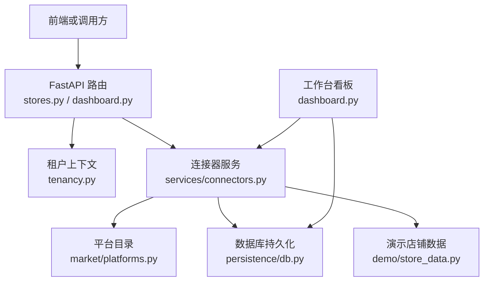
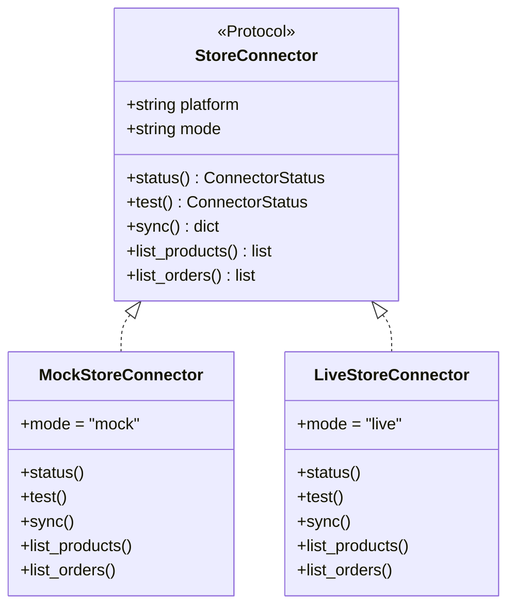
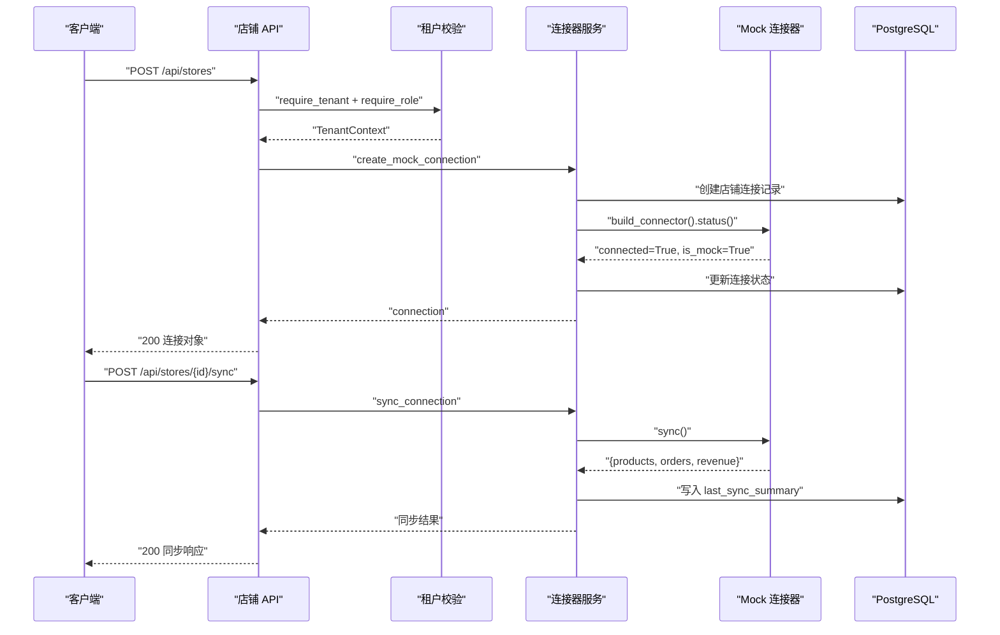
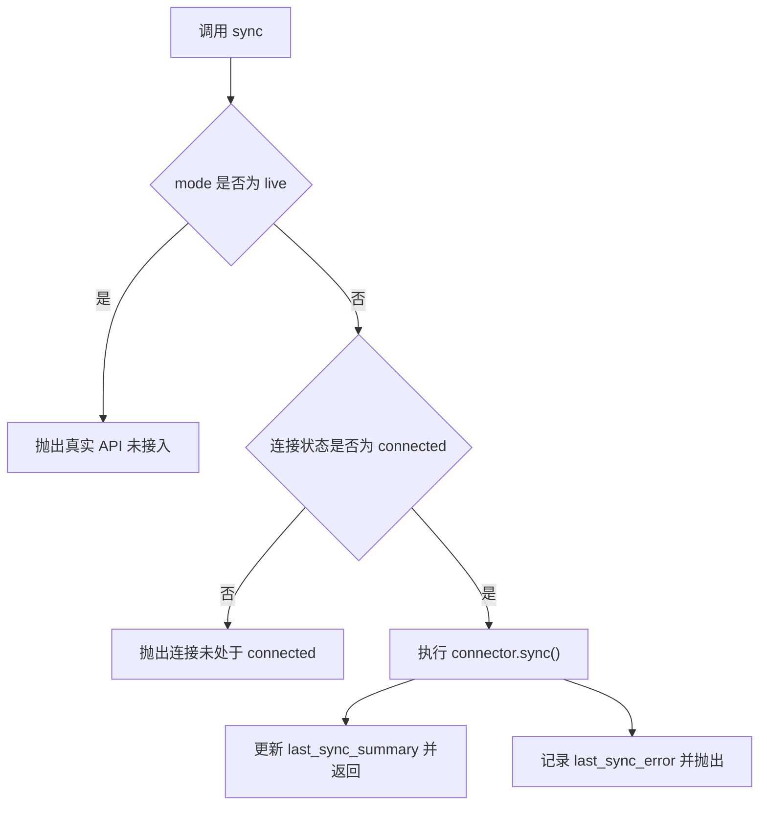
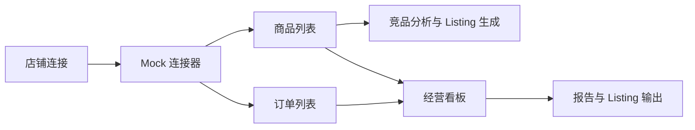

# 店铺管理 API

<cite>
**本文引用的文件**   
- [backend/surge/api/stores.py](file://backend/surge/api/stores.py)
- [backend/surge/services/connectors.py](file://backend/surge/services/connectors.py)
- [backend/surge/market/platforms.py](file://backend/surge/market/platforms.py)
- [backend/surge/models.py](file://backend/surge/models.py)
- [backend/surge/tenancy.py](file://backend/surge/tenancy.py)
- [backend/surge/persistence/db.py](file://backend/surge/persistence/db.py)
- [backend/surge/api/dashboard.py](file://backend/surge/api/dashboard.py)
- [backend/surge/demo/store_data.py](file://backend/surge/demo/store_data.py)
</cite>

## 目录
1. [引言](#引言)
2. [项目结构与职责边界](#项目结构与职责边界)
3. [核心组件与数据模型](#核心组件与数据模型)
4. [架构总览](#架构总览)
5. [API 参考：店铺连接、平台能力、商品、订单、看板](#api-参考店铺连接平台能力商品订单看板)
6. [平台连接器协议与当前限制](#平台连接器协议与当前限制)
7. [本地持久化、租户隔离与后续分析链路](#本地持久化租户隔离与后续分析链路)
8. [性能与错误处理](#性能与错误处理)
9. [故障排查与替代方案](#故障排查与替代方案)
10. [结论](#结论)

## 引言
本参考文档面向 Surge 的“店铺管理”能力，覆盖以下范围：
- 通过 `/api/stores` 系列端点添加、查看、测试、同步、断开店铺连接。
- 查看支持的平台清单与能力标签。
- 获取店铺的商品列表和订单列表。
- 从工作台看板读取经营相关统计与数据来源状态。
- 理解 Amazon、eBay、Walmart、Shopee、MercadoLibre 等平台在系统中的声明式配置。
- 明确当前仅实现 Mock 连接器，真实平台 API（如 Amazon SP-API）尚未接入，所有示例数据都带 `is_mock=True`。
- 说明店铺数据如何进入本地 PostgreSQL、如何在租户间隔离，并作为后续竞品分析、Listing 生成与经营看板的输入来源。

## 项目结构与职责边界
Surge 的店铺管理涉及四层：
- **API 层**：暴露 REST 端点，负责参数校验、角色检查、审计日志与 HTTP 状态码。
- **服务层**：封装连接器的创建、测试、同步、商品与订单查询、凭据绑定等业务流程。
- **平台与连接器层**：平台目录描述各平台字段、站点、认证方式和能力；连接器统一 `status/test/sync/list_products/list_orders` 协议。
- **持久化与租户层**：PostgreSQL 存储连接、任务、报告、Listing 等数据；多租户上下文强制按 `tenant_id` 过滤。



**图表来源**
- [backend/surge/api/stores.py:1-210](file://backend/surge/api/stores.py#L1-L210)
- [backend/surge/api/dashboard.py:1-99](file://backend/surge/api/dashboard.py#L1-L99)
- [backend/surge/services/connectors.py:1-410](file://backend/surge/services/connectors.py#L1-L410)
- [backend/surge/market/platforms.py:1-356](file://backend/surge/market/platforms.py#L1-L356)
- [backend/surge/persistence/db.py:1-600](file://backend/surge/persistence/db.py#L1-L600)
- [backend/surge/demo/store_data.py:1-200](file://backend/surge/demo/store_data.py#L1-L200)

**章节来源**
- [backend/surge/api/stores.py:1-210](file://backend/surge/api/stores.py#L1-L210)
- [backend/surge/services/connectors.py:1-410](file://backend/surge/services/connectors.py#L1-L410)
- [backend/surge/market/platforms.py:1-356](file://backend/surge/market/platforms.py#L1-L356)
- [backend/surge/tenancy.py:1-131](file://backend/surge/tenancy.py#L1-L131)
- [backend/surge/persistence/db.py:1-600](file://backend/surge/persistence/db.py#L1-L600)

## 核心组件与数据模型
### 平台枚举与目标平台
`models.Platform` 定义了系统可识别的销售平台枚举值，包括：
- Amazon
- eBay
- Walmart
- Shopee
- MercadoLibre

该枚举不仅用于类型约束，还会出现在 Pydantic JSON Schema 中，成为接口文档与表单提示的来源。

**章节来源**
- [backend/surge/models.py:1-200](file://backend/surge/models.py#L1-L200)

### 平台规格与能力
`market/platforms.py` 用 `PlatformSpec` 集中描述平台元信息，包括：
- 平台 key、显示名称、区域、站点列表。
- 平台商品主键字段名，例如 Amazon 用 `asin`，Walmart 用 `sku`。
- 能力集合：商品、订单、广告、指标、费用。
- 认证方式：OAuth2、client_credentials、app_secret、自定义。
- 真实接入状态：全部为未配置。
- OAuth 授权端点、令牌端点与作用域（部分平台）。

当前重点平台的配置要点：
| 平台 | 商品主键字段 | 主要能力 | 认证方式 | 当前真实接入状态 |
|---|---|---|---|---|
| Amazon | asin | 商品、订单、广告、指标、费用 | OAuth2 | 未配置 |
| eBay | item_id | 商品、订单、广告、指标、费用 | OAuth2 | 未配置 |
| Walmart | sku | 商品、订单、指标 | client_credentials | 未配置 |
| Shopee | item_id | 商品、订单、广告、指标 | OAuth2 | 未配置 |
| MercadoLibre | mercadolibre 枚举存在，但平台目录中未定义完整 spec | 取决于未来新增 spec | 待补充 | 未配置 |

注意：MercadoLibre 在 `models.Platform` 中存在枚举值，但在 `platforms.py` 的 `PLATFORMS` 元数据列表中未出现完整 `PlatformSpec`。因此：
- 业务模型可以表达 MercadoLibre 平台。
- 平台能力清单可能为空或未知。
- 当前不应假设 MercadoLibre 已具备完整的商品、订单或指标能力。

**章节来源**
- [backend/surge/market/platforms.py:1-356](file://backend/surge/market/platforms.py#L1-L356)
- [backend/surge/models.py:1-200](file://backend/surge/models.py#L1-L200)

### 连接器协议
`StoreConnector` 是一个 Protocol，要求每个平台连接器实现统一方法：
- `status()`：连接状态、模式、作用域。
- `test()`：连接测试。
- `sync()`：同步商品与订单摘要。
- `list_products()`：返回商品列表。
- `list_orders()`：返回订单列表。

当前有两个实现：
- `MockStoreConnector`：确定性示例数据，始终标记 `is_mock=True`。
- `LiveStoreConnector`：占位实现，任何真实调用都会抛出“真实 API 未接入”的错误，不降级为 Mock。



**图表来源**
- [backend/surge/services/connectors.py:1-200](file://backend/surge/services/connectors.py#L1-L200)
- [backend/surge/services/connectors.py:201-410](file://backend/surge/services/connectors.py#L201-L410)

**章节来源**
- [backend/surge/services/connectors.py:1-410](file://backend/surge/services/connectors.py#L1-L410)

## 架构总览
店铺管理的端到端流程如下：



**图表来源**
- [backend/surge/api/stores.py:1-210](file://backend/surge/api/stores.py#L1-L210)
- [backend/surge/services/connectors.py:201-410](file://backend/surge/services/connectors.py#L201-L410)
- [backend/surge/persistence/db.py:1-600](file://backend/surge/persistence/db.py#L1-L600)

## API 参考：店铺连接、平台能力、商品、订单、看板

### 通用说明
- 所有店铺连接操作都需要有效用户与会话。
- 读取店铺需要 `ROLE_READ`（viewer 及以上）。
- 创建、同步、断开、保存凭据需要写权限；保存凭据还需要 `ROLE_MANAGE`（admin 及以上）。
- 所有租户操作依赖 `X-Tenant-Id` 或由系统解析默认租户，非成员访问会返回 403。
- Mock 数据一律带 `is_mock=True`，不可视为真实平台数据。

### 列出店铺与平台能力
- **端点**：`GET /api/stores`
- **权限**：读权限。
- **用途**：列出当前租户下的店铺连接，并返回平台能力元数据。
- **成功响应结构**：
  - `items`：店铺连接列表。
  - `capabilities.mock`：`true`。
  - `capabilities.live`：`false`。
  - `capabilities.note`：说明当前仅 Mock 连接器可用，真实 SP-API 未接入。
- **典型字段含义**：
  - `connection_id`：本地连接 ID。
  - `platform`：平台 key，例如 `amazon`。
  - `marketplace`：站点，例如 `US`。
  - `shop_name`：店铺名称。
  - `mode`：`mock`。
  - `status`：`connected`、`error`、`disconnected`。
  - `is_mock`：是否为 Mock 连接。
  - `is_demo`：是否为演示店铺。
  - `platform_label`：平台显示名。
  - `platform_known`：是否在平台目录中注册。
  - `capabilities`：平台能力列表，例如 `products`、`orders`、`ads`、`metrics`、`fees`。
  - `can_sync`：是否允许同步。

**请求示例**
```http
GET /api/stores
Authorization: Bearer <token>
X-Tenant-Id: <租户ID>
```

**响应示例**
```json
{
  "items": [
    {
      "connection_id": "a1b2c3d4...",
      "platform": "amazon",
      "marketplace": "US",
      "shop_name": "EcoSip Official Store",
      "mode": "mock",
      "status": "connected",
      "is_mock": true,
      "is_demo": true,
      "platform_label": "Amazon",
      "platform_known": true,
      "capabilities": ["products", "orders", "ads", "metrics", "fees"],
      "can_sync": true
    }
  ],
  "capabilities": {
    "mock": true,
    "live": false,
    "note": "仅 Mock 连接器可用；真实 SP-API 未接入，不会显示为已连接"
  }
}
```

**错误响应**
- 无连接时仍返回空列表，不表示错误。
- 若租户解析失败，返回 403。

**章节来源**
- [backend/surge/api/stores.py:1-60](file://backend/surge/api/stores.py#L1-L60)
- [backend/surge/services/connectors.py:201-260](file://backend/surge/services/connectors.py#L201-L260)
- [backend/surge/market/platforms.py:1-200](file://backend/surge/market/platforms.py#L1-L200)

### 添加店铺连接
- **端点**：`POST /api/stores`
- **权限**：写权限。
- **用途**：创建一个 Mock 店铺连接。
- **请求体字段**：
  - `platform`：平台 key，默认 `amazon`。
  - `marketplace`：站点，默认 `US`。
  - `shop_name`：店铺名称，必填。
  - `mode`：当前只能为 `mock`。
- **成功响应**：返回已创建的连接对象。
- **冲突响应**：相同平台、站点、店铺名重复时返回 409。
- **非法模式响应**：尝试创建 `live` 模式时返回 400。
- **租户权限错误**：返回 403。

**请求示例**
```http
POST /api/stores
Content-Type: application/json
Authorization: Bearer <token>
X-Tenant-Id: <租户ID>

{
  "platform": "ebay",
  "marketplace": "EBAY_US",
  "shop_name": "My eBay Shop",
  "mode": "mock"
}
```

**响应示例**
```json
{
  "connection_id": "e1f2g3h4...",
  "tenant_id": "<租户ID>",
  "platform": "ebay",
  "marketplace": "EBAY_US",
  "shop_name": "My eBay Shop",
  "mode": "mock",
  "status": "connected",
  "scopes": ["mock:read", "mock:sync"],
  "credential_ref": null,
  "last_sync_at": null,
  "last_sync_status": null,
  "last_sync_error": null,
  "last_sync_summary": {},
  "created_at": "2026-11-10T00:00:00+00:00",
  "is_mock": true,
  "is_demo": false,
  "platform_label": "eBay",
  "platform_known": true,
  "capabilities": ["products", "orders", "ads", "metrics", "fees"],
  "can_sync": true
}
```

**章节来源**
- [backend/surge/api/stores.py:60-100](file://backend/surge/api/stores.py#L60-L100)
- [backend/surge/services/connectors.py:260-330](file://backend/surge/services/connectors.py#L260-L330)

### 查看单个店铺
- **端点**：`GET /api/stores/{connection_id}`
- **权限**：读权限。
- **成功响应**：单个连接对象，包含装饰后的平台信息与能力。
- **不存在**：返回 404。

**请求示例**
```http
GET /api/stores/a1b2c3d4...
Authorization: Bearer <token>
X-Tenant-Id: <租户ID>
```

**响应示例**
```json
{
  "connection_id": "a1b2c3d4...",
  "platform": "walmart",
  "marketplace": "US",
  "shop_name": "Walmart Demo Store",
  "mode": "mock",
  "status": "connected",
  "is_mock": true,
  "platform_label": "Walmart Marketplace",
  "capabilities": ["products", "orders", "metrics"],
  "can_sync": true
}
```

**章节来源**
- [backend/surge/api/stores.py:100-120](file://backend/surge/api/stores.py#L100-L120)
- [backend/surge/services/connectors.py:230-260](file://backend/surge/services/connectors.py#L230-L260)

### 测试连接
- **端点**：`POST /api/stores/{connection_id}/test`
- **用途**：调用连接器的 `test()`，并更新连接状态。
- **成功响应**：
  - `connection_id`
  - `connected`
  - `mode`
  - `detail`
  - `scopes`
- **不存在**：返回 404。

**请求示例**
```http
POST /api/stores/a1b2c3d4.../test
Authorization: Bearer <token>
X-Tenant-Id: <租户ID>
```

**响应示例**
```json
{
  "connection_id": "a1b2c3d4...",
  "connected": true,
  "mode": "mock",
  "detail": "Mock 连接器：本地确定性示例数据，不代表真实店铺",
  "scopes": ["mock:read", "mock:sync"]
}
```

**章节来源**
- [backend/surge/api/stores.py:120-140](file://backend/surge/api/stores.py#L120-L140)
- [backend/surge/services/connectors.py:330-360](file://backend/surge/services/connectors.py#L330-L360)

### 同步商品与订单
- **端点**：`POST /api/stores/{connection_id}/sync`
- **权限**：写权限。
- **用途**：执行连接器的 `sync()`，并把汇总写入连接的 `last_sync_summary`。
- **成功响应关键字段**：
  - `connection_id`
  - `mode`：`mock`
  - `is_mock`：`true`
  - `is_demo`：是否为演示店铺
  - `products`：商品数量
  - `orders`：订单数量
  - `revenue`：订单金额合计
  - `detail`：同步说明
- **限制**：
  - 不支持 `live` 模式同步。
  - 连接状态不是 `connected` 时会报错。
  - 真实平台同步目前会抛出连接器错误。

**请求示例**
```http
POST /api/stores/a1b2c3d4.../sync
Authorization: Bearer <token>
X-Tenant-Id: <租户ID>
```

**响应示例**
```json
{
  "connection_id": "a1b2c3d4...",
  "mode": "mock",
  "is_mock": true,
  "is_demo": false,
  "products": 6,
  "orders": 8,
  "revenue": 345.67,
  "detail": "Mock 同步完成；数据为示例，不可用于真实经营决策"
}
```

**章节来源**
- [backend/surge/api/stores.py:140-170](file://backend/surge/api/stores.py#L140-L170)
- [backend/surge/services/connectors.py:360-410](file://backend/surge/services/connectors.py#L360-L410)
- [backend/surge/services/connectors.py:1-200](file://backend/surge/services/connectors.py#L1-L200)

### 查询商品列表
- **端点**：`GET /api/stores/{connection_id}/products`
- **权限**：读权限。
- **成功响应**：
  - `items`：商品列表。
  - `is_mock`：`true`。
- **商品字段示例**：
  - `product_id`
  - `asin` 或其他平台主键
  - `name`
  - `price`
  - `currency`
  - `rating`
  - `review_count`
  - `marketplace`
  - `is_mock`
  - `source`

**请求示例**
```http
GET /api/stores/a1b2c3d4.../products
Authorization: Bearer <token>
X-Tenant-Id: <租户ID>
```

**响应示例**
```json
{
  "items": [
    {
      "product_id": "mock-amazon-001",
      "asin": "MOCK0000001",
      "name": "Mock Amazon Product 1",
      "price": 29.99,
      "currency": "USD",
      "rating": 4.3,
      "review_count": 1200,
      "marketplace": "US",
      "is_mock": true,
      "source": "mock_connector"
    }
  ],
  "is_mock": true
}
```

**章节来源**
- [backend/surge/api/stores.py:170-190](file://backend/surge/api/stores.py#L170-L190)
- [backend/surge/services/connectors.py:1-200](file://backend/surge/services/connectors.py#L1-L200)

### 查询订单列表
- **端点**：`GET /api/stores/{connection_id}/orders`
- **权限**：读权限。
- **成功响应**：
  - `items`：订单列表。
  - `is_mock`：`true`。
- **订单字段示例**：
  - `order_id`
  - `sku`
  - `quantity`
  - `amount`
  - `currency`
  - `status`
  - `created_at`
  - `is_mock`
  - `source`

**请求示例**
```http
GET /api/stores/a1b2c3d4.../orders
Authorization: Bearer <token>
X-Tenant-Id: <租户ID>
```

**响应示例**
```json
{
  "items": [
    {
      "order_id": "MOCK-ORDER-0001",
      "sku": "mock-amazon-001",
      "quantity": 2,
      "amount": 59.98,
      "currency": "USD",
      "status": "delivered",
      "created_at": "2026-11-05T00:00:00+00:00",
      "is_mock": true,
      "source": "mock_connector"
    }
  ],
  "is_mock": true
}
```

**章节来源**
- [backend/surge/api/stores.py:190-205](file://backend/surge/api/stores.py#L190-L205)
- [backend/surge/services/connectors.py:1-200](file://backend/surge/services/connectors.py#L1-L200)

### 断开店铺连接
- **端点**：`DELETE /api/stores/{connection_id}`
- **权限**：写权限。
- **用途**：将连接状态更新为 `disconnected`。
- **成功响应**：更新后的连接对象。
- **不存在**：返回 404。

**请求示例**
```http
DELETE /api/stores/a1b2c3d4...
Authorization: Bearer <token>
X-Tenant-Id: <租户ID>
```

**响应示例**
```json
{
  "connection_id": "a1b2c3d4...",
  "status": "disconnected",
  "is_mock": true,
  "platform_label": "Amazon",
  "capabilities": ["products", "orders", "ads", "metrics", "fees"]
}
```

**章节来源**
- [backend/surge/api/stores.py:205-210](file://backend/surge/api/stores.py#L205-L210)
- [backend/surge/services/connectors.py:400-410](file://backend/surge/services/connectors.py#L400-L410)

### 保存店铺凭据
- **端点**：`POST /api/stores/{connection_id}/credential`
- **权限**：管理权限。
- **用途**：加密保存凭据，只存引用，不在 API 响应中返回明文。
- **请求体字段**：
  - `secret`：凭据字符串。
- **成功响应**：
  - `credential_ref`：密文引用。
  - `masked`：掩码后的凭据片段。
  - `note`：说明明文不回传。
- **缺少凭据**：返回 422。
- **连接不存在**：返回 404。

**请求示例**
```http
POST /api/stores/a1b2c3d4.../credential
Content-Type: application/json
Authorization: Bearer <token>
X-Tenant-Id: <租户ID>

{
  "secret": "应用密钥或访问令牌"
}
```

**响应示例**
```json
{
  "credential_ref": "ref_a1b2c3d4...",
  "masked": "***",
  "note": "凭据已加密保存；接口不会返回明文"
}
```

**章节来源**
- [backend/surge/api/stores.py:205-210](file://backend/surge/api/stores.py#L205-L210)
- [backend/surge/services/connectors.py:400-410](file://backend/surge/services/connectors.py#L400-L410)

### 查看平台能力
- **端点**：平台能力由两个入口体现：
  - `/api/stores` 返回当前租户的连接及 `capabilities`。
  - 平台目录提供 `list_platforms()`，供前端新建店铺下拉使用。
- **用途**：展示支持的 Amazon、eBay、Walmart、Shopee、Temu、TikTok Shop、AliExpress、Shopify、自定义平台等。
- **重要限制**：
  - 所有平台的 `live_status` 均为未配置。
  - 没有 `ads` 能力的平台不应暴露广告入口。
  - 没有 `metrics` 能力的平台不应暴露经营指标入口。
  - MercadoLibre 在枚举中存在，但当前平台目录未定义完整 spec，因此不能直接认为它具备商品、订单、指标能力。

**请求示例**
```http
GET /api/stores
Authorization: Bearer <token>
X-Tenant-Id: <租户ID>
```

**响应示例中的能力片段**
```json
{
  "capabilities": ["products", "orders", "ads", "metrics", "fees"]
}
```

**章节来源**
- [backend/surge/market/platforms.py:1-356](file://backend/surge/market/platforms.py#L1-L356)
- [backend/surge/api/stores.py:1-60](file://backend/surge/api/stores.py#L1-L60)

### 经营看板与数据来源状态
- **端点**：`GET /api/dashboard`
- **权限**：需要用户与会话，并解析租户。
- **用途**：返回任务统计、近期任务、报告、Listing、14 天任务趋势、数据源状态。
- **关键字段**：
  - `stats.running`：运行中和排队任务数。
  - `stats.awaiting_approval`：等待审批任务数。
  - `stats.succeeded`：成功任务数。
  - `stats.failed`：失败任务数。
  - `stats.total`：任务总数。
  - `stats.reports`：报告数量。
  - `stats.listings`：Listing 数量。
  - `stats.stores`：店铺数量。
  - `stats.approvals`：审批数量。
  - `recent_tasks`：近期任务。
  - `recent_reports`：近期报告。
  - `recent_listings`：近期 Listing。
  - `daily_tasks`：14 天每日任务数。
  - `data_sources`：根据店铺连接生成的数据来源描述。

**请求示例**
```http
GET /api/dashboard
Authorization: Bearer <token>
X-Tenant-Id: <租户ID>
```

**响应示例**
```json
{
  "stats": {
    "running": 1,
    "awaiting_approval": 0,
    "succeeded": 5,
    "failed": 1,
    "total": 7,
    "reports": 2,
    "listings": 3,
    "stores": 1,
    "approvals": 0
  },
  "recent_tasks": [],
  "recent_reports": [],
  "recent_listings": [],
  "daily_tasks": [],
  "data_sources": []
}
```

**章节来源**
- [backend/surge/api/dashboard.py:1-99](file://backend/surge/api/dashboard.py#L1-L99)

## 平台连接器协议与当前限制

### 统一连接器协议
所有平台连接器必须实现 `StoreConnector` 协议：
- `status()`：返回平台、模式、是否连接、说明与作用域。
- `test()`：用于连接可用性测试。
- `sync()`：返回商品数量、订单数量、收入等摘要。
- `list_products()`：返回标准化商品列表。
- `list_orders()`：返回标准化订单列表。

这个协议是未来接入真实 SP-API 的关键扩展点：阶段 G 的真实实现只需实现同一协议，不需要修改现有 API 路由。

**章节来源**
- [backend/surge/services/connectors.py:1-200](file://backend/surge/services/connectors.py#L1-L200)

### 当前平台连接器边界
- **只有 Mock 连接器可用**。
- Mock 数据使用固定种子生成，同一连接每次同步得到确定性数据。
- 所有 Mock 商品和订单都带 `is_mock=True`。
- `LiveStoreConnector` 是占位实现，任何 `sync`、`list_products`、`list_orders` 都会抛出“真实 API 未接入”。
- 创建连接时，如果传入 `mode=live`，会拒绝而不是静默降级。
- 同步前要求连接状态为 `connected`。
- 同步失败会更新 `last_sync_status` 和 `last_sync_error`。



**图表来源**
- [backend/surge/services/connectors.py:330-410](file://backend/surge/services/connectors.py#L330-L410)

**章节来源**
- [backend/surge/services/connectors.py:1-410](file://backend/surge/services/connectors.py#L1-L410)

### 各平台连接器现状
| 平台 | 当前行为 | 建议替代方案 |
|---|---|---|
| Amazon | 平台 spec 已定义，SP-API 未接入 | 使用 Mock 连接演示流程；正式接入需完成开发者应用注册、卖家授权与审核 |
| eBay | 平台 spec 已定义，OAuth 端点已预留 | 使用 Mock 连接；真实接入需实现 token 交换与商品、订单映射 |
| Walmart | 平台 spec 已定义，client_credentials 未接入 | 使用 Mock 连接；真实接入需服务端换 token，无需用户跳转授权 |
| Shopee | 平台 spec 已定义，OAuth 端点已预留 | 使用 Mock 连接；真实接入需实现授权与 token 刷新 |
| MercadoLibre | 枚举存在，但未在平台目录定义完整 spec | 暂不建议用于真实业务；如需接入应先在 `platforms.py` 补充 spec，再实现连接器 |

**章节来源**
- [backend/surge/market/platforms.py:1-356](file://backend/surge/market/platforms.py#L1-L356)
- [backend/surge/models.py:1-200](file://backend/surge/models.py#L1-L200)
- [backend/surge/services/connectors.py:1-410](file://backend/surge/services/connectors.py#L1-L410)

## 本地持久化、租户隔离与后续分析链路

### 本地持久化
店铺连接数据最终落在 PostgreSQL 中。持久化层使用 psycopg 连接池，并提供统一的 `Database` 抽象。店铺相关数据通常通过 `store_connections`、`store_credentials` 等表结构保存；具体建表语句位于持久化层的 schema 与迁移逻辑中。

关键特性：
- 所有主键为字符串。
- JSON 内容整体存为 TEXT，便于审计与迁移。
- 连接池复用减少远端数据库建连成本。
- 首次启动自动执行迁移与版本化升级。

**章节来源**
- [backend/surge/persistence/db.py:1-600](file://backend/surge/persistence/db.py#L1-L600)

### 租户隔离
多租户的核心规则：
- 租户 ID 只能来自已认证用户的成员关系。
- 客户端可传 `X-Tenant-Id`，但必须校验用户属于该租户，否则返回 403。
- 未传时使用用户最早加入的租户。
- 所有业务查询都必须带上 `tenant_id`。
- 角色体系包括 viewer、editor、admin、owner。

店铺连接创建、同步、断开等操作都依赖 `TenantContext` 和 `require_role`。

**章节来源**
- [backend/surge/tenancy.py:1-131](file://backend/surge/tenancy.py#L1-L131)
- [backend/surge/api/stores.py:1-210](file://backend/surge/api/stores.py#L1-L210)

### 店铺数据在分析与 Listing 生成中的作用
店铺数据是 Surge 后续分析的重要输入来源：
- 商品数据可用于竞品分析、Listing 质量评估和 Listing 文案生成。
- 订单数据可用于收入、销量、转化率等经营指标计算。
- 看板的数据来源状态基于店铺连接列表生成。
- 演示店铺数据带有品牌感，便于体验完整工作流，但仍标记为 mock/demo。



**图表来源**
- [backend/surge/api/dashboard.py:1-99](file://backend/surge/api/dashboard.py#L1-L99)
- [backend/surge/demo/store_data.py:1-200](file://backend/surge/demo/store_data.py#L1-L200)
- [backend/surge/services/connectors.py:1-200](file://backend/surge/services/connectors.py#L1-L200)

**章节来源**
- [backend/surge/api/dashboard.py:1-99](file://backend/surge/api/dashboard.py#L1-L99)
- [backend/surge/demo/store_data.py:1-200](file://backend/surge/demo/store_data.py#L1-L200)

## 性能与错误处理

### 性能特征
- 看板聚合使用共享数据库连接，避免每次 SQL 单独建连。
- 数据库连接池按 DSN 复用，避免连接数打满。
- Mock 商品数量为 6，订单数量为 8，适合快速演示。
- 如果没有安装连接池依赖，会回退到每次新建连接，首屏会变慢。

**章节来源**
- [backend/surge/api/dashboard.py:1-99](file://backend/surge/api/dashboard.py#L1-L99)
- [backend/surge/persistence/db.py:1-600](file://backend/surge/persistence/db.py#L1-L600)

### 错误处理
- `StoreNotFound`：店铺连接不存在，API 转为 404。
- `StoreConflict`：重复店铺连接，API 转为 409。
- `ConnectorError`：连接器业务错误，API 转为 400。
- `TenantError`：租户权限错误，API 转为 403。
- 缺失凭据字符串：API 转为 422。
- 真实连接器尝试同步或拉取数据：抛出“真实 API 未接入”，不会伪造数据。

**章节来源**
- [backend/surge/api/stores.py:1-210](file://backend/surge/api/stores.py#L1-L210)
- [backend/surge/services/connectors.py:1-410](file://backend/surge/services/connectors.py#L1-L410)

## 故障排查与替代方案

### 常见问题
| 现象 | 可能原因 | 处理方式 |
|---|---|---|
| 创建店铺时报错无法创建 live 模式 | 当前仅支持 Mock | 改用 `mode=mock` |
| 同步时报真实 API 未接入 | 连接器为 `live` 或未接入真实平台 | 使用 Mock 连接或完成真实平台接入 |
| 同步时报连接未处于 connected | 连接未测试或状态异常 | 先调用测试连接 |
| 商品或订单列表为空 | 连接不存在、未同步或数据尚未加载 | 检查连接 ID 与同步结果 |
| 看板数据源为空 | 当前租户下没有店铺连接 | 先创建 Mock 店铺 |
| MercadoLibre 能力缺失 | 平台目录未定义完整 spec | 先补充 `platforms.py` 的 spec，再实现连接器 |

### 替代方案
- 开发期：继续使用 Mock 连接器验证 API、前端交互、看板聚合与审计流程。
- 集成期：优先接入一个平台（例如 Amazon 或 eBay），实现 `exchange_code`、token 存储、商品/订单字段映射。
- 生产期：严格区分 `is_mock` 与真实数据，禁止把 Mock 数据用于真实经营决策。

**章节来源**
- [backend/surge/services/connectors.py:1-410](file://backend/surge/services/connectors.py#L1-L410)
- [backend/surge/market/platforms.py:1-356](file://backend/surge/market/platforms.py#L1-L356)

## 结论
Surge 的店铺管理 API 在当前阶段提供了完整的 Mock 连接生命周期：创建、查看、测试、同步、查询商品与订单、断开、保存加密凭据。平台目录为 Amazon、eBay、Walmart、Shopee、MercadoLibre 等未来接入预留了规范位置，但真实平台 API 尚未接入，所有数据都明确标记为 Mock。

对使用者而言：
- 可以用 Mock 连接走通“店铺连接 → 同步 → 商品/订单 → 看板 → 分析 → Listing 生成”的全链路。
- 不要将 Mock 数据当作真实销售数据。
- 接入真实平台时，应遵循统一的 `StoreConnector` 协议，并在 `platforms.py` 中完善平台 spec 与能力声明。
- 所有数据都应遵守租户隔离与凭据加密策略，确保多租户安全与合规。