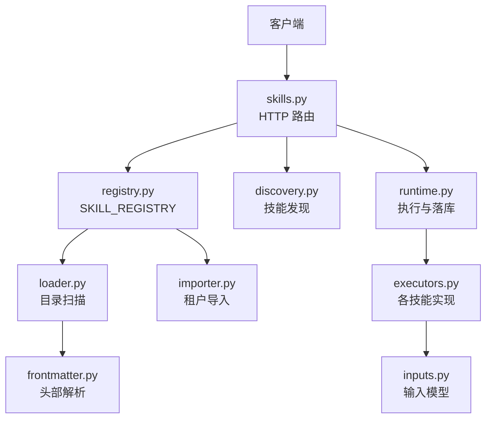
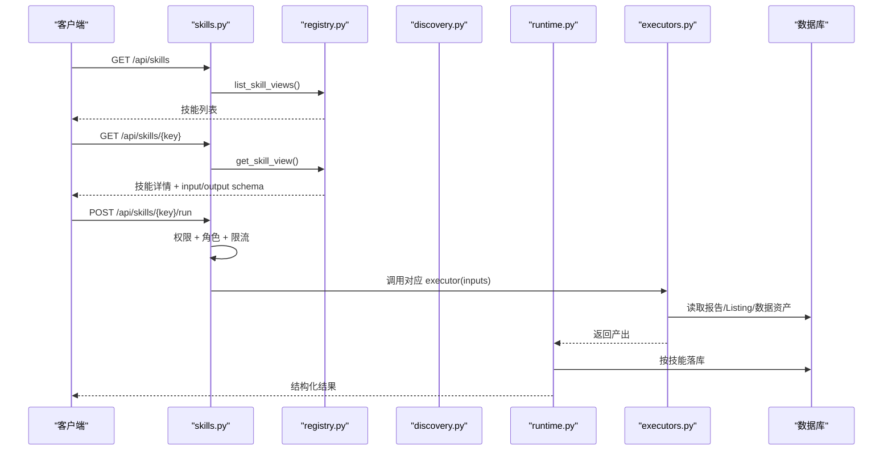
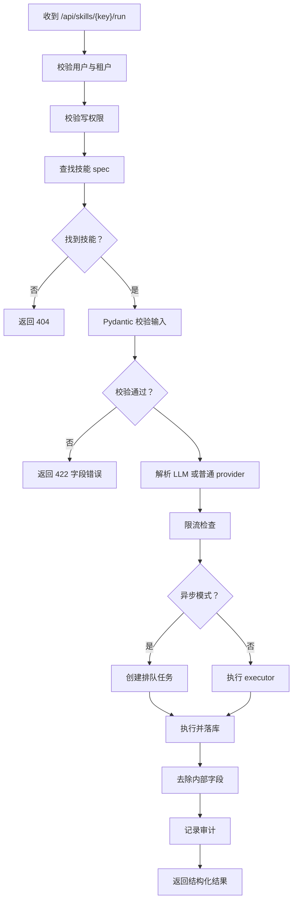
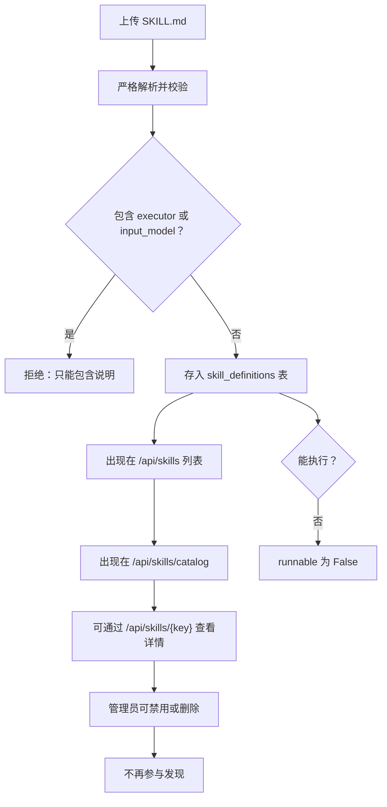

# 技能管理 API

<cite>
**本文引用的文件**   
- [backend/surge/api/skills.py](file://backend/surge/api/skills.py)
- [backend/surge/skills/loader.py](file://backend/surge/skills/loader.py)
- [backend/surge/skills/registry.py](file://backend/surge/skills/registry.py)
- [backend/surge/skills/executors.py](file://backend/surge/skills/executors.py)
- [backend/surge/skills/discovery.py](file://backend/surge/skills/discovery.py)
- [backend/surge/skills/frontmatter.py](file://backend/surge/skills/frontmatter.py)
- [backend/surge/skills/importer.py](file://backend/surge/skills/importer.py)
- [backend/surge/skills/inputs.py](file://backend/surge/skills/inputs.py)
- [backend/surge/skills/runtime.py](file://backend/surge/skills/runtime.py)
- [backend/surge/skills/catalog/competitor_analysis/output.schema.json](file://backend/surge/skills/catalog/competitor_analysis/output.schema.json)
- [backend/surge/skills/catalog/data_validation/output.schema.json](file://backend/surge/skills/catalog/data_validation/output.schema.json)
- [backend/surge/skills/catalog/listing_generation/output.schema.json](file://backend/surge/skills/catalog/listing_generation/output.schema.json)
- [backend/surge/skills/catalog/listing_quality/output.schema.json](file://backend/surge/skills/catalog/listing_quality/output.schema.json)
- [backend/surge/skills/catalog/market_summary/output.schema.json](file://backend/surge/skills/catalog/market_summary/output.schema.json)
- [backend/surge/skills/catalog/profit_calc/output.schema.json](file://backend/surge/skills/catalog/profit_calc/output.schema.json)
- [backend/surge/skills/catalog/review_mining/output.schema.json](file://backend/surge/skills/catalog/review_mining/output.schema.json)
</cite>

## 目录

1. [简介](#简介)
2. [项目结构](#项目结构)
3. [核心组件](#核心组件)
4. [架构总览](#架构总览)
5. [API 参考](#api-参考)
6. [内置技能说明](#内置技能说明)
7. [依赖与执行流程](#依赖与执行流程)
8. [自定义技能机制](#自定义技能机制)
9. [性能与错误处理](#性能与错误处理)
10. [故障排查](#故障排查)
11. [结论](#结论)

## 简介

Surge 的技能管理 API 提供统一的“能力协议”入口：前端和外部调用方不需要关心某个技能是用规则引擎、LLM 还是第三方数据实现的，只需要通过 `GET /api/skills` 浏览能力、通过 `GET /api/skills/{key}` 查看参数 schema，再统一走 `POST /api/skills/{skill_key}/run` 提交输入并获取结构化结果。

当前仓库实现了七个内置技能：

| 技能 key | 名称 | 主要用途 | 是否落库 |
|---|---|---|---|
| `competitor_analysis` | 竞品分析 | 根据自有商品和竞品明细生成价格、评论差异化等分析报告 | 是 |
| `review_mining` | 评论痛点挖掘 | 基于已有竞品报告中的评论样本归纳痛点、需求、担忧 | 否 |
| `market_summary` | 市场机会总结 | 从已有报告中提取卖点、局限性和要点 | 否 |
| `listing_generation` | Listing 生成 | 按商品事实、竞品报告、关键词生成标题、五点描述、描述和质量账本 | 是 |
| `listing_quality` | Listing 质检 | 对已有 Listing 草稿做事实对齐检查 | 否 |
| `data_validation` | 数据校验 | 校验上传的竞品数据文件，返回成功行、错误和预览 | 可选保存为批次 |
| `profit_calc` | 成本与利润测算 | 根据输入计算成本拆分、盈亏平衡、定价分层和敏感性分析 | 否 |

这些技能的发现、注册、输入校验、执行器和输出 schema 分别由 loader、registry、executors、runtime 与 inputs 模块协作完成。

## 项目结构

技能相关代码集中在后端 `surge` 应用中，采用“目录即技能”的设计：每个内置技能是一个目录，包含 SKILL.md 元数据和可选的 output.schema.json；运行时由 loader 扫描目录，registry 维护全局注册表，API 层暴露查询与执行端点。



**图表来源**
- [backend/surge/api/skills.py:1-457](file://backend/surge/api/skills.py#L1-L457)
- [backend/surge/skills/loader.py:1-165](file://backend/surge/skills/loader.py#L1-L165)
- [backend/surge/skills/registry.py:1-159](file://backend/surge/skills/registry.py#L1-L159)
- [backend/surge/skills/executors.py:1-205](file://backend/surge/skills/executors.py#L1-L205)
- [backend/surge/skills/discovery.py:1-304](file://backend/surge/skills/discovery.py#L1-L304)
- [backend/surge/skills/frontmatter.py:1-136](file://backend/surge/skills/frontmatter.py#L1-L136)
- [backend/surge/skills/importer.py:1-116](file://backend/surge/skills/importer.py#L1-L116)
- [backend/surge/skills/inputs.py:1-203](file://backend/surge/skills/inputs.py#L1-L203)
- [backend/surge/skills/runtime.py:1-146](file://backend/surge/skills/runtime.py#L1-L146)

**章节来源**
- [backend/surge/api/skills.py:1-457](file://backend/surge/api/skills.py#L1-L457)
- [backend/surge/skills/loader.py:1-165](file://backend/surge/skills/loader.py#L1-L165)
- [backend/surge/skills/registry.py:1-159](file://backend/surge/skills/registry.py#L1-L159)

## 核心组件

### 技能目录加载器

loader.py 负责把 `catalog/<key>/SKILL.md` 转换成系统内部可执行的 `SkillSpec`。一个合法目录必须满足以下约定：

- 目录名等于技能的 key。
- SKILL.md 头部必须包含 `name`、`title`、`description`、`input_model`、`executor`。
- `input_model` 必须指向一个 Pydantic 模型类，用于输入校验和 schema 生成。
- `executor` 必须指向一个可调用的函数，作为技能的执行器。
- `output_schema` 可选，若存在则必须是目录下的 JSON 对象文件。
- `requires`、`keywords`、`uses_llm`、`credits`、`renderer`、`status`、`executor_type` 等字段用于能力声明。

loader 使用 frontmatter.py 解析受控子集 YAML：支持标量、布尔值、数字、行内列表和块列表，但不支持嵌套映射，避免把用户文本当成任意 Python 表达式执行。

**章节来源**
- [backend/surge/skills/loader.py:1-165](file://backend/surge/skills/loader.py#L1-L165)
- [backend/surge/skills/frontmatter.py:1-136](file://backend/surge/skills/frontmatter.py#L1-L136)

### 技能注册表

registry.py 在进程启动时调用 `load_builtin_catalog()` 构建 `SKILL_REGISTRY`，并把每个内置技能转换为对外视图：

- 内置技能具有完整的 input schema、output schema、renderer、requires、uses_llm、credits、status、executor_type。
- 自定义导入技能没有执行器，`runnable` 始终为 False。
- `list_skill_views` 先列出内置技能，再追加租户导入技能。
- `get_skill_view` 详情接口优先返回内置技能，否则查找租户导入定义；已下线或平台内置但不在目录中的技能不会暴露。

**章节来源**
- [backend/surge/skills/registry.py:1-159](file://backend/surge/skills/registry.py#L1-L159)

### 输入契约

inputs.py 定义了七个技能使用的 Pydantic 模型。这些模型有两个作用：

1. `POST /api/skills/{skill_key}/run` 用 `model_validate` 校验请求体。
2. `GET /api/skills` 通过 `model_json_schema()` 生成前端表单 schema。

因此字段上的 `title` 不仅是注释，而是前端标签文案；`json_schema_extra.x-ui` 是给界面控件的提示，例如隐藏字段、文件选择器、报告选择器等。

**章节来源**
- [backend/surge/skills/inputs.py:1-203](file://backend/surge/skills/inputs.py#L1-L203)

### 执行器

executors.py 的职责很克制：只做参数拼装、读取上下文资源、调用既有实现，然后返回 dict。具体算法不写在这里，以保持“同一输入产出逐字段一致”。

| 执行器 | 输入模型 | 行为 | 典型输出 |
|---|---|---|---|
| `competitor_analysis` | `CompetitorAnalysisInput` | 读取竞品明细或导入批次，调用竞品分析工具 | 分析报告 |
| `review_mining` | `ReviewMiningInput` | 从已有报告抽取评论并归纳主题 | 痛点、需求、担忧 |
| `market_summary` | `MarketSummaryInput` | 从已有报告生成市场总结 | 要点、局限性 |
| `listing_generation` | `ListingGenerationInput` | 根据商品事实和可选报告生成 Listing | 标题、卖点、描述、质量账本 |
| `listing_quality` | `ListingQualityInput` | 对 Listing 草稿做质检 | 通过状态、错误、警告 |
| `data_validation` | `DataValidationInput` | base64 解码、限大小、导入校验 | ok、错误、预览、批次 |
| `profit_calc` | 通用 dict | 调用利润引擎计算 | 成本拆分、盈亏平衡、定价分层 |

**章节来源**
- [backend/surge/skills/executors.py:1-205](file://backend/surge/skills/executors.py#L1-L205)

### 运行与落库

runtime.py 区分两种用法：

- `execute`：只执行，不落库。供旧 7 节点图内部使用。
- `execute_and_persist`：执行后按技能类型落库，返回 `(产出, 产物 id)`。

需要落库的技能通过 `ARTIFACT_SAVERS` 注册：

| 技能 | 落库目标 | 返回 id |
|---|---|---|
| `competitor_analysis` | 分析报告 | `report_id` |
| `listing_generation` | Listing 草稿 | `listing_id` |
| `data_validation` | 数据批次 | `batch_id` |

同时，runtime 会递归去掉产出中以 `_` 开头的内部字段（例如 data_validation 的 `_batch`），保证 API 响应不包含纯落库载荷。

**章节来源**
- [backend/surge/skills/runtime.py:1-146](file://backend/surge/skills/runtime.py#L1-L146)

## 架构总览

技能管理的整体调用链如下：



**图表来源**
- [backend/surge/api/skills.py:1-457](file://backend/surge/api/skills.py#L1-L457)
- [backend/surge/skills/registry.py:1-159](file://backend/surge/skills/registry.py#L1-L159)
- [backend/surge/skills/discovery.py:1-304](file://backend/surge/skills/discovery.py#L1-L304)
- [backend/surge/skills/runtime.py:1-146](file://backend/surge/skills/runtime.py#L1-L146)
- [backend/surge/skills/executors.py:1-205](file://backend/surge/skills/executors.py#L1-L205)

## API 参考

### 列出全部技能

- **方法**：`GET`
- **路径**：`/api/skills`
- **认证**：需要租户上下文。
- **返回**：`items` 数组，每项包含 `skill_key`、`name`、`summary`、`category`、`renderer`、`requires`、`uses_llm`、`credits`、`status`、`version`、`input_schema`、`output_schema`、`builtin`、`source`、`executor_type`、`runnable`。
- **用途**：前端渲染技能广场，不再硬编码清单。

示例响应结构：

```json
{
  "items": [
    {
      "skill_key": "competitor_analysis",
      "name": "竞品分析",
      "summary": "基于自有商品和竞品生成分析报告",
      "category": "分析",
      "renderer": "report",
      "requires": [],
      "uses_llm": true,
      "credits": 1,
      "status": "available",
      "version": "1.0.0",
      "input_schema": {},
      "output_schema": {},
      "builtin": true,
      "source": "builtin",
      "executor_type": "function",
      "runnable": true
    }
  ]
}
```

**章节来源**
- [backend/surge/api/skills.py:33-56](file://backend/surge/api/skills.py#L33-L56)
- [backend/surge/skills/registry.py:36-60](file://backend/surge/skills/registry.py#L36-L60)

### 列出轻量目录

- **方法**：`GET`
- **路径**：`/api/skills/catalog`
- **认证**：需要租户上下文。
- **返回**：`items` 数组，仅含 `skill_key`、`name`、`description`、`category`、`source`、`runnable`。
- **用途**：给 Agent 做轻量能力检索，不含参数与正文。

示例响应结构：

```json
{
  "items": [
    {
      "skill_key": "market_summary",
      "name": "市场机会总结",
      "description": "从竞品报告中提取市场要点",
      "category": "分析",
      "source": "builtin",
      "runnable": true
    }
  ]
}
```

**章节来源**
- [backend/surge/api/skills.py:58-73](file://backend/surge/api/skills.py#L58-L73)
- [backend/surge/skills/discovery.py:143-179](file://backend/surge/skills/discovery.py#L143-L179)

### 自然语言发现技能

- **方法**：`POST`
- **路径**：`/api/skills/discover`
- **认证**：需要用户和租户，且具备写权限。
- **请求体**：
  - `goal`：必填字符串。
  - `limit`：可选整数，默认 5，最大限制为内部逻辑保护。
  - `load_body`：可选布尔，决定是否加载选中技能的正文。
- **返回**：`goal`、`degraded`、`reason`、`items`。
- **行为**：优先让 LLM 从目录中选技能；模型不可用或返回异常时退回确定性关键词匹配，并标记 `degraded=true`。

示例请求：

```json
{
  "goal": "帮我根据已有的竞品报告生成一份 Listing 标题和五点描述",
  "limit": 3,
  "load_body": true
}
```

示例响应结构：

```json
{
  "goal": "帮我根据已有的竞品报告生成一份 Listing 标题和五点描述",
  "degraded": false,
  "reason": "",
  "items": [
    {
      "skill_key": "listing_generation",
      "name": "Listing 生成",
      "description": "根据商品事实与竞品报告生成 Listing",
      "category": "内容",
      "source": "builtin",
      "runnable": true,
      "matched": ["Listing"],
      "instructions": "当需要生成标题、卖点或描述时使用..."
    }
  ]
}
```

**章节来源**
- [backend/surge/api/skills.py:75-118](file://backend/surge/api/skills.py#L75-L118)
- [backend/surge/skills/discovery.py:1-304](file://backend/surge/skills/discovery.py#L1-L304)

### 获取技能详情与 schema

- **方法**：`GET`
- **路径**：`/api/skills/{skill_key}`
- **认证**：需要租户上下文。
- **返回**：单个技能视图；不存在时返回 404。
- **重点字段**：
  - `input_schema`：Pydantic 模型的 JSON Schema，可用于前端表单生成。
  - `output_schema`：技能产出的结构定义。
  - `runnable`：只有绑定执行器的内置技能为 True。
  - `instructions`：SKILL.md 正文。

示例响应结构：

```json
{
  "skill_key": "data_validation",
  "name": "数据校验",
  "summary": "校验上传的竞品数据文件",
  "category": "数据",
  "renderer": "report",
  "requires": [],
  "uses_llm": false,
  "credits": 1,
  "status": "available",
  "version": "1.0.0",
  "input_schema": {},
  "output_schema": {},
  "builtin": true,
  "source": "builtin",
  "executor_type": "function",
  "runnable": true,
  "instructions": "当需要批量校验竞品数据时使用..."
}
```

**章节来源**
- [backend/surge/api/skills.py:120-132](file://backend/surge/api/skills.py#L120-L132)
- [backend/surge/skills/registry.py:62-114](file://backend/surge/skills/registry.py#L62-L114)

### 执行技能

- **方法**：`POST`
- **路径**：`/api/skills/{skill_key}/run`
- **查询参数**：
  - `async_run`：可选布尔。默认为同步执行；为真且未强制同步任务时返回排队任务。
- **认证**：需要用户、租户和写权限。
- **处理顺序**：权限 → 技能是否存在 → 参数校验 → 依赖判断 → 限流 → 执行 → 落库 → 审计。
- **返回**：
  - 同步成功：`skill_key`、`task_id`、`status`、`renderer`、`is_demo`、`credits`、`elapsed_ms`、`result_ref`、`engine`、`output`。
  - 异步：`skill_key`、`task_id`、`status: queued`、`async: true`、`renderer`、`plan`、`engine`。

示例请求：

```json
{
  "product_name": "无线降噪耳机",
  "platform": "AMAZON",
  "marketplace": "US",
  "competitors": [
    {
      "asin": "B0EXAMPLE",
      "title": "竞品耳机",
      "price": 39.99,
      "rating": 4.3,
      "review_count": 12000
    }
  ],
  "own_specs": {"颜色": "黑色"},
  "own_key_features": ["主动降噪", "长续航"],
  "data_source": "manual",
  "locale": "zh-CN"
}
```

示例同步响应：

```json
{
  "skill_key": "competitor_analysis",
  "task_id": "abc123",
  "status": "succeeded",
  "renderer": "report",
  "is_demo": false,
  "credits": 1,
  "elapsed_ms": 3210,
  "result_ref": "report_abc123",
  "engine": "大模型服务",
  "output": {
    "product_name": "无线降噪耳机",
    "price_analysis": {},
    "review_insights": {},
    "differentiation_opportunities": [],
    "data_provenance": {}
  }
}
```

示例异步响应：

```json
{
  "skill_key": "competitor_analysis",
  "task_id": "abc123",
  "status": "queued",
  "async": true,
  "renderer": "report",
  "plan": ["竞品分析"],
  "engine": "大模型服务"
}
```

**章节来源**
- [backend/surge/api/skills.py:243-457](file://backend/surge/api/skills.py#L243-L457)
- [backend/surge/skills/runtime.py:108-146](file://backend/surge/skills/runtime.py#L108-L146)

### 导入自定义技能

- **方法**：`POST`
- **路径**：`/api/skills/import`
- **认证**：需要租户和管理员角色。
- **请求体**：`content`，一份 SKILL.md 文本。
- **约束**：
  - 不允许出现 `executor`、`input_model`、`output_schema`、`executor_type`。
  - 文件大小不超过 64 KB。
  - `name` 必须符合小写字母开头、仅含小写字母、数字、下划线的正则。
  - 必须有 `description` 和非空正文。
- **返回**：`ok` 和导入后的技能视图。
- **注意**：导入的技能只有说明，不能直接执行。

示例请求：

```json
{
  "content": "---\nname: my_custom_skill\ntitle: 我的自定义技能\ndescription: 用于展示自定义技能导入\n---\n这是使用说明。\n"
}
```

示例响应：

```json
{
  "ok": true,
  "skill": {
    "skill_key": "my_custom_skill",
    "tenant_id": "",
    "name": "我的自定义技能",
    "summary": "用于展示自定义技能导入",
    "category": "自定义",
    "renderer": "",
    "requires": [],
    "uses_llm": false,
    "credits": 0,
    "status": "available",
    "version": "1.0.0",
    "input_schema": {},
    "output_schema": {},
    "builtin": false,
    "source": "imported",
    "executor_type": null,
    "runnable": false
  }
}
```

**章节来源**
- [backend/surge/api/skills.py:134-200](file://backend/surge/api/skills.py#L134-L200)
- [backend/surge/skills/importer.py:1-116](file://backend/surge/skills/importer.py#L1-L116)

### 创建、更新、禁用租户自定义技能

| 方法 | 路径 | 用途 |
|---|---|---|
| `POST /api/skills` | 创建租户自定义技能 | 存储元数据和可选内容 |
| `PUT /api/skills/{skill_key}` | 更新租户自定义技能 | 修改元数据 |
| `DELETE /api/skills/{skill_key}` | 禁用租户自定义技能 | 软删除，不再出现在发现列表中 |

这些接口均要求管理员角色，并通过审计记录操作。

**章节来源**
- [backend/surge/api/skills.py:201-241](file://backend/surge/api/skills.py#L201-L241)

## 内置技能说明

### competitor_analysis：竞品分析

- **适用场景**：已有自有商品信息和竞品明细，希望获得价格分析、评论洞察、差异化机会和数据来源追踪。
- **输入字段**：
  - `product_name`：商品名称。
  - `platform`：电商平台枚举。
  - `marketplace`：站点。
  - `category`：类目。
  - `own_specs`：自有规格键值对。
  - `own_key_features`：自有卖点列表。
  - `own_price`：自有价格。
  - `competitors`：竞品列表；至少需要一个，或者改用 `import_batch_id`。
  - `import_batch_id`：已导入的数据批次，适合复用 `/api/import` 的结果。
  - `keywords`：关键词指标。
  - `data_source`：`manual`、`demo`、`import`。
  - `locale`：`zh-CN` 或 `en-US`。
- **输出结构**：
  - `product_name`
  - `price_analysis`
  - `review_insights`
  - `differentiation_opportunities`
  - `data_provenance`
- **执行器行为**：如果未传竞品明细但有 `import_batch_id`，会从数据资产中读取并构造竞品对象；失败时返回输入错误。
- **落库**：保存为分析报告，可通过 `report_id` 取回。

**章节来源**
- [backend/surge/skills/inputs.py:34-100](file://backend/surge/skills/inputs.py#L34-L100)
- [backend/surge/skills/executors.py:58-78](file://backend/surge/skills/executors.py#L58-L78)
- [backend/surge/skills/catalog/competitor_analysis/output.schema.json:1-10](file://backend/surge/skills/catalog/competitor_analysis/output.schema.json#L1-L10)
- [backend/surge/skills/runtime.py:100-106](file://backend/surge/skills/runtime.py#L100-L106)

### review_mining：评论痛点挖掘

- **适用场景**：已有竞品分析报告，其中包含评论样本，需要从评论中归纳痛点、需求和担忧。
- **输入字段**：
  - `report_id` 或 `report`：二选一，引用已有报告。
- **输出结构**：
  - `total_samples`
  - `pain_points`
  - `needs`
  - `concerns`
- **执行器行为**：先加载报告，再调用评论挖掘能力。

**章节来源**
- [backend/surge/skills/inputs.py:102-116](file://backend/surge/skills/inputs.py#L102-L116)
- [backend/surge/skills/executors.py:80-86](file://backend/surge/skills/executors.py#L80-L86)
- [backend/surge/skills/catalog/review_mining/output.schema.json:1-9](file://backend/surge/skills/catalog/review_mining/output.schema.json#L1-L9)

### market_summary：市场机会总结

- **适用场景**：已有竞品报告，需要快速提炼市场 headline、要点、演示标记和局限性。
- **输入字段**：
  - `report_id` 或 `report`：二选一。
- **输出结构**：
  - `headline`
  - `points`
  - `data_is_demo`
  - `limitations`
- **执行器行为**：复用报告，不做额外写入。

**章节来源**
- [backend/surge/skills/inputs.py:118-122](file://backend/surge/skills/inputs.py#L118-L122)
- [backend/surge/skills/executors.py:88-94](file://backend/surge/skills/executors.py#L88-L94)
- [backend/surge/skills/catalog/market_summary/output.schema.json:1-9](file://backend/surge/skills/catalog/market_summary/output.schema.json#L1-L9)

### listing_generation：Listing 生成

- **适用场景**：根据商品事实、可选竞品报告和关键词生成 Listing 标题、五点描述、详细描述和质量账本。
- **输入字段**：
  - `product`：自有商品信息。
  - `language`：`zh-CN` 或 `en-US`。
  - `marketplace`：站点。
  - `report_id` 或 `analysis_report`：二选一，关联竞品报告。
  - `keywords`：关键词指标。
  - `tone`：语气。
  - `banned_terms`：禁用词列表。
  - `target_length_hint`：`short`、`medium`、`long`。
  - `data_source`：`manual`、`demo`、`import`。
- **输出结构**：
  - `title`
  - `bullets`
  - `description`
  - `fact_ledger`
  - `quality_check`
- **执行器行为**：若无 report 但传了 `report_id`，会从数据库读取；生成后通过 listing service 序列化，附带商品事实快照。
- **落库**：保存为 Listing 草稿，可通过 `listing_id` 取回。
- **大输出策略**：该技能属于“重产出”，同步任务返回的 `output` 可能为空，完整数据应通过 `result_ref` 或 listings 接口获取。

**章节来源**
- [backend/surge/skills/inputs.py:124-170](file://backend/surge/skills/inputs.py#L124-L170)
- [backend/surge/skills/executors.py:96-114](file://backend/surge/skills/executors.py#L96-L114)
- [backend/surge/skills/catalog/listing_generation/output.schema.json:1-10](file://backend/surge/skills/catalog/listing_generation/output.schema.json#L1-L10)
- [backend/surge/skills/runtime.py:100-106](file://backend/surge/skills/runtime.py#L100-L106)
- [backend/surge/api/skills.py:27-31](file://backend/surge/api/skills.py#L27-L31)

### listing_quality：Listing 质检

- **适用场景**：对已有 Listing 草稿做事实对齐检查，返回通过状态、错误、警告和待确认项。
- **输入字段**：
  - `listing_id` 或 `listing`：二选一。
- **输出结构**：
  - `passed`
  - `errors`
  - `warnings`
  - `pending_confirmations`
- **执行器行为**：先加载 Listing 草稿，再调用质检工具。

**章节来源**
- [backend/surge/skills/inputs.py:124-144](file://backend/surge/skills/inputs.py#L124-L144)
- [backend/surge/skills/executors.py:116-120](file://backend/surge/skills/executors.py#L116-L120)
- [backend/surge/skills/catalog/listing_quality/output.schema.json:1-9](file://backend/surge/skills/catalog/listing_quality/output.schema.json#L1-L9)

### data_validation：数据校验

- **适用场景**：一次性校验一份竞品数据文件，适合在正式导入前验证格式、类型和行级错误。
- **输入字段**：
  - `filename`：文件名。
  - `content_base64`：base64 编码的文件内容。
  - `allow_partial_rows`：允许部分行出错。
- **输出结构**：
  - `ok`
  - `source_format`
  - `source_name`
  - `total_rows`
  - `valid_rows`
  - `error_count`
  - `errors`：最多返回 50 条人类可读错误。
  - `warnings`
  - `preview`：最多返回 5 条解析成功的竞品预览。
  - `_batch`：内部字段，会被 runtime 剥离，但可用于保存批次。
- **执行器行为**：
  - 校验 base64 解码。
  - 按设置上限检查原始字节大小。
  - 调用导入器进行行级校验。
  - 若底层抛出导入验证错误，视为参数错误。
- **落库**：可选择保存为数据批次，后续 `competitor_analysis` 可通过 `import_batch_id` 复用。

**章节来源**
- [backend/surge/skills/inputs.py:172-184](file://backend/surge/skills/inputs.py#L172-L184)
- [backend/surge/skills/executors.py:122-158](file://backend/surge/skills/executors.py#L122-L158)
- [backend/surge/skills/catalog/data_validation/output.schema.json:1-9](file://backend/surge/skills/catalog/data_validation/output.schema.json#L1-L9)
- [backend/surge/skills/runtime.py:64-98](file://backend/surge/skills/runtime.py#L64-L98)

### profit_calc：成本与利润测算

- **适用场景**：纯计算型能力，根据输入计算成本拆分、盈亏平衡点、定价分层和敏感性分析。
- **输入字段**：通用 dict，具体字段由利润引擎消费。
- **输出结构**：
  - `cost_breakdown`
  - `break_even`
  - `pricing_tiers`
  - `sensitivity`
- **执行器行为**：延迟导入利润引擎，避免循环依赖。
- **落库**：无专用落库器，结果仅存在于响应中。

**章节来源**
- [backend/surge/skills/executors.py:160-168](file://backend/surge/skills/executors.py#L160-L168)
- [backend/surge/skills/catalog/profit_calc/output.schema.json:1-9](file://backend/surge/skills/catalog/profit_calc/output.schema.json#L1-L9)

## 依赖与执行流程

### 执行流程图



**图表来源**
- [backend/surge/api/skills.py:243-457](file://backend/surge/api/skills.py#L243-L457)
- [backend/surge/skills/runtime.py:108-146](file://backend/surge/skills/runtime.py#L108-L146)

### 关键设计决策

1. **参数校验优先于依赖判定**：这样用户看到的具体字段错误比“缺少 Key”更早出现。
2. **大输出不塞入任务列表**：`competitor_analysis` 和 `listing_generation` 的同步响应中 `output` 可能为空，完整数据通过 `result_ref` 或对应业务接口获取。
3. **内部字段隔离**：以 `_` 开头的键不参与 API 输出，但可用于落库。
4. **demo 数据标记**：runtime 递归检测 `is_demo`、`data_is_demo`、`data_provenance.is_demo`，以便前端提示数据来源。
5. **执行器职责单一**：executors 只做拼装和调用，不写复杂算法，保证 UI 页面、工作流图和 API 调用的一致性。

**章节来源**
- [backend/surge/api/skills.py:27-31](file://backend/surge/api/skills.py#L27-L31)
- [backend/surge/api/skills.py:243-457](file://backend/surge/api/skills.py#L243-L457)
- [backend/surge/skills/runtime.py:1-146](file://backend/surge/skills/runtime.py#L1-L146)
- [backend/surge/skills/executors.py:1-20](file://backend/surge/skills/executors.py#L1-L20)

## 自定义技能机制

自定义技能通过 `POST /api/skills/import` 导入，其生命周期如下：



**图表来源**
- [backend/surge/api/skills.py:134-200](file://backend/surge/api/skills.py#L134-L200)
- [backend/surge/skills/importer.py:1-116](file://backend/surge/skills/importer.py#L1-L116)
- [backend/surge/skills/discovery.py:143-179](file://backend/surge/skills/discovery.py#L143-L179)
- [backend/surge/skills/registry.py:86-114](file://backend/surge/skills/registry.py#L86-L114)

### 内置技能与自定义技能的区别

| 维度 | 内置技能 | 自定义技能 |
|---|---|---|
| 来源 | `catalog/<key>/SKILL.md` | `POST /api/skills/import` |
| 是否有执行器 | 有 | 无 |
| 是否能直接执行 | 可以 | 不可以 |
| `runnable` | 通常为 True | 始终为 False |
| `source` | `builtin` | `imported` 或 `custom` |
| 是否可被 Agent 发现 | 是 | 是 |
| 是否可被删除/禁用 | 通过目录变更控制 | 通过 API 管理 |

### 安全边界

- 内置目录加载器可以使用 `module:attribute` 动态导入 Python 属性和函数，因为 SKILL.md 由平台维护。
- 租户导入 SKILL.md **绝不**参与 Python 导入；`executor`、`input_model`、`output_schema`、`executor_type` 等危险字段被明确拒绝。
- 导入内容上限为 64 KB，防止超大文档拖慢列表和发现流程。

**章节来源**
- [backend/surge/skills/loader.py:1-165](file://backend/surge/skills/loader.py#L1-L165)
- [backend/surge/skills/importer.py:1-116](file://backend/surge/skills/importer.py#L1-L116)

## 性能与错误处理

### 性能特征

- 目录扫描只在进程启动时执行一次，开发期可通过 `reload()` 原地更新注册表。
- catalog 接口只返回轻量信息，避免加载 SKILL.md 全文。
- 大输出技能在任务响应中省略完整 `output`，减少轮询负载。
- data_validation 对原始 base64 内容做大小限制，默认上限与系统上传配置一致。
- profit_calc 延迟导入利润引擎，避免启动期循环依赖。

### 错误分类

| 场景 | HTTP 状态 | 语义 |
|---|---:|---|
| 技能不存在 | 404 | 传入的 `skill_key` 不在注册表中 |
| 参数校验失败 | 422 | Pydantic 字段错误，包含字段级消息 |
| 缺少必需资源 | 422 | 例如未传竞品、未传报告、未传 Listing |
| 文件过大 | 422 | payload 超过限制 |
| 模型服务不可用 | 503 | LLM provider 报错 |
| 其他执行期异常 | 502 | 统一包装为“这次运行没有完成，可以重试一次” |

**章节来源**
- [backend/surge/api/skills.py:243-457](file://backend/surge/api/skills.py#L243-L457)
- [backend/surge/skills/executors.py:122-158](file://backend/surge/skills/executors.py#L122-L158)
- [backend/surge/skills/loader.py:1-165](file://backend/surge/skills/loader.py#L1-L165)
- [backend/surge/skills/runtime.py:1-146](file://backend/surge/skills/runtime.py#L1-L146)

## 故障排查

### 常见问题

1. **404 技能不存在**  
   检查 `skill_key` 是否与目录名一致，或通过 `GET /api/skills` 确认技能是否在注册表中。

2. **422 字段错误**  
   使用 `GET /api/skills/{key}` 获取 `input_schema`，对照 Pydantic 字段类型、枚举值和必填约束。

3. **数据校验报“文件读不出来”**  
   检查 `content_base64` 是否为有效 base64；检查 `filename` 是否符合长度限制。

4. **数据校验报“无法识别的行”**  
   这是数据格式问题，不是文件完全不可读；调整源文件格式后重试，或开启 `allow_partial_rows` 保留部分成功行。

5. **异步任务返回 queued 但没有立即结果**  
   这是预期行为；应通过任务队列轮询任务状态，而不是重复提交。

6. **自定义技能无法执行**  
   导入技能没有执行器，`runnable` 为 False。若要让 Agent 理解它，可在 SKILL.md 正文中说明用途；若要真正执行，需要在后端添加对应的内置技能或扩展执行框架。

7. **自定义技能不出现在 catalog**  
   检查是否被禁用，或导入时缺少 `description` 和正文。

**章节来源**
- [backend/surge/api/skills.py:120-200](file://backend/surge/api/skills.py#L120-L200)
- [backend/surge/api/skills.py:243-457](file://backend/surge/api/skills.py#L243-L457)
- [backend/surge/skills/importer.py:1-116](file://backend/surge/skills/importer.py#L1-L116)

## 结论

Surge 的技能管理 API 把“有哪些能力”“要什么输入”“怎么执行”“产出是什么”四个问题拆成清晰层次：

- 目录浏览和轻量 catalog 解决“有什么能力”。
- `GET /api/skills/{key}` 提供 input/output schema，解决“怎么调用”。
- `POST /api/skills/{skill_key}/run` 收敛所有执行路径，解决“怎么跑”。
- 内置技能通过目录自动发现，自定义技能通过导入只暴露说明，既扩展又安全。

对于开发者而言，新增内置技能的标准路径是：新增 catalog 目录、编写 SKILL.md、定义输入 Pydantic 模型、实现 executor、编写 output.schema.json，无需改动主路由逻辑。对于调用方而言，只需遵循 schema、提交结构化输入，并消费带 `report_id`、`listing_id` 或 `batch_id` 的统一响应。