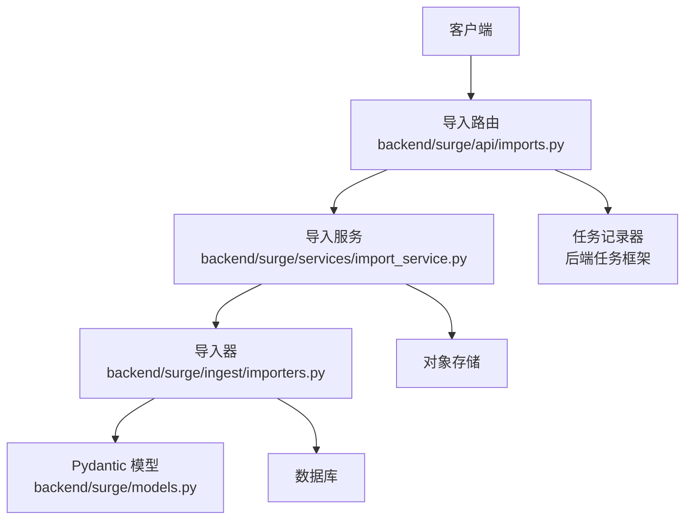
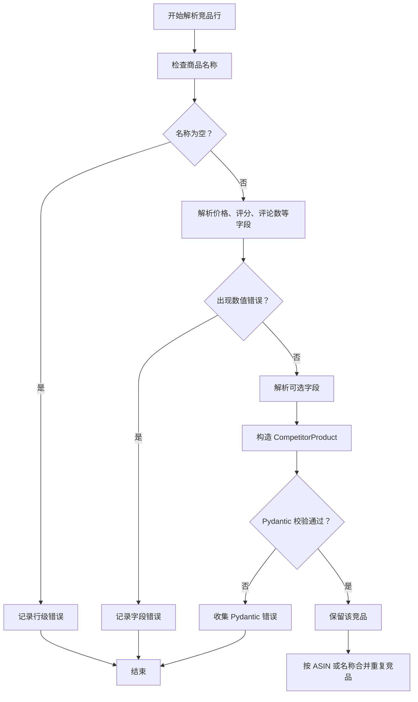
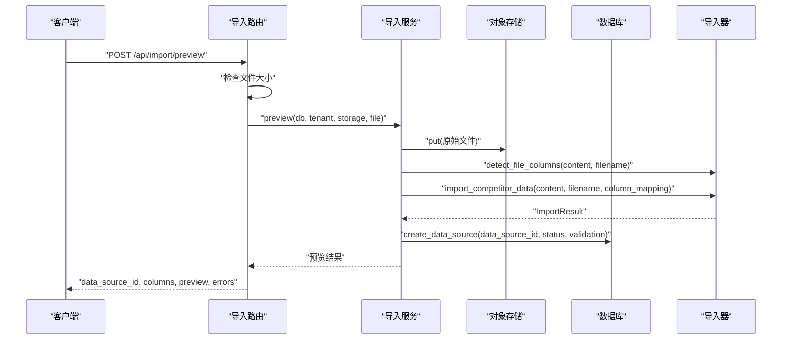
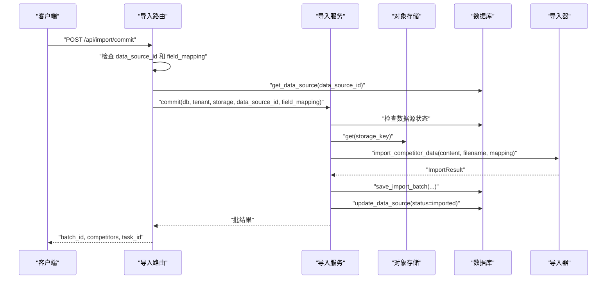
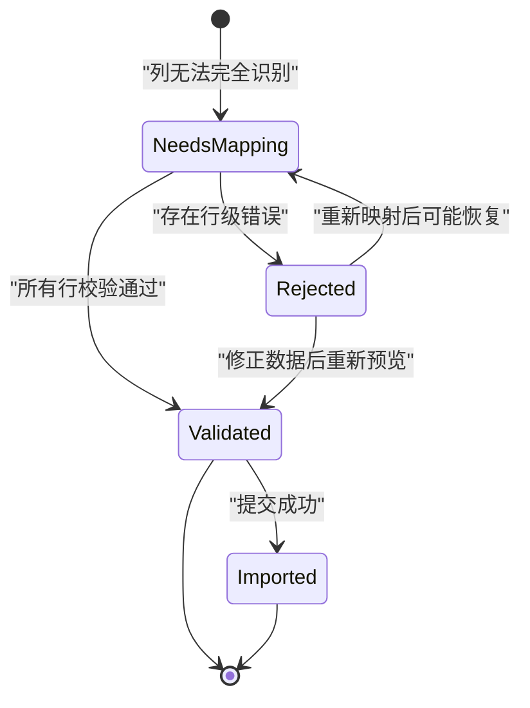

# 数据导入 API

<cite>
**本文引用的文件**   
- [backend/surge/api/imports.py](file://backend/surge/api/imports.py)
- [backend/surge/ingest/importers.py](file://backend/surge/ingest/importers.py)
- [backend/surge/services/import_service.py](file://backend/surge/services/import_service.py)
- [backend/surge/models.py](file://backend/surge/models.py)
- [backend/surge/app.py](file://backend/surge/app.py)
- [backend/tests/test_import_preview.py](file://backend/tests/test_import_preview.py)
- [backend/tests/test_import_flow.py](file://backend/tests/test_import_flow.py)
- [backend/tests/test_importers.py](file://backend/tests/test_importers.py)
</cite>

## 目录
1. [简介](#简介)
2. [项目结构与职责划分](#项目结构与职责划分)
3. [支持的端点与请求格式](#支持的端点与请求格式)
4. [上传限制与错误码](#上传限制与错误码)
5. [字段映射与列识别规则](#字段映射与列识别规则)
6. [逐行校验、空值处理与重复 SKU 合并](#逐行校验空值处理与重复-sku-合并)
7. [预览接口与提交接口详解](#预览接口与提交接口详解)
8. [常见失败场景与响应示例](#常见失败场景与响应示例)
9. [导入结果如何进入竞品分析与 Listing 生成](#导入结果如何进入竞品分析与-listing-生成)
10. [异步任务与进度查询](#异步任务与进度查询)
11. [性能与可维护性注意事项](#性能与可维护性注意事项)
12. [故障排查清单](#故障排查清单)
13. [结论](#结论)

## 简介
Surge 的数据导入 API 用于把外部 CSV、JSON、Excel 文件中的竞品商品数据解析为系统内部的 `CompetitorProduct` 和 `KeywordMetric`，并支持：
- 一步导入：直接上传并返回结构化结果。
- 两步导入：先预览列识别和字段映射，确认后再提交。
- 错误定位：每行错误都带行号、字段名、人类可读消息和原始值。
- 错误导出：通过 CSV 下载预览或提交阶段的错误明细。
- 租户隔离：数据源、导入批次和错误 CSV 按租户隔离。
- 后续流程衔接：导入结果可用于竞品分析或 Listing 生成。

## 项目结构与职责划分

**图表来源**  
- [backend/surge/api/imports.py:1-286](file://backend/surge/api/imports.py#L1-L286)
- [backend/surge/services/import_service.py:1-348](file://backend/surge/services/import_service.py#L1-L348)
- [backend/surge/ingest/importers.py:1-779](file://backend/surge/ingest/importers.py#L1-L779)
- [backend/surge/models.py:1-646](file://backend/surge/models.py#L1-L646)

**章节来源**  
- [backend/surge/api/imports.py:1-286](file://backend/surge/api/imports.py#L1-L286)
- [backend/surge/services/import_service.py:1-348](file://backend/surge/services/import_service.py#L1-L348)
- [backend/surge/ingest/importers.py:1-779](file://backend/surge/ingest/importers.py#L1-L779)
- [backend/surge/models.py:1-646](file://backend/surge/models.py#L1-L646)

## 支持的端点与请求格式

| 方法 | 路径 | 用途 | 认证与权限 | 主要表单字段或请求体 |
|---|---|---|---|---|
| POST | `/api/import` | 一步导入；直接解析并保存导入批次 | 需要登录，租户写入角色 | `file`（CSV/JSON/Excel） |
| POST | `/api/import/preview` | 上传原始文件，返回列识别、字段映射建议和前 10 行预览 | 需要登录，租户写入角色 | `file`，可选 `field_mapping` |
| POST | `/api/import/remap` | 用新映射重新校验已上传文件，不重传文件 | 需要登录，租户写入角色 | `data_source_id`，`field_mapping` |
| POST | `/api/import/commit` | 按映射保存导入批次，更新数据源状态 | 需要登录，租户写入角色 | `data_source_id`，可选 `field_mapping` |
| GET | `/api/data-sources` | 列出当前租户的导入数据源 | 需要登录，租户读取角色 | `limit`，默认 50，最大 100 |
| GET | `/api/data-sources/{data_source_id}` | 查看数据源详情 | 需要登录，租户读取角色 | 路径参数 |
| GET | `/api/data-sources/{data_source_id}/errors.csv` | 下载导入错误 CSV | 需要登录，租户读取角色 | 路径参数 |

### 一步导入端点

- 路径：`POST /api/import`
- 内容类型：`multipart/form-data`
- 表单字段：
  - `file`：必填。支持 `.csv`、`.json`、`.xlsx`。
- 成功响应包含：
  - `batch_id`：导入批次 ID。
  - `total_rows`：总行数。
  - `valid_rows`：有效竞品行数。
  - `errors`：错误数。
  - `source_format`：数据来源格式。
  - `task_id`：任务记录 ID。
  - `competitors`、`keywords`、`warnings` 等导入结果字段。

**章节来源**  
- [backend/surge/api/imports.py:25-115](file://backend/surge/api/imports.py#L25-L115)
- [backend/tests/test_importers.py:175-223](file://backend/tests/test_importers.py#L175-L223)

### 两步导入端点

#### 预览端点

- 路径：`POST /api/import/preview`
- 内容类型：`multipart/form-data`
- 表单字段：
  - `file`：必填。
  - `field_mapping`：可选。JSON 字符串，键是原始列名，值是目标字段名。
- 成功响应包含：
  - `data_source_id`：本次导入的数据源 ID。
  - `status`：`needs_mapping`、`validated`、`rejected`。
  - `can_commit`：仅当状态为 `validated` 时可提交。
  - `columns`：列识别结果。
  - `field_mapping`：当前字段映射。
  - `total_rows`、`valid_rows`、`preview`、`errors`、`warnings`、`is_demo`、`format`。

#### 重新映射端点

- 路径：`POST /api/import/remap`
- 内容类型：`application/json`
- 请求体字段：
  - `data_source_id`：必填。
  - `field_mapping`：必填。字典，键和值都必须是字符串。
- 行为：从对象存储读取上次上传的原始文件，使用新映射重新解析，不产生业务数据。

#### 提交端点

- 路径：`POST /api/import/commit`
- 内容类型：`application/json`
- 请求体字段：
  - `data_source_id`：必填。
  - `field_mapping`：可选。如果预览时没有保存映射，可在提交时传入。
- 行为：
  - 检查数据源是否存在。
  - 检查是否已经提交过。
  - 从对象存储读取原始文件。
  - 调用导入器解析并生成导入批次。
  - 更新数据源状态为 `imported`。

**章节来源**  
- [backend/surge/api/imports.py:117-286](file://backend/surge/api/imports.py#L117-L286)
- [backend/surge/services/import_service.py:1-348](file://backend/surge/services/import_service.py#L1-L348)
- [backend/tests/test_import_preview.py:1-183](file://backend/tests/test_import_preview.py#L1-L183)
- [backend/tests/test_import_flow.py:1-247](file://backend/tests/test_import_flow.py#L1-L247)

## 上传限制与错误码

### 文件大小上限

- 一步导入和预览端点都会读取完整文件。
- 文件大小上限来自 `api.settings.max_upload_bytes`，对应环境变量 `SURGE_MAX_UPLOAD_BYTES`。
- 超过上限返回 HTTP 413，错误信息中会带上具体字节上限。

### 允许的文件类型

- CSV：`.csv`
- JSON：`.json`
- Excel：`.xlsx`
- 其他扩展名会被导入器拒绝。
- Excel 必须以二进制方式上传，文本形式的 `.xlsx` 在统一入口会报错。

### 关键错误码

| 场景 | HTTP 状态码 | 说明 |
|---|---:|---|
| 文件为空 | 422 | 一步导入直接拒绝。 |
| 文件超过上传上限 | 413 | 一步导入和预览均检查。 |
| 文件格式不支持 | 422 | 扩展名不是 CSV/JSON/XLSX。 |
| 缺少必需字段或列 | 422 | 例如 CSV 缺少 `name` 列。 |
| 数据源不存在 | 404 | 提交或查询数据源时使用。 |
| 数据源已提交 | 409 | 同一数据源不能重复提交。 |
| 行级校验错误 | 422 | 提交阶段存在未修复的行错误。 |
| 租户无权限 | 403 | 读取角色尝试预览/提交。 |
| 通用请求校验错误 | 422 | FastAPI/Pydantic 校验失败。 |

**章节来源**  
- [backend/surge/api/imports.py:39-115](file://backend/surge/api/imports.py#L39-L115)
- [backend/surge/ingest/importers.py:201-245](file://backend/surge/ingest/importers.py#L201-L245)
- [backend/surge/ingest/importers.py:700-779](file://backend/surge/ingest/importers.py#L700-L779)
- [backend/surge/app.py:201-277](file://backend/surge/app.py#L201-L277)
- [backend/tests/test_import_preview.py:1-183](file://backend/tests/test_import_preview.py#L1-L183)

## 字段映射与列识别规则

### 自动列识别

预览时，系统会根据文件名后缀选择解析策略：
- CSV：读取第一行作为表头。
- JSON：取第一个对象或数组元素作为结构参考。
- XLSX：读取活动工作表的第一个非空行。

每个原始列会经过以下处理：
1. 去首尾空白。
2. 小写化。
3. 空格、连字符替换为下划线。
4. 匹配内置别名。
5. 如果用户提供了 `field_mapping`，优先使用用户映射。

### 内置列别名

系统支持英文和中文列名，包括但不限于：
- `name`：商品名称，也接受 `商品名称`、`竞品名称`、`product`、`title`。
- `brand`：品牌，也接受 `品牌`。
- `asin`：ASIN。
- `price`：价格，也接受 `价格`。
- `currency`：币种，也接受 `币种`。
- `rating`：评分，也接受 `评分`、`stars`。
- `review_count`：评论数，也接受 `评论数`、`reviews`。
- `category`：类目，也接受 `类目`。
- `key_features`：核心卖点，也接受 `features`、`卖点`、`核心卖点`。
- `specifications`：规格，也接受 `specs`、`规格`。
- `review_text`：评论内容，也接受 `评论`、`评论内容`。
- `review_rating`：评论星级，也接受 `评论星级`。
- `review_title`：评论标题，也接受 `评论标题`。
- `review_date`：评论日期，也接受 `评论日期`。
- `review_list`：评论列表，也接受 `reviews`、`review_samples`、`评论列表`。
- `is_demo`：是否演示数据。
- `source_ref`：数据来源，也接受 `数据来源`。

### 列识别响应字段

预览返回的 `columns` 中，每列包含：
- `source`：原始列名。
- `field`：规范化后的目标字段名；无法识别时为 `None`。
- `required`：是否为必需字段。目前只有 `name` 是必需列。
- `recognized`：是否被系统自动识别。

**章节来源**  
- [backend/surge/ingest/importers.py:34-116](file://backend/surge/ingest/importers.py#L34-L116)
- [backend/surge/ingest/importers.py:143-200](file://backend/surge/ingest/importers.py#L143-L200)
- [backend/surge/ingest/importers.py:201-245](file://backend/surge/ingest/importers.py#L201-L245)
- [backend/tests/test_import_preview.py:27-53](file://backend/tests/test_import_preview.py#L27-L53)

## 逐行校验、空值处理与重复 SKU 合并

### 必需字段

- 商品名称 `name` 是必需的。
- CSV 必须包含 `name` 列；否则直接报错。
- JSON 顶层必须是对象或数组；对象必须包含 `competitors` 或 `products` 数组。

### 数值字段

| 字段 | 类型 | 规则 |
|---|---|---|
| `price` | 浮点数 | 可为空；非空时必须是非负数字；逗号、美元符号会被清理。 |
| `rating` | 浮点数 | 可为空；必须在 0.0 到 5.0 之间。 |
| `review_count` | 整数 | 可为空；非空时必须是非负整数。 |
| `search_volume` | 整数 | 关键词搜索量，可为空。 |
| `rank` | 整数 | 关键词排名，可为空。 |
| `relevance` | 浮点数 | 相关性，可为空，范围 0 到 1。 |
| `conversion_share` | 浮点数 | 转化占比，可为空，范围 0 到 1。 |

### 布尔字段

`is_demo` 支持多种写法：
- 真值：`1`、`true`、`yes`、`y`、`是`。
- 假值：`0`、`false`、`no`、`n`、`否`。
- 空值或空字符串保持 `None`，由上层逻辑决定最终值。

### 空值处理

- 缺失的非必填字段保持 `None`。
- 空字符串会被归一化为 `None`。
- 纯空白字符串不会自动补全为事实，而是进入待确认或缺失字段集合。
- 规格字段支持：
  - 键值对字符串，如 `颜色:黑色|容量:500ml`。
  - JSON 字符串。
  - Python dict。

### 评论样本

- CSV 中可使用 `review_text`、`review_rating`、`review_title`、`review_date` 多列。
- JSON 中可使用 `reviews` 或 `review_list` 数组。
- 单条评论文本必填。
- 单个竞品的评论样本最多保留 500 条，超出会截断并给出警告。

### 重复 SKU 合并

系统不会直接用 `sku` 作为唯一键；它按以下顺序确定竞品合并键：
1. `asin`。
2. `name`。

键比较时会去除首尾空白并统一小写。相同键的竞品会合并：
- 评论拼接。
- 卖点去重并集。
- 规格合并。
- 其余字段优先保留首个非空值。

因此，“重复 SKU”在这个系统中更准确的说法是“同名或同 ASIN 的竞品行”。

**图表来源**  
- [backend/surge/ingest/importers.py:300-449](file://backend/surge/ingest/importers.py#L300-L449)
- [backend/surge/ingest/importers.py:745-779](file://backend/surge/ingest/importers.py#L745-L779)

**章节来源**  
- [backend/surge/ingest/importers.py:116-142](file://backend/surge/ingest/importers.py#L116-L142)
- [backend/surge/ingest/importers.py:300-449](file://backend/surge/ingest/importers.py#L300-L449)
- [backend/surge/ingest/importers.py:700-779](file://backend/surge/ingest/importers.py#L700-L779)
- [backend/surge/models.py:118-198](file://backend/surge/models.py#L118-L198)
- [backend/tests/test_importers.py:1-174](file://backend/tests/test_importers.py#L1-L174)

## 预览接口与提交接口详解

### 预览流程

**图表来源**  
- [backend/surge/api/imports.py:117-154](file://backend/surge/api/imports.py#L117-L154)
- [backend/surge/services/import_service.py:55-139](file://backend/surge/services/import_service.py#L55-L139)
- [backend/surge/ingest/importers.py:143-245](file://backend/surge/ingest/importers.py#L143-L245)

### 提交流程

**图表来源**  
- [backend/surge/api/imports.py:156-239](file://backend/surge/api/imports.py#L156-L239)
- [backend/surge/services/import_service.py:141-234](file://backend/surge/services/import_service.py#L141-L234)

### 预览状态机

**图表来源**  
- [backend/surge/services/import_service.py:23-31](file://backend/surge/services/import_service.py#L23-L31)
- [backend/surge/services/import_service.py:55-139](file://backend/surge/services/import_service.py#L55-L139)

**章节来源**  
- [backend/surge/services/import_service.py:55-234](file://backend/surge/services/import_service.py#L55-L234)
- [backend/tests/test_import_flow.py:1-247](file://backend/tests/test_import_flow.py#L1-L247)

## 常见失败场景与响应示例

### 上传失败

| 场景 | 请求 | 响应 |
|---|---|---|
| 文件为空 | `POST /api/import`，`file` 为空 | `422`，`detail` 表示文件为空。 |
| 文件超过上限 | `POST /api/import/preview`，文件过大 | `413`，`detail` 包含字节上限。 |
| 不支持的文件类型 | `POST /api/import`，扩展名为 `.txt` | `422`，提示仅支持 CSV/JSON/XLSX。 |
| Excel 以文本形式上传 | `POST /api/import`，`.xlsx` 被当作文本 | `422`，提示 Excel 需二进制上传。 |

### 字段缺失

| 场景 | 行为 |
|---|---|
| CSV 缺少 `name` 列 | 直接抛出导入验证错误，提示缺少必需列。 |
| JSON 缺少 `competitors` | 抛出导入验证错误，要求顶层对象包含 `competitors` 或直接使用顶层数组。 |
| 某行 `name` 为空 | 该行不计入有效竞品，返回行级错误。 |

### 重复 SKU 或同名竞品

- 同名或同 ASIN 的竞品会被合并。
- 这不是传统意义上的“重复提交”，而是数据形状合并。
- 如果希望保留多条，应提供不同 ASIN。

### 解析异常

| 场景 | 响应 |
|---|---|
| JSON 语法错误 | `422`，包含 JSON 解析位置和可读消息。 |
| 价格不是数字 | 行级错误，字段为 `price`。 |
| 价格为负数 | 行级错误，字段为 `price`。 |
| 评分不在 0 到 5 之间 | 行级错误，字段为 `rating`。 |
| 评论数为负数或非整数 | 行级错误，字段为 `review_count`。 |
| `is_demo` 不是合法布尔值 | 行级错误，字段为 `is_demo`。 |

### 预览与提交的典型响应

#### 预览成功且可提交

- 状态：`validated`
- `can_commit`：`true`
- `columns` 中所有可识别列都有 `field`。
- `errors` 为空或仅有警告。

#### 预览失败但可修复

- 状态：`rejected`
- `can_commit`：`false`
- `errors` 中包含 `row`、`field`、`message`、`value`。

#### 提交重复数据源

- 状态：`409`
- `detail`：提示数据源已提交过。

**章节来源**  
- [backend/surge/api/imports.py:25-239](file://backend/surge/api/imports.py#L25-L239)
- [backend/surge/ingest/importers.py:300-779](file://backend/surge/ingest/importers.py#L300-L779)
- [backend/tests/test_import_flow.py:1-247](file://backend/tests/test_import_flow.py#L1-L247)
- [backend/tests/test_importers.py:1-223](file://backend/tests/test_importers.py#L1-L223)

## 导入结果如何进入竞品分析与 Listing 生成

### 竞品分析

导入结果中的 `competitors` 和 `keywords` 可以直接转换为竞品分析请求所需的字段。代码中提供了转换辅助函数，把 `ImportResult` 转为包含 `competitors` 和 `keywords` 的请求载荷。

实际竞品分析请求模型包括：
- `product_name`：自有商品名称。
- `platform`：销售平台。
- `marketplace`：站点。
- `own_specs`、`own_key_features`、`own_price`：自有商品信息。
- `competitors`：导入或手动提供的竞品列表。
- `keywords`：关键词指标。
- `data_source`：数据来源，如 `manual`、`csv`、`json`、`demo`。
- `locale`：语言区域。

### Listing 生成

Listing 生成请求模型包括：
- `product`：自有商品信息。
- `language`、`marketplace`。
- `analysis_report` 或 `analysis_report_id`：竞品分析报告。
- `keywords`。
- `tone`、`banned_terms`、`target_length_hint`。
- `revision_notes`：质检修订备注。

因此，导入流程本身不直接生成 Listing；它提供标准化的竞品数据和关键词数据，供后续分析技能或 Listing 生成技能消费。

**图表来源**  
- [backend/surge/ingest/importers.py:771-779](file://backend/surge/ingest/importers.py#L771-L779)
- [backend/surge/models.py:201-400](file://backend/surge/models.py#L201-L400)

**章节来源**  
- [backend/surge/ingest/importers.py:771-779](file://backend/surge/ingest/importers.py#L771-L779)
- [backend/surge/models.py:201-400](file://backend/surge/models.py#L201-L400)

## 异步任务与进度查询

### 一步导入的任务记录

一步导入使用 `TaskRecorder` 包装整个流程，记录：
- 任务类型：`data_import`。
- 任务标题：包含文件名。
- 来源：`form`。
- 负载：包含文件名、批次 ID 等。
- 步骤：读取文件、解析并校验、保存导入批次。
- 成功输出：批次 ID、总行数、有效行数、错误数、来源格式。

### 两步导入的任务记录

两步导入的提交端点也会创建任务记录，包含：
- 任务类型：`data_import`。
- 负载：包含 `data_source_id` 和文件名。
- 步骤：读取数据源、校验并写入批次、写入数据源状态。
- 成功输出：批次 ID、数据源 ID、总行数、有效行数。

### 进度查询

当前导入相关路由中没有定义专门的“查询任务进度”端点。现有设计通过以下方式暴露导入状态：
- 数据源状态：`needs_mapping`、`validated`、`rejected`、`imported`。
- 数据源详情：包含 `validation.errors`、`validation.total`、`validation.valid`、`field_mapping`、`storage_key`、`created_at` 等。
- 导入错误 CSV：包含 `row`、`field`、`message`、`value`。
- 一步导入响应中的 `task_id`：表示任务已记录，但当前导入路由没有提供按 `task_id` 查询进度的专用端点。

如果需要查询异步任务进度，应关注任务队列服务和任务记录器的扩展能力；就当前导入 API 而言，前端通常通过轮询数据源状态和错误 CSV 来掌握导入进展。

**章节来源**  
- [backend/surge/api/imports.py:39-115](file://backend/surge/api/imports.py#L39-L115)
- [backend/surge/api/imports.py:201-286](file://backend/surge/api/imports.py#L201-L286)
- [backend/surge/app.py:1-120](file://backend/surge/app.py#L1-L120)

## 性能与可维护性注意事项

- 一步导入会读取完整文件，适合中小规模文件。
- 预览和重新映射都会从对象存储读取原始文件，避免在未经验证的情况下落库。
- 预览只返回前 10 行，减少前端渲染压力。
- 评论样本上限为 500，防止单条竞品携带过多评论影响性能。
- 重复竞品合并会保留评论并集和卖点并集，可能增加内存占用，但对数据一致性有益。
- 全局请求校验错误和 Pydantic 校验错误会统一转为 422，便于前端展示。

[本节为一般性指导，不直接分析具体代码片段]

## 故障排查清单

| 问题 | 检查项 | 建议 |
|---|---|---|
| 上传立即失败 | 文件大小是否超过 `SURGE_MAX_UPLOAD_BYTES` | 压缩文件或调整配置。 |
| 预览显示列无法识别 | `columns` 中 `field` 是否为 `None` | 使用 `remap` 将原始列映射到目标字段。 |
| 预览状态为 `rejected` | 查看 `errors` 中的 `row` 和 `field` | 下载错误 CSV 定位具体行和字段。 |
| 提交返回 409 | 是否已经提交过同一个 `data_source_id` | 重新上传文件获取新的数据源。 |
| 提交返回 422 | 是否仍有行级错误 | 修复数据后重新预览。 |
| JSON 解析失败 | 根节点是否是对象或数组 | 确保顶层结构包含 `competitors`。 |
| Excel 打开失败 | 是否加密或受保护 | 取消密码保护后重新上传。 |
| 中文表头未识别 | 是否命中内置别名 | 使用 `field_mapping` 显式映射。 |
| 评论丢失 | 是否使用了 `review_text` 或多列评论 | 检查 CSV/JSON 评论字段命名。 |
| 竞品数量少于预期 | 是否发生同名合并 | 检查 ASIN 或名称是否相同。 |

**章节来源**  
- [backend/surge/api/imports.py:241-286](file://backend/surge/api/imports.py#L241-L286)
- [backend/surge/services/import_service.py:236-348](file://backend/surge/services/import_service.py#L236-L348)
- [backend/surge/ingest/importers.py:451-779](file://backend/surge/ingest/importers.py#L451-L779)

## 结论
Surge 的数据导入 API 围绕“先预览、再提交”的设计展开，重点解决真实业务中列名不一致、中英文混用、逐行数据质量不可见等问题。导入层负责解析 CSV/JSON/XLSX，模型层负责 `CompetitorProduct` 和 `KeywordMetric` 的规范化，服务层负责持久化原始文件和校验状态，路由层负责权限、大小检查和任务记录。

对于集成方来说，推荐的两步路径是：
1. 调用预览接口上传文件并确认字段映射。
2. 调用提交接口生成导入批次。
3. 通过数据源状态和错误 CSV 跟踪导入质量。
4. 将导入结果中的竞品和关键词数据传给竞品分析或 Listing 生成流程。