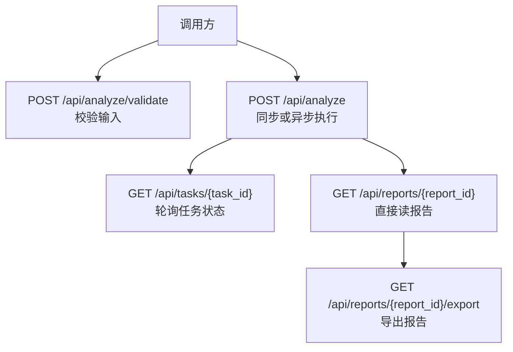
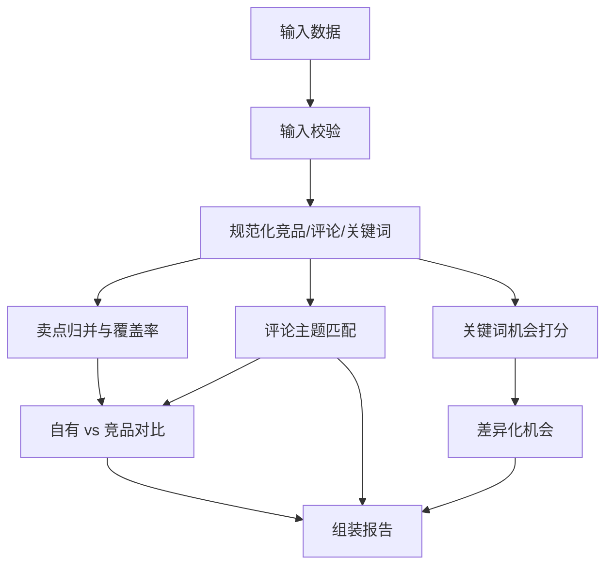
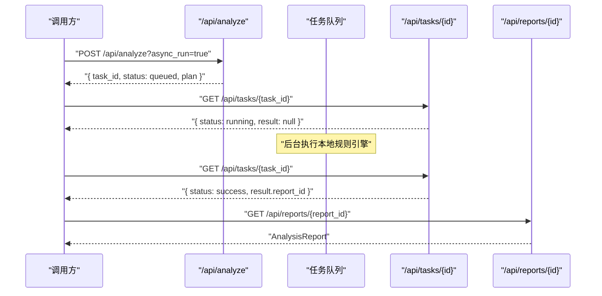
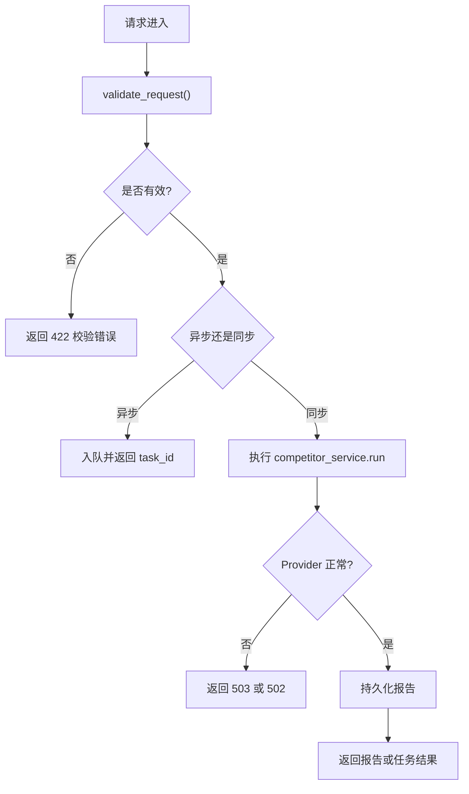

# 竞品分析 API

<cite>
**本文引用的文件**   
- [backend/surge/api/analyses.py](file://backend/surge/api/analyses.py)
- [backend/surge/engine/analysis.py](file://backend/surge/engine/analysis.py)
- [backend/surge/models.py](file://backend/surge/models.py)
- [backend/surge/api/tasks.py](file://backend/surge/api/tasks.py)
- [examples/competitors_sample.json](file://examples/competitors_sample.json)
</cite>

## 目录
1. [简介](#简介)
2. [API 总览与端点](#api-总览与端点)
3. [请求模型](#请求模型)
4. [响应模型与报告结构](#响应模型与报告结构)
5. [分析引擎与证据体系](#分析引擎与证据体系)
6. [异步执行与任务轮询](#异步执行与任务轮询)
7. [完整示例](#完整示例)
8. [错误处理](#错误处理)
9. [常见问题与策略](#常见问题与策略)
10. [性能与可观测性](#性能与可观测性)
11. [结论](#结论)

## 简介
本参考文档说明 Surge 的竞品分析能力。其核心入口是提交竞品资料、关键词和自有商品信息，由本地确定性规则引擎生成结构化分析报告；可选通过任务系统异步执行并轮询结果。该接口明确声明：分析本身不调用大模型，因此可以在没有外部 API Key 的情况下运行。

## API 总览与端点
当前竞品分析相关端点集中在 `backend/surge/api/analyses.py`：

| 方法 | 路径 | 作用 | 主要行为 |
|---|---|---|---|
| POST | `/api/analyze/validate` | 校验输入 | 返回是否有效、错误列表、警告列表和评论样本总数 |
| POST | `/api/analyze` | 同步或异步执行竞品分析 | 默认同步返回报告；支持 `async_run=true` 立即返回任务信息 |
| GET | `/api/reports` | 列出报告 | 按用户和租户分页查询已保存的报告 |
| GET | `/api/reports/{report_id}` | 获取报告 | 返回完整的 `AnalysisReport` |
| GET | `/api/reports/{report_id}/export` | 导出报告 | 以附件形式返回 Markdown 等格式 |

**图表来源**
- [backend/surge/api/analyses.py:22-256](file://backend/surge/api/analyses.py#L22-L256)
- [backend/surge/api/tasks.py:47-110](file://backend/surge/api/tasks.py#L47-L110)

**章节来源**
- [backend/surge/api/analyses.py:1-256](file://backend/surge/api/analyses.py#L1-L256)
- [backend/surge/api/tasks.py:1-110](file://backend/surge/api/tasks.py#L1-L110)

## 请求模型
所有输入模型定义在 `backend/surge/models.py`。

### CompetitorAnalysisRequest
| 字段 | 类型 | 必填 | 默认值 | 说明 |
|---|---|---:|---|---|
| `product_name` | 字符串 | 是 | — | 自有商品名称，用于关键词相关性估算 |
| `platform` | 枚举 | 否 | `amazon` | 目标销售平台 |
| `marketplace` | 字符串 | 否 | `US` | 站点标识，会被规范化为大写 |
| `category` | 字符串 | 否 | 空 | 类目描述 |
| `own_specs` | 键值对 | 否 | 空对象 | 自有商品规格参数 |
| `own_key_features` | 字符串数组 | 否 | 空数组 | 自有核心卖点 |
| `own_price` | 浮点数 | 否 | 空 | 自有商品价格 |
| `competitors` | 竞品数组 | 是 | — | 至少包含一个竞品 |
| `keywords` | 关键词数组 | 否 | 空数组 | 关键词及其量化指标 |
| `data_source` | 字符串 | 否 | `user_input` | 数据来源标记 |
| `locale` | 枚举 | 否 | `zh-CN` | 输出语言区域 |

### CompetitorProduct
| 字段 | 类型 | 必填 | 默认值 | 说明 |
|---|---|---:|---|---|
| `name` | 字符串 | 是 | — | 竞品名称，不能为空 |
| `brand` | 字符串 | 否 | 空 | 品牌 |
| `asin` | 字符串 | 否 | 空 | 商品编号 |
| `price` | 浮点数 | 否 | 空 | 价格，必须非负 |
| `currency` | 字符串 | 否 | `USD` | 币种 |
| `rating` | 浮点数 | 否 | 空 | 评分，范围 0 到 5 |
| `review_count` | 整数 | 否 | 空 | 评论总数 |
| `category` | 字符串 | 否 | 空 | 类目 |
| `key_features` | 字符串数组 | 否 | 空数组 | 核心卖点；也支持传入单字符串并按竖线或换行拆分 |
| `specifications` | 键值对 | 否 | 空对象 | 规格参数 |
| `reviews` | 评论数组 | 否 | 空数组 | 评论样本 |
| `image` | 字符串 | 否 | 空 | 商品图地址，仅展示，不计入字段完整度 |
| `is_demo` | 布尔值 | 否 | `true` | 是否为演示数据 |
| `source_ref` | 字符串 | 否 | 空 | 原始数据来源引用 |

### ReviewSample
| 字段 | 类型 | 必填 | 默认值 | 说明 |
|---|---|---:|---|---|
| `text` | 字符串 | 是 | — | 评论内容，去空白后不能为空 |
| `title` | 字符串 | 否 | 空 | 评论标题 |
| `rating` | 浮点数 | 否 | 空 | 星级，范围 1 到 5 |
| `date` | 字符串 | 否 | 空 | 评论时间 |
| `verified_purchase` | 布尔值 | 否 | 空 | 是否认证购买 |
| `source` | 字符串 | 否 | 空 | 评论来源 |
| `language` | 字符串 | 否 | 空 | 评论语言 |

### KeywordMetric
| 字段 | 类型 | 必填 | 默认值 | 说明 |
|---|---|---:|---|---|
| `keyword` | 字符串 | 是 | — | 关键词文本 |
| `search_volume` | 整数 | 否 | 空 | 搜索量 |
| `rank` | 整数 | 否 | 空 | 自然排名 |
| `relevance` | 浮点数 | 否 | 空 | 相关性，范围 0 到 1 |
| `competition` | 枚举 | 否 | 空 | 竞争程度：`low` / `medium` / `high` |
| `conversion_share` | 浮点数 | 否 | 空 | 转化份额 |
| `source` | 字符串 | 否 | 空 | 指标来源 |

`KeywordMetric.has_metrics` 表示是否存在任一量化指标：搜索量、排名、相关性或竞争程度。若全部为 `None`，则视为无指标关键词。

**章节来源**
- [backend/surge/models.py:125-310](file://backend/surge/models.py#L125-L310)
- [backend/surge/models.py:310-390](file://backend/surge/models.py#L310-L390)

## 响应模型与报告结构
同步调用成功时返回 `AnalysisResponse`，其中包含完整 `AnalysisReport`。异步模式下先返回任务信息，任务成功后再通过任务详情或报告接口读取报告。

### AnalysisResponse
| 字段 | 类型 | 说明 |
|---|---|---|
| `report` | `AnalysisReport` | 结构化分析报告 |
| `persisted` | 布尔值 | 报告是否已持久化 |
| `duration_ms` | 整数 | 本次分析耗时毫秒数 |
| `task_id` | 字符串 | 关联的任务 ID |

### AnalysisReport
| 字段 | 类型 | 说明 |
|---|---|---|
| `report_id` | 字符串 | 报告唯一标识 |
| `created_at` | 时间戳 | 创建时间 |
| `product_name` | 字符串 | 商品名称 |
| `platform` | 枚举 | 平台 |
| `marketplace` | 字符串 | 站点 |
| `category` | 字符串 | 类目 |
| `locale` | 字符串 | 语言区域 |
| `data_provenance` | `DataProvenance` | 数据来源与完整性 |
| `competitor_snapshots` | 商品快照数组 | 每个竞品的汇总行 |
| `price_analysis` | `PriceAnalysis` | 价格统计与定位 |
| `feature_comparison` | 卖点对比数组 | 共性卖点、覆盖率和自有独有卖点 |
| `own_vs_competitors` | 结论数组 | 自有商品与竞品的对比结论 |
| `review_insights` | `ReviewInsights` | 评论挖掘结果 |
| `keyword_analysis` | `KeywordAnalysis` | 关键词机会分析 |
| `differentiation_opportunities` | 差异化机会数组 | 可操作的差异化方向 |
| `content_recommendations` | 内容建议数组 | 标题、五点、描述、A+、定价等建议 |
| `limitations` | 字符串数组 | 分析限制说明 |
| `warnings` | 字符串数组 | 输入质量警告 |
| `engine` | 字符串 | 引擎标识 |
| `engine_version` | 字符串 | 引擎版本 |

#### PriceAnalysis（价格统计）
| 字段 | 类型 | 说明 |
|---|---|---|
| `min_price` | 浮点数 | 最低价 |
| `max_price` | 浮点数 | 最高价 |
| `mean_price` | 浮点数 | 平均价 |
| `median_price` | 浮点数 | 中位数 |
| `own_price` | 浮点数 | 自有价格 |
| `own_position` | 枚举 | `below_range` / `within_range` / `above_range` / `unknown` |
| `position_percentile` | 浮点数 | 自有价格在竞品中的分位 |
| `compared_count` | 整数 | 参与价格统计的竞品数量 |
| `currency` | 字符串 | 币种 |
| `claims` | 结论数组 | 价格相关结构化结论 |

#### ReviewInsights（评论挖掘）
| 字段 | 类型 | 说明 |
|---|---|---|
| `total_samples` | 整数 | 评论样本总数 |
| `with_rating` | 整数 | 带星级的评论数 |
| `rating_distribution` | 字典 | 星级分布 |
| `low_rating_count` | 整数 | 低星评论数量 |
| `pain_points` | 痛点数组 | 高频痛点 |
| `needs` | 需求数组 | 高频需求 |
| `purchase_concerns` | 顾虑数组 | 购买顾虑 |
| `low_rating_themes` | 痛点数组 | 低星负面反馈主题 |
| `limitations` | 字符串数组 | 评论分析限制 |

#### KeywordAnalysis（关键词机会）
| 字段 | 类型 | 说明 |
|---|---|---|
| `available` | 布尔值 | 是否提供关键词数据 |
| `total_keywords` | 整数 | 关键词总数 |
| `with_metrics` | 整数 | 带量化指标的关键词数 |
| `opportunities` | 机会数组 | 每个关键词的机会项 |
| `notes` | 字符串数组 | 关键词分析说明 |

#### DifferentiationOpportunity（差异化机会）
| 字段 | 类型 | 说明 |
|---|---|---|
| `angle` | 字符串 | 差异化角度 |
| `rationale` | 字符串 | 依据与理由 |
| `supporting_evidence` | 结论数组 | 支撑证据 |
| `priority` | 枚举 | `high` / `medium` / `low` |
| `confidence` | 枚举 | `high` / `medium` / `low` |
| `requires_confirmation` | 布尔值 | 是否需要人工确认 |

**章节来源**
- [backend/surge/models.py:430-520](file://backend/surge/models.py#L430-L520)
- [backend/surge/models.py:520-646](file://backend/surge/models.py#L520-L646)

## 分析引擎与证据体系
分析逻辑主要由 `backend/surge/engine/analysis.py` 实现。它遵循固定流水线：

1. 校验输入
2. 规范化竞品、评论和关键词
3. 计算卖点覆盖率与差异
4. 从评论中提取痛点、需求和购买顾虑
5. 仅在存在量化指标时计算关键词机会分
6. 对比自有商品与竞品
7. 组装结构化报告

### 证据类型 EvidenceKind
| 值 | 含义 | 典型使用位置 |
|---|---|---|
| `fact` | 直接来自输入的事实 | 完全相同的卖点归类、自有独有卖点 |
| `statistic` | 由输入计算出的统计量 | 价格区间、覆盖率、评论频率、价格定位 |
| `inference` | 基于证据的规则推断 | 自有卖点被竞品覆盖判断、内容建议、差异化角度 |
| `assumption` | 假设，需要人工确认 | 没有价格数据时的占位结论、资料不足时的提示 |

每条结论都通过 `Claim` 表达，包含陈述、证据类型、证据锚点和样本量。事实类和统计类结论必须附带证据，否则触发校验错误。

### IssueCode 与严重级别
`IssueCode` 主要用于 Listing 质检问题分类，例如违禁词、超长、未验证宣称、占位文本等。竞品分析报告的结论层不直接使用 `IssueCode`，而是使用更通用的 `EvidenceKind` 和语义化的 `Claim.statement`。如果后续把竞品结论接入 Listing 质检流程，才可能映射到这些代码。

**图表来源**
- [backend/surge/engine/analysis.py:28-110](file://backend/surge/engine/analysis.py#L28-L110)
- [backend/surge/engine/analysis.py:201-592](file://backend/surge/engine/analysis.py#L201-L592)
- [backend/surge/engine/analysis.py:593-949](file://backend/surge/engine/analysis.py#L593-L949)

**章节来源**
- [backend/surge/engine/analysis.py:1-110](file://backend/surge/engine/analysis.py#L1-L110)
- [backend/surge/engine/analysis.py:201-592](file://backend/surge/engine/analysis.py#L201-L592)
- [backend/surge/engine/analysis.py:593-949](file://backend/surge/engine/analysis.py#L593-L949)
- [backend/surge/models.py:56-84](file://backend/surge/models.py#L56-L84)

## 异步执行与任务轮询
POST `/api/analyze` 支持两种模式：

| async_run | 行为 | 返回体 |
|---|---|---|
| `false`（默认） | 同步执行，等待分析完成 | `AnalysisResponse` |
| `true` | 立即入队，后台执行 | `{ task_id, status, plan, async: true }` |

异步路径会创建 `TaskRecorder`，初始状态为 `queued`，然后提交到任务队列。完成后将报告持久化，并把 `report_id` 放入任务输出。

### 轮询约定
1. 收到异步响应后，使用 `GET /api/tasks/{task_id}` 轮询。
2. 任务状态包括排队、运行、成功、失败、取消等。
3. 成功时 `result.report_id` 指向最终报告。
4. 可通过 `GET /api/reports/{report_id}` 直接读取报告。
5. 支持 `POST /api/tasks/{task_id}/cancel` 取消任务。
6. 某些 Agent 任务支持重试，但竞品分析作为规则任务通常不需要重试；重试接口主要针对 Agent 工作流。

**图表来源**
- [backend/surge/api/analyses.py:40-170](file://backend/surge/api/analyses.py#L40-L170)
- [backend/surge/api/tasks.py:47-110](file://backend/surge/api/tasks.py#L47-L110)

**章节来源**
- [backend/surge/api/analyses.py:40-170](file://backend/surge/api/analyses.py#L40-L170)
- [backend/surge/api/tasks.py:47-110](file://backend/surge/api/tasks.py#L47-L110)

## 完整示例
以下示例使用仓库中的示例数据文件，但实际生产请求应替换真实竞品、评论和关键词。

### 请求体
请求体对应 `CompetitorAnalysisRequest`，示例数据路径：

- [examples/competitors_sample.json](file://examples/competitors_sample.json)

该示例包含两个竞品、若干评论，以及两个搜索量为空的关键词。关键字段包括：
- `competitors[].name`
- `competitors[].price`
- `competitors[].currency`
- `competitors[].key_features`
- `competitors[].reviews[].text`
- `keywords[].keyword`
- `keywords[].search_volume`

注意：
- `reviews[].text` 不能为空。
- `competitors[]` 至少有一个元素。
- `product_name` 不能为空。
- 缺失 `price` 或 `currency` 不会直接导致 422，但会影响价格分析和警告。

### 典型同步响应
同步成功响应包含：
- `report.report_id`
- `report.product_name`
- `report.platform`
- `report.marketplace`
- `report.data_provenance`
- `report.competitor_snapshots`
- `report.price_analysis`
- `report.feature_comparison`
- `report.review_insights`
- `report.keyword_analysis`
- `report.differentiation_opportunities`
- `report.content_recommendations`
- `report.warnings`
- `report.limitations`
- `duration_ms`
- `task_id`

### 典型异步响应
当 `async_run=true` 且服务端允许异步任务时，返回：
- `task_id`
- `status: "queued"`
- `plan`
- `async: true`

随后轮询任务详情，成功后从 `result.report_id` 拉取报告。

### 错误响应
常见错误包括：
- 422：输入校验失败，包含 `message`、`errors`、`warnings`
- 404：任务或报告不存在
- 503：外部 Provider 不可用（同步路径依赖 LLM Provider）
- 502：Provider 调用抛出异常时被包装
- 400：导出格式不支持

**章节来源**
- [examples/competitors_sample.json:1-43](file://examples/competitors_sample.json#L1-L43)
- [backend/surge/api/analyses.py:22-170](file://backend/surge/api/analyses.py#L22-L170)
- [backend/surge/api/tasks.py:47-110](file://backend/surge/api/tasks.py#L47-L110)

## 错误处理
### 输入校验错误
校验函数收集两类结果：
- `errors`：阻止分析的硬错误，例如评论文本为空、缺少竞品
- `warnings`：数据不完整但分析仍可继续的警告，例如缺少价格、缺少评论样本、关键词无指标

校验结果会通过：
- `/api/analyze/validate` 暴露给调用方
- `/api/analyze` 的 422 响应体
- 最终报告的 `warnings` 和 `limitations`

### Provider 错误
同步路径构建 LLM Provider 时：
- `ProviderError` 转为 503
- 其他异常转为 502，并包含 Provider 名称、模型名和异常信息
- 已经抛出的 HTTP 异常会原样传递

### 任务与报告不存在
- 任务不存在：404
- 报告不存在：404
- 报告导出失败：400

**图表来源**
- [backend/surge/engine/analysis.py:62-110](file://backend/surge/engine/analysis.py#L62-L110)
- [backend/surge/api/analyses.py:40-170](file://backend/surge/api/analyses.py#L40-L170)

**章节来源**
- [backend/surge/engine/analysis.py:62-110](file://backend/surge/engine/analysis.py#L62-L110)
- [backend/surge/api/analyses.py:40-170](file://backend/surge/api/analyses.py#L40-L170)
- [backend/surge/api/tasks.py:112-170](file://backend/surge/api/tasks.py#L112-L170)

## 常见问题与策略
### 缺失 price 或 currency
- 缺失 `price`：该竞品不参与价格统计，同时产生警告“缺少价格，价格分析将排除该竞品”。
- `currency` 默认为 `USD`；如果所有有价格的竞品都缺币种，价格分析仍会使用 `USD`。
- 如果没有任何竞品提供价格，价格分析仍存在，但主要结论会标注为假设，并提示没有可用价格。

### reviews 为空
- 单个竞品没有评论：产生警告“没有评论样本，评论洞察将不覆盖该竞品”。
- 所有竞品都没有评论：产生警告“没有任何评论样本，评论痛点/需求分析将不可用”，报告中 `ReviewInsights` 会记录限制。
- 评论文本为空：直接报错，因为 `ReviewSample.text` 不允许为空。

### 关键词指标为 None
- 如果所有关键词的 `search_volume`、`rank`、`relevance`、`competition` 都为 `None`：
  - 校验阶段给出警告“关键词均无搜索量/排名指标，不做关键词机会打分”
  - 引擎只列出关键词，机会分为 `None`，并在 `notes` 中说明“只列出关键词，不计算机会分，也不推断流量大小”
- 如果部分关键词有指标、部分没有：
  - 有指标的关键词参与机会分排序
  - 无指标的关键词标记 `has_metrics=false`，机会分不填充
  - 报告中会记录缺失搜索量或缺失排名的数量

### 自有商品资料不足
- 未填写 `own_specs`：差异化分析仍会进行，但主要依赖卖点和价格；报告可能提示“自有商品未填写规格，差异化分析将只基于卖点与价格”。
- 未填写 `own_price`：无法判断价格定位，价格分析中会加入假设类结论。
- 未填写 `own_key_features`：无法做自有卖点与竞品卖点对比。

### 同名竞品
校验器会检测重复竞品名称并给出警告，提示调用方确认是否为重复录入。

### 数据完整性
引擎会计算每个竞品的字段完整度，检查 `price`、`rating`、`review_count`、`key_features`、`specifications`、`reviews`、`brand` 等字段是否填充，并将缺失字段列入 `ProductSnapshot.missing_fields`。

**章节来源**
- [backend/surge/engine/analysis.py:62-110](file://backend/surge/engine/analysis.py#L62-L110)
- [backend/surge/engine/analysis.py:201-592](file://backend/surge/engine/analysis.py#L201-L592)
- [backend/surge/engine/analysis.py:593-949](file://backend/surge/engine/analysis.py#L593-L949)
- [backend/surge/models.py:125-310](file://backend/surge/models.py#L125-L310)

## 性能与可观测性
- 分析本身是本地确定性计算，不依赖外部大模型调用即可完成基础统计。
- 同步路径会创建任务记录，写入步骤日志，并持久化报告。
- 异步路径避免阻塞调用方，适合前端轮询。
- 服务端会对调用方施加任务速率限制。
- 审计日志记录任务运行、取消和报告导出等操作。
- 报告包含 `engine` 和 `engine_version`，便于区分规则引擎与可能的 LLM 增强路径。

[本节为通用指导，不直接分析具体代码片段]

## 结论
Surge 的竞品分析 API 以结构化模型约束输入，以确定性规则引擎产出可解释的报告。其设计重点不是“黑盒 AI 结论”，而是：
- 明确的数据来源
- 明确的证据类型
- 明确的限制说明
- 可追溯的证据锚点

对于调用方而言，最稳妥的实践是：
- 尽量提供 `price`、`currency`、`key_features`、`reviews` 和带指标的 `keywords`
- 使用 `/api/analyze/validate` 预先发现警告
- 使用 `async_run=true` 配合任务轮询处理长时间分析
- 消费报告中的 `warnings`、`limitations`、`evidence_kind`，而不是只看结论文字