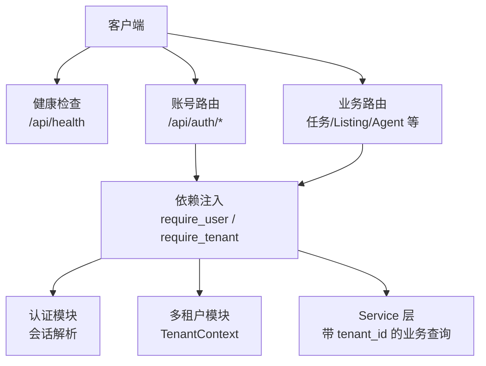
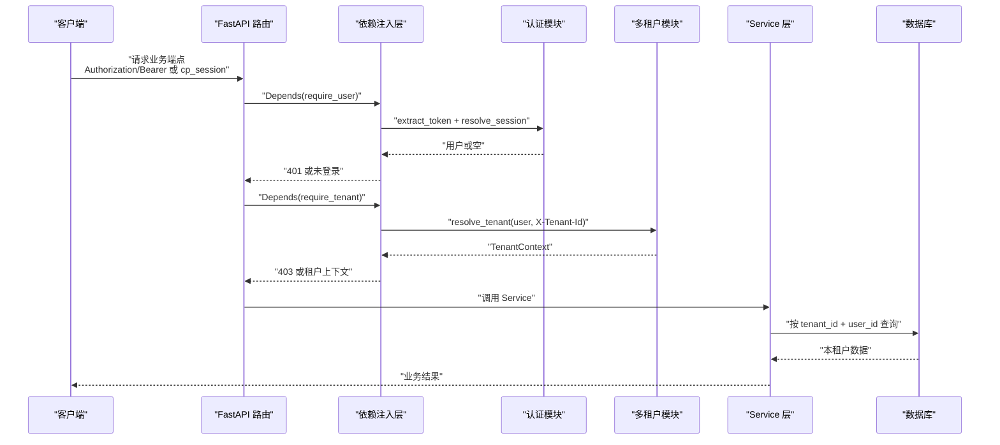
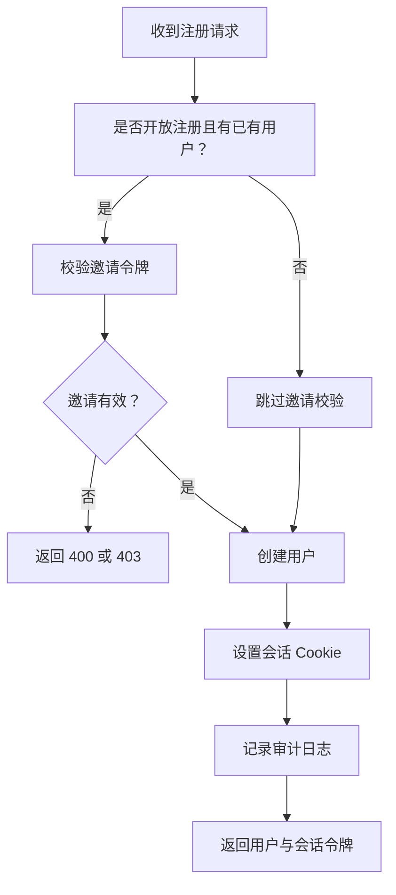
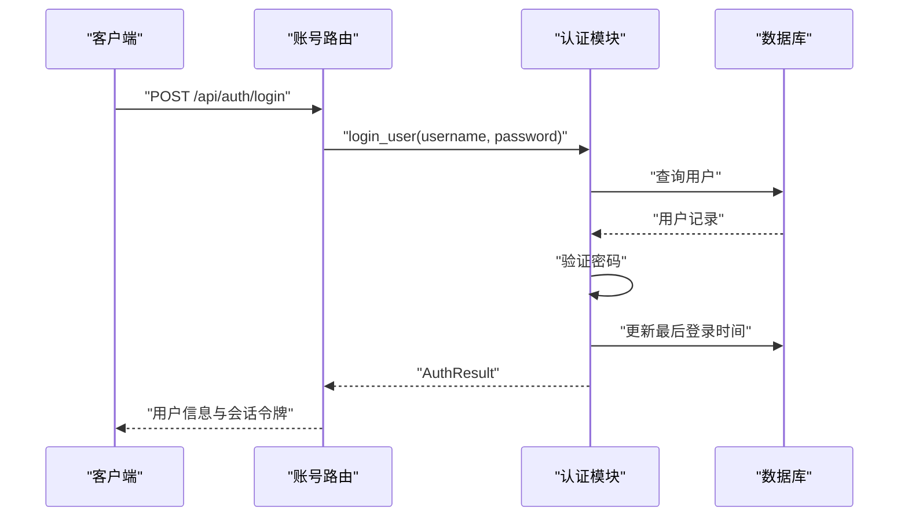
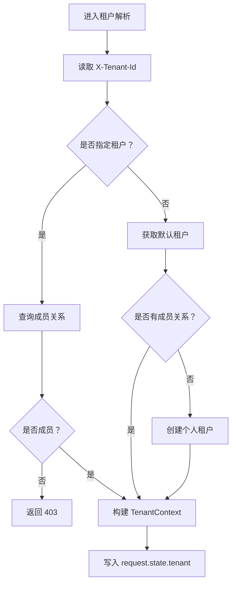
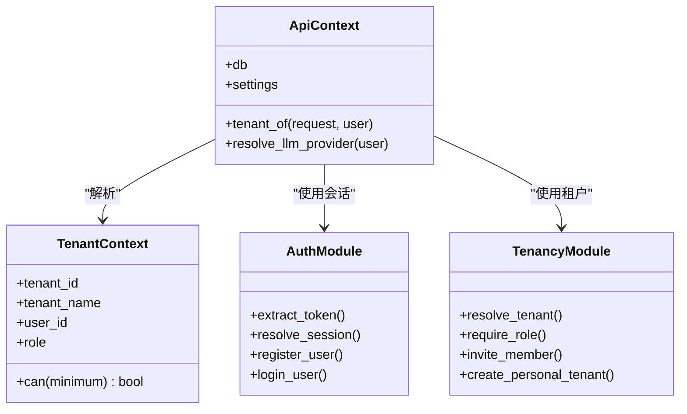
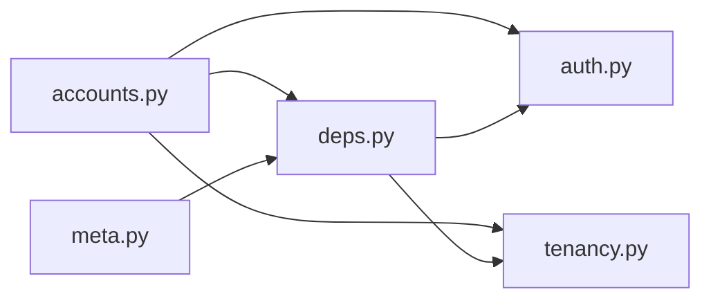

# 认证与多租户

<cite>
**本文引用的文件**   
- [backend/surge/api/accounts.py](file://backend/surge/api/accounts.py)
- [backend/surge/auth.py](file://backend/surge/auth.py)
- [backend/surge/tenancy.py](file://backend/surge/tenancy.py)
- [backend/surge/api/deps.py](file://backend/surge/api/deps.py)
- [backend/surge/api/meta.py](file://backend/surge/api/meta.py)
</cite>

## 目录
1. [简介](#简介)
2. [项目结构](#项目结构)
3. [核心组件](#核心组件)
4. [架构总览](#架构总览)
5. [详细组件分析](#详细组件分析)
6. [依赖关系分析](#依赖关系分析)
7. [性能考虑](#性能考虑)
8. [故障排查指南](#故障排查指南)
9. [结论](#结论)
10. [附录：API 参考](#附录api-参考)

## 简介
本文面向使用 Surge 的开发者，说明 BYOK（自带密钥）模式下的认证、鉴权和多租户机制。重点包括：

- 会话令牌通过 `Authorization: Bearer <token>` 或 Cookie `cp_session` 传递。
- 当前代码库中未实现服务端主动校验请求头 `X-API-Key`；BYOK 的“缺少 API Key”场景由服务层 Provider 配置驱动，典型返回为 `428 api_key_required`。
- 业务端点通过 `X-Tenant-Id` 切换租户，并由 Service 层按 `tenant_id` + `user_id` 双重过滤实现数据隔离。
- 文档给出注册、登录、获取租户、切换租户、设置默认模型等 curl 示例，并明确哪些端点不需要鉴权、哪些必须携带租户上下文。

## 项目结构
Surge 后端采用 FastAPI 路由分层：

- 认证与会话逻辑集中在 `auth.py`。
- 账号注册、登录、登出、邀请、管理员管理等路由在 `api/accounts.py`。
- 多租户解析、角色校验、成员邀请在 `tenancy.py`。
- HTTP 层共享依赖、租户解析、限流、审计在 `api/deps.py`。
- 健康检查、平台元信息在 `api/meta.py`。



**图表来源**
- [backend/surge/api/meta.py:1-60](file://backend/surge/api/meta.py#L1-L60)
- [backend/surge/api/accounts.py:1-60](file://backend/surge/api/accounts.py#L1-L60)
- [backend/surge/api/deps.py:1-120](file://backend/surge/api/deps.py#L1-L120)
- [backend/surge/auth.py:1-60](file://backend/surge/auth.py#L1-L60)
- [backend/surge/tenancy.py:1-40](file://backend/surge/tenancy.py#L1-L40)

**章节来源**
- [backend/surge/api/meta.py:1-60](file://backend/surge/api/meta.py#L1-L60)
- [backend/surge/api/accounts.py:1-60](file://backend/surge/api/accounts.py#L1-L60)
- [backend/surge/api/deps.py:1-120](file://backend/surge/api/deps.py#L1-L120)
- [backend/surge/auth.py:1-60](file://backend/surge/auth.py#L1-L60)
- [backend/surge/tenancy.py:1-40](file://backend/surge/tenancy.py#L1-L40)

## 核心组件

### 认证模块
认证模块负责：

- 密码哈希：使用标准库 scrypt，禁止明文存储。
- 会话令牌：随机令牌，数据库只存其 SHA-256。
- 令牌提取：优先从 `Authorization: Bearer` 取，其次从 Cookie `cp_session` 取。
- 会话解析：过期则删除并返回空用户。
- 注册与登录：注册自动创建个人租户，登录返回会话令牌。

关键行为：

| 能力 | 说明 |
|---|---|
| 密码强度 | 至少 8 位 |
| 用户名格式 | 3-32 位字母、数字、下划线、点或短横线 |
| 会话有效期 | 默认 7 天 |
| 首次用户 | 自动成为管理员 |
| 登录时序防御 | 对不存在用户也执行一次哈希比较，避免计时枚举 |

**章节来源**
- [backend/surge/auth.py:1-60](file://backend/surge/auth.py#L1-L60)
- [backend/surge/auth.py:60-120](file://backend/surge/auth.py#L60-L120)
- [backend/surge/auth.py:120-180](file://backend/surge/auth.py#L120-L180)
- [backend/surge/auth.py:200-274](file://backend/surge/auth.py#L200-L274)

### 账号路由
账号路由提供以下功能：

| 路径 | 方法 | 鉴权要求 | 说明 |
|---|---|---|---|
| `/api/auth/status` | GET | 可选 | 前端启动时判断是否需要初始化、是否已登录 |
| `/api/auth/demo` | POST | 无 | 一键体验，按 IP 限流，创建临时账户 |
| `/api/auth/register` | POST | 无 | 注册用户；关闭开放注册时需要邀请令牌 |
| `/api/auth/login` | POST | 无 | 登录并设置会话 Cookie |
| `/api/auth/logout` | POST | 需要登录 | 清理会话 |
| 管理员相关端点 | 多种 | 需要管理员 | 用户管理、租户与成员管理 |

注册流程支持邀请令牌：

- 如果已存在用户且关闭开放注册，除首个用户外必须提供有效邀请令牌。
- 即使开放注册开启，传入了无效邀请令牌也会返回错误。
- 接受邀请后，将用户加入对应租户。

**章节来源**
- [backend/surge/api/accounts.py:1-60](file://backend/surge/api/accounts.py#L1-L60)
- [backend/surge/api/accounts.py:60-120](file://backend/surge/api/accounts.py#L60-L120)
- [backend/surge/api/accounts.py:120-200](file://backend/surge/api/accounts.py#L120-L200)
- [backend/surge/api/accounts.py:200-451](file://backend/surge/api/accounts.py#L200-L451)

### 多租户模块
多租户模块定义：

- 角色等级：viewer、editor、admin、owner。
- `TenantContext`：包含 `tenant_id`、`tenant_name`、`user_id`、`role`。
- `resolve_tenant`：根据用户和请求中的 `X-Tenant-Id` 解析最终租户。
- `require_role`：校验最低角色。
- `invite_member`：仅 admin/owner 可添加成员。
- `create_personal_tenant`：为新用户创建个人空间。

铁律：

1. 租户 ID 只能来自已认证用户的成员关系。
2. 不传 `X-Tenant-Id` 时使用用户最早加入的租户，即个人空间。
3. 所有业务查询都应带上 `tenant_id`，并与 `user_id` 一起构成双重过滤。

**章节来源**
- [backend/surge/tenancy.py:1-131](file://backend/surge/tenancy.py#L1-L131)

### HTTP 依赖注入层
依赖注入层是认证、租户和服务装配的核心：

- `ApiContext`：集中持有数据库、对象存储、任务队列、加密工厂、设置、服务构造器。
- `get_ctx`：从 `app.state.ctx` 取出上下文。
- `require_user`：解析会话，未登录返回 401。
- `require_admin`：在 `require_user` 基础上要求管理员。
- `require_tenant`：在 `require_user` 基础上解析租户上下文。
- `optional_user`：公开接口用，有会话返回用户，否则返回空。
- `ApiContext.tenant_of`：读取请求头 `X-Tenant-Id`，调用 `tenancy.resolve_tenant`，统一 403。
- `API_KEY_REQUIRED`：标识缺少 API Key 的标准响应载荷。

注意：当前依赖层没有直接读取 `X-API-Key` 请求头来拒绝请求；“缺少 API Key”的处理更多体现在 Provider 配置与服务层行为上。

**章节来源**
- [backend/surge/api/deps.py:1-120](file://backend/surge/api/deps.py#L1-L120)
- [backend/surge/api/deps.py:180-282](file://backend/surge/api/deps.py#L180-L282)

## 架构总览
下图展示一个受保护业务请求的典型生命周期：



**图表来源**
- [backend/surge/api/deps.py:200-240](file://backend/surge/api/deps.py#L200-L240)
- [backend/surge/auth.py:120-180](file://backend/surge/auth.py#L120-L180)
- [backend/surge/tenancy.py:60-131](file://backend/surge/tenancy.py#L60-L131)

## 详细组件分析

### 鉴权流程与 BYOK 语义

#### 会话令牌
认证模块允许两种方式传递会话：

| 方式 | 位置 | 说明 |
|---|---|---|
| Authorization 头 | `Authorization: Bearer <token>` | 适合程序化客户端 |
| Cookie | `cp_session` | 适合浏览器环境，HttpOnly 更安全 |

`extract_token` 先尝试 Bearer，再回退到 Cookie。`resolve_session` 会校验会话是否存在、是否过期，并在活跃间隔内更新最后活跃时间。

#### 缺少 API Key 的行为
依赖注入层定义了常量：

| 字段 | 值 |
|---|---|
| `code` | `api_key_required` |
| `action` | `open_settings` |

该常量的注释说明它是“需要真实模型调用时缺 Key 的 428 载荷”，用于提示前端跳转设置页。不过在当前依赖层中，并未发现直接从请求头 `X-API-Key` 校验并返回 428 的代码；更常见的路径是：

1. 客户端成功登录并获得会话。
2. 客户端访问需要大模型能力的端点。
3. 服务层或 Provider 配置检测当前用户缺少可用的模型配置。
4. 返回包含 `api_key_required` 的错误，前端据此打开设置页面。

因此，“缺少 `api_key` 返回 428 `api_key_required`”应理解为 **BYOK 缺失时的业务级错误语义**，而不是一个通用的全局请求头拦截规则。

#### 请求头职责总结

| 请求头 | 作用 | 是否必须 |
|---|---|---|
| `Authorization: Bearer <token>` | 身份认证 | 受保护端点通常需要 |
| `Cookie: cp_session` | 身份认证（浏览器） | 受保护端点通常需要 |
| `X-Tenant-Id` | 指定目标租户 | 业务端点通常需要在会话登录后携带 |
| `X-API-Key` | 当前仓库未发现服务端强制校验逻辑 | 不是通用鉴权头；BYOK 缺失时由服务层返回 `api_key_required` |

**章节来源**
- [backend/surge/auth.py:120-180](file://backend/surge/auth.py#L120-L180)
- [backend/surge/api/deps.py:40-60](file://backend/surge/api/deps.py#L40-L60)
- [backend/surge/api/deps.py:100-120](file://backend/surge/api/deps.py#L100-L120)

### 账户注册、登录与邀请令牌

#### 注册流程
注册入口接受用户名、密码、显示名和可选邀请令牌。



**图表来源**
- [backend/surge/api/accounts.py:120-200](file://backend/surge/api/accounts.py#L120-L200)

#### 登录流程
登录流程验证用户名和密码，成功后设置会话 Cookie 并返回用户信息与令牌。



**图表来源**
- [backend/surge/api/accounts.py:160-200](file://backend/surge/api/accounts.py#L160-L200)
- [backend/surge/auth.py:200-240](file://backend/surge/auth.py#L200-L240)

#### 邀请令牌
邀请令牌的生命周期如下：

1. 管理员或拥有管理角色的成员创建邀请。
2. 邀请令牌关联目标租户和角色。
3. 新用户注册时携带邀请令牌。
4. 系统校验邀请令牌有效性。
5. 注册成功后，将用户加入该租户。

**章节来源**
- [backend/surge/api/accounts.py:120-200](file://backend/surge/api/accounts.py#L120-L200)
- [backend/surge/tenancy.py:100-131](file://backend/surge/tenancy.py#L100-L131)

### 租户创建与切换

#### 租户解析顺序
`ApiContext.tenant_of` 的解析顺序如下：

1. 从请求头 `X-Tenant-Id` 读取目标租户。
2. 调用 `tenancy.resolve_tenant`。
3. 如果用户无权访问该租户，返回 403。
4. 将 `TenantContext` 写入 `request.state.tenant`。

`tenancy.resolve_tenant` 的逻辑：

- 如果传入 `requested`，则查询用户在该租户的成员关系。
- 找不到成员关系时返回“无权访问该租户”。
- 如果没有传入 `requested`，则使用用户最早加入的租户。
- 如果用户没有任何成员关系，则自动创建个人租户。



**图表来源**
- [backend/surge/api/deps.py:80-100](file://backend/surge/api/deps.py#L80-L100)
- [backend/surge/tenancy.py:60-100](file://backend/surge/tenancy.py#L60-L100)

#### curl 示例

以下示例假设服务器地址为 `http://localhost:8000`，且已完成初始化和登录。

##### 获取当前租户信息
获取当前租户信息通常由业务端点返回，例如 Listing、任务、仪表盘等端点在鉴权后返回当前租户上下文或基于租户的数据。若某个端点返回当前租户信息，可在登录后直接调用：

```bash
curl -H "Authorization: Bearer YOUR_SESSION_TOKEN" \
     "http://localhost:8000/api/listings"
```

如果端点需要显式切换租户，则加上 `X-Tenant-Id`。

##### 切换租户
切换租户的关键是在后续请求中携带 `X-Tenant-Id`：

```bash
curl -H "Authorization: Bearer YOUR_SESSION_TOKEN" \
     -H "X-Tenant-Id: TARGET_TENANT_ID" \
     "http://localhost:8000/api/tasks"
```

如果 `TARGET_TENANT_ID` 不是当前用户的成员，将返回 403。

##### 设置默认模型
设置默认模型通常通过设置类端点完成。当前依赖层会在需要模型能力时读取用户配置的 Provider 或模型设置；若配置缺失，可能返回 `api_key_required`。示例：

```bash
curl -X POST \
     -H "Authorization: Bearer YOUR_SESSION_TOKEN" \
     -H "Content-Type: application/json" \
     -d '{"provider":"openai","model":"gpt-4o"}' \
     "http://localhost:8000/api/settings/models"
```

实际字段以具体设置端点的请求体定义为准。若服务端检测到用户缺少可用模型配置，可能返回：

```json
{
  "code": "api_key_required",
  "action": "open_settings"
}
```

**章节来源**
- [backend/surge/api/deps.py:80-120](file://backend/surge/api/deps.py#L80-L120)
- [backend/surge/tenancy.py:60-100](file://backend/surge/tenancy.py#L60-L100)
- [backend/surge/api/deps.py:40-60](file://backend/surge/api/deps.py#L40-L60)

### 权限校验与数据隔离

#### 权限层级
多租户模块定义了四种角色：

| 角色 | 等级 | 典型权限 |
|---|---:|---|
| viewer | 1 | 只读 |
| editor | 2 | 创建任务、编辑 Listing、上传数据 |
| admin | 3 | 成员管理、数据源、店铺、模型配置 |
| owner | 4 | 全部权限，含删除租户 |

#### 数据隔离生效位置
多租户数据隔离的关键在于：

1. 路由层通过 `require_tenant` 把 `TenantContext` 注入请求。
2. Service 层使用 `tenant_id` 查询数据库。
3. 文档注释强调：所有业务查询都必须带上 `tenant_id`，并与 `user_id` 共同构成双重过滤。

虽然当前 tenancy.py 本身不包含数据库查询 SQL，但它提供了 `TenantContext`、角色校验和成员关系校验；真正的数据隔离发生在 Service 层和持久层调用数据库时。



**图表来源**
- [backend/surge/api/deps.py:60-120](file://backend/surge/api/deps.py#L60-L120)
- [backend/surge/tenancy.py:20-100](file://backend/surge/tenancy.py#L20-L100)
- [backend/surge/auth.py:120-180](file://backend/surge/auth.py#L120-L180)

**章节来源**
- [backend/surge/tenancy.py:1-131](file://backend/surge/tenancy.py#L1-L131)
- [backend/surge/api/deps.py:60-120](file://backend/surge/api/deps.py#L60-L120)

## 依赖关系分析



**图表来源**
- [backend/surge/api/accounts.py:1-30](file://backend/surge/api/accounts.py#L1-L30)
- [backend/surge/api/meta.py:1-30](file://backend/surge/api/meta.py#L1-L30)
- [backend/surge/api/deps.py:1-40](file://backend/surge/api/deps.py#L1-L40)
- [backend/surge/auth.py:1-30](file://backend/surge/auth.py#L1-L30)
- [backend/surge/tenancy.py:1-20](file://backend/surge/tenancy.py#L1-L20)

**章节来源**
- [backend/surge/api/accounts.py:1-30](file://backend/surge/api/accounts.py#L1-L30)
- [backend/surge/api/meta.py:1-30](file://backend/surge/api/meta.py#L1-L30)
- [backend/surge/api/deps.py:1-40](file://backend/surge/api/deps.py#L1-L40)

## 性能考虑
- 会话最后活跃时间更新采用节流策略，避免每次请求都写数据库。
- 健康检查中对 Provider 状态和 Worker 健康探测做了异常捕获，确保探针失败不影响整体健康状态。
- 租户解析使用了性能计时钩子，便于定位租户解析开销。

**章节来源**
- [backend/surge/auth.py:140-180](file://backend/surge/auth.py#L140-L180)
- [backend/surge/api/meta.py:60-140](file://backend/surge/api/meta.py#L60-L140)
- [backend/surge/api/deps.py:80-100](file://backend/surge/api/deps.py#L80-L100)

## 故障排查指南

| 现象 | 可能原因 | 处理建议 |
|---|---|---|
| 401 未登录 | 未携带 `Authorization: Bearer` 或 `cp_session` 失效 | 重新登录，保存会话令牌 |
| 403 无权访问租户 | `X-Tenant-Id` 不是当前用户成员 | 确认租户归属或使用默认租户 |
| 403 需要管理员权限 | 非管理员访问管理员端点 | 使用管理员账户 |
| 428 `api_key_required` | 当前用户缺少可用模型配置 | 打开设置页配置 Provider 或 API Key |
| 注册返回邀请错误 | 关闭开放注册但邀请令牌无效 | 检查邀请链接或联系管理员 |
| 健康检查不可用 | Provider 配置错误或 Redis 不可用 | 检查 Provider 配置、Redis 连接 |

**章节来源**
- [backend/surge/api/deps.py:200-240](file://backend/surge/api/deps.py#L200-L240)
- [backend/surge/api/meta.py:60-140](file://backend/surge/api/meta.py#L60-L140)
- [backend/surge/api/accounts.py:120-200](file://backend/surge/api/accounts.py#L120-L200)

## 结论
Surge 的认证与多租户机制可以概括为：

- 认证基于会话令牌，支持 Bearer 与 Cookie。
- 当前仓库未发现对 `X-API-Key` 的全局鉴权拦截；BYOK 缺失时通过 `api_key_required` 业务错误提示前端设置。
- 多租户通过 `X-Tenant-Id` 切换，由 `TenantContext` 承载用户角色和租户信息。
- 数据隔离在 Service 层通过 `tenant_id` + `user_id` 双重过滤生效。
- 健康检查和部分元信息端点不需要登录；绝大多数业务端点需要登录，并且需要有效的租户上下文。

## 附录：API 参考

### 公开或半公开端点

| 路径 | 方法 | 鉴权 | 说明 |
|---|---|---|---|
| `/api/health` | GET | 可选 | 健康检查，可反映当前用户模型配置 |
| `/` | GET | 无 | SPA 外壳 |
| 前端路由路径 | GET | 无 | 如 `/dashboard`、`/settings` 等返回 SPA 外壳 |

**章节来源**
- [backend/surge/api/meta.py:1-60](file://backend/surge/api/meta.py#L1-L60)
- [backend/surge/api/meta.py:60-140](file://backend/surge/api/meta.py#L60-L140)

### 认证相关端点

| 路径 | 方法 | 鉴权 | 说明 |
|---|---|---|---|
| `/api/auth/status` | GET | 可选 | 获取初始化状态和当前用户信息 |
| `/api/auth/demo` | POST | 无 | 一键体验，按 IP 限流 |
| `/api/auth/register` | POST | 无 | 注册；可能需要邀请令牌 |
| `/api/auth/login` | POST | 无 | 登录并设置会话 |
| `/api/auth/logout` | POST | 需要登录 | 注销 |

**章节来源**
- [backend/surge/api/accounts.py:60-200](file://backend/surge/api/accounts.py#L60-L200)

### 需要租户上下文的端点
几乎所有业务端点都会使用 `Depends(require_tenant)`，包括但不限于：

- 任务端点
- Listing 端点
- Agent 端点
- 分析端点
- 市场端点
- 技能端点
- 店铺端点

这些端点必须在登录后携带 `X-Tenant-Id`，除非希望使用默认租户。

**章节来源**
- [backend/surge/api/deps.py:230-240](file://backend/surge/api/deps.py#L230-L240)
- [backend/surge/tenancy.py:60-100](file://backend/surge/tenancy.py#L60-L100)