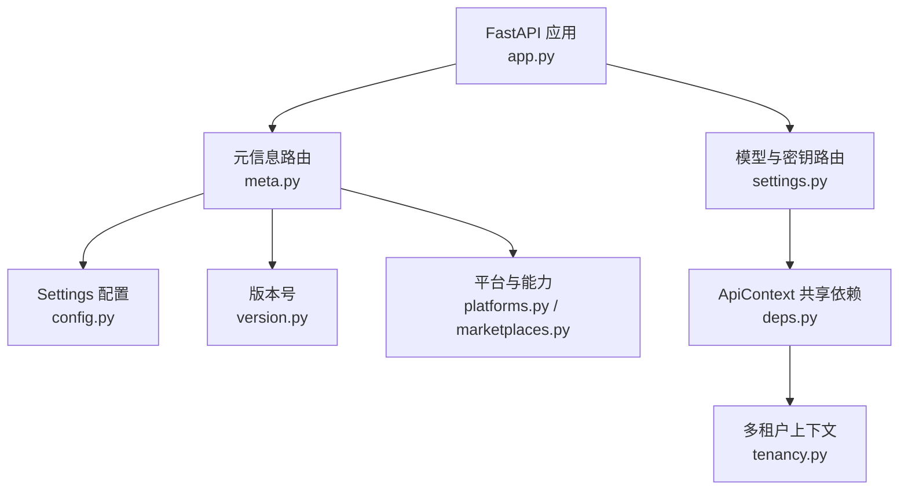
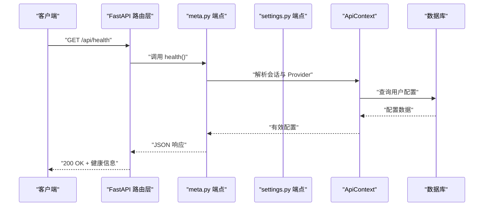
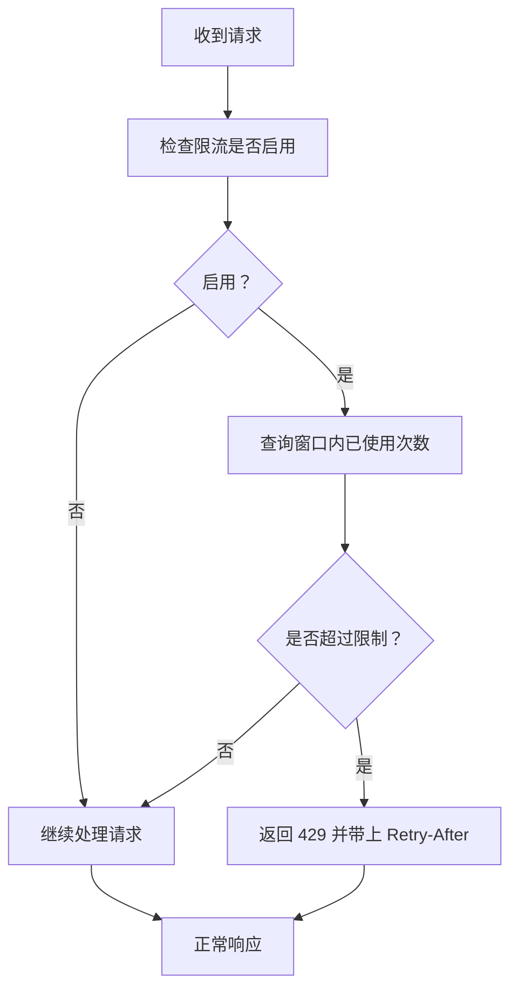
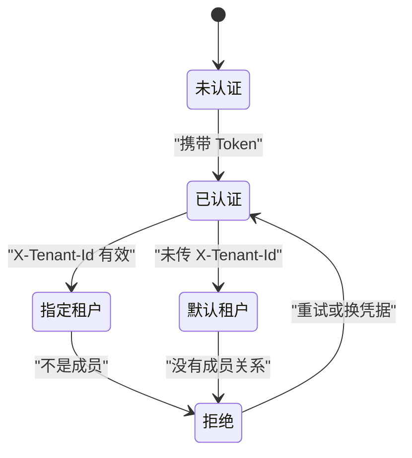
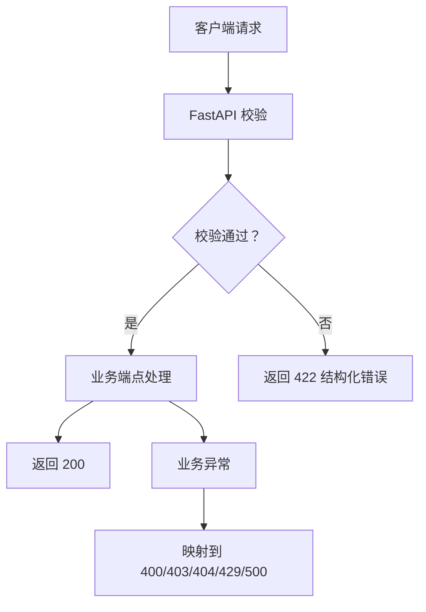

# 通用接口

<cite>
**本文引用的文件**   
- [backend/surge/api/meta.py](file://backend/surge/api/meta.py)
- [backend/surge/api/settings.py](file://backend/surge/api/settings.py)
- [backend/surge/app.py](file://backend/surge/app.py)
- [backend/surge/config.py](file://backend/surge/config.py)
- [backend/surge/tenancy.py](file://backend/surge/tenancy.py)
- [backend/surge/version.py](file://backend/surge/version.py)
- [backend/surge/models.py](file://backend/surge/models.py)
- [backend/surge/market/platforms.py](file://backend/surge/market/platforms.py)
- [backend/surge/market/marketplaces.py](file://backend/surge/market/marketplaces.py)
- [backend/surge/api/deps.py](file://backend/surge/api/deps.py)
</cite>

## 目录
1. [引言](#引言)
2. [项目结构定位](#项目结构定位)
3. [通用接口总览](#通用接口总览)
4. [架构与 OpenAPI 生成机制](#架构与-openapi-生成机制)
5. [端点详细说明](#端点详细说明)
6. [全局限制：限流与上传大小](#全局限制限流与上传大小)
7. [多租户行为差异](#多租户行为差异)
8. [客户端调用示例](#客户端调用示例)
9. [错误处理与状态码](#错误处理与状态码)
10. [性能与可观测性](#性能与可观测性)
11. [故障排查](#故障排查)
12. [结论](#结论)

## 引言

本参考文档面向 Surge 的“通用系统接口”，即健康检查、元信息、平台枚举、模型配置和设置管理等无业务上下文或低业务上下文的端点。它们通常用于：

- 前端初始化：加载品牌、版本、SPA 外壳、平台能力。
- 动态能力探测：判断是否启用 API Key、当前 Provider 是否可用、后台执行器状态。
- 运行时配置：读取和修改用户级模型配置与多厂商 Provider 配置。
- 演示站体验：创建访客账号、测试连接、观察限流行为。

这些接口横跨 `backend/surge/api/meta.py` 与 `backend/surge/api/settings.py`，并依赖 FastAPI 应用装配层、配置模块、市场平台定义以及多租户权限模型。

## 项目结构定位

Surge 的后端采用按领域拆分路由的方式：

- 应用装配层位于 `backend/surge/app.py`，负责构造 FastAPI、挂载中间件、注册全部 Router。
- 通用系统接口集中在 `backend/surge/api/meta.py`（健康、平台、Provider 状态）和 `backend/surge/api/settings.py`（模型配置、Provider 配置）。
- 共享依赖、限流、审计等横切逻辑在 `backend/surge/api/deps.py`。
- 平台与站点规则来自 `backend/surge/market/platforms.py` 与 `backend/surge/market/marketplaces.py`。
- 全局运行配置来自 `backend/surge/config.py`。
- 多租户上下文由 `backend/surge/tenancy.py` 提供。
- 对外版本号来自 `backend/surge/version.py`。
- 通用 Pydantic 枚举（如平台枚举）也存在于 `backend/surge/models.py`。



**图示来源**
- [backend/surge/app.py:60-120](file://backend/surge/app.py#L60-L120)
- [backend/surge/api/meta.py:1-30](file://backend/surge/api/meta.py#L1-L30)
- [backend/surge/api/settings.py:1-35](file://backend/surge/api/settings.py#L1-L35)
- [backend/surge/api/deps.py:1-40](file://backend/surge/api/deps.py#L1-L40)

**章节来源**
- [backend/surge/app.py:1-120](file://backend/surge/app.py#L1-L120)
- [backend/surge/api/meta.py:1-30](file://backend/surge/api/meta.py#L1-L30)
- [backend/surge/api/settings.py:1-35](file://backend/surge/api/settings.py#L1-L35)

## 通用接口总览

下表列出本次覆盖的通用接口。部分端点在 OpenAPI Schema 中隐藏，例如 SPA 外壳路由。

| HTTP 方法 | URL | 认证要求 | 主要用途 | 关键响应字段 | 典型状态码 |
|---|---|---|---|---|---|
| GET | `/` | 否 | 返回 SPA 外壳页面 | HTML | 200、500 |
| GET | `/workbench` 等 SPA 路由 | 否 | 前端单页应用路由入口 | HTML | 200、500 |
| GET | `/api/health` | 可选 | 健康检查与 Provider 可用性探测 | status、version、brand、provider、configured_model、worker | 200 |
| GET | `/api/platforms` | 否 | 查询支持的平台、站点、能力和默认平台 | platforms、marketplaces、catalog、capabilities、default_platform | 200 |
| GET | `/api/platform-rules/{platform}/{marketplace}` | 否 | 查询某平台某站点的字符上限与禁用词规则 | 规则字典 | 200、404 |
| GET | `/api/ban-lists` | 否 | 查询禁用词分类与绝对化用语清单 | categories、universal_superlatives | 200 |
| GET | `/api/providers` | 是 | 查询当前用户的激活模型、Provider 状态与已知模型列表 | active、model、source、status、models | 200 |
| POST | `/api/providers/ping` | 是 | 用当前用户已保存配置真实调用一次模型 | ok、detail、model、elapsed_ms | 200 |
| GET | `/api/settings/model` | 是 | 读取旧版单套模型配置 | provider、model、base_url、timeout 等 | 200 |
| PUT | `/api/settings/model` | 是 | 更新旧版单套模型配置 | provider、model、base_url、timeout 等 | 200、400、500 |
| DELETE | `/api/settings/model` | 是 | 重置旧版单套模型配置 | provider、model 等 | 200 |
| POST | `/api/settings/model/test` | 是 | 测试提交但未保存的模型参数连通性 | ok、detail、model、elapsed_ms | 200 |
| GET | `/api/settings/providers` | 是 | 列出当前用户的 Provider 配置集合 | configs、active_config_id | 200 |
| POST | `/api/settings/providers` | 是 | 新增或更新一套 Provider 配置 | config | 200、400、500 |
| POST | `/api/settings/providers/models` | 是 | 读取该配置下真正可用的模型名 | models | 200、400 |
| DELETE | `/api/settings/providers/{config_id}` | 是 | 删除一套 Provider 配置 | ok、active_config_id | 200、404 |
| POST | `/api/settings/providers/{config_id}/test` | 是 | 最小连通性测试，结果落库但不改激活状态 | ok、detail、model、elapsed_ms、raw、config | 200、404 |
| POST | `/api/settings/providers/{config_id}/activate` | 是 | 激活一套 Provider 配置 | config、active_config_id | 200、400 |

**章节来源**
- [backend/surge/api/meta.py:1-220](file://backend/surge/api/meta.py#L1-L220)
- [backend/surge/api/meta.py:220-339](file://backend/surge/api/meta.py#L220-L339)
- [backend/surge/api/settings.py:1-200](file://backend/surge/api/settings.py#L1-L200)
- [backend/surge/api/settings.py:201-364](file://backend/surge/api/settings.py#L201-L364)

## 架构与 OpenAPI 生成机制

### FastAPI 自动生成的 OpenAPI/Swagger

Surge 使用 FastAPI 作为 Web 框架。FastAPI 会基于以下信息自动生成 OpenAPI 描述和 Swagger UI：

- `title`、`version`、`description`：来自 FastAPI 应用构造参数。
- 每个 `APIRouter` 上的装饰器：`@router.get`、`@router.post`、`@router.put`、`@router.delete`。
- 函数参数中的 Pydantic 模型：例如 `ModelSettingsUpdate`、`ProviderConfigInput`、`ProviderModelsInput`。
- `response_class`：例如 `HTMLResponse`。
- `include_in_schema=False`：明确从 OpenAPI 文档中隐藏某些端点。

因此，OpenAPI 文档中的“请求体”“响应体”“错误体”主要由以下组件决定：

1. **Pydantic 输入模型**：定义必填字段、类型、校验规则。
2. **函数返回值注释或返回对象**：FastAPI 会尝试推断响应结构。
3. **HTTPException**：定义状态码和 detail。
4. **全局异常处理器**：把请求校验失败统一为 422 结构化 JSON。



**图示来源**
- [backend/surge/app.py:60-120](file://backend/surge/app.py#L60-L120)
- [backend/surge/api/meta.py:140-220](file://backend/surge/api/meta.py#L140-L220)
- [backend/surge/api/deps.py:100-160](file://backend/surge/api/deps.py#L100-L160)

**章节来源**
- [backend/surge/app.py:60-120](file://backend/surge/app.py#L60-L120)
- [backend/surge/app.py:201-277](file://backend/surge/app.py#L201-L277)
- [backend/surge/api/meta.py:1-30](file://backend/surge/api/meta.py#L1-L30)
- [backend/surge/api/settings.py:1-35](file://backend/surge/api/settings.py#L1-L35)

## 端点详细说明

### 健康检查：`GET /api/health`

#### 用途

这是前端初始化的关键端点。它回答：

- 服务是否存活。
- 当前版本和品牌名称。
- 是否需要 API Key。
- 当前用户的模型配置是否生效。
- 当前 Provider 是否可用。
- 异步执行器是否可用。

#### 请求

- 方法：GET
- URL：`/api/health`
- 认证：可选。携带 Token 时返回与当前用户相关的 Provider 信息；未登录时只返回进程级默认值。

#### 响应字段

| 字段 | 类型 | 含义 |
|---|---|---|
| status | string | 固定为 `ok` |
| version | string | 当前 Surge 版本，例如 `V1.0` |
| brand | string | 品牌名称，来自当前 Settings |
| requires_api_key | boolean | 是否要求 API Key |
| configured_model | object \| null | 当前生效的 provider、model、source |
| provider | object | 当前 Provider 名称、是否可用、是否已验证、错误详情 |
| worker | object | 异步执行器后端、是否存活、Redis 状态 |
| marketplace_mode | string | mock 或 live |
| demo_data | string | 说明示例数据性质 |
| db | string | 数据库路径或连接标识 |
| platforms | array | 支持的平台列表 |

#### 错误

该端点内部对 Provider 状态、Worker 探测、会话解析等做了容错，通常不会因底层异常而失败。若 Session 解析或 Provider 探测失败，对应字段可能为空或不可用，但健康检查本身仍应返回 200。

#### 示例

```bash
curl -i http://localhost:8000/api/health
```

```python
import requests

resp = requests.get("http://localhost:8000/api/health")
print(resp.status_code, resp.json())
```

**章节来源**
- [backend/surge/api/meta.py:120-220](file://backend/surge/api/meta.py#L120-L220)
- [backend/surge/version.py:1-11](file://backend/surge/version.py#L1-L11)

### SPA 外壳与静态路由

#### 用途

Surge 是一个单页应用。根路径和一组预定义路由都返回同一个 `index.html`，由前端 JavaScript 接管路由。

#### 相关路由

- `/`
- `/workbench`
- `/dashboard`
- `/tasks`
- `/tasks/{task_id}`
- `/data`
- `/agents`
- `/skills`
- `/stores`
- `/stores/authorize`
- `/stores/product`
- `/stores/ledger`
- `/settings`
- `/research`
- `/assets`
- `/operations`
- `/workflows`
- `/knowledge`

#### 特点

- 响应类型为 HTML。
- 不在 OpenAPI Schema 中暴露。
- 注入构建时间戳以强制浏览器刷新静态资源。
- 如果缺少 `frontend/index.html`，返回 500。

#### 示例

```bash
curl -i http://localhost:8000/workbench
```

```python
import requests

resp = requests.get("http://localhost:8000/workbench")
print(resp.status_code, resp.headers.get("Content-Type"))
```

**章节来源**
- [backend/surge/api/meta.py:30-120](file://backend/surge/api/meta.py#L30-L120)

### 平台与站点元信息

#### `GET /api/platforms`

返回三类信息：

1. **平台规则**：支持的平台、字符上限、禁用词来源。
2. **Marketplace 列表**：支持的站点代码。
3. **Catalog**：平台接入目录，包含字段名、能力、认证方式、真实接入状态。
4. **能力集合**：`products`、`orders`、`ads`、`metrics`、`fees`。
5. **默认平台**。

#### `GET /api/platform-rules/{platform}/{marketplace}`

根据平台和站点返回具体规则。不支持的平台或站点返回 404。

#### `GET /api/ban-lists`

返回禁用词分类、绝对化用语清单，并附带免责声明：清单为项目内部可配置示例，未经平台审核。

#### 响应字段摘要

| 端点 | 关键字段 |
|---|---|
| `/api/platforms` | platforms、marketplaces、catalog、capabilities、default_platform、note、catalog_note |
| `/api/platform-rules/{platform}/{marketplace}` | 规则字典，包含字符上限、禁用词等 |
| `/api/ban-lists` | categories、universal_superlatives、disclaimer |

#### 示例

```bash
curl -i http://localhost:8000/api/platforms
curl -i http://localhost:8000/api/platform-rules/amazon/US
curl -i http://localhost:8000/api/ban-lists
```

```python
import requests

print(requests.get("http://localhost:8000/api/platforms").json())
print(requests.get("http://localhost:8000/api/platform-rules/amazon/US").json())
print(requests.get("http://localhost:8000/api/ban-lists").json())
```

**章节来源**
- [backend/surge/api/meta.py:201-260](file://backend/surge/api/meta.py#L201-L260)
- [backend/surge/market/platforms.py:1-80](file://backend/surge/market/platforms.py#L1-L80)
- [backend/surge/market/marketplaces.py:1-60](file://backend/surge/market/marketplaces.py#L1-L60)

### Provider 状态与连通性

#### `GET /api/providers`

需要登录。返回：

- 当前激活的 provider。
- 当前 model。
- 配置来源。
- Provider 状态。
- 已知模型列表。
- 说明 deepseek-flash 与退役旧模型名的关系。

#### `POST /api/providers/ping`

需要登录。使用当前用户已保存的配置真实调用一次模型。它会消耗极少量额度，适合前端在保存后做“真实连通性测试”。

#### 响应字段摘要

| 端点 | 关键字段 |
|---|---|
| `/api/providers` | active、model、source、status、models、note |
| `/api/providers/ping` | ok、detail、model、elapsed_ms |

#### 示例

```bash
curl -i -H "Authorization: Bearer YOUR_TOKEN" http://localhost:8000/api/providers
curl -i -X POST -H "Authorization: Bearer YOUR_TOKEN" http://localhost:8000/api/providers/ping
```

```python
import requests

headers = {"Authorization": "Bearer YOUR_TOKEN"}
print(requests.get("http://localhost:8000/api/providers", headers=headers).json())
print(requests.post("http://localhost:8000/api/providers/ping", headers=headers).json())
```

**章节来源**
- [backend/surge/api/meta.py:260-339](file://backend/surge/api/meta.py#L260-L339)

### 旧版模型配置：`/api/settings/model`

#### 用途

这是遗留的单套模型配置接口。代码注释明确说明它是回退路径，新增功能应走新的 Provider 配置接口。

#### 端点

| HTTP 方法 | URL | 认证 | 行为 |
|---|---|---|---|
| GET | `/api/settings/model` | 是 | 读取当前用户的模型配置 |
| PUT | `/api/settings/model` | 是 | 更新当前用户的模型配置 |
| DELETE | `/api/settings/model` | 是 | 重置当前用户的模型配置 |
| POST | `/api/settings/model/test` | 是 | 测试提交但未保存的参数 |

#### 请求体

PUT 和 POST test 使用 `ModelSettingsUpdate`，常见字段包括 provider、model、base_url、timeout、max_retries、temperature、thinking、reasoning_effort、api_key。

#### 响应

返回服务端公开的配置视图，通常包含 provider、model、base_url、timeout 等字段。

#### 错误

- 400：模型配置校验失败。
- 403：演示账号写入被拒绝。
- 500：保存配置失败。

#### 示例

```bash
curl -i -H "Authorization: Bearer YOUR_TOKEN" http://localhost:8000/api/settings/model
curl -i -X PUT -H "Authorization: Bearer YOUR_TOKEN" -H "Content-Type: application/json" \
  -d '{"provider":"deepseek","model":"deepseek-chat"}' \
  http://localhost:8000/api/settings/model
```

```python
import requests

headers = {"Authorization": "Bearer YOUR_TOKEN"}
print(requests.get("http://localhost:8000/api/settings/model", headers=headers).json())
```

**章节来源**
- [backend/surge/api/settings.py:1-120](file://backend/surge/api/settings.py#L1-L120)

### 新版 Provider 配置：`/api/settings/providers`

#### 用途

这是设置页实际使用的接口。一个账号可以保存多套 Provider 配置，每次只激活一套。

#### 端点

| HTTP 方法 | URL | 认证 | 行为 |
|---|---|---|---|
| GET | `/api/settings/providers` | 是 | 列出当前用户的 Provider 配置 |
| POST | `/api/settings/providers` | 是 | 新增或更新一套配置 |
| POST | `/api/settings/providers/models` | 是 | 读取该配置下的可用模型 |
| DELETE | `/api/settings/providers/{config_id}` | 是 | 删除一套配置 |
| POST | `/api/settings/providers/{config_id}/test` | 是 | 连通性测试，结果落库但不改激活状态 |
| POST | `/api/settings/providers/{config_id}/activate` | 是 | 激活一套配置 |

#### 请求体

- 新增或更新：`ProviderConfigInput`。
- 模型列表：`ProviderModelsInput`。

#### 响应字段摘要

| 端点 | 关键字段 |
|---|---|
| GET providers | configs、active_config_id |
| POST providers | config |
| POST providers/models | models |
| DELETE providers/{id} | ok、active_config_id |
| POST providers/{id}/test | ok、detail、model、elapsed_ms、raw、config |
| POST providers/{id}/activate | config、active_config_id |

#### 示例

```bash
curl -i -H "Authorization: Bearer YOUR_TOKEN" http://localhost:8000/api/settings/providers
curl -i -X POST -H "Authorization: Bearer YOUR_TOKEN" -H "Content-Type: application/json" \
  -d '{"provider":"deepseek","model":"deepseek-chat","label":"我的配置"}' \
  http://localhost:8000/api/settings/providers
```

```python
import requests

headers = {"Authorization": "Bearer YOUR_TOKEN"}
print(requests.get("http://localhost:8000/api/settings/providers", headers=headers).json())
```

**章节来源**
- [backend/surge/api/settings.py:1-200](file://backend/surge/api/settings.py#L1-L200)
- [backend/surge/api/settings.py:201-364](file://backend/surge/api/settings.py#L201-L364)

## 全局限制：限流与上传大小

### 限流配置

全局限流通过 Settings 控制，关键环境变量如下：

| 配置项 | 默认值 | 含义 |
|---|---:|---|
| SURGE_RATE_LIMIT_ENABLED | true | 是否启用限流 |
| SURGE_RATE_LIMIT_TASKS_PER_HOUR | 10 | 每账号每小时任务数 |
| SURGE_RATE_LIMIT_KEY_TESTS_PER_HOUR | 5 | 每账号每小时 Provider Key 测试次数 |
| SURGE_RATE_LIMIT_GUEST_PER_HOUR | 5 | 访客账号按 IP 每小时创建次数 |

这些配置由 `backend/surge/config.py` 提供，并在 `backend/surge/demo/demo_mode.py` 和 `backend/surge/api/deps.py` 中被使用。

### 受影响端点

虽然本参考文档聚焦通用接口，但限流会影响多个端点：

- 任务类端点：受 `rate_limit_tasks_per_hour` 影响。
- Provider 配置测试：受 `rate_limit_key_tests_per_hour` 影响。
- 演示账号创建：受 `rate_limit_guest_per_hour` 影响。

当触达限流阈值时，`ApiContext.rate_limit_identity` 抛出 429，并附带 `Retry-After` 响应头。

### 上传大小限制

`SURGE_MAX_UPLOAD_BYTES` 控制最大上传字节数，默认值为 5 MiB。它在导入等涉及文件上传的接口中使用，超出时返回 400，提示文件超过上限。

### 限流流程图



**图示来源**
- [backend/surge/api/deps.py:131-151](file://backend/surge/api/deps.py#L131-L151)
- [backend/surge/config.py:145-149](file://backend/surge/config.py#L145-L149)
- [backend/surge/config.py:120-130](file://backend/surge/config.py#L120-L130)

**章节来源**
- [backend/surge/config.py:120-149](file://backend/surge/config.py#L120-L149)
- [backend/surge/api/deps.py:131-151](file://backend/surge/api/deps.py#L131-L151)

## 多租户行为差异

### 租户解析规则

多租户的核心规则是：

1. 租户 ID 只能来自已认证用户的成员关系。
2. 客户端可传 `X-Tenant-Id` 表示希望切换到哪个租户，但必须校验用户确实属于该租户。
3. 不传时使用用户最早加入的租户，通常是个人空间。
4. 所有业务查询都应带上 tenant_id。

角色分为 viewer、editor、admin、owner，分别对应不同权限。

### 对通用接口的影响

- `/api/health`：不需要登录，因此不体现租户差异。
- `/api/platforms`、`/api/platform-rules/*`、`/api/ban-lists`：不需要登录，不体现租户差异。
- `/api/providers`、`/api/providers/ping`：需要登录，返回的是当前用户的模型配置，不直接返回 tenant_id，但配置是按 user_id 存储的。
- `/api/settings/model`、`/api/settings/providers*`：需要登录，配置按用户隔离。演示账号是共享账户，禁止写入 Provider 配置。
- 多租户显式切换主要通过 `X-Tenant-Id` 在需要租户上下文的端点中生效；通用接口多数不直接暴露租户选择，但鉴权与会话解析与多租户体系共用同一基础设施。

### 权限错误

无权访问租户时会抛出 `TenantError`，由应用层统一转为 403，消息可直接展示给用户。



**图示来源**
- [backend/surge/tenancy.py:1-131](file://backend/surge/tenancy.py#L1-L131)
- [backend/surge/app.py:215-235](file://backend/surge/app.py#L215-L235)

**章节来源**
- [backend/surge/tenancy.py:1-131](file://backend/surge/tenancy.py#L1-L131)
- [backend/surge/app.py:215-235](file://backend/surge/app.py#L215-L235)

## 客户端调用示例

### Python requests

```python
import requests

BASE = "http://localhost:8000"

# 健康检查
print(requests.get(f"{BASE}/api/health").json())

# 平台能力
print(requests.get(f"{BASE}/api/platforms").json())

# 带认证的 Provider 状态
headers = {"Authorization": "Bearer YOUR_TOKEN"}
print(requests.get(f"{BASE}/api/providers", headers=headers).json())

# 带认证的模型配置
print(requests.get(f"{BASE}/api/settings/model", headers=headers).json())
```

### curl

```bash
curl http://localhost:8000/api/health
curl http://localhost:8000/api/platforms
curl -H "Authorization: Bearer YOUR_TOKEN" http://localhost:8000/api/providers
curl -H "Authorization: Bearer YOUR_TOKEN" http://localhost:8000/api/settings/model
```

**章节来源**
- [backend/surge/api/meta.py:120-220](file://backend/surge/api/meta.py#L120-L220)
- [backend/surge/api/settings.py:1-200](file://backend/surge/api/settings.py#L1-L200)

## 错误处理与状态码

### 通用状态码

| 状态码 | 含义 | 触发位置 |
|---:|---|---|
| 200 | 成功 | 大多数通用接口 |
| 400 | 请求参数错误或配置无效 | 模型配置更新、Provider 配置保存 |
| 403 | 权限不足或演示账号写入被拒绝 | 租户无权、演示账号写保护 |
| 404 | 资源不存在 | 平台规则未知、Provider 配置不存在 |
| 422 | 请求校验失败 | FastAPI/Pydantic 校验错误 |
| 429 | 触发限流 | 任务、Key 测试、访客账号创建 |
| 500 | 服务器内部错误 | SPA 外壳缺失、保存配置失败 |
| 503 | 数据库暂时不可用 | 全局数据库异常处理器 |

### 校验错误结构

FastAPI 的 `RequestValidationError` 和 Pydantic 的 `ValidationError` 会被统一转换为 422 JSON，包含 message 和 errors 数组。errors 中的每条错误有 field、message、type、ctx。



**图示来源**
- [backend/surge/app.py:201-235](file://backend/surge/app.py#L201-L235)
- [backend/surge/api/deps.py:131-151](file://backend/surge/api/deps.py#L131-L151)

**章节来源**
- [backend/surge/app.py:201-235](file://backend/surge/app.py#L201-L235)
- [backend/surge/api/settings.py:60-120](file://backend/surge/api/settings.py#L60-L120)
- [backend/surge/api/settings.py:201-364](file://backend/surge/api/settings.py#L201-L364)

## 性能与可观测性

### Worker 健康探测

`/api/health` 中的 worker 健康检查不会建立长连接或发起业务请求，只检查：

- 任务队列后端是 thread 还是 arq。
- Redis 是否可达。
- 整体 alive 状态。

这使健康检查保持轻量，避免误报或拖慢前端初始化。

### 性能观测

当启用 `profile=True` 时，应用会在响应头中添加 `Server-Timing` 和 `X-Perf`，并把性能快照写入日志。这不是通用接口的必需能力，但对排查延迟有帮助。

### 前端静态资源缓存

SPA 外壳和资源一律带 `Cache-Control: no-cache`，并通过构建时间戳替换前端脚本中的版本号，确保修改前端后浏览器重新拉取新资源。

**章节来源**
- [backend/surge/api/meta.py:60-120](file://backend/surge/api/meta.py#L60-L120)
- [backend/surge/app.py:20-60](file://backend/surge/app.py#L20-L60)
- [backend/surge/app.py:60-100](file://backend/surge/app.py#L60-L100)

## 故障排查

### 健康检查返回 Provider 不可用

可能原因：

- 未配置 API Key。
- API Key 无效。
- base_url 配置错误。
- 厂商接口限流或网络不可达。
- 当前用户配置的模型已被退役。

建议操作：

1. 先调用 `/api/providers/ping` 确认当前用户配置的真实连通性。
2. 检查 `/api/health` 中的 provider 字段。
3. 如果是演示站，注意演示账号不能保存新的 API Key。

**章节来源**
- [backend/surge/api/meta.py:140-220](file://backend/surge/api/meta.py#L140-L220)
- [backend/surge/api/meta.py:260-339](file://backend/surge/api/meta.py#L260-L339)

### Provider 配置测试失败

可能原因：

- API Key 缺失。
- 模型名不存在。
- base_url 不是目标厂商兼容地址。
- 厂商返回空内容或非预期格式。
- 达到 Key 测试限流。

建议操作：

1. 使用 `/api/settings/providers/{config_id}/test` 进行最小连通性测试。
2. 查看响应的 raw 字段排查原始错误。
3. 检查 `rate_limit_key_tests_per_hour` 是否耗尽。

**章节来源**
- [backend/surge/api/settings.py:201-364](file://backend/surge/api/settings.py#L201-L364)
- [backend/surge/config.py:145-149](file://backend/surge/config.py#L145-L149)

### 平台规则返回 404

当访问 `/api/platform-rules/{platform}/{marketplace}` 时，如果平台或站点不被规则支持，会返回 404。这不是 500，因为未知平台不应阻断前端能力探测。

**章节来源**
- [backend/surge/api/meta.py:240-260](file://backend/surge/api/meta.py#L240-L260)

### 上传文件过大

当上传数据超过 `max_upload_bytes` 时，导入相关接口返回 400，提示文件超过字节上限。

**章节来源**
- [backend/surge/config.py:120-130](file://backend/surge/config.py#L120-L130)

## 结论

Surge 的通用系统接口提供了前端初始化、能力探测和运行时配置的基础能力。它们的特点是：

- 健康检查和平台枚举尽量无业务上下文，便于快速探测。
- Provider 状态和模型配置区分“旧版单套配置”与“新版多厂商配置”。
- OpenAPI/Swagger 由 FastAPI 自动推断，但 SPA 外壳和部分内部路由明确隐藏。
- 全局限流和上传大小限制通过 Settings 控制，并在相关端点中体现。
- 多租户环境中的通用接口大多按用户隔离，而不是按租户暴露租户选择。
- 错误处理统一、可观测性强，适合自动化测试和前端容错。

在实际对接时，建议优先使用 `/api/health`、`/api/platforms`、`/api/providers` 和 `/api/settings/providers` 完成初始化与能力探测，再进入业务端点。