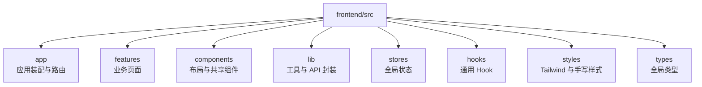
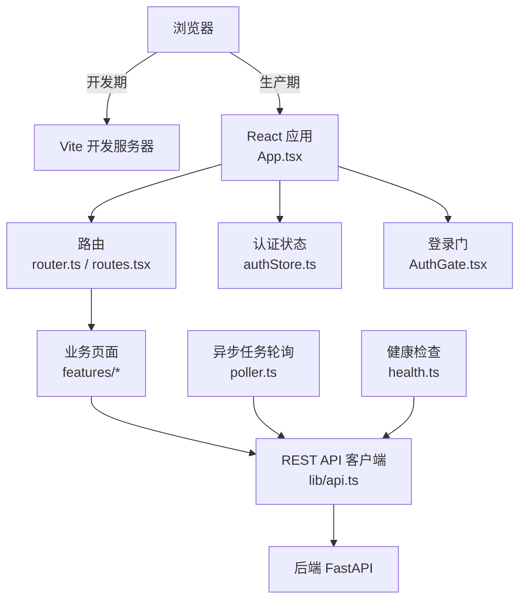
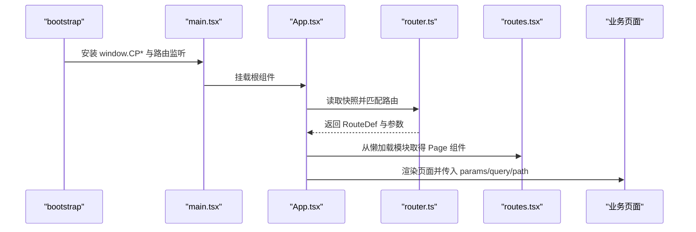
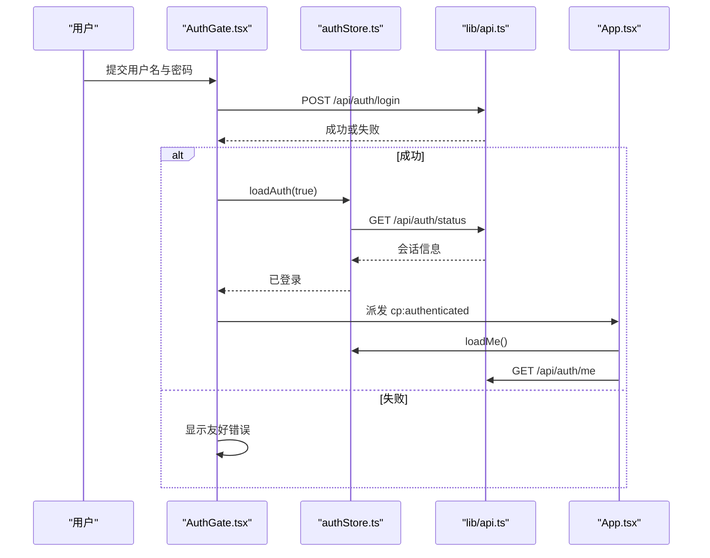
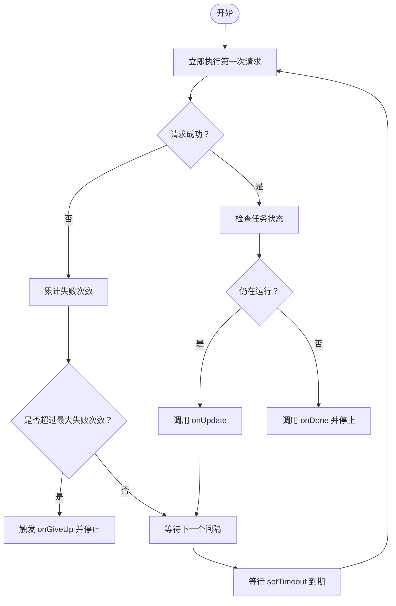
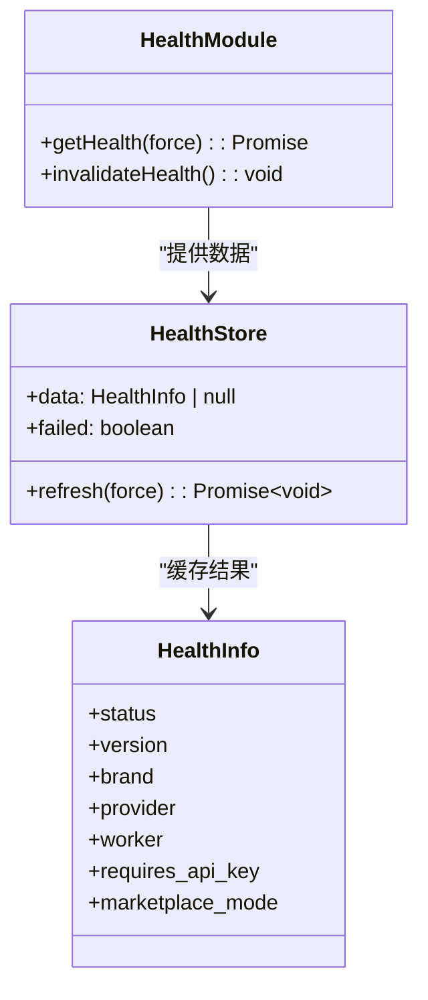
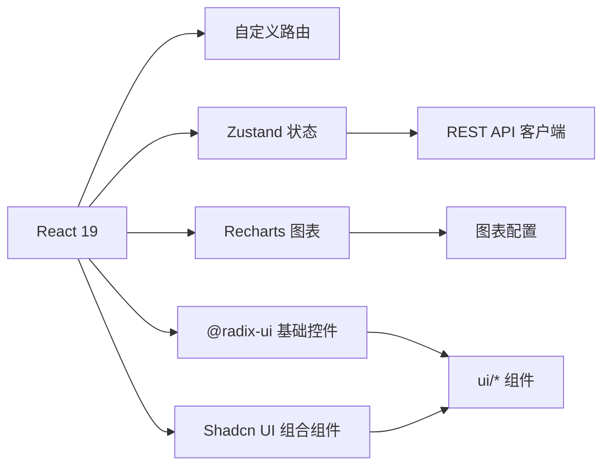

# 前端指南

<cite>
**本文引用的文件**   
- [frontend/package.json](file://frontend/package.json)
- [frontend/vite.config.ts](file://frontend/vite.config.ts)
- [frontend/index.html](file://frontend/index.html)
- [frontend/src/main.tsx](file://frontend/src/main.tsx)
- [frontend/src/App.tsx](file://frontend/src/App.tsx)
- [frontend/src/app/bootstrap.ts](file://frontend/src/app/bootstrap.ts)
- [frontend/src/app/router.ts](file://frontend/src/app/router.ts)
- [frontend/src/app/routes.tsx](file://frontend/src/app/routes.tsx)
- [frontend/src/lib/api.ts](file://frontend/src/lib/api.ts)
- [frontend/src/stores/authStore.ts](file://frontend/src/stores/authStore.ts)
- [frontend/src/stores/uiStore.ts](file://frontend/src/stores/uiStore.ts)
- [frontend/src/components/layout/AuthGate.tsx](file://frontend/src/components/layout/AuthGate.tsx)
- [frontend/src/lib/async-run/poller.ts](file://frontend/src/lib/async-run/poller.ts)
- [frontend/src/lib/async-run/tasks-api.ts](file://frontend/src/lib/async-run/tasks-api.ts)
- [frontend/src/lib/async-run/useTaskPolling.ts](file://frontend/src/lib/async-run/useTaskPolling.ts)
- [frontend/src/lib/health/health.ts](file://frontend/src/lib/health/health.ts)
- [frontend/src/styles/tailwind.css](file://frontend/src/styles/tailwind.css)
</cite>

## 目录
1. [简介](#简介)
2. [项目结构](#项目结构)
3. [核心组件](#核心组件)
4. [架构总览](#架构总览)
5. [详细组件分析](#详细组件分析)
6. [依赖关系分析](#依赖关系分析)
7. [性能与构建](#性能与构建)
8. [本地开发与启动](#本地开发与启动)
9. [前后端契约](#前后端契约)
10. [常见问题与调试](#常见问题与调试)
11. [可访问性与响应式设计](#可访问性与响应式设计)
12. [结论](#结论)

## 简介
本指南面向 Surge 前端开发者，说明当前仓库中 React 19、TypeScript、Vite、Tailwind CSS 4、Zustand、React Query（作为业务层能力）、Recharts、Radix UI 与 Shadcn UI 的组合方式，并解释应用装配、路由、状态、异步任务轮询、登录门以及构建产物的后端消费契约。

Surge 前端的职责是渲染工作台仪表盘、AI 助手对话执行台、技能广场、任务详情、店铺经营看板与设置页；它通过同源 Cookie 调用后端 REST API，并通过轮询机制展示后台任务的运行进度。生产环境中，`vite build` 产出的 `frontend/dist` 由 FastAPI 直接托管，静态资源路径必须保持 `/css/*`、`/js/*`、`/media/*` 与 `index.html` 的约定。

## 项目结构
前端源码位于 `frontend/src`，按“应用装配 — 业务页面 — 布局与共享组件 — 工具与 API — 全局状态”分层组织：

- `src/app`：应用入口编排、极简 History 路由、路由表、旧 HTML 门面桥接。
- `src/features`：业务页面模块，包括 dashboard、skills、stores、tasks、settings、agents、data-assets，workbench 为遗留大体积页面。
- `src/components`：
  - `layout`：RootLayout、Sidebar、Topbar、AuthGate、NavDrawer、SourceBanner。
  - `shared`：图表挂载、计数动画、图标、图片灯箱、PageFallback、PageShell、StatusBadge。
  - `ui`：基于 Radix UI 和 Shadcn UI 的按钮、卡片、对话框、表格、标签页等原子组件。
- `src/lib`：REST API 客户端、异步任务轮询、健康检查、图表配置、图标、面板、标签、UI 门面、Schema Form、渲染器。
- `src/stores`：Zustand 全局状态，包含认证与会话、UI 抽屉等。
- `src/hooks`：媒体查询、页面显影、存在性检测等通用 Hook。
- `src/styles`：Tailwind 入口、Token、基础样式、组件样式、布局样式、页面样式与店铺样式。
- `src/types`：全局类型声明。

**图示来源**
- [frontend/src/main.tsx:1-21](file://frontend/src/main.tsx#L1-L21)
- [frontend/src/app/routes.tsx:1-93](file://frontend/src/app/routes.tsx#L1-L93)

**章节来源**
- [frontend/src/main.tsx:1-21](file://frontend/src/main.tsx#L1-L21)
- [frontend/src/app/routes.tsx:1-93](file://frontend/src/app/routes.tsx#L1-L93)

## 核心组件
- **应用根与路由装配**：`main.tsx` 先执行 `bootstrap()`，再挂载 `<App />`；`App.tsx` 负责加载会话、注册 401 处理、选择当前页面、控制骨架显影层与登录门。
- **极简路由**：`router.ts` 实现路径归一化、查询解析、参数匹配与历史订阅；`routes.tsx` 维护路由表，所有页面使用 `lazy` 按需加载。
- **全局门面**：`bootstrap.ts` 把 React 侧实现挂到 `window.CP*`，供旧 HTML 字符串页面与验收脚本复用。
- **API 客户端**：`lib/api.ts` 提供同源 Cookie 请求、统一错误、401 登录态处理与常用方法。
- **认证状态**：`stores/authStore.ts` 管理用户、登录门开关、注册与演示账号行为。
- **UI 状态**：`stores/uiStore.ts` 管理数据来源提示条与导航抽屉。
- **登录门**：`components/layout/AuthGate.tsx` 在未登录或需要管理员初始化时覆盖整屏。
- **异步任务轮询**：`lib/async-run` 提供无依赖轮询器、任务 API 绑定与 React Hook。
- **健康检查**：`lib/health/health.ts` 缓存 `/api/health`，供顶栏与工作区显示服务状态。

**章节来源**
- [frontend/src/main.tsx:1-21](file://frontend/src/main.tsx#L1-L21)
- [frontend/src/App.tsx:1-151](file://frontend/src/App.tsx#L1-L151)
- [frontend/src/app/bootstrap.ts:1-108](file://frontend/src/app/bootstrap.ts#L1-L108)
- [frontend/src/app/router.ts:1-200](file://frontend/src/app/router.ts#L1-L200)
- [frontend/src/app/routes.tsx:1-93](file://frontend/src/app/routes.tsx#L1-L93)
- [frontend/src/lib/api.ts:1-159](file://frontend/src/lib/api.ts#L1-L159)
- [frontend/src/stores/authStore.ts:1-116](file://frontend/src/stores/authStore.ts#L1-L116)
- [frontend/src/stores/uiStore.ts:1-46](file://frontend/src/stores/uiStore.ts#L1-L46)
- [frontend/src/components/layout/AuthGate.tsx:1-200](file://frontend/src/components/layout/AuthGate.tsx#L1-L200)
- [frontend/src/lib/async-run/poller.ts:1-133](file://frontend/src/lib/async-run/poller.ts#L1-L133)
- [frontend/src/lib/async-run/tasks-api.ts:1-20](file://frontend/src/lib/async-run/tasks-api.ts#L1-L20)
- [frontend/src/lib/async-run/useTaskPolling.ts:1-51](file://frontend/src/lib/async-run/useTaskPolling.ts#L1-L51)
- [frontend/src/lib/health/health.ts:1-107](file://frontend/src/lib/health/health.ts#L1-L107)

## 架构总览
Surge 前端采用单页应用架构：浏览器加载 `dist/index.html`，React 根组件完成全局门面对象、会话校验、健康检查与路由渲染；业务页面按需懒加载；所有数据通过同源 REST API 获取；后台任务通过固定间隔轮询更新。

**图示来源**
- [frontend/src/App.tsx:1-151](file://frontend/src/App.tsx#L1-L151)
- [frontend/src/app/router.ts:1-200](file://frontend/src/app/router.ts#L1-L200)
- [frontend/src/app/routes.tsx:1-93](file://frontend/src/app/routes.tsx#L1-L93)
- [frontend/src/lib/api.ts:1-159](file://frontend/src/lib/api.ts#L1-L159)
- [frontend/src/lib/async-run/poller.ts:1-133](file://frontend/src/lib/async-run/poller.ts#L1-L133)
- [frontend/src/lib/health/health.ts:1-107](file://frontend/src/lib/health/health.ts#L1-L107)
- [frontend/src/stores/authStore.ts:1-116](file://frontend/src/stores/authStore.ts#L1-L116)
- [frontend/src/components/layout/AuthGate.tsx:1-200](file://frontend/src/components/layout/AuthGate.tsx#L1-L200)

## 详细组件分析

### 应用装配与路由
`main.tsx` 在首次渲染前调用 `bootstrap()`，确保 Legacy 门面对象与路由监听已经安装。`App.tsx` 做四件事：
1. 刷新健康状态。
2. 注册 401 处理器，让未登录与登录过期都能走到登录门。
3. 读取会话，已登录则拉取当前用户信息。
4. 监听换号、退出事件，重绘当前路由并把地址回退到 `/dashboard`。

路由表 `ROUTES` 是 SPA 能力的唯一真源：每个页面都是 `lazy` 导入，首屏只下载外壳；工作区作为遗留大模块单独切分；`/tasks/:id` 复用列表页并携带初始任务 ID；`/stores/*` 多视图共用同一组件；`/settings` 通过查询串传递目标分区。

**图示来源**
- [frontend/src/main.tsx:1-21](file://frontend/src/main.tsx#L1-L21)
- [frontend/src/app/bootstrap.ts:1-108](file://frontend/src/app/bootstrap.ts#L1-L108)
- [frontend/src/App.tsx:1-151](file://frontend/src/App.tsx#L1-L151)
- [frontend/src/app/router.ts:1-200](file://frontend/src/app/router.ts#L1-L200)
- [frontend/src/app/routes.tsx:1-93](file://frontend/src/app/routes.tsx#L1-L93)

**章节来源**
- [frontend/src/main.tsx:1-21](file://frontend/src/main.tsx#L1-L21)
- [frontend/src/App.tsx:1-151](file://frontend/src/App.tsx#L1-L151)
- [frontend/src/app/router.ts:1-200](file://frontend/src/app/router.ts#L1-L200)
- [frontend/src/app/routes.tsx:1-93](file://frontend/src/app/routes.tsx#L1-L93)

### 登录门与会话流程
登录门根据后端 `/api/auth/status` 决定模式：首次启动管理员创建、普通登录、注册或一键体验。登录成功后派发 `cp:authenticated` 事件，应用重新拉取用户并刷新健康状态；登出后派发 `cp:logout`，并清空地址。

**图示来源**
- [frontend/src/components/layout/AuthGate.tsx:1-200](file://frontend/src/components/layout/AuthGate.tsx#L1-L200)
- [frontend/src/stores/authStore.ts:1-116](file://frontend/src/stores/authStore.ts#L1-L116)
- [frontend/src/App.tsx:1-151](file://frontend/src/App.tsx#L1-L151)
- [frontend/src/lib/api.ts:1-159](file://frontend/src/lib/api.ts#L1-L159)

**章节来源**
- [frontend/src/stores/authStore.ts:1-116](file://frontend/src/stores/authStore.ts#L1-L116)
- [frontend/src/components/layout/AuthGate.tsx:1-200](file://frontend/src/components/layout/AuthGate.tsx#L1-L200)
- [frontend/src/App.tsx:1-151](file://frontend/src/App.tsx#L1-L151)

### 异步任务轮询
异步任务轮询由三层组成：
- `poller.ts`：纯函数轮询器，每秒尝试一次，首次立即执行，遇到终态停止，连续失败达到上限才放弃。
- `tasks-api.ts`：把任务详情与取消操作绑定到 `/api/tasks/*`。
- `useTaskPolling.ts`：React Hook，在组件卸载、taskId 变化或禁用时正确清理轮询器。

**图示来源**
- [frontend/src/lib/async-run/poller.ts:1-133](file://frontend/src/lib/async-run/poller.ts#L1-L133)
- [frontend/src/lib/async-run/tasks-api.ts:1-20](file://frontend/src/lib/async-run/tasks-api.ts#L1-L20)
- [frontend/src/lib/async-run/useTaskPolling.ts:1-51](file://frontend/src/lib/async-run/useTaskPolling.ts#L1-L51)

**章节来源**
- [frontend/src/lib/async-run/poller.ts:1-133](file://frontend/src/lib/async-run/poller.ts#L1-L133)
- [frontend/src/lib/async-run/tasks-api.ts:1-20](file://frontend/src/lib/async-run/tasks-api.ts#L1-L20)
- [frontend/src/lib/async-run/useTaskPolling.ts:1-51](file://frontend/src/lib/async-run/useTaskPolling.ts#L1-L51)

### 健康检查与顶栏状态
健康检查模块不使用 TanStack Query，而是用模块级 Promise 与 15 秒 TTL 复用同一个请求，避免多个组件同时打满接口。设置页保存模型密钥后调用失效函数，强制下次刷新。

**图示来源**
- [frontend/src/lib/health/health.ts:1-107](file://frontend/src/lib/health/health.ts#L1-L107)

**章节来源**
- [frontend/src/lib/health/health.ts:1-107](file://frontend/src/lib/health/health.ts#L1-L107)

### 主要页面概览
- **工作台仪表盘**：默认入口 `/dashboard`，加载后进入首页，显示关键指标与服务状态。
- **AI 助手对话执行台**：对应遗留工作区 `/workbench`，通过 `LegacyPage` 加载大体积模块，内部懒取依赖。
- **技能广场**：`/skills`，通过查询串区分浏览与批量操作，支持缓存与呈现逻辑分离。
- **任务详情**：`/tasks` 与 `/tasks/:id`，前者为列表，后者打开初始任务抽屉，仍复用 TasksPage。
- **店铺经营看板**：`/stores` 及其子路由 authorize、product、ledger，共用 StoresPage 并按 view 切换。
- **设置页**：`/settings`，通过 `?section=` 定位目标分区。

**章节来源**
- [frontend/src/app/routes.tsx:1-93](file://frontend/src/app/routes.tsx#L1-L93)

## 依赖关系分析
前端依赖集中在 `frontend/package.json`：

| 类别 | 关键依赖 | 用途 |
| --- | --- | --- |
| 运行时 | `react`、`react-dom` | React 19 组件与渲染 |
| 路由 | `react-router-dom` | 虽然代码自实现路由，但仍保留依赖 |
| 状态 | `zustand` | 认证、UI、健康状态 |
| 数据请求 | 自定义 `lib/api.ts` | 同源 Cookie、统一错误、401 处理 |
| 图表 | `recharts` | 数据可视化 |
| 基础 UI | `@radix-ui/*` | 可访问的基础交互控件 |
| 组件库 | Shadcn UI 相关工具 | `class-variance-authority`、`clsx`、`tailwind-merge` |
| 表单 | `react-hook-form`、`@hookform/resolvers`、`zod` | Schema 驱动表单 |
| 构建 | `vite`、`@vitejs/plugin-react`、`typescript` | 开发、类型检查与构建 |
| 样式 | `tailwindcss`、`@tailwindcss/cli`、`tw-animate-css` | Tailwind CSS 4 与动画 |
| 通知 | `sonner` | Toast 提示 |
| 图标 | `lucide-react` | 图标库 |

**图示来源**
- [frontend/package.json:1-71](file://frontend/package.json#L1-L71)

**章节来源**
- [frontend/package.json:1-71](file://frontend/package.json#L1-L71)

## 性能与构建

### 构建产物契约
Vite 配置明确禁止把图片或字体打包进 JS/CSS，因为后端只挂载 `/css`、`/js`、`/media` 和 `index.html`。静态资源必须放在 `frontend/assets`，并通过 `/media/...` 引用。构建阶段会：
1. 复制 `css/` 到 `dist/css`。
2. 复制手写样式 `src/styles/*.css` 到 `dist/css`。
3. 复制 `src/assets` 到 `dist/assets`。
4. 通过 `transformIndexHtml` 保证样式加载顺序与占位符格式。

因此，生产部署产物必须是：
- `frontend/dist/index.html`
- `frontend/dist/css/*.css`
- `frontend/dist/js/*`
- `frontend/dist/assets/*`

**章节来源**
- [frontend/vite.config.ts:1-200](file://frontend/vite.config.ts#L1-L200)

### 首屏优化
- 所有业务页面均使用 `lazy` 动态导入，首屏仅加载外壳与登录门。
- 路由使用自实现的 History 订阅，避免额外路由库开销。
- 健康检查使用 Promise 缓存，15 秒内不重复请求。
- 轮询器固定 1 秒间隔，有连续失败上限，避免网络抖动导致永久卡住。
- 页面切换使用幽灵层与纸片式动画，超大 DOM 跳过克隆，减少卡顿。

**章节来源**
- [frontend/src/app/routes.tsx:1-93](file://frontend/src/app/routes.tsx#L1-L93)
- [frontend/src/lib/health/health.ts:1-107](file://frontend/src/lib/health/health.ts#L1-L107)
- [frontend/src/lib/async-run/poller.ts:1-133](file://frontend/src/lib/async-run/poller.ts#L1-L133)
- [frontend/src/app/router.ts:1-200](file://frontend/src/app/router.ts#L1-L200)

## 本地开发与启动

### 前置条件
- Node.js 版本不低于 `package.json` 要求的 `>=22.12.0`。
- 后端服务已启动，以便前端能调用 `/api/*`。

### 常用命令
| 命令 | 作用 |
| --- | --- |
| `cd frontend && npm run dev` | 启动 Vite 开发服务器，端口默认 `5173`，并先编译 Tailwind 样式 |
| `npm run typecheck` | TypeScript 类型检查 |
| `npm run build` | 完整构建：CSS 预构建、类型检查、Vite 构建、产物验证 |
| `npm run preview` | 预览构建产物，端口 `5174` |
| `npm run parity` | 运行 API、原语、渲染与轮询一致性脚本 |
| `npm run build:css` | 使用 Tailwind CLI 生成 `css/tailwind.css` |
| `npm run watch:css` | 监听 Tailwind 样式变更 |

### 开发期别名
- `@` 指向 `frontend/src`。
- `/media/*` 在开发期被中间件映射到 `src/assets/*`。
- `/css/<手写样式>.css` 在开发期映射到 `src/styles/<name>.css`，免去手动构建 CSS。

**章节来源**
- [frontend/package.json:1-71](file://frontend/package.json#L1-L71)
- [frontend/vite.config.ts:1-200](file://frontend/vite.config.ts#L1-L200)

## 前后端契约

### REST API 调用
前端通过 `lib/api.ts` 发起请求，默认行为如下：
- 使用同源 Cookie 会话，不附加 Authorization 头。
- 网络层失败抛出 `ApiError("网络不可用")`，状态码为 `0`。
- 非认证入口的 401 会触发全局 401 处理器，然后抛出“登录已过期”。
- 其他非 2xx 错误将 `detail` 拼成中文文案。
- 支持 JSON body、FormData、GET/POST/PUT/DELETE。

**章节来源**
- [frontend/src/lib/api.ts:1-159](file://frontend/src/lib/api.ts#L1-L159)

### 异步任务轮询
- 任务详情通过 `/api/tasks/{taskId}` 获取。
- 取消任务通过 `/api/tasks/{taskId}/cancel`。
- 轮询间隔默认 1 秒，首次立即执行。
- 状态为 `queued`、`running`、`cancelling` 时继续轮询；其他状态视为终态。
- 连续失败最多 5 次后放弃，并触发 `onGiveUp`。

**章节来源**
- [frontend/src/lib/async-run/poller.ts:1-133](file://frontend/src/lib/async-run/poller.ts#L1-L133)
- [frontend/src/lib/async-run/tasks-api.ts:1-20](file://frontend/src/lib/async-run/tasks-api.ts#L1-L20)

### 多租户 X-Tenant-Id
当前前端 API 客户端并未自动注入 `X-Tenant-Id`。若后端通过该头部区分租户，应在 `request` 或各业务 API 封装处添加相应逻辑，并在 `RequestOptions.headers` 中透传。目前前端的状态与路由也未体现租户上下文，新增租户功能时需要同时更新状态、存储与请求拦截。

### 登录态与 AuthGate
- 登录态来自 `/api/auth/status` 与 `/api/auth/me`。
- 未登录、会话过期、首次建管理员都会亮出登录门。
- 登录成功后派发 `cp:authenticated`，登出派发 `cp:logout`。
- 登录门与认证状态解耦：`gateOpen` 独立于 `user`，避免 401 场景丢失“曾经登录过”的判断。

**章节来源**
- [frontend/src/stores/authStore.ts:1-116](file://frontend/src/stores/authStore.ts#L1-L116)
- [frontend/src/components/layout/AuthGate.tsx:1-200](file://frontend/src/components/layout/AuthGate.tsx#L1-L200)
- [frontend/src/App.tsx:1-151](file://frontend/src/App.tsx#L1-L151)

## 常见问题与调试

### 端口冲突
- 开发服务器默认端口 `5173`，预览端口 `5174`，且配置了严格端口。
- 如果端口被占用，优先检查是否已有 Vite 实例运行；也可修改 `vite.config.ts` 中的 `server.port`。

**章节来源**
- [frontend/vite.config.ts:1-200](file://frontend/vite.config.ts#L1-L200)
- [frontend/package.json:1-71](file://frontend/package.json#L1-L71)

### CORS 问题
前端使用 `credentials: "same-origin"`，意味着它期望后端在同一域名下提供 API。跨域通常不是前端配置问题，而是后端未允许同源 Cookie 或部署拓扑不一致。排查要点：
- 确认前端与后端共享域名。
- 确认后端启用同源 Cookie 会话。
- 确认 Vite 代理未意外改变 Origin。

**章节来源**
- [frontend/src/lib/api.ts:1-159](file://frontend/src/lib/api.ts#L1-L159)

### 环境变量缺失
当前前端未读取 `.env` 类变量，API 地址硬编码为相对路径 `/api/*`。如果需要多环境 API 基址，应扩展 `lib/api.ts` 的 `request` 方法，加入环境变量前缀，并确保构建脚本与部署脚本同步更新。

### 构建后 404 静态资源
- 图片和字体不能通过 `import` 引入，否则会产出 `/assets/*`，后端未挂载该前缀。
- 资源应放入 `frontend/assets`，并用 `/media/...` 引用。
- 构建产物必须保留 `dist/index.html`、`dist/css/*`、`dist/js/*`、`dist/assets/*`。

**章节来源**
- [frontend/vite.config.ts:1-200](file://frontend/vite.config.ts#L1-L200)

### 登录成功但页面空白
- 检查 `/api/auth/status` 是否返回 `authenticated`。
- 检查 `loadAuth` 是否成功写入 `user`。
- 检查 `cp:authenticated` 事件是否被派发。
- 检查是否有 401 触发登录门但未恢复会话。

**章节来源**
- [frontend/src/stores/authStore.ts:1-116](file://frontend/src/stores/authStore.ts#L1-L116)
- [frontend/src/components/layout/AuthGate.tsx:1-200](file://frontend/src/components/layout/AuthGate.tsx#L1-L200)
- [frontend/src/App.tsx:1-151](file://frontend/src/App.tsx#L1-L151)

### 任务轮询卡住
- 如果任务一直停留在某个状态，检查 `task.status` 是否属于 RUNNING 集合。
- 如果轮询不再发请求，检查是否达到连续失败上限。
- 如果是组件卸载后仍轮询，检查是否正确使用 `useTaskPolling` 或在卸载时调用 `stop`。

**章节来源**
- [frontend/src/lib/async-run/poller.ts:1-133](file://frontend/src/lib/async-run/poller.ts#L1-L133)
- [frontend/src/lib/async-run/useTaskPolling.ts:1-51](file://frontend/src/lib/async-run/useTaskPolling.ts#L1-L51)

## 可访问性与响应式设计

### 可访问性
- Radix UI 组件提供键盘、焦点与语义支持，适合构建无障碍基础控件。
- 登录门为全屏覆盖层，首次打开时将焦点放到用户名输入框。
- 幽灵层使用 `aria-hidden`，避免屏幕阅读器朗读过渡元素。
- 建议使用语义化标签、合理标题层级，并为图标补充 `aria-label`。

**章节来源**
- [frontend/src/components/layout/AuthGate.tsx:1-200](file://frontend/src/components/layout/AuthGate.tsx#L1-L200)
- [frontend/src/app/router.ts:1-200](file://frontend/src/app/router.ts#L1-L200)

### 响应式设计
- Tailwind 断点与既有 CSS 保持一致：`shell 981px`、`wide 1180px`、`narrow 720px`。
- 窄屏时使用全量导航抽屉，替代传统侧边栏。
- 设计 Token 通过 CSS 变量集中管理，深色主题与品牌色通过变量映射，避免硬编码颜色。
- 图表颜色与 UI 颜色共用 Token，避免切换主题时图表失真。

**章节来源**
- [frontend/src/styles/tailwind.css:1-186](file://frontend/src/styles/tailwind.css#L1-L186)
- [frontend/src/stores/uiStore.ts:1-46](file://frontend/src/stores/uiStore.ts#L1-L46)

## 结论
Surge 前端以 React 19 为核心，结合 Vite、Tailwind CSS 4、Zustand、Radix UI 与 Recharts，形成一套轻量、可维护、与后端部署契约强绑定的 SPA。开发者应重点关注：
- 路由表与懒加载对首屏的影响。
- API 客户端的同源 Cookie 与 401 行为。
- 异步任务轮询的生命周期与失败策略。
- 构建产物与后端静态资源挂载路径的一致性。
- 新增功能时同时考虑可访问性、响应式断点与 Token 体系。