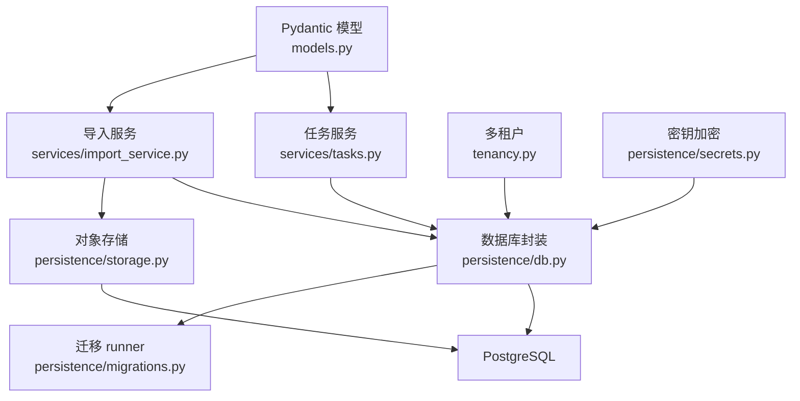
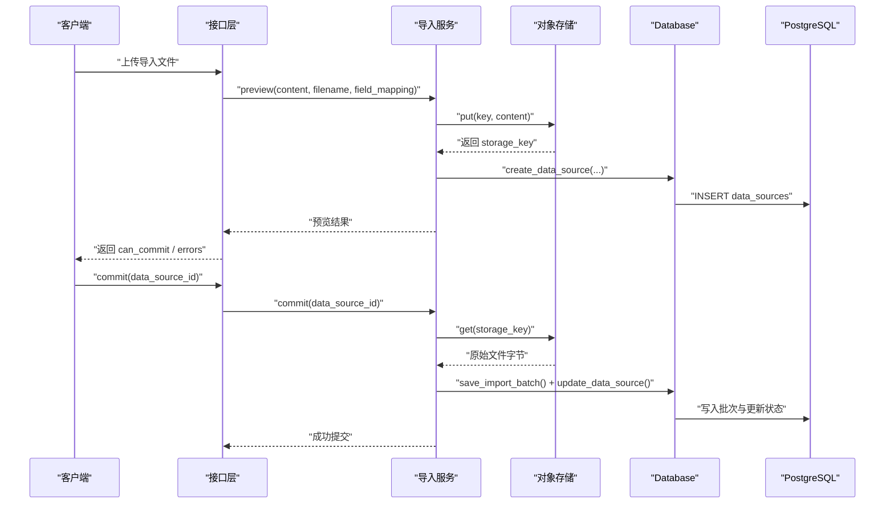
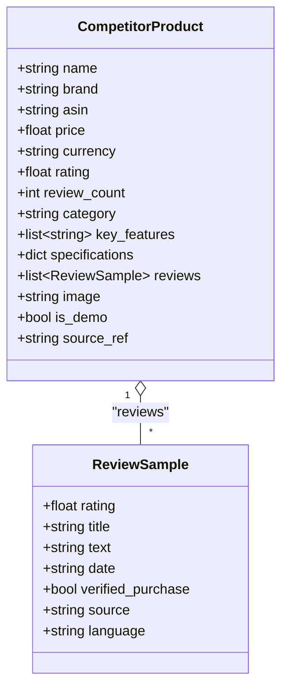
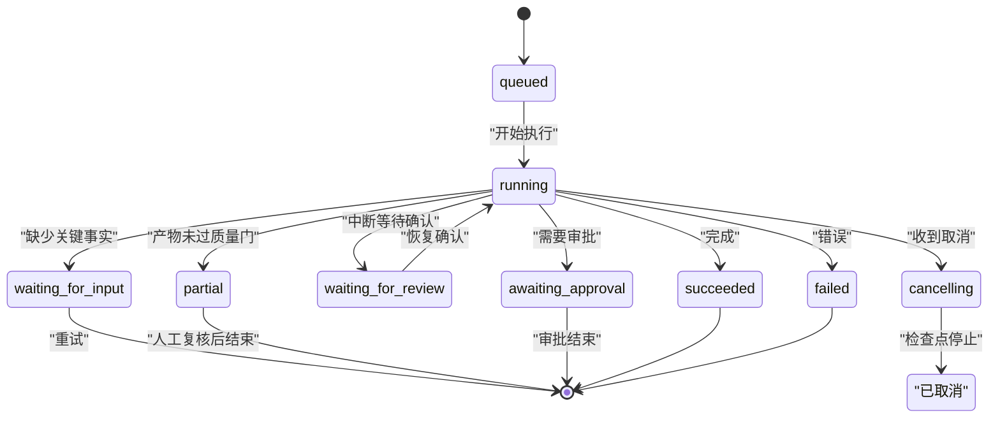
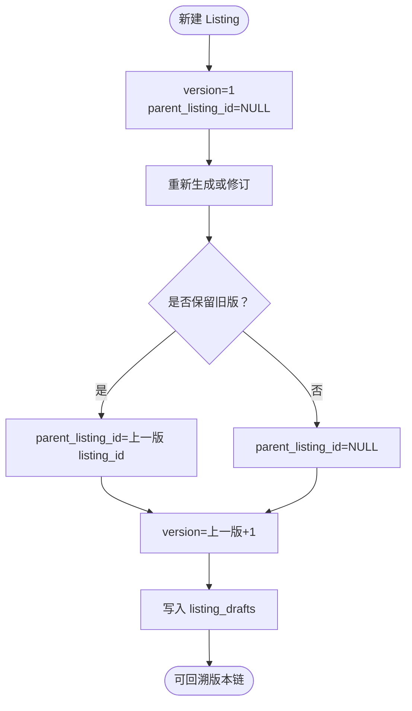
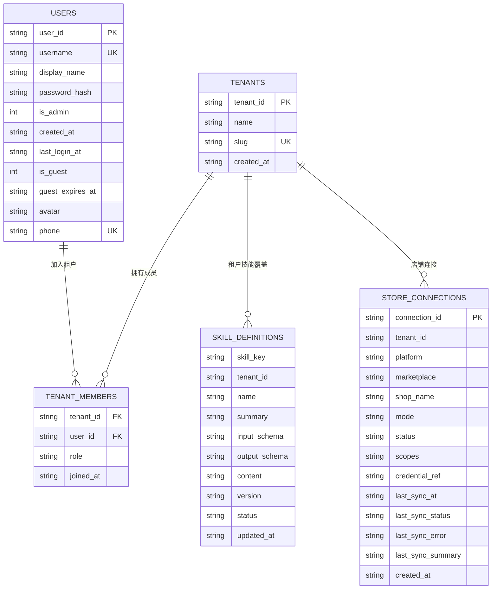
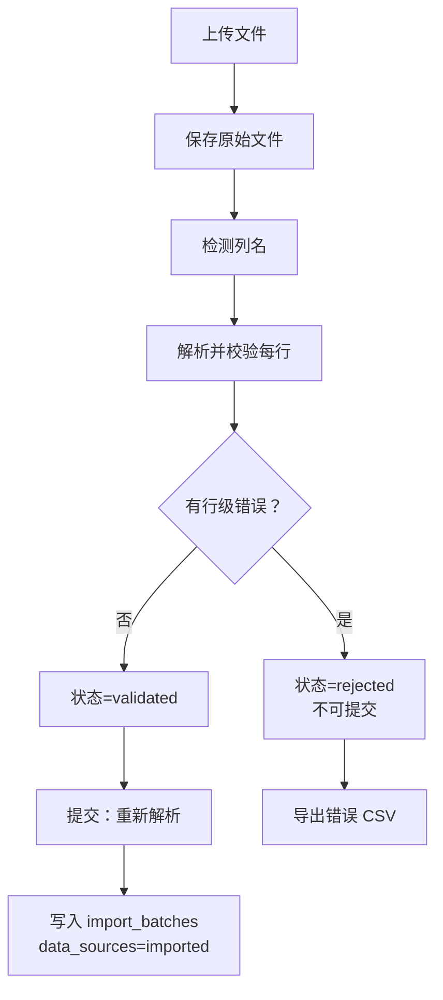
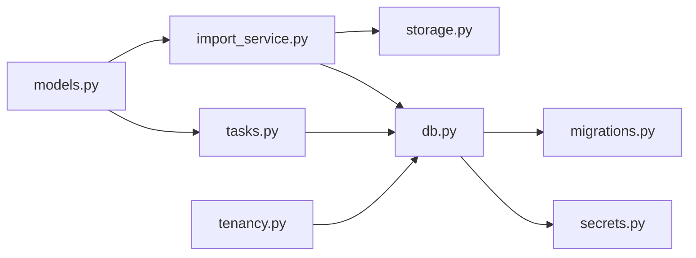

# 数据模型

<cite>
**本文引用的文件**   
- [models.py](file://backend/surge/models.py)
- [db.py](file://backend/surge/persistence/db.py)
- [migrations.py](file://backend/surge/persistence/migrations.py)
- [secrets.py](file://backend/surge/persistence/secrets.py)
- [storage.py](file://backend/surge/persistence/storage.py)
- [tenancy.py](file://backend/surge/tenancy.py)
- [import_service.py](file://backend/surge/services/import_service.py)
- [tasks.py](file://backend/surge/services/tasks.py)
</cite>

## 目录
1. [引言](#引言)
2. [项目结构](#项目结构)
3. [核心实体与关系](#核心实体与关系)
4. [架构总览](#架构总览)
5. [详细模型分析](#详细模型分析)
6. [数据生命周期](#数据生命周期)
7. [依赖关系分析](#依赖关系分析)
8. [性能与缓存策略](#性能与缓存策略)
9. [数据安全要求](#数据安全要求)
10. [故障排查指南](#故障排查指南)
11. [结论](#结论)

## 引言
本文围绕 Surge 后端的数据模型与持久化层，说明核心业务实体、字段约束、主外键关系、索引与唯一性约束，并解释导入校验、任务状态机、Listing 版本链、审批记录、审计日志、迁移机制、存储后端及密钥管理。目标是让熟悉 Pydantic 和 PostgreSQL 的开发者快速定位数据契约，也让非技术读者理解“从导入到 Listing 产出”的数据流向与安全边界。

## 项目结构
Surge 的数据相关代码集中在 `backend/surge`：
- `models.py`：Pydantic 输入、规范化实体与分析报告、Listing 输出模型。
- `persistence/db.py`：PostgreSQL 连接池、表结构常量 `_SCHEMA`、租户迁移、基础 CRUD。
- `persistence/migrations.py`：轻量版本化迁移 runner，新增 revision 实现增量建表。
- `persistence/secrets.py`：API Key 等敏感字段的加密与掩码。
- `persistence/storage.py`：对象存储抽象，当前实现为本地与 Supabase。
- `services/import_service.py`：导入预览 → 提交两步流程。
- `services/tasks.py`：任务记录服务与状态机。
- `tenancy.py`：多租户上下文与角色权限。

**图表来源**
- [models.py:1-639](file://backend/surge/models.py#L1-L639)
- [import_service.py:1-348](file://backend/surge/services/import_service.py#L1-L348)
- [tasks.py:1-474](file://backend/surge/services/tasks.py#L1-L474)
- [tenancy.py:1-131](file://backend/surge/tenancy.py#L1-L131)
- [db.py:1-598](file://backend/surge/persistence/db.py#L1-L598)
- [migrations.py:1-690](file://backend/surge/persistence/migrations.py#L1-L690)
- [secrets.py:1-165](file://backend/surge/persistence/secrets.py#L1-L165)
- [storage.py:1-200](file://backend/surge/persistence/storage.py#L1-L200)

**章节来源**
- [models.py:1-639](file://backend/surge/models.py#L1-L639)
- [db.py:1-598](file://backend/surge/persistence/db.py#L1-L598)
- [migrations.py:1-690](file://backend/surge/persistence/migrations.py#L1-L690)
- [secrets.py:1-165](file://backend/surge/persistence/secrets.py#L1-L165)
- [storage.py:1-200](file://backend/surge/persistence/storage.py#L1-L200)
- [tenancy.py:1-131](file://backend/surge/tenancy.py#L1-L131)
- [import_service.py:1-348](file://backend/surge/services/import_service.py#L1-L348)
- [tasks.py:1-474](file://backend/surge/services/tasks.py#L1-L474)

## 核心实体与关系
以下表格聚焦文档目标中提到的核心实体，以及它们在数据库中对应的表和关键约束。

| 实体 | Pydantic 模型或数据库表 | 关键字段 | 必填项与约束 | 主键 / 唯一 / 索引 | 业务规则 |
|---|---|---|---|---|---|
| 竞品商品 | `CompetitorProduct` | name, brand, asin, price, currency, rating, review_count, category, key_features, specifications, reviews, image, is_demo, source_ref | name 必填且去空白；price ≥ 0；rating ∈ [0,5]；review_count ≥ 0；currency 默认 USD | 无数据库表；作为 JSON payload 的一部分写入报告 | 缺失字段保持 None，不得自动补全事实 |
| 评论样本 | `ReviewSample` | text, title, rating, date, verified_purchase, source, language | text 必填且去空白；rating ∈ [1,5] | 无独立表；嵌入竞品分析输入或报告中 | 空文本直接报错 |
| 任务 | `TaskRecorder` + `tasks` / `task_steps` | task_id, user_id, tenant_id, type, title, status, input/output, error_code/message, result_ref, trace_id, created_at/started_at/finished_at, conversation_id, degraded, retry_of, input_fingerprint, workflow_version | task_id 为主键；status 受状态机约束；input/output 为 TEXT(JSON) | 主键 task_id；索引：user+created_at、user+status+created_at、task_id+seq、tenant+created_at、conversation+created_at | 见任务状态机 |
| Listing 版本 | `ListingDraft` + `listing_drafts` | listing_id, tenant_id, user_id, report_id, task_id, version, parent_listing_id, product_name, platform, marketplace, language, title, bullets, description, search_terms, quality_check, fact_ledger, pending_confirmations, is_demo, engine, payload, created_at | listing_id 主键；version ≥ 1；parent_listing_id 可选 | 主键 listing_id；索引：tenant+created_at、report_id | 版本链通过 parent_listing_id 串联 |
| 审批记录 | `approval_requests` | approval_id, tenant_id, task_id, kind, payload, status, requested_by, decided_by, decided_at, note, created_at | approval_id 主键；status 默认 pending | 主键 approval_id；索引：tenant+status+created_at | 用于 Listing 等需要人工确认的流程 |
| 审计日志 | `audit_logs` | audit_id(自增), tenant_id, actor_id, action, target_type, target_id, detail, trace_id, created_at | detail 为 JSON(TEXT) | 主键 audit_id；索引：tenant+created_at、action+created_at | 所有写操作应落审计 |
| 技能定义 | `skill_definitions` | skill_key, tenant_id, name, summary, input_schema, output_schema, content, version, status, updated_at | 复合主键 (skill_key, tenant_id) | 复合主键；tenant_id 可为 NULL 表示平台内置 | 随技能注册表加载 |
| 店铺连接 | `store_connections` | connection_id, tenant_id, platform, marketplace, shop_name, mode, status, scopes, credential_ref, last_sync_* | connection_id 主键 | 主键；唯一索引：tenant+platform+marketplace+shop_name | 同一租户内店铺连接唯一 |
| 账户 | `users` | user_id, username, password_hash, display_name, is_admin, created_at, last_login_at, is_guest, guest_expires_at, avatar, phone | user_id 主键；username 唯一；password_hash 必填 | 主键 user_id；唯一 username；唯一 phone(非空时) | 支持访客账号过期 |
| 租户 | `tenants` | tenant_id, name, slug, created_at | tenant_id 主键；slug 唯一 | 主键 tenant_id；唯一 slug | 个人空间 slug 以 personal- 前缀生成 |

**章节来源**
- [models.py:1-639](file://backend/surge/models.py#L1-L639)
- [db.py:1-598](file://backend/surge/persistence/db.py#L1-L598)
- [migrations.py:201-690](file://backend/surge/persistence/migrations.py#L201-L690)

## 架构总览
Surge 的数据访问采用“Pydantic 契约 + psycopg SQL + 版本化迁移”的组合：
- 输入和输出使用 Pydantic 做类型校验与结构化描述。
- 数据库只有 PostgreSQL，主键统一为字符串，JSON 内容整体存 TEXT。
- 启动时执行 `_SCHEMA` 基线建表，再运行 `_migrate_tenants`，最后由 `apply_migrations` 执行增量 revision。
- 对象存储通过 `ObjectStorage` 协议隔离本地与 Supabase。
- 多租户在 tenancy 层强制校验用户成员关系，所有查询需带 `tenant_id`。

**图表来源**
- [import_service.py:1-348](file://backend/surge/services/import_service.py#L1-L348)
- [storage.py:1-200](file://backend/surge/persistence/storage.py#L1-L200)
- [db.py:1-598](file://backend/surge/persistence/db.py#L1-L598)

**章节来源**
- [db.py:1-598](file://backend/surge/persistence/db.py#L1-L598)
- [migrations.py:1-690](file://backend/surge/persistence/migrations.py#L1-L690)
- [storage.py:1-200](file://backend/surge/persistence/storage.py#L1-L200)
- [tenancy.py:1-131](file://backend/surge/tenancy.py#L1-L131)

## 详细模型分析

### CompetitorProduct 与 ReviewSample
- `CompetitorProduct` 是竞品商品的规范化输入。name 必填；brand、asin、category、source_ref 会被去空白；key_features 支持字符串或分隔符拆分；reviews 列表中的每个 `ReviewSample` 必须包含非空 text。
- 价格、评分、评论数等指标允许为空；空值进入“待确认”逻辑，而不是被算法猜测填充。
- `is_demo` 标记 demo 数据；`source_ref` 可记录导入文件名或 API 批次号，便于溯源。
- 该模型本身不建表，而是作为分析请求或导入结果中的结构化数据，最终序列化为 JSON 存入报告或导入批次。

**图表来源**
- [models.py:1-200](file://backend/surge/models.py#L1-L200)

**章节来源**
- [models.py:1-200](file://backend/surge/models.py#L1-L200)

### Task 与 TaskStep
任务不是简单的一行状态，而是“任务 + 步骤”的可追溯执行记录：
- `TaskRecorder.open()` 创建任务，`mark_running()` 开始执行，`succeed()/fail()/await_input()/partial()/await_review()/cancel()` 表达不同终态或中间态。
- `step()` 是上下文管理器，异常会记录失败步骤并继续抛出，避免吞错。
- 取消分为“排队立即取消”“running 进入 cancelling”“等待确认的任务可直接取消”。
- 重试血缘通过 `retry_of` 指向原任务；断点复用通过 `input_fingerprint` 和 `workflow_version` 控制。

**图表来源**
- [tasks.py:1-474](file://backend/surge/services/tasks.py#L1-L474)

**章节来源**
- [tasks.py:1-474](file://backend/surge/services/tasks.py#L1-L474)
- [db.py:1-598](file://backend/surge/persistence/db.py#L1-L598)

### ListingVersion 与 Listing 版本链
Listing 不再是一张扁平表，而是 `listing_drafts` 上的版本链：
- `listing_id` 是 Listing 主键。
- `version` 是整数版本号，从 1 开始递增。
- `parent_listing_id` 指向上一版，形成链式历史。
- `payload` 保存完整 Pydantic 序列化后的 ListingDraft；`quality_check`、`fact_ledger`、`pending_confirmations` 单独列以便查询与审计。
- 迁移脚本会把旧 `listings` 表回填为新表，初始 version=1，parent_listing_id=NULL。

**图表来源**
- [migrations.py:201-350](file://backend/surge/persistence/migrations.py#L201-L350)
- [models.py:400-639](file://backend/surge/models.py#L400-L639)

**章节来源**
- [migrations.py:201-350](file://backend/surge/persistence/migrations.py#L201-L350)
- [models.py:400-639](file://backend/surge/models.py#L400-L639)

### AuditLog 与 ApprovalRecord
- 审计日志 `audit_logs` 使用自增 `audit_id`，按 `tenant_id` 和 `action` 建立索引，适合按租户和时间范围检索。
- 审批记录 `approval_requests` 以 `approval_id` 为主键，status 默认 pending，支持 `requested_by`、`decided_by`、`decided_at` 追踪决策者。
- 这两类记录都是审计与合规的关键证据：审计日志记录“谁在何时对什么做了什么”，审批记录记录“哪些 Listing 或任务经过人工确认”。

**章节来源**
- [migrations.py:120-200](file://backend/surge/persistence/migrations.py#L120-L200)

### SkillDefinition、Store、Account、Tenant
- `skill_definitions` 是技能注册表，tenant_id 为 NULL 时表示平台内置定义，非 NULL 时表示租户级覆盖。
- `store_connections` 记录店铺连接，tenant_id + platform + marketplace + shop_name 唯一，防止重复连接。
- `users` 是账户表，支持访客账号 (`is_guest`, `guest_expires_at`)、头像、手机号（非空唯一）。
- `tenants` 是租户表，slug 唯一；`tenant_members` 维护用户与租户的角色关系。

**图表来源**
- [db.py:1-200](file://backend/surge/persistence/db.py#L1-L200)
- [migrations.py:500-690](file://backend/surge/persistence/migrations.py#L500-L690)

**章节来源**
- [db.py:1-200](file://backend/surge/persistence/db.py#L1-L200)
- [migrations.py:500-690](file://backend/surge/persistence/migrations.py#L500-L690)
- [tenancy.py:1-131](file://backend/surge/tenancy.py#L1-L131)

## 数据生命周期

### 导入数据的逐行校验
导入服务采用“预览 → 提交”两步：
1. 上传文件后，`preview()` 将原始文件保存到对象存储，并以 `data_source_id` 写入 `data_sources`。
2. 解析列名，尝试 `import_competitor_data()`，收集列级错误、行级错误和警告。
3. 如果存在行级错误，状态为 rejected，不允许提交。
4. 提交时再次读取原始文件，重新解析；只要仍有行级错误就拒绝，并把错误写入导入批次。
5. 成功后更新 `data_sources.status = imported`，并写入 `import_batches`。

**图表来源**
- [import_service.py:1-348](file://backend/surge/services/import_service.py#L1-L348)

**章节来源**
- [import_service.py:1-348](file://backend/surge/services/import_service.py#L1-L348)

### 任务状态机
任务状态机强调“真实执行过程可观测”：
- 终态包括 succeeded、failed、cancelled、waiting_for_input、partial。
- cancellable 状态包括 queued、running、cancelling。
- resumable 状态主要是 waiting_for_review，因为 checkpoint 还在，可以原地恢复。
- 异步执行时，running 任务先变 cancelling，再由执行器在下一个图节点检查并收尾。

**章节来源**
- [tasks.py:1-474](file://backend/surge/services/tasks.py#L1-L474)

### Listing 版本链
- 每次重新生成 Listing 都会产生新版本。
- 旧版本不会删除，而是通过 `parent_listing_id` 链接。
- 迁移脚本负责把历史 `listings` 数据回填到新表，确保升级后仍可回溯。

**章节来源**
- [migrations.py:201-350](file://backend/surge/persistence/migrations.py#L201-L350)
- [models.py:400-639](file://backend/surge/models.py#L400-L639)

### 审批记录
- 审批记录独立于任务，但可通过 `task_id` 关联。
- 状态从 pending 开始，支持 approved/rejected 等业务扩展。
- 与 `approval_requests` 配合，可记录 Listing 修改、技能配置变更等需要人工确认的操作。

**章节来源**
- [migrations.py:120-200](file://backend/surge/persistence/migrations.py#L120-L200)

### 审计日志脱敏策略
- 审计日志只记录 action、target_type、target_id、trace_id 和 JSON 形式的 detail。
- 不应把敏感字段（如 API Key、密码）放入 detail；如需记录，应先脱敏。
- 日志表有按 tenant_id 和 action 的索引，便于安全审计。

**章节来源**
- [migrations.py:120-200](file://backend/surge/persistence/migrations.py#L120-L200)

## 依赖关系分析

**图表来源**
- [models.py:1-639](file://backend/surge/models.py#L1-L639)
- [import_service.py:1-348](file://backend/surge/services/import_service.py#L1-L348)
- [tasks.py:1-474](file://backend/surge/services/tasks.py#L1-L474)
- [storage.py:1-200](file://backend/surge/persistence/storage.py#L1-L200)
- [db.py:1-598](file://backend/surge/persistence/db.py#L1-L598)
- [migrations.py:1-690](file://backend/surge/persistence/migrations.py#L1-L690)
- [secrets.py:1-165](file://backend/surge/persistence/secrets.py#L1-L165)
- [tenancy.py:1-131](file://backend/surge/tenancy.py#L1-L131)

**章节来源**
- [models.py:1-639](file://backend/surge/models.py#L1-L639)
- [import_service.py:1-348](file://backend/surge/services/import_service.py#L1-L348)
- [tasks.py:1-474](file://backend/surge/services/tasks.py#L1-L474)
- [storage.py:1-200](file://backend/surge/persistence/storage.py#L1-L200)
- [db.py:1-598](file://backend/surge/persistence/db.py#L1-L598)
- [migrations.py:1-690](file://backend/surge/persistence/migrations.py#L1-L690)
- [secrets.py:1-165](file://backend/surge/persistence/secrets.py#L1-L165)
- [tenancy.py:1-131](file://backend/surge/tenancy.py#L1-L131)

## 性能与缓存策略
- 数据库连接池：`Database` 基于 `psycopg_pool.ConnectionPool`，按 DSN 复用连接；没有 pool 时会回退到每次新建连接，首屏会变慢。
- 连接参数针对 Supabase pooler 做了保守设置：connect_timeout、sslmode=require、prepare_threshold=None，避免 PgBouncer transaction 模式下的 prepared statement 冲突。
- 查询性能依赖索引：tasks 的 user+status+created_at、task_steps 的 task_id+seq、listing_drafts 的 tenant+created_at、audit_logs 的 tenant+created_at、business_reports 的 tenant+kind+created_at 等。
- 对象存储：本地存储只做相对路径校验，拒绝 `..` 与绝对路径；Supabase 实现走 REST，避免引入额外 SDK 依赖。
- 缓存策略：代码中没有通用内存缓存层；主要靠数据库索引和连接池优化 IO。若后续需要热点缓存，应避免缓存敏感字段，并保证缓存失效与租户隔离。

**章节来源**
- [db.py:1-598](file://backend/surge/persistence/db.py#L1-L598)
- [storage.py:1-200](file://backend/surge/persistence/storage.py#L1-L200)
- [migrations.py:201-690](file://backend/surge/persistence/migrations.py#L201-L690)

## 数据安全要求

### 敏感字段脱敏
- `SecretBox.mask()` 对 API Key 展示时只返回前几位和后几位，绝不返回完整 Key。
- 模型输出中的敏感字段应优先返回 mask 值，而非明文。
- 审计日志 detail 中禁止存放明文 Key。

**章节来源**
- [secrets.py:1-165](file://backend/surge/persistence/secrets.py#L1-L165)

### BYOK Key 加密
- 加密方案使用标准库：scrypt 派生密钥，HMAC-SHA256 构造密钥流，encrypt-then-MAC 防篡改。
- 密文格式为 `v1:<base64(nonce||ciphertext||mac)>`。
- 密钥材料来源优先级：环境变量 `SURGE_SECRET_KEY` > `.secret_key` 文件 > 自动生成并限制权限。
- 解密失败直接抛 `SecretError`，不降级为空值。

**章节来源**
- [secrets.py:1-165](file://backend/surge/persistence/secrets.py#L1-L165)

### 租户隔离
- 所有业务查询必须带 `tenant_id`，并与 `user_id` 双重过滤。
- 客户端传 `X-Tenant-Id` 仅表示“想切到哪个租户”，仍需校验用户成员关系。
- 未指定租户时，取用户最早加入的租户；历史用户可自动创建个人空间。
- 角色分为 viewer、editor、admin、owner，对应读、写、管理权限。

**章节来源**
- [tenancy.py:1-131](file://backend/surge/tenancy.py#L1-L131)
- [db.py:1-598](file://backend/surge/persistence/db.py#L1-L598)

## 故障排查指南

### 数据库连接失败
- 现象：启动时报 `DatabaseError`。
- 可能原因：未设置 `SURGE_DATABASE_URL`、URL 不是 PostgreSQL 连接串、psycopg 未安装、连接池超时。
- 处理：检查 DSN、安装依赖、确认 Supabase/PG 网络可达，必要时增大连接超时或降低并发。

**章节来源**
- [db.py:1-200](file://backend/surge/persistence/db.py#L1-L200)

### 迁移失败
- 现象：服务启动时 schema 初始化或迁移报错。
- 设计原则：迁移幂等、只增不删、与建表在同一事务中；失败会回滚，不会留下半套结构。
- 排查：查看 `migration_status()` 输出，确认已执行版本；不要修改历史 revision，应新增 revision。

**章节来源**
- [migrations.py:1-200](file://backend/surge/persistence/migrations.py#L1-L200)
- [db.py:200-598](file://backend/surge/persistence/db.py#L200-L598)

### 导入无法提交
- 现象：预览显示有行级错误，但 commit 仍失败。
- 规则：只要有行级错误就不允许提交；必须先修正 CSV/Excel 列映射或数据格式。
- 工具：可使用 `error_csv()` 下载错误明细。

**章节来源**
- [import_service.py:1-348](file://backend/surge/services/import_service.py#L1-L348)

### 任务无法取消
- 现象：点击取消后仍然运行。
- 原因：同步执行无法中途取消；队列托管任务会进入 cancelling，并在检查点停止。
- 排查：查看任务状态是否为 queued、running、cancelling；对 waiting_for_review 的任务可直接取消。

**章节来源**
- [tasks.py:201-474](file://backend/surge/services/tasks.py#L201-L474)

### 存储写入失败
- 现象：上传文件报 `StorageError`。
- 原因：非法 key、路径穿越、本地磁盘权限不足、Supabase 鉴权失败。
- 排查：检查 key 是否包含 `..`、本地 root 目录是否存在、Supabase URL 与 service key 是否正确。

**章节来源**
- [storage.py:1-200](file://backend/surge/persistence/storage.py#L1-L200)

## 结论
Surge 的数据模型以 Pydantic 为契约、PostgreSQL 为唯一持久化后端，通过版本化迁移实现平滑演进。核心数据围绕“竞品与评论输入 → 任务执行 → 分析报告与 Listing 版本链 → 审批与审计”展开。安全方面强调敏感字段脱敏、BYOK Key 加密、租户隔离与最小权限。运维方面强调连接池、索引、幂等迁移和可观测的任务时间线。未来扩展新实体时，应遵循“新增列、新增表、新增 revision”的原则，避免破坏历史数据与审计连续性。