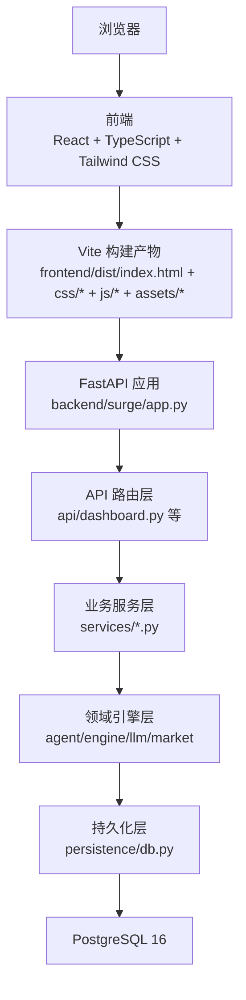
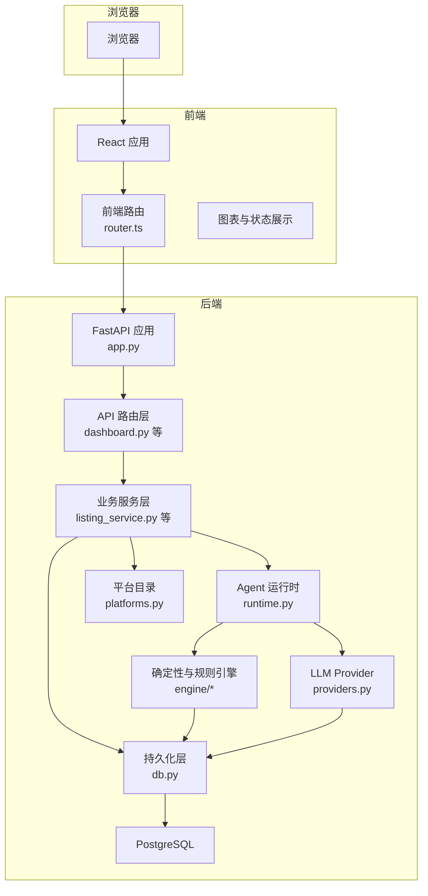
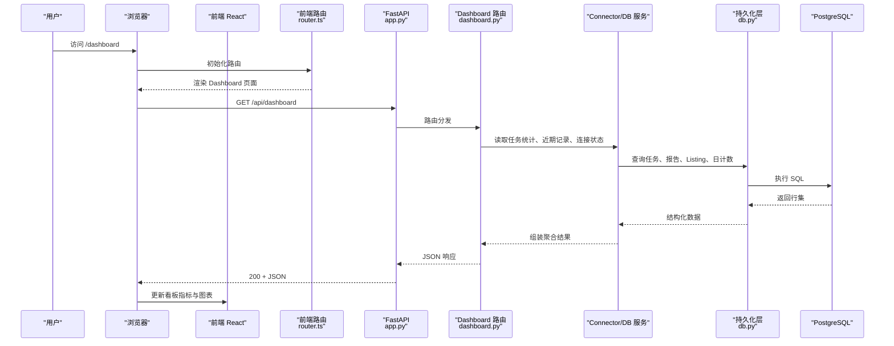
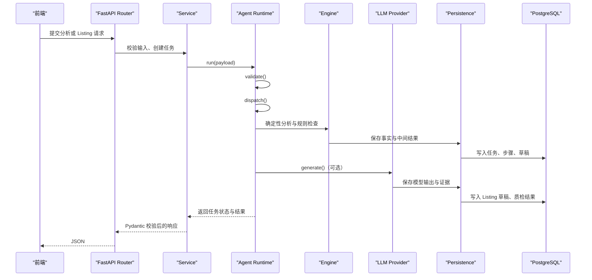
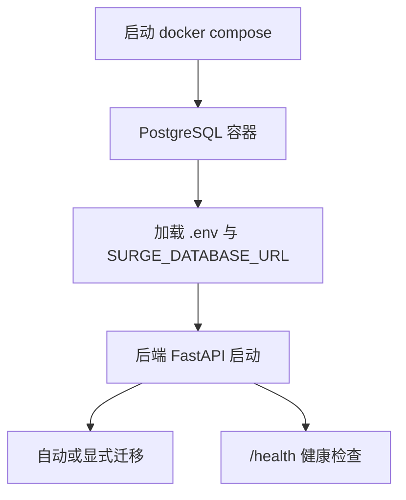
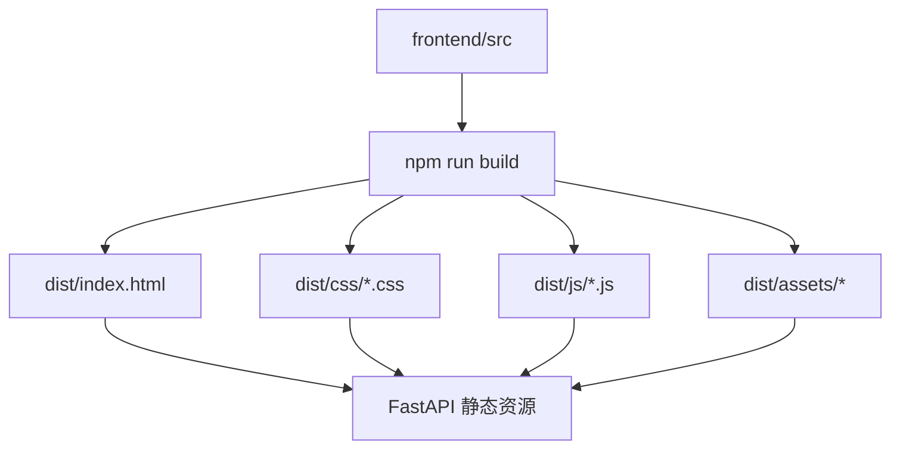
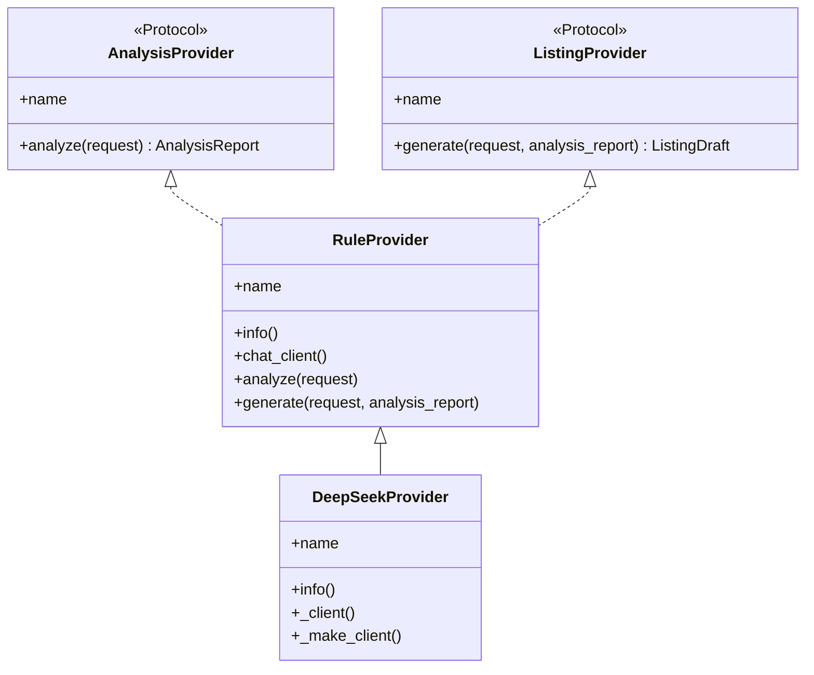

# 架构总览

<cite>
**本文引用的文件**   
- [README.md](file://README.md)
- [backend/surge/app.py](file://backend/surge/app.py)
- [backend/surge/__main__.py](file://backend/surge/__main__.py)
- [backend/surge/api/dashboard.py](file://backend/surge/api/dashboard.py)
- [backend/surge/api/deps.py](file://backend/surge/api/deps.py)
- [backend/surge/services/listing_service.py](file://backend/surge/services/listing_service.py)
- [backend/surge/agent/runtime.py](file://backend/surge/agent/runtime.py)
- [backend/surge/llm/providers.py](file://backend/surge/llm/providers.py)
- [backend/surge/market/platforms.py](file://backend/surge/market/platforms.py)
- [backend/surge/persistence/db.py](file://backend/surge/persistence/db.py)
- [frontend/package.json](file://frontend/package.json)
- [frontend/vite.config.ts](file://frontend/vite.config.ts)
- [frontend/src/app/router.ts](file://frontend/src/app/router.ts)
- [docker-compose.yml](file://docker-compose.yml)
- [render.yaml](file://render.yaml)
- [vercel.json](file://vercel.json)
</cite>

## 目录
1. [引言](#引言)
2. [项目结构](#项目结构)
3. [核心组件](#核心组件)
4. [架构总览](#架构总览)
5. [关键流程：从浏览器到数据库](#关键流程从浏览器到数据库)
6. [设计原则与约束](#设计原则与约束)
7. [技术栈与外部依赖](#技术栈与外部依赖)
8. [部署与构建产物关系](#部署与构建产物关系)
9. [扩展点](#扩展点)
10. [性能与可靠性特征](#性能与可靠性特征)
11. [故障排查要点](#故障排查要点)
12. [结论](#结论)

## 引言
Surge 是一个面向跨境电商卖家的全栈应用：后端提供 FastAPI 接口、Agent 工作流与 LLM Provider 抽象，前端用 React + TypeScript 实现工作台、技能广场、任务执行台和店铺看板。其核心目标是“一句话进，结构化结果出”，并保证每个结论可追溯、每次生成可审计、每个任务进度真实。

仓库采用前后端同仓组织：`backend/surge` 是 Python 包，`frontend` 是 Vite + React 工程；`docker-compose.yml` 提供本地 PostgreSQL，`render.yaml` 与 `vercel.json` 分别定义 Render 常驻进程部署和 Vercel 函数/静态站点部署。

**章节来源**
- [README.md:1-120](file://README.md#L1-L120)

## 项目结构
仓库按职责分层组织，而不是按语言简单分目录：

| 层级 | 主要目录或文件 | 职责 |
|---|---|---|
| 前端 | `frontend/src` | React 路由、页面、共享 UI、图表、异步任务轮询等 |
| 构建产物 | `frontend/dist` | Vite 构建后的 `index.html`、`css/*`、`js/*`、`assets/*` |
| API 路由层 | `backend/surge/api/*.py` | FastAPI Router，只负责请求校验、鉴权、调用 Service |
| 服务层 | `backend/surge/services/*.py` | 业务编排、状态管理、审批、导入、报告等 |
| 领域引擎层 | `backend/surge/agent/`、`engine/`、`llm/`、`market/` | Agent 工作流、LLM Provider、平台能力声明 |
| 持久化层 | `backend/surge/persistence/` | PostgreSQL 连接池、迁移、存储后端、密文存储 |
| 装配入口 | `backend/surge/app.py`、`worker_service.py` | 创建 FastAPI、挂载 Router、静态资源、错误处理 |

**图表来源**
- [backend/surge/app.py:1-120](file://backend/surge/app.py#L1-L120)
- [backend/surge/api/dashboard.py:1-99](file://backend/surge/api/dashboard.py#L1-L99)
- [backend/surge/persistence/db.py:1-80](file://backend/surge/persistence/db.py#L1-L80)
- [frontend/vite.config.ts:1-40](file://frontend/vite.config.ts#L1-L40)

**章节来源**
- [README.md:120-200](file://README.md#L120-L200)
- [backend/surge/app.py:1-120](file://backend/surge/app.py#L1-L120)
- [frontend/vite.config.ts:1-40](file://frontend/vite.config.ts#L1-L40)

## 核心组件
本项目的核心组件不是单一类，而是由一组协作对象构成的分层体系：

| 组件 | 所在文件 | 作用 |
|---|---|---|
| FastAPI 应用装配器 | `backend/surge/app.py` | 构造 Database、Storage、TaskQueue、ApiContext，挂载 Router 与静态资源，注册全局异常处理 |
| API 共享上下文 | `backend/surge/api/deps.py` | 暴露 `ApiContext`，集中持有 DB、存储、队列、密钥盒、租户与 Provider 解析逻辑 |
| Dashboard 路由 | `backend/surge/api/dashboard.py` | 聚合任务统计、近期记录、趋势、数据源状态 |
| Listing 服务 | `backend/surge/services/listing_service.py` | 包装 Provider、版本派生、质检、差异比较、导出 |
| Agent 运行时 | `backend/surge/agent/runtime.py` | 校验 → 分派 → 执行 → 收尾，断点续跑，暂停不收尾 |
| LLM Provider 抽象 | `backend/surge/llm/providers.py` | `RuleProvider`、`DeepSeekProvider` 等统一实现 `analyze` / `generate` |
| 平台目录 | `backend/surge/market/platforms.py` | 平台规范、OAuth 端点声明、能力标签 |
| 持久化层 | `backend/surge/persistence/db.py` | psycopg 适配、连接池、SQL 占位符转换、表结构 |
| 前端路由 | `frontend/src/app/router.ts` | History 路由、路径匹配、页面切换动画 |
| Vite 构建配置 | `frontend/vite.config.ts` | 固定 `/css`、`/js`、`/media` 产物契约 |

**章节来源**
- [backend/surge/app.py:1-120](file://backend/surge/app.py#L1-L120)
- [backend/surge/api/deps.py:1-120](file://backend/surge/api/deps.py#L1-L120)
- [backend/surge/api/dashboard.py:1-99](file://backend/surge/api/dashboard.py#L1-L99)
- [backend/surge/services/listing_service.py:1-80](file://backend/surge/services/listing_service.py#L1-L80)
- [backend/surge/agent/runtime.py:1-80](file://backend/surge/agent/runtime.py#L1-L80)
- [backend/surge/llm/providers.py:1-60](file://backend/surge/llm/providers.py#L1-L60)
- [backend/surge/market/platforms.py:1-60](file://backend/surge/market/platforms.py#L1-L60)
- [backend/surge/persistence/db.py:1-60](file://backend/surge/persistence/db.py#L1-L60)
- [frontend/src/app/router.ts:1-60](file://frontend/src/app/router.ts#L1-L60)
- [frontend/vite.config.ts:1-40](file://frontend/vite.config.ts#L1-L40)

## 架构总览
Surge 的分层可以概括为：

1. **API 路由层**：FastAPI Router 接收 HTTP 请求，完成认证、租户隔离、限流、参数校验。
2. **Services 业务逻辑层**：Service 组合多个领域能力，维护任务、版本、审批、导入等跨模块状态。
3. **Engine/Agent/LLM/Market 领域引擎层**：Agent 负责目标解析与工作流编排，Engine 做确定性计算，LLM Provider 封装模型调用，Market 描述平台能力。
4. **Persistence 持久化层**：通过 psycopg 访问 PostgreSQL，提供连接池、迁移、对象存储和密文存储。

**图表来源**
- [backend/surge/app.py:1-120](file://backend/surge/app.py#L1-L120)
- [backend/surge/api/dashboard.py:1-99](file://backend/surge/api/dashboard.py#L1-L99)
- [backend/surge/services/listing_service.py:1-80](file://backend/surge/services/listing_service.py#L1-L80)
- [backend/surge/agent/runtime.py:1-120](file://backend/surge/agent/runtime.py#L1-L120)
- [backend/surge/llm/providers.py:1-120](file://backend/surge/llm/providers.py#L1-L120)
- [backend/surge/market/platforms.py:1-120](file://backend/surge/market/platforms.py#L1-L120)
- [backend/surge/persistence/db.py:1-120](file://backend/surge/persistence/db.py#L1-L120)

**章节来源**
- [backend/surge/app.py:1-120](file://backend/surge/app.py#L1-L120)
- [backend/surge/api/deps.py:1-120](file://backend/surge/api/deps.py#L1-L120)
- [backend/surge/agent/runtime.py:1-120](file://backend/surge/agent/runtime.py#L1-L120)

## 关键流程：从浏览器到数据库
以用户打开 `/dashboard` 为例，实际请求链路如下：

**图表来源**
- [frontend/src/app/router.ts:60-120](file://frontend/src/app/router.ts#L60-L120)
- [backend/surge/app.py:120-277](file://backend/surge/app.py#L120-L277)
- [backend/surge/api/dashboard.py:1-99](file://backend/surge/api/dashboard.py#L1-L99)
- [backend/surge/persistence/db.py:1-120](file://backend/surge/persistence/db.py#L1-L120)

另一个典型链路是 Agent 分析与 Listing 生成：

**图表来源**
- [backend/surge/agent/runtime.py:1-200](file://backend/surge/agent/runtime.py#L1-L200)
- [backend/surge/services/listing_service.py:1-120](file://backend/surge/services/listing_service.py#L1-L120)
- [backend/surge/llm/providers.py:1-120](file://backend/surge/llm/providers.py#L1-L120)
- [backend/surge/persistence/db.py:1-120](file://backend/surge/persistence/db.py#L1-L120)

**章节来源**
- [backend/surge/api/dashboard.py:1-99](file://backend/surge/api/dashboard.py#L1-L99)
- [backend/surge/agent/runtime.py:1-200](file://backend/surge/agent/runtime.py#L1-L200)
- [backend/surge/services/listing_service.py:1-120](file://backend/surge/services/listing_service.py#L1-L120)

## 设计原则与约束
Surge 的核心行为约束在 README 与代码注释中反复出现，可归纳为以下五条：

| 原则 | 含义 | 代码体现 |
|---|---|---|
| 确定性归代码 | 价格统计、字符限制、字段校验、机会分计算由业务代码完成；模型只写文案 | Engine 与 Rules 承担可测试计算；Provider 产出需过质检 |
| 模型只负责解析目标与撰写文案 | 模型不被信任作为唯一事实源 | Provider 的 `generate` 返回候选草稿，再由质检规则验证 |
| 证据分级 | 每条结论标记事实、统计、推断、假设 | Agent 与 Engine 需要保留证据链，缺失即失败 |
| BYOK 不静默降级 | 没有 Key 时返回明确错误码，引导用户配置 | `api_key_required`、`RuleProvider` 降级但需如实标注 |
| 进度就是状态 | 页面显示的任务步骤、耗时、状态来自真实记录 | TaskRecorder、Agent runtime、持久化层共同维护 |

这些约束直接决定了系统不是“大模型套壳”，而是“可测试的业务代码为主、大模型为辅”的生产级工具。

**章节来源**
- [README.md:1-120](file://README.md#L1-L120)
- [backend/surge/llm/providers.py:1-120](file://backend/surge/llm/providers.py#L1-L120)
- [backend/surge/agent/runtime.py:1-120](file://backend/surge/agent/runtime.py#L1-L120)

## 技术栈与外部依赖
### 后端技术栈
- Python ≥ 3.10
- FastAPI
- Pydantic v2
- PostgreSQL 16
- psycopg / psycopg_pool
- LangGraph（Agent checkpoint 与工作图）
- OpenAI 兼容 SDK（多厂商统一调用）
- Arq（可选任务队列）
- Supabase Storage（可选对象存储）

### 前端技术栈
- Node ≥ 22.12.0
- React 19
- TypeScript
- Vite
- Tailwind CSS
- Radix UI
- Recharts
- TanStack Query
- Zustand
- Zod

### 关键依赖职责
| 依赖 | 用途 |
|---|---|
| LangGraph | Agent 工作图、中断与断点恢复 |
| OpenAI SDK | 通过 OpenAI 兼容协议调用 DeepSeek、OpenAI、Moonshot、智谱、通义、硅基流动、OpenRouter、Ollama 等 |
| psycopg / psycopg_pool | PostgreSQL 连接与连接池 |
| Recharts | 前端趋势图、柱状图等可视化 |
| Radix UI | 无障碍基础 UI 组件 |
| Tailwind CSS | 样式系统与 Token |
| Zod | 前端数据结构校验 |

**章节来源**
- [README.md:1-120](file://README.md#L1-L120)
- [frontend/package.json:1-71](file://frontend/package.json#L1-L71)
- [backend/surge/llm/providers.py:1-120](file://backend/surge/llm/providers.py#L1-L120)
- [backend/surge/persistence/db.py:1-120](file://backend/surge/persistence/db.py#L1-L120)

## 部署与构建产物关系
### 本地开发
使用 `docker-compose.yml` 启动 PostgreSQL 16，后端通过 `python -m surge serve` 或 `uvicorn surge.worker_service:app` 启动。首次访问会引导创建管理员账号。

**图表来源**
- [docker-compose.yml:1-22](file://docker-compose.yml#L1-L22)
- [README.md:120-200](file://README.md#L1-L200)

### Render 部署
Render 定义的是常驻 Python Web Service：
- `rootDir: backend`
- `buildCommand: pip install -r requirements.txt`
- `startCommand: uvicorn surge.worker_service:app --host 0.0.0.0 --port $PORT --workers 1`
- 前端静态站通过 `SURGE_WEB_DIR=../frontend/dist` 由 FastAPI 的 `StaticFiles` 提供
- 默认线程队列，不需要 serverless 同步任务模式

### Vercel 部署
`vercel.json` 把 `worker_service.py` 暴露为函数，设置最大执行时间，并配置静态资源缓存与安全头：
- `/css/*` 缓存 300 秒
- `/js/*` 缓存 300 秒
- `/media/*` 缓存 86400 秒
- 根路径添加 `X-Content-Type-Options`、`X-Frame-Options`、`Referrer-Policy`

### Vite 构建产物契约
Vite 不会把图片/字体打包进 JS/CSS，而是要求静态资源放在 `frontend/assets`，并通过 `/media/...` 引用；CSS 走独立构建命令，产物落在 `dist/css`，JS 产物落在 `dist/js`，主 HTML 是 `dist/index.html`。后端只挂载这三个前缀。

**图表来源**
- [frontend/vite.config.ts:1-120](file://frontend/vite.config.ts#L1-L120)
- [backend/surge/app.py:1-120](file://backend/surge/app.py#L1-L120)
- [render.yaml:1-74](file://render.yaml#L1-L74)
- [vercel.json:1-27](file://vercel.json#L1-L27)

**章节来源**
- [docker-compose.yml:1-22](file://docker-compose.yml#L1-L22)
- [render.yaml:1-74](file://render.yaml#L1-L74)
- [vercel.json:1-27](file://vercel.json#L1-L27)
- [frontend/vite.config.ts:1-120](file://frontend/vite.config.ts#L1-L120)

## 扩展点
Surge 在几个位置预留了扩展点，使 Skill、Provider 和平台接入可以在不破坏现有 API 的前提下增加。

| 扩展点 | 位置 | 说明 |
|---|---|---|
| Skill 注册表 | `backend/surge/agent/registry.py`、`backend/surge/skills/registry.py` | 平台内置 Skill 与租户自定义 Skill 集中管理，支持启用、禁用、覆盖 |
| Provider 抽象 | `backend/surge/llm/providers.py` | 新增 LLM 厂商只需实现统一 `AnalysisProvider` / `ListingProvider` 协议 |
| Platform Connector | `backend/surge/market/platforms.py` | 新增跨境平台只需补充 `PlatformSpec`、OAuth 端点与能力声明 |
| Agent 工作流 | `backend/surge/agent/workflows.py`、`graphs/*` | 新增分析或 Listing 工作流，按 `with_listing` 或 `kind` 分派 |
| 前端页面 | `frontend/src/features/*` | 新功能以 feature 目录组织，通过 `routes.tsx` 与 `router.ts` 接入 |

**图表来源**
- [backend/surge/llm/providers.py:1-200](file://backend/surge/llm/providers.py#L1-L200)

**章节来源**
- [backend/surge/llm/providers.py:1-200](file://backend/surge/llm/providers.py#L1-L200)
- [backend/surge/market/platforms.py:1-200](file://backend/surge/market/platforms.py#L1-L200)
- [backend/surge/agent/runtime.py:1-120](file://backend/surge/agent/runtime.py#L1-L120)

## 性能与可靠性特征
- **连接复用**：`Database` 按 DSN 复用连接池，避免每次请求重建连接。
- **Dashboard 单连接聚合**：dashboard 路由在单次请求内复用同一连接读取统计、计数、近期任务、报告和 Listing。
- **渐进式迁移**：生产建议关闭 `SURGE_AUTO_MIGRATE`，改用 `surge migrate` 显式迁移；LangGraph checkpoint 表单独初始化，失败降级不阻断启动。
- **任务队列**：默认线程队列适合 Render 常驻进程；arq 队列用于 Redis Worker 场景。
- **性能观测**：可选 `SURGE_PROFILE=1` 开启 HTTP 层性能快照，输出 `Server-Timing` 与 `X-Perf`。
- **缓存控制**：后端对静态资源强制 `no-cache`，避免浏览器启发式缓存导致前端刷新仍见旧脚本；Vercel 上通过 `vercel.json` 设置静态资源缓存头。

**章节来源**
- [backend/surge/api/dashboard.py:1-99](file://backend/surge/api/dashboard.py#L1-L99)
- [backend/surge/app.py:1-120](file://backend/surge/app.py#L1-L120)
- [backend/surge/persistence/db.py:1-120](file://backend/surge/persistence/db.py#L1-L120)
- [vercel.json:1-27](file://vercel.json#L1-L27)

## 故障排查要点
| 现象 | 可能原因 | 处理方向 |
|---|---|---|
| 启动时报数据库连接错误 | `SURGE_DATABASE_URL` 错误或 PostgreSQL 未启动 | 检查 `.env`、`docker compose up`、Supabase 连接串 |
| 前端刷新后样式或脚本未更新 | 浏览器缓存旧资源 | 确认后端 `NoCacheStatic` 或 Vercel 缓存头是否生效 |
| 需要模型的接口返回 428 | BYOK 未配置或 Key 不可用 | 进入设置页配置 Provider，不要期望静默降级 |
| Agent 任务停在确认点 | 工作流命中暂停节点 | 等待用户确认后再恢复，不应自动收尾 |
| 报表或 Listing 数字与预期不一致 | 模型输出未通过质检或使用了规则引擎 | 查看 `engine_label`、质检结果与 Provider 类型 |
| 平台连接显示未授权 | 真实接入未完成或 OAuth 未换 token | 查看平台目录中的 `live_status`，不伪造 token |

**章节来源**
- [README.md:120-200](file://README.md#L120-L200)
- [backend/surge/app.py:120-277](file://backend/surge/app.py#L120-L277)
- [backend/surge/agent/runtime.py:120-297](file://backend/surge/agent/runtime.py#L120-L297)
- [backend/surge/llm/providers.py:60-200](file://backend/surge/llm/providers.py#L60-L200)
- [backend/surge/market/platforms.py:1-120](file://backend/surge/market/platforms.py#L1-L120)

## 结论
Surge 的架构本质上是“确定性代码为主、模型辅助”的可审计工作流系统。FastAPI 负责边界，Service 负责编排，Agent 与工作流负责状态推进，Engine 负责可复现计算，Provider 负责模型与规则的统一入口，Persistence 负责所有结果的落库留痕。前端通过 `/dashboard` 等页面消费后端 JSON，并把进度、质量检查和证据分级呈现给用户。

对于后续扩展，推荐遵循现有约定：新增 Skill 走注册表，新增 LLM 厂商走 Provider 协议，新增平台走 `platforms.py` 的能力声明，新增页面走 `frontend/src/features`，并确保所有用户可见的数字都来自可测试的代码而非模型猜测。