# Agent 工作流

<cite>
**本文引用的文件**   
- [state.py](file://backend/surge/agent/state.py)
- [planner.py](file://backend/surge/agent/planner.py)
- [routing.py](file://backend/surge/agent/routing.py)
- [runtime.py](file://backend/surge/agent/runtime.py)
- [workflows.py](file://backend/surge/agent/workflows.py)
- [registry.py](file://backend/surge/agent/registry.py)
- [contracts.py](file://backend/surge/agent/contracts.py)
- [errors.py](file://backend/surge/agent/errors.py)
- [schemas.py](file://backend/surge/agent/schemas.py)
- [skills.py](file://backend/surge/agent/skills.py)
</cite>

## 目录
1. [引言](#引言)
2. [项目结构](#项目结构)
3. [核心组件](#核心组件)
4. [架构总览](#架构总览)
5. [详细组件分析](#详细组件分析)
6. [依赖关系分析](#依赖关系分析)
7. [性能与完整性特性](#性能与完整性特性)
8. [调试与监控指南](#调试与监控指南)
9. [扩展新工作流的方法](#扩展新工作流的方法)
10. [结论](#结论)

## 引言
本文面向希望理解并扩展 **Agent 工作流引擎** 的开发者。该引擎以 LangGraph 子图为执行载体，把自然语言目标拆解为结构化参数，再按“竞品分析”“Listing 生成”或“组合流程”三种路径编排执行；在执行过程中提供输入校验、计划骨架、技能路由、图执行、暂停确认、结果收尾和统一错误分类等能力。

文档重点覆盖：
- State 数据结构与工作流节点契约
- Planner 如何解析自然语言目标并做确定性降级
- Routing 如何选择 Skill 或 Tool
- Runtime 如何执图形结构、处理中断与异常
- 与 LLM 客户端、Skill 注册表的集成方式
- 示例：“分析竞品 A 的价格趋势”的完整链路
- 调试技巧、监控要点与扩展方法

## 项目结构
Agent 相关代码集中在 `backend/surge/agent` 包中，采用职责分层组织：

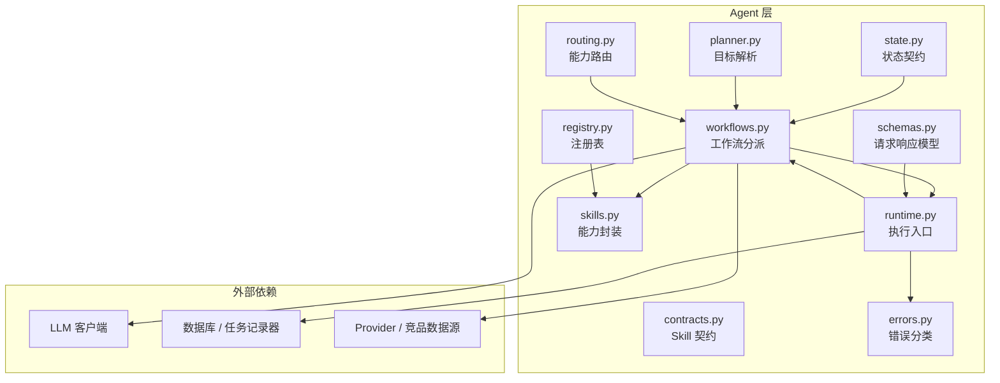

**图示来源**
- [state.py:1-173](file://backend/surge/agent/state.py#L1-L173)
- [planner.py:1-261](file://backend/surge/agent/planner.py#L1-L261)
- [routing.py:1-176](file://backend/surge/agent/routing.py#L1-L176)
- [workflows.py:1-550](file://backend/surge/agent/workflows.py#L1-L550)
- [runtime.py:1-297](file://backend/surge/agent/runtime.py#L1-L297)
- [contracts.py:1-326](file://backend/surge/agent/contracts.py#L1-L326)
- [errors.py:1-423](file://backend/surge/agent/errors.py#L1-L423)
- [registry.py:1-526](file://backend/surge/agent/registry.py#L1-L526)
- [skills.py:1-189](file://backend/surge/agent/skills.py#L1-L189)
- [schemas.py:1-217](file://backend/surge/agent/schemas.py#L1-L217)

**章节来源**
- [state.py:1-173](file://backend/surge/agent/state.py#L1-L173)
- [workflows.py:1-550](file://backend/surge/agent/workflows.py#L1-L550)

## 核心组件
Agent 工作流的核心由以下模块构成：

| 模块 | 职责 | 关键设计点 |
|---|---|---|
| `state.py` | 定义 Listing、竞品分析和组合工作流的 TypedDict 状态 | 状态只包含 JSON 可序列化值；明确结局常量与修订上限 |
| `planner.py` | 把自然语言目标解析为结构化 `GoalSpec` | 优先调用 LLM，失败时回退到规则解析，标记 `degraded` |
| `routing.py` | 根据显式选择或自动发现决定执行哪些能力 | 区分显式路由、自动路由、不支持能力 |
| `workflows.py` | 选择工作流类型、计算指纹、执行 LangGraph 子图、统一收尾 | 唯一分派判据是 `with_listing` 和 `listing_only` |
| `runtime.py` | 创建任务、校验、分派、超时控制、暂停与收尾 | 暂停不收尾，取消走独立分支 |
| `contracts.py` | 定义 Skill 声明、执行上下文、执行器和统一结果信封 | 区分“已启用”和“真正可执行” |
| `errors.py` | 把异常映射为 10 类错误策略 | 面向用户的消息与日志原文分离 |
| `registry.py` | 平台内置 Agent/Skill/Tool 注册与租户自定义管理 | 用空字符串表示内置，避免复合主键 NULL 问题 |
| `skills.py` | 把既有业务逻辑包装成 Skill | 不写算法，复用现有 engine/provider 实现 |
| `schemas.py` | 定义 API 请求/响应 Pydantic 模型 | 支持自然语言目标和结构化参数两种入口 |

**章节来源**
- [state.py:1-173](file://backend/surge/agent/state.py#L1-L173)
- [planner.py:1-261](file://backend/surge/agent/planner.py#L1-L261)
- [routing.py:1-176](file://backend/surge/agent/routing.py#L1-L176)
- [workflows.py:1-550](file://backend/surge/agent/workflows.py#L1-L550)
- [runtime.py:1-297](file://backend/surge/agent/runtime.py#L1-L297)
- [contracts.py:1-326](file://backend/surge/agent/contracts.py#L1-L326)
- [errors.py:1-423](file://backend/surge/agent/errors.py#L1-L423)
- [registry.py:1-526](file://backend/surge/agent/registry.py#L1-L526)
- [skills.py:1-189](file://backend/surge/agent/skills.py#L1-L189)
- [schemas.py:1-217](file://backend/surge/agent/schemas.py#L1-L217)

## 架构总览
从一次用户请求到结果落库，整体流程如下：

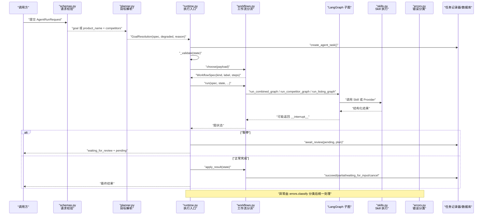

**图示来源**
- [schemas.py:1-217](file://backend/surge/agent/schemas.py#L1-L217)
- [planner.py:1-261](file://backend/surge/agent/planner.py#L1-L261)
- [runtime.py:1-297](file://backend/surge/agent/runtime.py#L1-L297)
- [workflows.py:1-550](file://backend/surge/agent/workflows.py#L1-L550)
- [skills.py:1-189](file://backend/surge/agent/skills.py#L1-L189)
- [errors.py:1-423](file://backend/surge/agent/errors.py#L1-L423)

## 详细组件分析

### State 数据结构与工作流节点契约
State 是 LangGraph 子图的共享内存，使用 `TypedDict` 声明键集合，而不是裸字典。这样做的目的是：
- 对外承诺输入输出键，便于组合工作流、技能入口和 checkpoint 使用
- 表达“某些键一定存在”，减少节点里到处 `get(k)` 的防御性代码
- 保证状态可序列化，避免往状态里塞不可序列化的对象

当前定义了三种状态：

| 状态 | 用途 | 关键字段 |
|---|---|---|
| `ListingState` | Listing 子图 | `request`、`facts`、`rules`、`insights`、`required`、`listing`、`quality`、`revision`、`outcome`、`message`、`artifact` |
| `CompetitorState` | 竞品分析子图 | `request`、`provider`、`fetched`、`normalized`、`sufficiency`、`report`、`checks`、`summary`、`validation`、`outcome`、`provenance`、`artifact` |
| `CombinedState` | 组合工作流 | 阶段一分析结果 + 暂停确认点 + 阶段二 Listing + 任务级 `task_status` |

结局常量包括：
- Listing：`succeeded`、`needs_user_input`、`needs_review`
- 竞品：`partial`
- 通用：`cancelled`

此外，Listing 子图默认最多修订一次，因为修订需要重新过模型，两轮之后仍不过通常属于资料问题而非措辞问题。

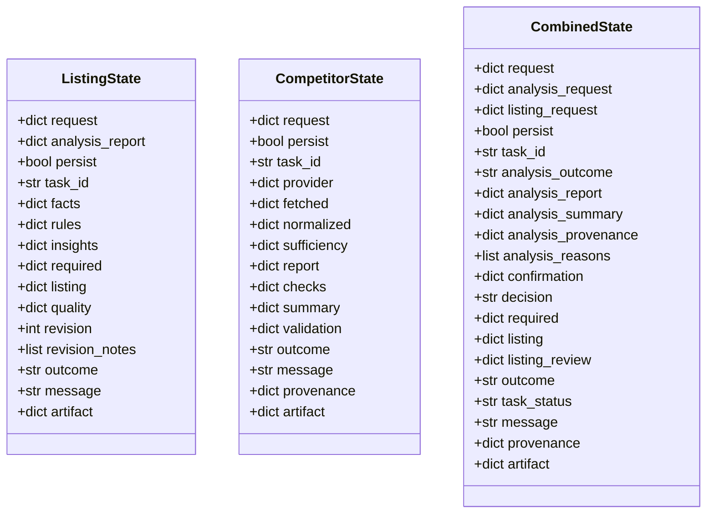

**图示来源**
- [state.py:1-173](file://backend/surge/agent/state.py#L1-L173)

**章节来源**
- [state.py:1-173](file://backend/surge/agent/state.py#L1-L173)

### Planner：自然语言目标解析与计划编排
Planner 的职责是把自然语言目标翻译成结构化参数，同时保持执行计划确定性：

1. **LLM 负责语义提取**：系统提示要求模型只提取用户明确说出的信息，不编造商品、认证、销量或竞品数据。
2. **规则降级必须可见**：没有 LLM、调用失败、Pydantic 校验失败都会回退到 `rule_resolve`，并在 `GoalResolution.degraded` 中标注原因。
3. **计划本身是确定性的**：图节点固定为“竞品分析 → 完整性检查 → 总结 → 可选 Listing → 持久化”，LLM 不决定执行哪些节点。
4. **语言与市场推断**：通过关键词匹配 US、CA、UK、DE、FR、IT、ES、JP、MX 等平台，并推导默认文案语言。
5. **Plan 骨架委托给 Workflows**：`plan_for` 与 `plan_for_listing_only` 最终委托 `workflows.choose`，确保分派判据只有一处。

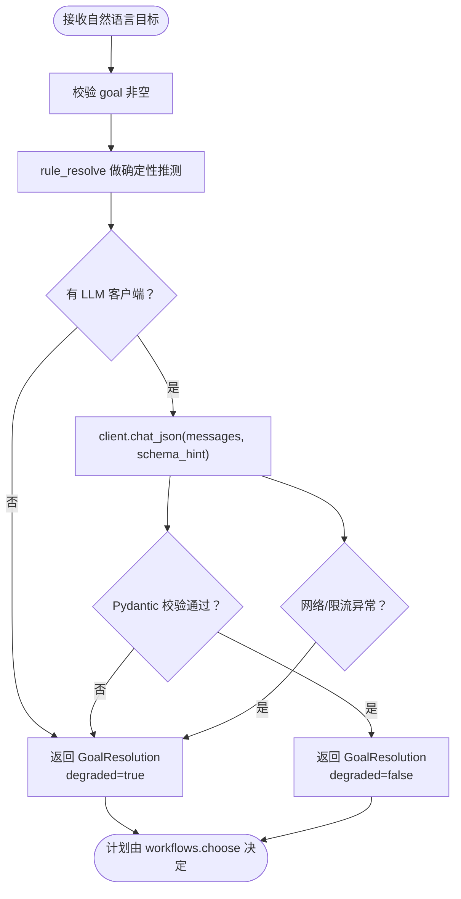

**图示来源**
- [planner.py:1-261](file://backend/surge/agent/planner.py#L1-L261)

**章节来源**
- [planner.py:1-261](file://backend/surge/agent/planner.py#L1-L261)

### Routing：Skill 与 Tool 路由
Routing 只做“选能力”，不改执行图：

优先级顺序：
1. 用户显式传入 `skill_key`：直接映射为 `(with_listing, listing_only)`
2. 调用方显式传入 `with_listing` / `listing_only`：作为约束
3. 自动路由：基于 `discover` 的结果，从技能目录中选择本次需要的能力

支持的 Agent 技能：
- `competitor_analysis`
- `listing_generation`
- `market_summary`
- `review_mining`

其中 `market_summary` 和 `review_mining` 由竞品工作流内部完成，不需要单独节点。若自动路由只命中利润测算、数据校验等需要专属参数的能力，则返回 `unsupported`，不会默默退回默认组合流程。

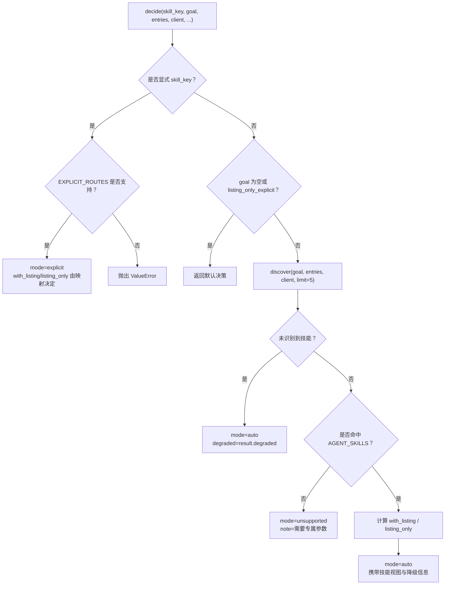

**图示来源**
- [routing.py:1-176](file://backend/surge/agent/routing.py#L1-L176)

**章节来源**
- [routing.py:1-176](file://backend/surge/agent/routing.py#L1-L176)

### Runtime：图执行与异常处理
`AgentRuntime` 是一个一次任务的执行器，只做三件事：

1. **校验**：确认 `product_name` 必填；若非 `listing_only`，还需要 `competitors`。
2. **分派**：根据 `with_listing` 选择竞品分析、组合流程或仅 Listing。
3. **收尾**：将工作流结局翻译为任务状态，但暂停时不收尾。

关键点：
- 工作流超时通过 `begin_deadline` / `end_deadline` 控制，超时窗口覆盖整条工作流。
- 组合工作流可能触发 `interrupt()`，此时任务进入 `waiting_for_review`，等待确认接口恢复。
- 非暂停状态才调用 `apply_result`：`succeeded`、`partial`、`waiting_for_input`、`cancelled`。
- 所有未捕获异常经 `errors.classify` 转为统一错误，任务标记失败，并抛出 `AgentRunError`。

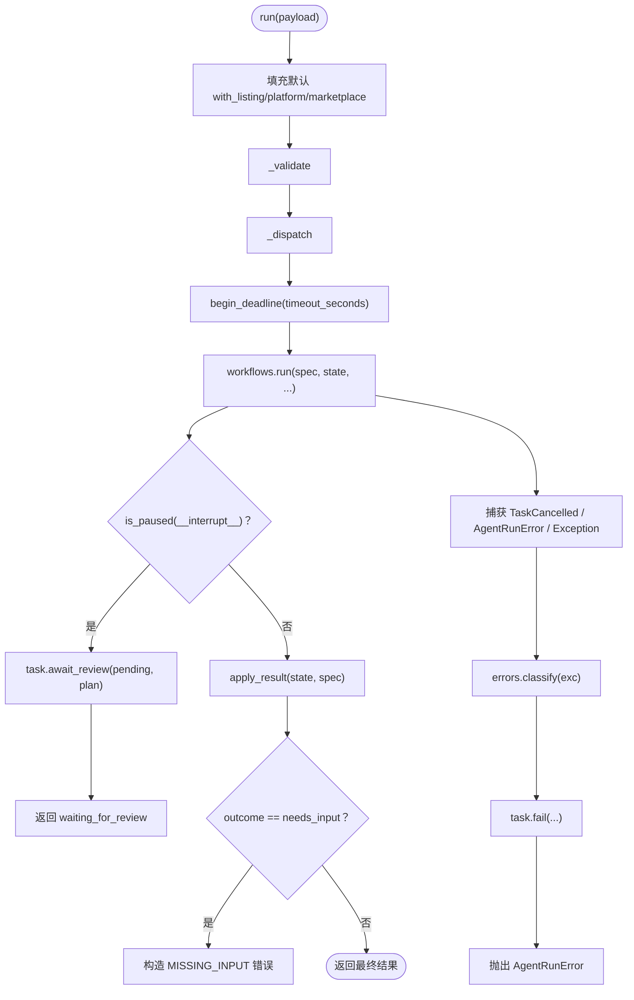

**图示来源**
- [runtime.py:1-297](file://backend/surge/agent/runtime.py#L1-L297)
- [workflows.py:201-550](file://backend/surge/agent/workflows.py#L201-L550)
- [errors.py:1-423](file://backend/surge/agent/errors.py#L1-L423)

**章节来源**
- [runtime.py:1-297](file://backend/surge/agent/runtime.py#L1-L297)
- [workflows.py:201-550](file://backend/surge/agent/workflows.py#L201-L550)
- [errors.py:1-423](file://backend/surge/agent/errors.py#L1-L423)

### Workflows：工作流分派、指纹与统一收尾
`workflows.py` 是“选图”的单一权威位置：

- `choose` 根据 `payload` 决定三种工作流：
  - `listing_only=true`：仅 Listing
  - `with_listing=true`：组合流程（竞品分析 → 可能暂停 → Listing）
  - 其他：独立竞品分析
- `fingerprint` 对输入字段做哈希，用于判断重试时能否复用中间结果。
- `WORKFLOW_VERSION` 用于防止旧版本中间结果被错配到新节点结构。
- `can_reuse` 宁可重算也不复用错误结果：版本不同或指纹不同都放弃复用。
- `run` 把扁平请求拆成子图所需结构，分别调用组合、Listing 或竞品分析图。
- `apply_result` 是唯一把工作流结局落到任务状态的函数。

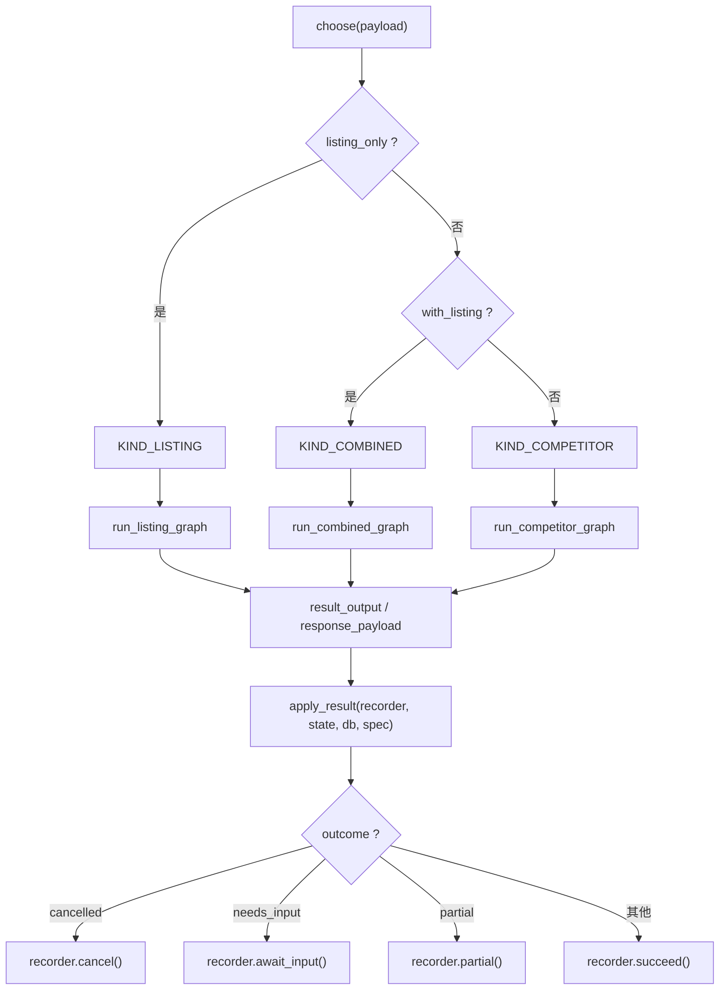

**图示来源**
- [workflows.py:1-550](file://backend/surge/agent/workflows.py#L1-L550)

**章节来源**
- [workflows.py:1-550](file://backend/surge/agent/workflows.py#L1-L550)

### Skill 契约、注册表与 LLM 集成
#### Skill 契约
`contracts.py` 定义了 Skill 的执行契约：

- `SkillDefinition`：一个能力的完整声明，包含输入模型、输出 schema、执行器、依赖项、超时、状态和用户说明。
- `SkillContext`：执行所需的上下文，如 `db`、`tenant_id`、`user_id`、`provider`、`timeout_seconds`。
- `Executor`：协议签名，接受 `SkillContext` 和已校验输入模型，返回业务对象或 dict。
- `SkillResult`：统一结果信封，包含 skill_key、status、result、warnings、quality、provenance、attempts、duration_ms 等。
- 多种 Skill 层异常：`SkillNotFound`、`SkillDisabled`、`SkillNotExecutable`、`SkillInputInvalid`、`SkillMissingInput`、`SkillTimeout` 等。

#### 注册表
`registry.py` 维护平台内置与租户自定义的 Agent、Skill、Tool：

- 平台内置定义随代码发布，启动时幂等写入。
- 用空字符串表示内置 tenant，避免复合主键中 NULL 互不相等导致的重复插入。
- 租户自定义只能写在当前租户空间，不能覆盖或停用平台内置。
- Agent/Skill/Tool 的元数据来自 `skills_registry.seed_rows()` 和内置 TOOLS/AGENTS 列表。

#### LLM 客户端集成
- Planner 通过 `client.chat_json(messages, schema_hint=...)` 解析目标，失败则降级。
- `SkillContext.has_llm()` 探测 Provider 是否真的能调模型，而不是只看 Provider 实例是否存在。
- 错误分类会识别 `LLMError`、`ProviderError`，区分限流、网络、鉴权、服务端错误和非法 JSON。

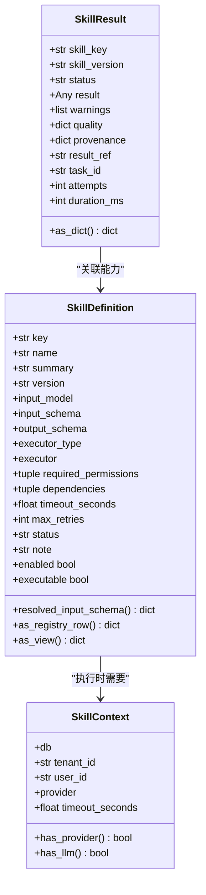

**图示来源**
- [contracts.py:1-326](file://backend/surge/agent/contracts.py#L1-L326)

**章节来源**
- [contracts.py:1-326](file://backend/surge/agent/contracts.py#L1-L326)
- [registry.py:1-526](file://backend/surge/agent/registry.py#L1-L526)

### 示例：用户输入“分析竞品 A 的价格趋势”
以下是一次典型执行的端到端过程：

1. **前端或调用方提交 `AgentRunRequest`**  
   可以是自然语言目标 `goal="分析竞品 A 的价格趋势"`，也可以是结构化 `product_name` + `competitors`。

2. **Planner 解析目标**  
   - 尝试调用 LLM 提取商品名、平台、站点、品类、是否生成 Listing、语言、关键词。
   - 如果 LLM 不可用或返回不合规，则回退到规则解析，标记 `degraded=true`，并把原因放入任务输出。

3. **Routing 选择能力**  
   - 如果用户显式传了 `skill_key`，按映射执行。
   - 否则根据目标自动发现能力；“价格趋势”通常会命中竞品分析相关技能。

4. **Runtime 校验并分派**  
   - 校验 `product_name` 和非 `listing_only` 时的 `competitors`。
   - 若 `with_listing=true`，选择组合工作流；否则选择竞品分析工作流。

5. **Workflows 执行 LangGraph 子图**  
   - 组合工作流：先跑竞品分析，若证据不足可能进入 `confirm_partial` 暂停点，用户确认后继续 Listing。
   - 竞品工作流：取数、归一化、充分性检查、市场分析、质量检查、总结、持久化。
   - Listing 工作流：事实解析、品牌规则加载、市场洞察、必填事实检查、生成、质检、修订、草稿保存。

6. **Skills 与 Provider 调用**  
   - 竞品分析通过 `skills.run_competitor_analysis` 调用 Provider。
   - Listing 生成通过 `skills.generate_listing` 调用 Provider。
   - 评论挖掘、市场总结、完整性检查和质量快照走确定性逻辑。

7. **结果收尾**  
   - 暂停：任务状态为 `waiting_for_review`，返回 `pending` 待确认内容。
   - 缺事实：任务状态为 `waiting_for_input`，返回 422 并列出缺失字段。
   - 部分成功：任务状态为 `partial`，绝不清理为 `succeeded`。
   - 正常完成：任务状态为 `succeeded`。

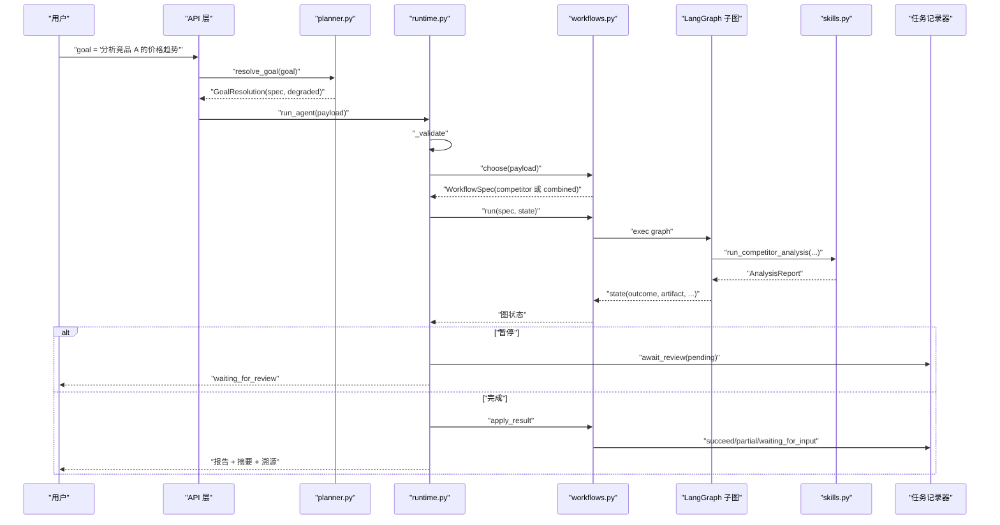

**图示来源**
- [schemas.py:1-217](file://backend/surge/agent/schemas.py#L1-L217)
- [planner.py:1-261](file://backend/surge/agent/planner.py#L1-L261)
- [runtime.py:1-297](file://backend/surge/agent/runtime.py#L1-L297)
- [workflows.py:1-550](file://backend/surge/agent/workflows.py#L1-L550)
- [skills.py:1-189](file://backend/surge/agent/skills.py#L1-L189)

**章节来源**
- [schemas.py:1-217](file://backend/surge/agent/schemas.py#L1-L217)
- [planner.py:1-261](file://backend/surge/agent/planner.py#L1-L261)
- [runtime.py:1-297](file://backend/surge/agent/runtime.py#L1-L297)
- [workflows.py:1-550](file://backend/surge/agent/workflows.py#L1-L550)
- [skills.py:1-189](file://backend/surge/agent/skills.py#L1-L189)

## 依赖关系分析
Agent 层的内部依赖呈现清晰的分层：

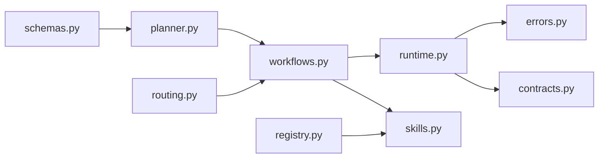

- `schemas.py` 是请求边界，定义 `AgentRunRequest`、`AgentRunResponse`、`CombinedRunRequest`、`ConfirmRequest`、`RetryRequest` 等。
- `planner.py` 依赖 LLM 客户端和 scrubbing 工具，但不直接依赖执行图。
- `routing.py` 依赖技能目录发现能力，输出 `RoutingDecision`。
- `workflows.py` 是执行图调度中心，不直接调用 LLM，而是交给具体 LangGraph 子图。
- `runtime.py` 是任务生命周期入口，连接任务记录器、工作流和错误分类。
- `contracts.py` 定义 Skill 契约，供 Skill 实现和调度使用。
- `errors.py` 集中处理异常，向上层暴露统一 `ErrorInfo`。
- `registry.py` 提供 Agent/Skill/Tool 的静态定义和租户管理能力。
- `skills.py` 是对已有 engine/provider 的薄封装，避免 AI 工作台与独立页面代码分叉。

**图示来源**
- [schemas.py:1-217](file://backend/surge/agent/schemas.py#L1-L217)
- [planner.py:1-261](file://backend/surge/agent/planner.py#L1-L261)
- [routing.py:1-176](file://backend/surge/agent/routing.py#L1-L176)
- [workflows.py:1-550](file://backend/surge/agent/workflows.py#L1-L550)
- [runtime.py:1-297](file://backend/surge/agent/runtime.py#L1-L297)
- [contracts.py:1-326](file://backend/surge/agent/contracts.py#L1-L326)
- [errors.py:1-423](file://backend/surge/agent/errors.py#L1-L423)
- [registry.py:1-526](file://backend/surge/agent/registry.py#L1-L526)
- [skills.py:1-189](file://backend/surge/agent/skills.py#L1-L189)

**章节来源**
- [workflows.py:1-550](file://backend/surge/agent/workflows.py#L1-L550)
- [runtime.py:1-297](file://backend/surge/agent/runtime.py#L1-L297)

## 性能与完整性特性
### 性能特性
- **确定性优先**：Planner 只做自然语言到结构化参数的映射；执行节点固定，不因模型幻觉跳过质检。
- **工作流版本与输入指纹**：`WORKFLOW_VERSION` 与 `fingerprint` 共同控制重试时能否复用中间结果。版本变化或输入变化都会放弃复用，宁可多花一次模型调用，也不给用户错误的历史结论。
- **超时控制**：每条工作流定义 `timeout_seconds`，组合流程最长，因为可能跑两轮模型。
- **断点续跑**：`resume_from` 让命中的节点不重跑，但只在同一张顶层图和正确版本下有效。
- **组合流程暂停不重复执行**：注释明确指出，恢复时中断节点之前的节点不重跑，中断节点本身会重跑，因此副作用必须放在确认节点之前或恢复之后的节点。

### 完整性检查
`skills.check_integrity` 是确定性数据完整性检查，任何结论都不能绕过：
- 竞品数量不足时发出警告
- 无评论样本时指出痛点与需求为空
- 无竞品价格时指出价格定位不可用
- 字段缺失时列出前几个缺失字段
- 示例数据时明确标注不可用于真实经营决策

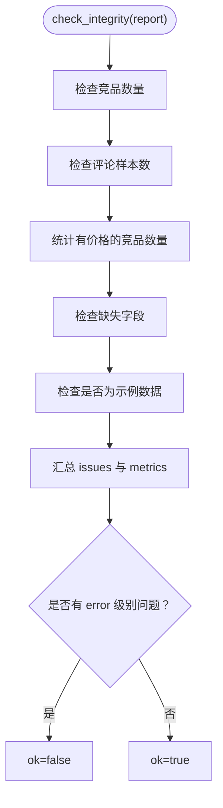

**图示来源**
- [skills.py:1-189](file://backend/surge/agent/skills.py#L1-L189)

**章节来源**
- [workflows.py:201-550](file://backend/surge/agent/workflows.py#L201-L550)
- [skills.py:1-189](file://backend/surge/agent/skills.py#L1-L189)

## 调试与监控指南

### 调试技巧
1. **查看任务计划与时间线**  
   任务计划由 `WorkflowSpec.plan()` 生成，包含主图三阶段和工作流内部步骤。若时间线上出现“计划外步骤”，说明分派逻辑或步骤命名不一致。

2. **关注 `degraded` 标记**  
   如果 Planner 无法调用 LLM 或模型返回不合规，`degraded=true` 会进入任务输出。这是“不允许静默降级”的设计体现。

3. **检查 `__interrupt__`**  
   组合工作流暂停时会设置 `__interrupt__`。`workflows.is_paused` 据此判断是否应走 `await_review` 分支。

4. **核对输入指纹与工作流版本**  
   如果重试没有复用旧结果，检查 `WORKFLOW_VERSION` 是否升级，以及 `fingerprint` 字段是否发生变化。

5. **区分“参数错误”和“缺资料”**  
   `SkillInputInvalid` 是参数格式错误；`SkillMissingInput` 是内容缺失，应引导用户补资料并重试。

### 监控要点
- **任务状态分布**：`succeeded`、`partial`、`waiting_for_input`、`waiting_for_review`、`cancelled`、`failed`。
- **降级比例**：`degraded` 和 `degraded_reason` 反映 LLM 可用性。
- **错误分类**：`validation_error`、`missing_input`、`provider_unavailable`、`rate_limited`、`model_timeout`、`model_output_invalid`、`quality_gate_failed`、`cancelled`、`internal_error`。
- **耗时与重试次数**：`SkillResult.duration_ms` 和 `attempts` 可用于监控慢节点。
- **完整性指标**：`check_integrity.metrics.competitors`、`reviews`、`priced_competitors`、`is_demo`。

**章节来源**
- [errors.py:1-423](file://backend/surge/agent/errors.py#L1-L423)
- [workflows.py:201-550](file://backend/surge/agent/workflows.py#L201-L550)
- [contracts.py:201-326](file://backend/surge/agent/contracts.py#L201-L326)
- [skills.py:1-189](file://backend/surge/agent/skills.py#L1-L189)

## 扩展新工作流的方法
如果要新增一条工作流，建议遵循现有模式：

1. **定义新的 LangGraph 子图**  
   参考 `graphs/combined_operations.py`、`graphs/listing_generation.py` 的结构，使用 TypedDict 状态，并明确中断点和持久化节点。

2. **在 `workflows.py` 中添加 `WorkflowSpec`**  
   指定 `kind`、`label`、`step_names`、`needs_llm`、`timeout_seconds`。

3. **更新 `choose` 或新增分派分支**  
   不要分散分派判据；如果新增条件，应明确它和 `with_listing`、`listing_only` 的关系。

4. **更新 `WORKFLOW_VERSION` 与指纹字段**  
   如果节点结构或语义变化，必须升级工作流版本；如果影响输入等价性，更新 `_FINGERPRINT_FIELDS`。

5. **补充状态契约**  
   如果新工作流需要新的状态键，先在 `state.py` 中声明，并确保只放 JSON 可序列化值。

6. **注册 Skill 或 Tool（如需要）**  
   若新工作流暴露为新能力，应在 `registry.py` 或 `skills_registry` 中补充元数据，使 API 和界面能展示其输入输出 schema。

7. **编写测试**  
   覆盖正常路径、暂停路径、降级路径、缺资料路径和异常路径。尤其要验证“恢复不重复执行竞争品分析”和“暂停不收尾”。

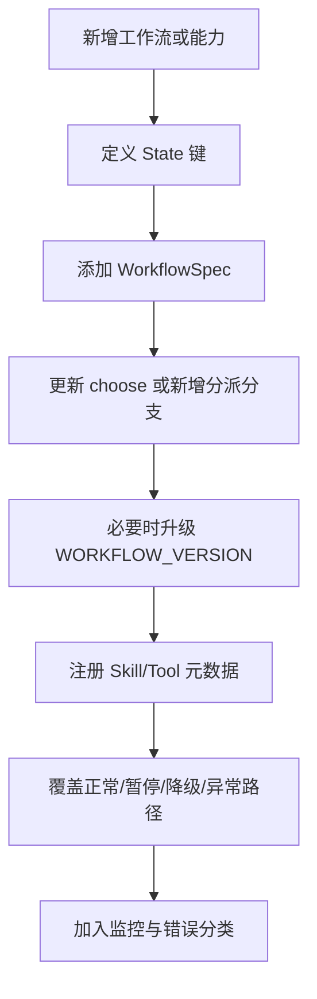

**图示来源**
- [workflows.py:1-550](file://backend/surge/agent/workflows.py#L1-L550)
- [state.py:1-173](file://backend/surge/agent/state.py#L1-L173)
- [registry.py:1-526](file://backend/surge/agent/registry.py#L1-L526)

**章节来源**
- [workflows.py:1-550](file://backend/surge/agent/workflows.py#L1-L550)
- [state.py:1-173](file://backend/surge/agent/state.py#L1-L173)
- [registry.py:1-526](file://backend/surge/agent/registry.py#L1-L526)

## 结论
Agent 工作流引擎通过“Planner 解析目标 + Routing 选择能力 + Workflows 分派图 + Runtime 控制生命周期 + Contracts/Errors 统一契约与错误分类”的方式，把自然语言任务转化为可测试、可恢复、可监控的 LangGraph 执行流程。其核心设计原则是：**LLM 负责语义，代码负责确定性；计划可测试，质检不跳过；降级必须可见；暂停不重复执行；错误可分类、可重试、可展示。**

对于使用者而言，最安全的扩展方式是：新增 LangGraph 子图、新增 `WorkflowSpec`、保持分派判据集中、升级工作流版本、完善状态契约，并通过 `check_integrity` 与错误分类保障结果质量和可观测性。