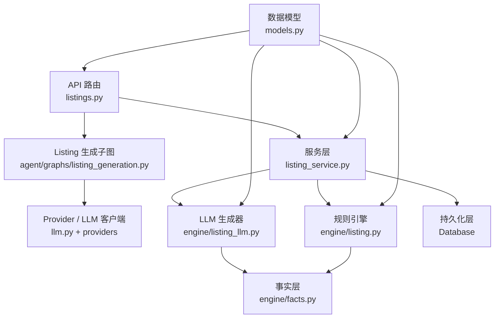
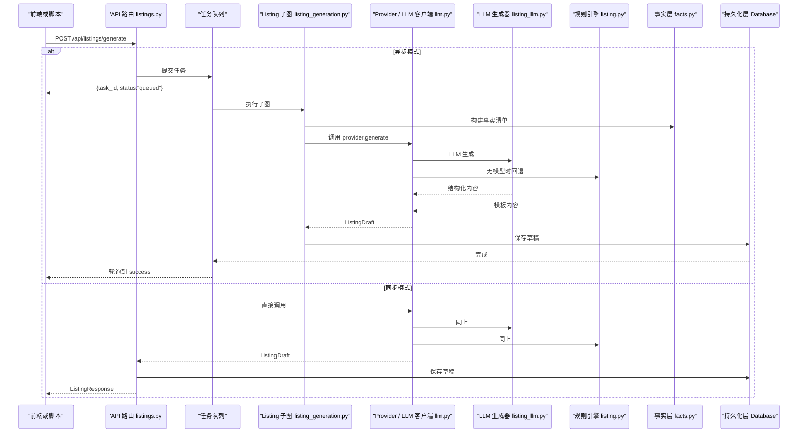
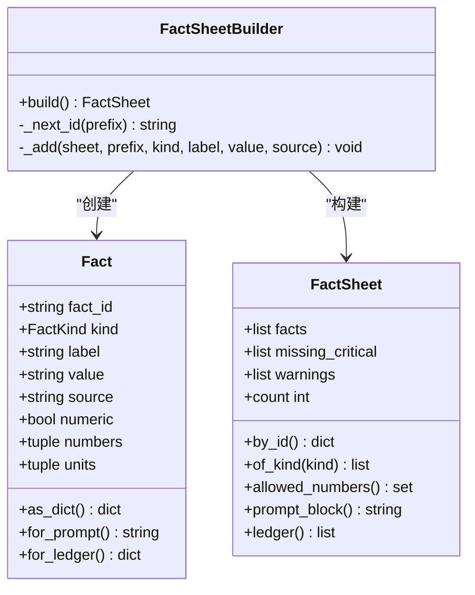
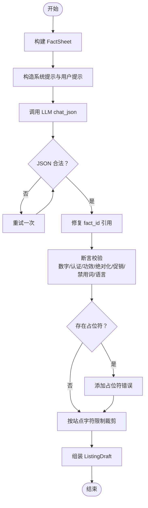
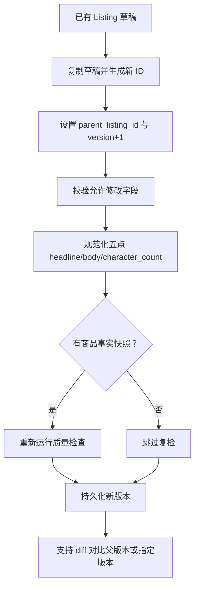
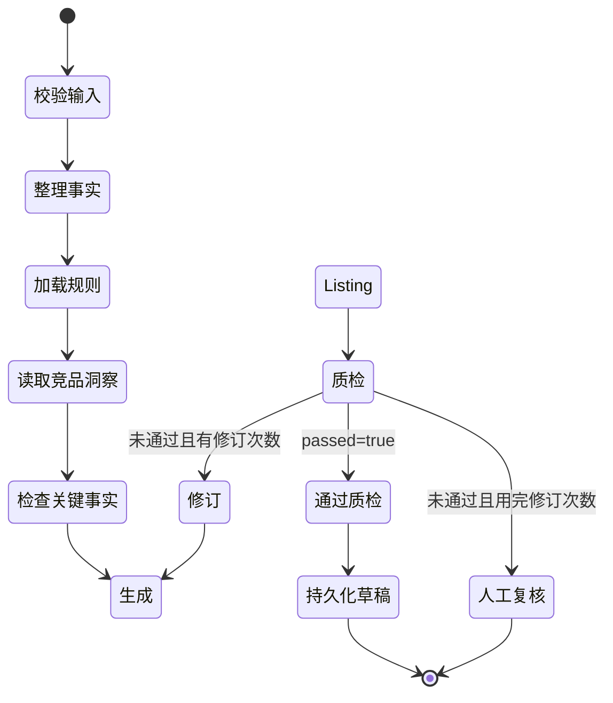
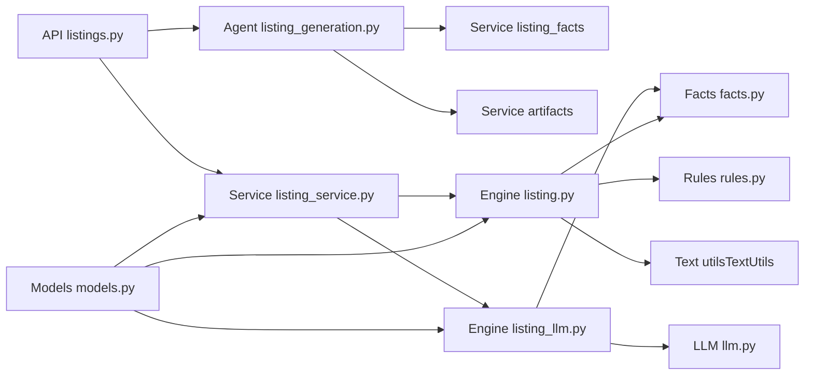

# Listing 生成

<cite>
**本文引用的文件**   
- [listing.py](file://backend/surge/engine/listing.py)
- [listing_llm.py](file://backend/surge/engine/listing_llm.py)
- [facts.py](file://backend/surge/engine/facts.py)
- [models.py](file://backend/surge/models.py)
- [listing_service.py](file://backend/surge/services/listing_service.py)
- [listings.py](file://backend/surge/api/listings.py)
- [listing_generation.py](file://backend/surge/agent/graphs/listing_generation.py)
- [llm.py](file://backend/surge/llm/llm.py)
</cite>

## 目录
1. [引言](#引言)
2. [项目结构](#项目结构)
3. [核心组件](#核心组件)
4. [架构总览](#架构总览)
5. [详细组件分析](#详细组件分析)
6. [依赖关系分析](#依赖关系分析)
7. [性能与可靠性](#性能与可靠性)
8. [故障排查指南](#故障排查指南)
9. [结论](#结论)
10. [附录：工作流、输入约束与质量规则](#附录工作流输入约束与质量规则)

## 引言
本文面向 Listing 生成功能，覆盖从产品数据到标题、五点描述、产品描述、A+ 内容大纲、Search Terms 和事实台账的完整链路。重点说明：
- 各类型 Listing 产物的输入约束、字符数限制与平台差异；
- LLM 生成过程、结构化输出 schema 与降级机制；
- 事实台账如何保证“每条断言有出处”；
- `ListingVersion` 版本管理与对比能力；
- 质量检查规则与编辑优化流程；
- 典型工作流：输入产品数据 → 选择目标平台 → 生成标题和五点 → 生成 A+ 和 Search Terms → 质量评估 → 发布审批；
- 与 Engine、LLM 客户端、任务系统、持久化层的集成方式。

## 项目结构
Listing 生成功能分布在后端多个层次：API 路由负责请求入口与异步任务编排；Agent 子图定义可重试、可审计的节点式执行流程；Engine 层提供规则引擎与 LLM 两套实现；Facts 层抽取带 ID 的事实；Service 层管理版本、复检与导出；Models 层统一输入输出契约；LLM 客户端封装模型调用与 JSON 解析。

**图表来源**
- [listings.py:1-200](file://backend/surge/api/listings.py#L1-L200)
- [listing_generation.py:1-200](file://backend/surge/agent/graphs/listing_generation.py#L1-L200)
- [listing_service.py:1-120](file://backend/surge/services/listing_service.py#L1-L120)
- [listing.py:1-120](file://backend/surge/engine/listing.py#L1-L120)
- [listing_llm.py:1-120](file://backend/surge/engine/listing_llm.py#L1-L120)
- [facts.py:1-120](file://backend/surge/engine/facts.py#L1-L120)
- [models.py:580-646](file://backend/surge/models.py#L580-L646)
- [llm.py:1-120](file://backend/surge/llm/llm.py#L1-L120)

**章节来源**
- [listings.py:1-200](file://backend/surge/api/listings.py#L1-L200)
- [listing_generation.py:1-200](file://backend/surge/agent/graphs/listing_generation.py#L1-L200)
- [listing_service.py:1-120](file://backend/surge/services/listing_service.py#L1-L120)
- [listing.py:1-120](file://backend/surge/engine/listing.py#L1-L120)
- [listing_llm.py:1-120](file://backend/surge/engine/listing_llm.py#L1-L120)
- [facts.py:1-120](file://backend/surge/engine/facts.py#L1-L120)
- [models.py:580-646](file://backend/surge/models.py#L580-L646)
- [llm.py:1-120](file://backend/surge/llm/llm.py#L1-L120)

## 核心组件
- **数据模型层（models.py）**：定义平台枚举、自有商品 `OwnProduct`、请求 `ListingGenerationRequest`、输出 `ListingDraft`、质检结果 `QualityCheck`、A+ 模块 `APlusModule`、五点 `BulletPoint` 等。所有缺失字段保持可选并进入待确认清单，不自动补全事实。
- **事实层（facts.py）**：将产品资料抽取为带 `fact_id` 的原子事实，支持属性、卖点、认证、人群、品牌、物流分类，并记录允许的数字和单位集合，用于后续校验。
- **规则引擎（listing.py）**：基于模板拼装标题、五点、描述、A+ 大纲和 Search Terms，内置长度裁剪、禁用词审计、数字与绝对化声明检查。
- **LLM 生成器（listing_llm.py）**：构造事实清单与提示词，调用 LLM 返回结构化 JSON，再按 fact_id 做断言对齐、长度检查、占位符检测，并在无模型时退化为事实直出。
- **服务层（listing_service.py）**：包装 Provider 调用、保存事实快照、创建版本、计算 diff、重新质检、导出 Markdown/JSON/TXT。
- **Agent 子图（listing_generation.py）**：用状态图组织校验、整理事实、加载规则、读取竞品洞察、关键事实检查、生成、质检、修订、持久化和人工复核路径。
- **API 层（listings.py）**：暴露同步与异步两种生成接口，对接任务队列、审计、持久化与导出。
- **LLM 客户端（llm.py）**：封装 DeepSeek/OpenAI 兼容调用、JSON 解析、重试、用量统计与错误分类。

**章节来源**
- [models.py:201-646](file://backend/surge/models.py#L201-L646)
- [facts.py:1-348](file://backend/surge/engine/facts.py#L1-L348)
- [listing.py:1-200](file://backend/surge/engine/listing.py#L1-L200)
- [listing_llm.py:1-200](file://backend/surge/engine/listing_llm.py#L1-L200)
- [listing_service.py:1-200](file://backend/surge/services/listing_service.py#L1-L200)
- [listing_generation.py:1-200](file://backend/surge/agent/graphs/listing_generation.py#L1-L200)
- [listings.py:1-200](file://backend/surge/api/listings.py#L1-L200)
- [llm.py:1-200](file://backend/surge/llm/llm.py#L1-L200)

## 架构总览
Listing 生成的端到端流程如下：

**图表来源**
- [listings.py:60-200](file://backend/surge/api/listings.py#L60-L200)
- [listing_generation.py:201-433](file://backend/surge/agent/graphs/listing_generation.py#L201-L433)
- [listing_llm.py:350-567](file://backend/surge/engine/listing_llm.py#L350-L567)
- [listing.py:201-500](file://backend/surge/engine/listing.py#L201-L500)
- [facts.py:201-348](file://backend/surge/engine/facts.py#L201-L348)
- [llm.py:201-401](file://backend/surge/llm/llm.py#L201-L401)

## 详细组件分析

### 事实层与事实台账
事实层把产品资料拆成带 ID 的原子事实，并记录来源字段、是否数值型、数值和单位集合。关键字段包括：
- `Fact.fact_id`：唯一引用标识；
- `Fact.kind`：属性、卖点、认证、人群、品牌、物流；
- `Fact.label/value/source`：人类可读标签、值与来源字段；
- `Fact.numbers/units`：用于校验文案中数字是否来自事实；
- `FactSheet.missing_critical`：缺失的关键属性列表；
- `FactSheet.allowed_numbers()`：允许出现在文案中的数字集合。

**图表来源**
- [facts.py:1-200](file://backend/surge/engine/facts.py#L1-L200)
- [facts.py:201-348](file://backend/surge/engine/facts.py#L201-L348)

事实台账通过两种方式产出：
- 规则引擎使用 `FactLedger`，从 `OwnProduct` 构建 statement 到输入字段的映射，并把缺失必填属性放入 `pending_confirmations`；
- LLM 生成器使用 `FactSheet`，给每个事实分配稳定 ID，并把 fact_id 注入提示词，要求模型只引用这些 ID。

**章节来源**
- [listing.py:1-120](file://backend/surge/engine/listing.py#L1-L120)
- [facts.py:1-348](file://backend/surge/engine/facts.py#L1-L348)
- [listing_llm.py:1-120](file://backend/surge/engine/listing_llm.py#L1-L120)

### LLM 生成过程与结构化输出 Schema
LLM 生成器先构造系统提示和用户提示，把目标站点、语言、字符上限、度量体系、事实清单、缺失项、差异化方向和关键词传入模型，并要求返回固定 JSON 结构：
- `title`：标题；
- `bullets`：五点数组，每条含 `headline`、`body`、`fact_ids`；
- `description`：产品描述；
- `search_terms`：Search Terms；
- `a_plus`：A+ 内容大纲数组，每项含 `module_type`、`title`、`content_outline`、`assets_needed`、`fact_ids`；
- `used_fact_ids`：实际使用的 fact_id 列表；
- `notes`：内部备注。

模型返回后，生成器会：
1. 解析 JSON；
2. 修复 fact_id 引用（精确匹配、归一化、文本包含）；
3. 校验数字、认证、功效、绝对化、促销词、禁用词、语言一致性；
4. 拦截未替换的模板占位符；
5. 按站点字符限制裁剪；
6. 组装 `ListingDraft`，附带事实台账、待确认项、质检结果。

当没有可用模型时，走 `rule_fallback`：仅拼接事实原文，不做翻译，并在结果中标注“未使用模型，需人工改写”。

**图表来源**
- [listing_llm.py:201-567](file://backend/surge/engine/listing_llm.py#L201-L567)
- [llm.py:201-401](file://backend/surge/llm/llm.py#L201-L401)

**章节来源**
- [listing_llm.py:1-200](file://backend/surge/engine/listing_llm.py#L1-L200)
- [listing_llm.py:201-567](file://backend/surge/engine/listing_llm.py#L201-L567)
- [llm.py:201-401](file://backend/surge/llm/llm.py#L201-L401)

### 规则引擎产物：标题、五点、描述、A+ 大纲、Search Terms
规则引擎提供两类 Listing 构建能力：
- 标题：品牌 + 商品名 + 前两项规格 + 第一条短卖点 + 相关关键词，并按站点字符上限裁剪；
- 五点：按“核心价值、规格适配、使用体验、材质认证、适用场景”角度拼装，不足条数时用“待补充卖点”占位；
- 产品描述：品牌、类目、卖点、规格、材质、认证、差异化方向与使用说明；
- A+ 内容大纲：主视觉 Banner、利益点图标、痛点对比、规格表、使用场景图、品牌故事；
- Search Terms：去重、剔除已出现在标题和五点中的词，按 UTF-8 字节上限裁剪。

规则引擎还会对数字、绝对化、认证、功效、禁用词进行审计，并把结果写入 `QualityCheck`。

**章节来源**
- [listing.py:1-200](file://backend/surge/engine/listing.py#L1-L200)
- [listing.py:201-500](file://backend/surge/engine/listing.py#L201-L500)

### 版本管理机制与对比能力
服务层通过 `create_version` 派生新版本：
- 复制已有草稿，生成新 `listing_id`；
- 设置 `parent_listing_id` 和递增 `version`；
- 仅允许修改标题、五点、描述、Search Terms、A+ 大纲、待确认项；
- 规范化五点头部与正文，计算字符数；
- 如果有商品事实快照，则重新运行质检；
- 保存到新记录，并标记 `edited_after_generation`。

对比功能 `diff` 支持：
- 与父版本比较；
- 也可指定任意历史版本作为基准；
- 输出字段级差异、统一 diff、变更字段列表。

导出功能支持 Markdown、JSON、TXT，便于发布前归档。

**图表来源**
- [listing_service.py:120-310](file://backend/surge/services/listing_service.py#L120-L310)

**章节来源**
- [listing_service.py:120-310](file://backend/surge/services/listing_service.py#L120-L310)
- [listings.py:201-334](file://backend/surge/api/listings.py#L201-L334)

### 质量检查规则与编辑优化流程
质量检查围绕“结论必须有出处”展开，主要规则包括：
- **禁止无依据数字**：文案中出现的事实清单中没有的数字会被标记；
- **认证必须可验证**：出现 FDA、CE、RoHS、ISO、BPA-free、食品级等表述时，若事实层未登记对应证书，则报错或警告；
- **禁止虚假功效**：医疗、杀菌、抗菌等强功效表述需要检测报告或平台许可；
- **禁止绝对化与促销**：best、#1、guaranteed、free shipping、discount 等会被标记；
- **禁用词**：平台或品牌自定义禁用词命中即报错；
- **语言一致性**：英文站点不得出现中文主体文案；
- **占位符拦截**：`[Brand]`、`{product_name}`、`<PRODUCT>` 等占位符不允许进入可发布文案；
- **长度限制**：标题、五点、描述、Search Terms 按站点配置裁剪；
- **空内容与占位文本**：空段落或占位文本会触发问题。

编辑优化流程由 Agent 子图驱动：
1. 校验输入；
2. 整理事实；
3. 加载品牌与站点规则；
4. 读取竞品洞察；
5. 检查关键事实；
6. 生成 Listing；
7. 质检；
8. 如果未通过且还有修订次数，带着上一版问题重新生成；
9. 最多修订次数后进入人工复核；
10. 通过质检后持久化草稿。

**图表来源**
- [listing_generation.py:1-200](file://backend/surge/agent/graphs/listing_generation.py#L1-L200)
- [listing_generation.py:201-433](file://backend/surge/agent/graphs/listing_generation.py#L201-L433)

**章节来源**
- [listing_llm.py:201-567](file://backend/surge/engine/listing_llm.py#L201-L567)
- [listing.py:201-500](file://backend/surge/engine/listing.py#L201-L500)
- [listing_generation.py:1-433](file://backend/surge/agent/graphs/listing_generation.py#L1-L433)

### 典型工作流
推荐的标准工作流如下：

1. **输入产品数据**：填写商品名称、品牌、类目、规格、卖点、材质、认证、目标平台、站点、价格、币种、目标人群、禁用词、差异化点。
2. **选择目标平台与站点**：例如 Amazon US、DE、JP 等，决定语言、字符上限、度量体系。
3. **生成标题和五点**：优先走 LLM 生成，失败时回退到规则引擎；两者都会生成事实台账与待确认项。
4. **生成 A+ 与 Search Terms**：A+ 以内容大纲形式产出，标注所需素材；Search Terms 从关键词中过滤重复和已用词。
5. **质量评估**：系统自动检查数字、认证、功效、绝对化、促销、禁用词、语言、占位符、长度。
6. **人工复核与修订**：未通过时可自动修订若干次；用尽修订次数后进入人工复核。
7. **版本管理与对比**：编辑标题、五点、描述、Search Terms 或 A+ 大纲后派生新版本，并重新质检；通过 diff 查看变更。
8. **导出与发布审批**：导出 Markdown/JSON/TXT，结合质检结果和待确认项完成发布审批。

**章节来源**
- [models.py:201-400](file://backend/surge/models.py#L201-L400)
- [listing_generation.py:1-433](file://backend/surge/agent/graphs/listing_generation.py#L1-L433)
- [listing_service.py:120-310](file://backend/surge/services/listing_service.py#L120-L310)
- [listings.py:201-334](file://backend/surge/api/listings.py#L201-L334)

### 与 Engine、LLM 客户端、任务系统、持久化层的集成
- **Engine**：规则引擎和 LLM 生成器都返回 `ListingDraft`，包含标题、五点、描述、A+ 大纲、Search Terms、事实台账、待确认项、质检结果、数据来源与引擎信息。
- **LLM 客户端**：DeepSeekClient 封装 OpenAI 兼容接口，提供重试、超时、JSON 解析、用量统计；Provider 层可切换 Anthropic/Gemini 原生客户端，但对外契约一致。
- **任务系统**：异步路径通过 TaskRecorder 记录步骤、状态和结果；前端轮询任务状态，后台线程执行生成、质检、保存。
- **持久化层**：API 层调用数据库保存 Listing 草稿，并关联 task_id；服务层在版本派生时再次保存，并保留父版本链。

**章节来源**
- [listing.py:1-120](file://backend/surge/engine/listing.py#L1-L120)
- [listing_llm.py:1-120](file://backend/surge/engine/listing_llm.py#L1-L120)
- [llm.py:1-200](file://backend/surge/llm/llm.py#L1-L200)
- [listings.py:1-200](file://backend/surge/api/listings.py#L1-L200)
- [models.py:580-646](file://backend/surge/models.py#L580-L646)

## 依赖关系分析
Listing 生成模块之间的耦合关系如下：
- API 层依赖服务层和 Agent 子图；
- Agent 子图依赖服务层的事实工具、持久化与任务记录；
- 服务层依赖 Engine 和持久化；
- Engine 依赖 models、rules、textutils、facts；
- LLM 生成器依赖 facts、llm、marketplace 和 models；
- 事实层依赖 models；
- LLM 客户端依赖 openai SDK 或 LangChain 原生客户端。

**图表来源**
- [listings.py:1-200](file://backend/surge/api/listings.py#L1-L200)
- [listing_generation.py:1-200](file://backend/surge/agent/graphs/listing_generation.py#L1-L200)
- [listing_service.py:1-200](file://backend/surge/services/listing_service.py#L1-L200)
- [listing.py:1-120](file://backend/surge/engine/listing.py#L1-L120)
- [listing_llm.py:1-120](file://backend/surge/engine/listing_llm.py#L1-L120)
- [facts.py:1-120](file://backend/surge/engine/facts.py#L1-L120)
- [llm.py:1-120](file://backend/surge/llm/llm.py#L1-L120)
- [models.py:580-646](file://backend/surge/models.py#L580-L646)

**章节来源**
- [listings.py:1-200](file://backend/surge/api/listings.py#L1-L200)
- [listing_generation.py:1-200](file://backend/surge/agent/graphs/listing_generation.py#L1-L200)
- [listing_service.py:1-200](file://backend/surge/services/listing_service.py#L1-L200)
- [listing.py:1-120](file://backend/surge/engine/listing.py#L1-L120)
- [listing_llm.py:1-120](file://backend/surge/engine/listing_llm.py#L1-L120)
- [facts.py:1-120](file://backend/surge/engine/facts.py#L1-L120)
- [llm.py:1-120](file://backend/surge/llm/llm.py#L1-L120)
- [models.py:580-646](file://backend/surge/models.py#L580-L646)

## 性能与可靠性
- **异步优先**：Listing 生成耗时较长，前端唯一路径为异步任务；同步路径主要用于脚本和测试。
- **重试与降级**：LLM 客户端对网络、限流、服务端错误进行指数退避重试；JSON 解析失败会重试一次；无模型时回退到规则引擎或事实直出。
- **成本与用量**：LLM 客户端记录 prompt、completion、total tokens 与调用次数，便于成本核算。
- **可观测性**：任务记录器记录步骤、状态、结果参考；LLM 调用通过遥测记录 provider、model、尝试次数和成功状态。
- **幂等与半写保护**：Agent 子图在独立运行时可选择是否持久化，避免失败时留下半份数据；主图是唯一写库点。

**章节来源**
- [listings.py:1-200](file://backend/surge/api/listings.py#L1-L200)
- [llm.py:201-401](file://backend/surge/llm/llm.py#L201-L401)
- [listing_generation.py:201-433](file://backend/surge/agent/graphs/listing_generation.py#L201-L433)

## 故障排查指南
常见问题和处理建议：
- **API Key 无效或未配置**：LLM 客户端会抛出带 `no_key` 类型的错误；解决方案是配置自己的 API Key，或使用规则引擎生成。
- **限流或网络超时**：LLM 客户端会把这类错误分类为 `rate_limit` 或 `network`，默认可重试；若多次失败，检查网络、配额和模型可用性。
- **LLM 返回非 JSON**：解析器会尝试去除围栏并提取 JSON；仍失败则抛错；可通过降低温度、简化提示词或改用更强推理模型解决。
- **事实不足导致无法生成**：Agent 子图会进入 `needs_user_input`，要求补充至少一条属性事实和一条卖点事实。
- **质检未通过**：查看 `QualityCheck.issues`，根据 `issue.code` 定位问题：无依据数字、未验证认证、功效承诺、绝对化、促销词、禁用词、语言不匹配、占位符、超长、空内容。
- **历史草稿无法复检**：早期草稿可能缺少 `product_snapshot`，此时复检会抛 `ListingSnapshotMissing`；应重新生成 Listing。
- **版本对比失败**：如果没有父版本或未指定 `against`，diff 会报错；需指定可比对的历史版本。

**章节来源**
- [llm.py:120-401](file://backend/surge/llm/llm.py#L120-L401)
- [listing_generation.py:201-433](file://backend/surge/agent/graphs/listing_generation.py#L201-L433)
- [listing_service.py:120-310](file://backend/surge/services/listing_service.py#L120-L310)
- [listing_llm.py:201-567](file://backend/surge/engine/listing_llm.py#L201-L567)

## 结论
Listing 生成功能以“事实台账”为核心约束，确保标题、五点、描述、A+ 大纲和 Search Terms 不编造数据；LLM 生成器负责语言与风格，规则引擎负责兜底与确定性；Agent 子图把流程拆成可审计、可重试、可恢复的节点；服务层提供版本管理和对比能力；API 层通过异步任务系统连接前端与后端。质量检查贯穿始终，确保“结论有出处、断言可验证、文案可发布”。

## 附录：工作流、输入约束与质量规则

### 输入约束
- **商品名称**：必填；
- **品牌**：可选，若不在商品名中则参与标题；
- **类目**：可选；
- **规格参数**：键值对，用于标题、五点、规格表和事实台账；
- **核心卖点**：列表，用于五点、A+ 利益点和差异化；
- **材质**：列表，用于材质合规说明；
- **认证资质**：列表，出现认证表述时必须可验证；
- **目标平台**：Amazon、eBay、Walmart、Shopee、MercadoLibre；
- **站点**：如 US、DE、JP，决定语言和字符上限；
- **价格与币种**：可选，价格可作为事实数字；
- **目标人群**：可选，用于适用场景；
- **禁用词**：平台或品牌自定义；
- **差异化点**：用于 A+ 和差异化方向；
- **关键词**：可选指标，用于 Search Terms 和自然布局。

**章节来源**
- [models.py:201-400](file://backend/surge/models.py#L201-L400)

### 各类型产物约束
- **标题**：受 `title_max_chars` 限制；品牌与商品名优先级最高，随后是前两项规格和短卖点；多余部分按字符上限裁剪；
- **五点描述**：每条受 `bullet_max_chars` 限制，总数受 `bullet_count` 限制；无事实支撑的角度不生成，不足时用待补充占位；
- **产品描述**：受 `description_max_chars` 限制；只能使用输入中已有的规格、卖点、材质、认证和目标人群；
- **A+ 内容大纲**：不是最终文案，而是模块结构、内容要点和所需素材清单；
- **Search Terms**：UTF-8 字节受限；去重并剔除已出现在标题和五点中的词；
- **事实台账**：statement 到输入字段的映射，配合 fact_id 保证可追溯；
- **待确认项**：缺失关键属性、认证或报告时的风险提示，绝不自动补全。

**章节来源**
- [listing.py:201-500](file://backend/surge/engine/listing.py#L201-L500)
- [listing_llm.py:201-567](file://backend/surge/engine/listing_llm.py#L201-L567)
- [facts.py:1-348](file://backend/surge/engine/facts.py#L1-L348)

### 质量规则摘要
| 类别 | 规则 | 严重级别 | 处理建议 |
|---|---|---|---|
| 无依据数字 | 文案出现事实清单中没有的数字 | 错误 | 删除数字或在规格中补充真实数据 |
| 未验证认证 | 出现 FDA/CE/RoHS/ISO/BPA-free/食品级等但未登记证书 | 错误或警告 | 补充证书或删除表述 |
| 未验证功效 | 出现医疗/杀菌/抗菌等强功效表述 | 错误 | 改为客观材质与结构描述 |
| 绝对化表述 | best、#1、guaranteed 等 | 警告 | 改为具体可验证表述 |
| 促销词 | free shipping、discount、lowest price 等 | 警告 | 删除促销表述 |
| 禁用词 | 命中平台或品牌禁用词 | 依规则 | 替换为中性描述 |
| 语言不一致 | 英文站点出现中文主体文案 | 错误 | 重新生成或提供目标语言事实 |
| 占位符残留 | [Brand]、{product_name}、<PRODUCT> 等 | 错误 | 补齐字段后重新生成 |
| 超长 | 标题、五点、描述、Search Terms 超过站点限制 | 错误 | 裁剪或重写 |
| 空内容 | 段落为空或仅为占位文本 | 错误 | 补充真实内容 |

**章节来源**
- [listing_llm.py:201-567](file://backend/surge/engine/listing_llm.py#L201-L567)
- [listing.py:201-500](file://backend/surge/engine/listing.py#L201-L500)
- [models.py:520-646](file://backend/surge/models.py#L520-L646)