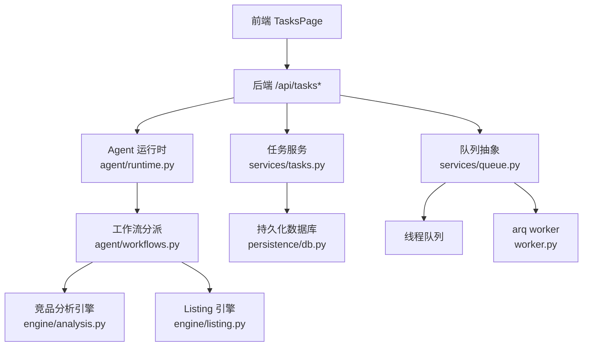
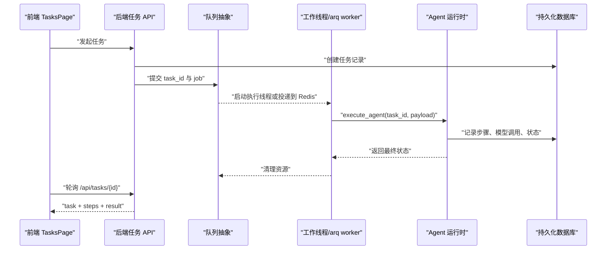
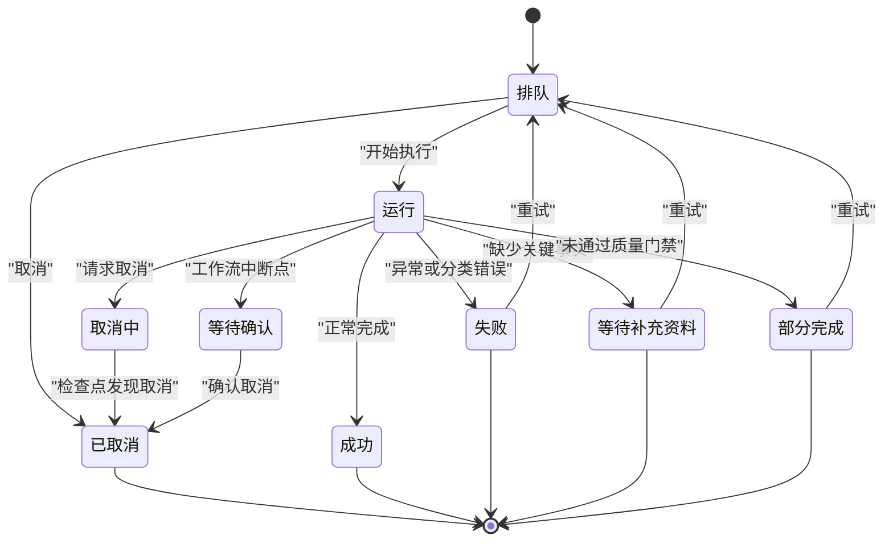
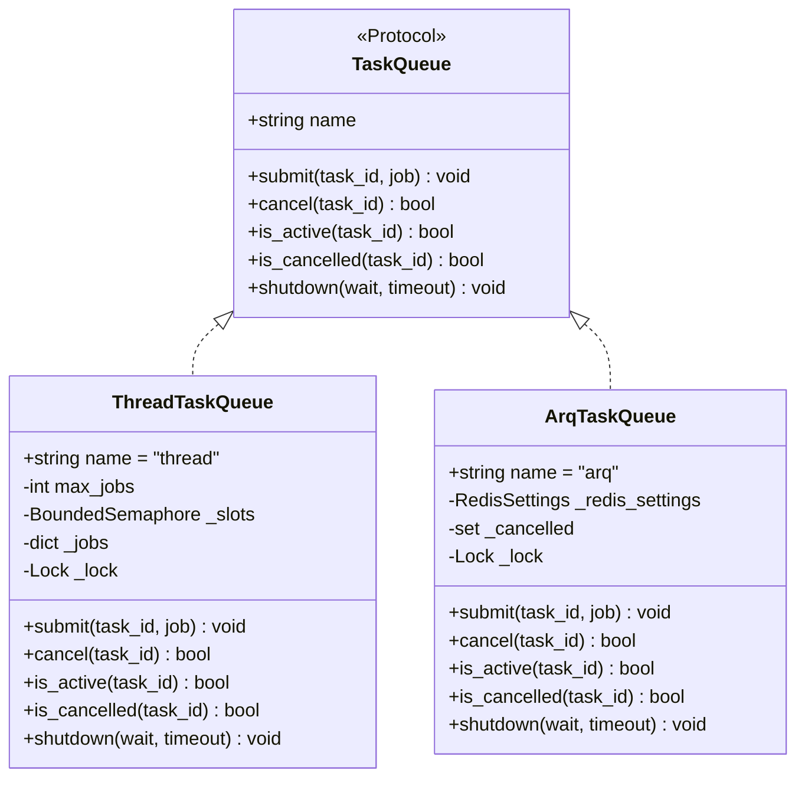
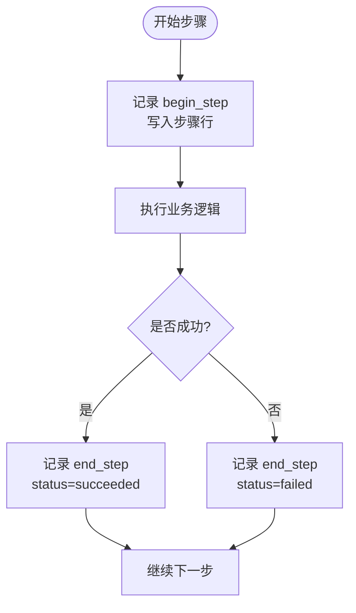
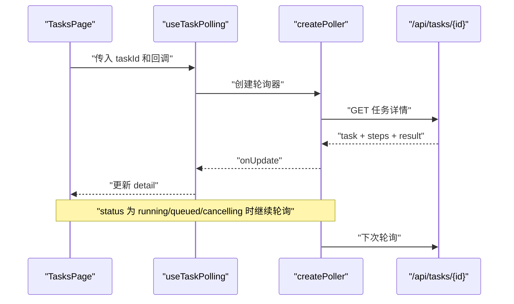
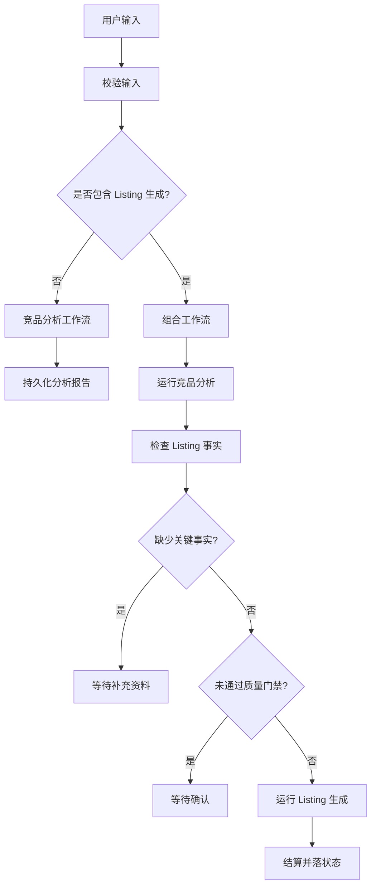
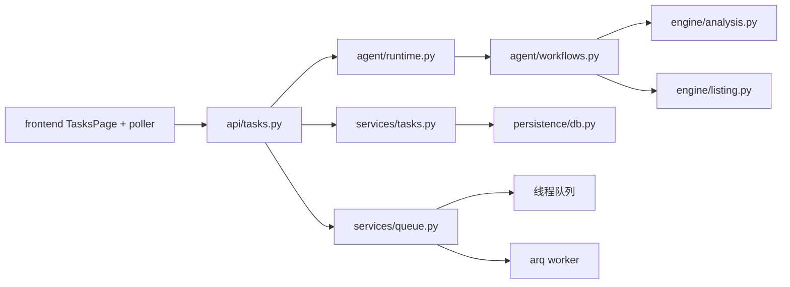
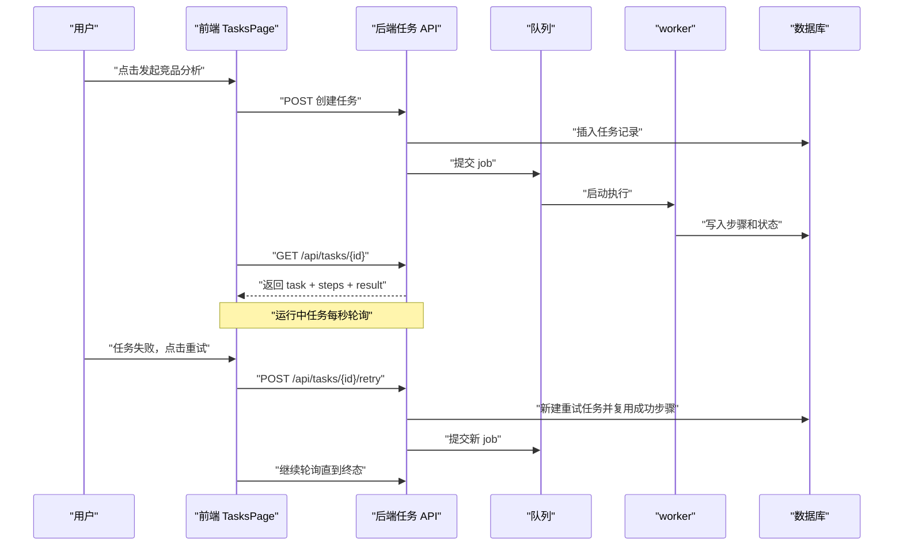

# 任务管理

<cite>
**本文引用的文件**   
- [backend/surge/services/tasks.py](file://backend/surge/services/tasks.py)
- [backend/surge/services/queue.py](file://backend/surge/services/queue.py)
- [backend/surge/api/tasks.py](file://backend/surge/api/tasks.py)
- [backend/surge/worker.py](file://backend/surge/worker.py)
- [backend/surge/persistence/db.py](file://backend/surge/persistence/db.py)
- [backend/surge/agent/runtime.py](file://backend/surge/agent/runtime.py)
- [backend/surge/agent/workflows.py](file://backend/surge/agent/workflows.py)
- [backend/surge/engine/analysis.py](file://backend/surge/engine/analysis.py)
- [backend/surge/engine/listing.py](file://backend/surge/engine/listing.py)
- [frontend/src/features/tasks/TasksPage.tsx](file://frontend/src/features/tasks/TasksPage.tsx)
- [frontend/src/lib/async-run/useTaskPolling.ts](file://frontend/src/lib/async-run/useTaskPolling.ts)
- [frontend/src/lib/async-run/poller.ts](file://frontend/src/lib/async-run/poller.ts)
- [frontend/src/lib/async-run/tasks-api.ts](file://frontend/src/lib/async-run/tasks-api.ts)
</cite>

## 目录
1. [简介](#简介)
2. [项目结构](#项目结构)
3. [核心组件](#核心组件)
4. [架构总览](#架构总览)
5. [详细组件分析](#详细组件分析)
6. [依赖关系分析](#依赖关系分析)
7. [性能与可观测性](#性能与可观测性)
8. [故障排查指南](#故障排查指南)
9. [结论](#结论)
10. [附录：端到端示例](#附录端到端示例)

## 简介
本文件系统性地说明 Surge 任务管理系统的设计与实现，覆盖任务状态机、生命周期、异步执行机制、步骤级进度追踪、前端轮询渲染，以及与业务功能（竞品分析、Listing 生成）的绑定方式。重点解释以下内容：
- 任务的创建、调度、执行、重试、失败处理流程。
- 线程队列与 arq 分布式队列的使用场景差异。
- 任务步骤如何记录真实耗时，并支持断点续跑。
- 前端 TasksPage 的轮询机制、状态渲染和交互。
- 任务与 Services、Queue、Persistence 的依赖关系。
- 性能监控指标与错误诊断方法。

## 项目结构
任务相关代码横跨后端 API、服务层、队列、持久化、Agent 运行时、工作流定义、引擎实现以及前端页面和轮询库。整体按职责分层组织：
- API 层负责路由、鉴权、审计和对外响应。
- 服务层封装任务记录、取消、重试等跨领域逻辑。
- 队列抽象统一线程池与 arq worker 的提交、取消、活跃状态查询。
- Agent 运行时与工作流把具体业务（竞品分析、Listing 生成）包装成可追踪的任务。
- 持久化层负责 PostgreSQL 中的任务、步骤、模型调用记录。
- 前端通过 `TasksPage` 展示列表、详情、步骤、结果，并对运行中任务进行轮询。

**图表来源**
- [backend/surge/api/tasks.py:1-504](file://backend/surge/api/tasks.py#L1-L504)
- [backend/surge/services/tasks.py:1-474](file://backend/surge/services/tasks.py#L1-L474)
- [backend/surge/services/queue.py:1-250](file://backend/surge/services/queue.py#L1-L250)
- [backend/surge/agent/runtime.py:1-297](file://backend/surge/agent/runtime.py#L1-L297)
- [backend/surge/agent/workflows.py:1-200](file://backend/surge/agent/workflows.py#L1-L200)
- [backend/surge/engine/analysis.py:1-200](file://backend/surge/engine/analysis.py#L1-L200)
- [backend/surge/engine/listing.py:1-200](file://backend/surge/engine/listing.py#L1-L200)
- [backend/surge/persistence/db.py:1-200](file://backend/surge/persistence/db.py#L1-L200)
- [frontend/src/features/tasks/TasksPage.tsx:1-796](file://frontend/src/features/tasks/TasksPage.tsx#L1-L796)

**章节来源**
- [backend/surge/api/tasks.py:1-504](file://backend/surge/api/tasks.py#L1-L504)
- [backend/surge/services/tasks.py:1-474](file://backend/surge/services/tasks.py#L1-L474)
- [backend/surge/services/queue.py:1-250](file://backend/surge/services/queue.py#L1-L250)
- [backend/surge/agent/runtime.py:1-297](file://backend/surge/agent/runtime.py#L1-L297)
- [backend/surge/agent/workflows.py:1-200](file://backend/surge/agent/workflows.py#L1-L200)
- [backend/surge/engine/analysis.py:1-200](file://backend/surge/engine/analysis.py#L1-L200)
- [backend/surge/engine/listing.py:1-200](file://backend/surge/engine/listing.py#L1-L200)
- [backend/surge/persistence/db.py:1-200](file://backend/surge/persistence/db.py#L1-L200)
- [frontend/src/features/tasks/TasksPage.tsx:1-796](file://frontend/src/features/tasks/TasksPage.tsx#L1-L796)

## 核心组件
- **任务记录器**：负责创建任务、开启步骤、结束步骤、成功、失败、等待输入、部分完成、等待确认、取消、恢复。它是任务生命周期的“真相源”。
- **队列抽象**：提供统一的 `submit`、`cancel`、`is_active`、`is_cancelled`、`shutdown` 接口，当前实现包括线程池和 arq。
- **API 任务中心**：暴露任务列表、详情、取消、重试、确认、追踪接口，并把业务结果（报告、Listing、技能输出）组装给前端。
- **Agent 运行时与工作流**：把校验、分派、子图执行、暂停、收尾包装成可追踪的 Agent 运行。
- **持久化层**：基于 PostgreSQL，维护任务、步骤、模型调用等表，并提供查询、统计、认领确认等操作。
- **前端轮询库**：包含轮询器、Hook、API 绑定，负责在任务运行期间稳定刷新 UI。

**章节来源**
- [backend/surge/services/tasks.py:1-474](file://backend/surge/services/tasks.py#L1-L474)
- [backend/surge/services/queue.py:1-250](file://backend/surge/services/queue.py#L1-L250)
- [backend/surge/api/tasks.py:1-504](file://backend/surge/api/tasks.py#L1-L504)
- [backend/surge/agent/runtime.py:1-297](file://backend/surge/agent/runtime.py#L1-L297)
- [backend/surge/agent/workflows.py:1-200](file://backend/surge/agent/workflows.py#L1-L200)
- [backend/surge/persistence/db.py:1-200](file://backend/surge/persistence/db.py#L1-L200)
- [frontend/src/lib/async-run/poller.ts:1-133](file://frontend/src/lib/async-run/poller.ts#L1-L133)
- [frontend/src/lib/async-run/useTaskPolling.ts:1-51](file://frontend/src/lib/async-run/useTaskPolling.ts#L1-L51)
- [frontend/src/lib/async-run/tasks-api.ts:1-20](file://frontend/src/lib/async-run/tasks-api.ts#L1-L20)

## 架构总览
任务从前端发起后，由 API 创建任务记录；随后根据配置选择线程队列或 arq worker 执行。执行过程中通过 `TaskRecorder.step(...)` 记录每一步的真实起止时间和耗时；任务结束后写入报告或 Listing 产物。前端对运行中任务使用 1 秒轮询，终态后停止并刷新列表。

**图表来源**
- [backend/surge/api/tasks.py:1-200](file://backend/surge/api/tasks.py#L1-L200)
- [backend/surge/services/queue.py:1-250](file://backend/surge/services/queue.py#L1-L250)
- [backend/surge/worker.py:1-127](file://backend/surge/worker.py#L1-L127)
- [backend/surge/agent/runtime.py:1-297](file://backend/surge/agent/runtime.py#L1-L297)
- [frontend/src/features/tasks/TasksPage.tsx:1-200](file://frontend/src/features/tasks/TasksPage.tsx#L1-L200)
- [frontend/src/lib/async-run/poller.ts:1-133](file://frontend/src/lib/async-run/poller.ts#L1-L133)

## 详细组件分析

### 任务状态机与生命周期
任务状态包括排队、运行、等待审批、等待补充资料、等待确认、部分完成、成功、失败、取消中、已取消。其中终态包括成功、失败、取消、等待补充资料、部分完成；可取消状态包括排队、运行、取消中；可原地恢复的状态是等待确认。

生命周期关键行为：
- 创建：`TaskRecorder.open()` 写入任务行，包含用户、租户、类型、标题、初始状态、输入、trace_id 等。
- 开始：`mark_running()` 将状态改为运行，并设置开始时间；如果任务已被取消则抛出取消异常。
- 步骤：`begin_step()` 和 `end_step()` 记录步骤 id、名称、节点键、状态、耗时、输出。`step(...)` 上下文管理器自动捕获异常并标记失败。
- 成功：`succeed()` 写入结果引用、输出、结束时间。
- 失败：`fail()` 写入错误码和消息，不吞异常。
- 等待输入：`await_input()` 表示缺关键事实，不是失败，允许用户补资料后重试。
- 部分完成：`partial()` 表示有产物但未通过质量门禁，需要人工复核。
- 等待确认：`await_review()` 让工作流停在中断点，不写结束时间，留给确认接口恢复。
- 取消：`cancel()` 写入取消步骤，并在检查点检测 `cancelling` 或 `cancelled`。
- 恢复：`resume()` 用于 arq worker 或确认接口重新加载任务，继续已有步骤序号。

**图表来源**
- [backend/surge/services/tasks.py:1-200](file://backend/surge/services/tasks.py#L1-L200)
- [backend/surge/services/tasks.py:201-474](file://backend/surge/services/tasks.py#L201-L474)

**章节来源**
- [backend/surge/services/tasks.py:1-474](file://backend/surge/services/tasks.py#L1-L474)

### 异步执行机制与队列
队列抽象定义了统一的接口，使上层无需关心底层是线程池还是 arq。

- 线程队列：进程内线程池，默认限制最大并发任务数，适合单机和免费实例；每个任务一个线程，取消通过事件对象在检查点生效。
- arq 队列：独立 worker 进程，任务以 `run_task` 形式投递到 Redis；取消通过数据库状态 `cancelling` 配合 worker 的检查点实现。

线程队列特点：
- `submit` 立即返回，后台线程等待信号量或执行。
- `_run` 捕获 `TaskCancelled` 和普通异常；普通异常由 `TaskRecorder` 记录，不掩盖业务失败。
- `cancel` 设置事件，`is_cancelled` 和 `is_active` 供 API 层判断。

arq 队列特点：
- `submit` 异步连接 Redis 并 enqueue `run_task`。
- worker 读取任务、重建 Provider、调用 `execute_agent`。
- worker 与 API 共享数据库作为取消和状态的唯一真相。

**图表来源**
- [backend/surge/services/queue.py:1-250](file://backend/surge/services/queue.py#L1-L250)

**章节来源**
- [backend/surge/services/queue.py:1-250](file://backend/surge/services/queue.py#L1-L250)
- [backend/surge/worker.py:1-127](file://backend/surge/worker.py#L1-L127)

### 任务步骤与断点续跑
步骤记录的核心目标是“真实耗时”和“可追溯”。每次步骤都有：
- 步骤 id、任务 id、用户、租户、序列号、名称、节点键、状态、开始时间、结束时间、耗时毫秒、可选输出。
- `step(...)` 上下文自动捕获异常，记录失败步骤，同时继续抛出异常，不吞错。
- 断点续跑时，`TaskRecorder.resume()` 从数据库读取已有步骤，计算最大 seq，保证新步骤顺序不会交错。
- 工作流重试时，`can_reuse` 比较输入指纹和工作流版本，复用已成功步骤的输出，但排除持久化和落状态节点，避免重复保存和状态不一致。

**图表来源**
- [backend/surge/services/tasks.py:201-300](file://backend/surge/services/tasks.py#L201-L300)
- [backend/surge/services/tasks.py:300-474](file://backend/surge/services/tasks.py#L300-L474)
- [backend/surge/api/tasks.py:201-504](file://backend/surge/api/tasks.py#L201-L504)

**章节来源**
- [backend/surge/services/tasks.py:201-474](file://backend/surge/services/tasks.py#L201-L474)
- [backend/surge/api/tasks.py:201-504](file://backend/surge/api/tasks.py#L201-L504)

### 前端 TasksPage 的轮询机制与状态渲染
前端轮询由三层组成：
- `poller.ts`：核心轮询器，1 秒间隔，首次立刻执行；只认为 `queued`、`running`、`cancelling` 为运行中；连续失败 5 次才放弃，避免网络抖动导致永久卡住。
- `useTaskPolling.ts`：React Hook，管理轮询器生命周期，支持组件卸载、taskId 变化、enabled 关闭三种取消路径。
- `tasks-api.ts`：生产环境绑定 `/api/tasks/{id}` 和 `/api/tasks/{id}/cancel`。

`TasksPage` 的职责：
- 列表页加载任务列表和统计，支持筛选、搜索、排序。
- 行展开详情时，URL 替换为 `/tasks/{id}` 但不触发路由重绘，保持滚动位置。
- 运行中任务打开详情后启用 1 秒轮询，终态后刷新列表。
- 渲染状态徽章、错误信息、待审批提示、等待确认面板、执行步骤、报告、Listing 草稿。
- 取消任务、确认继续或取消、复制 Listing 内容。

**图表来源**
- [frontend/src/lib/async-run/poller.ts:1-133](file://frontend/src/lib/async-run/poller.ts#L1-L133)
- [frontend/src/lib/async-run/useTaskPolling.ts:1-51](file://frontend/src/lib/async-run/useTaskPolling.ts#L1-L51)
- [frontend/src/lib/async-run/tasks-api.ts:1-20](file://frontend/src/lib/async-run/tasks-api.ts#L1-L20)
- [frontend/src/features/tasks/TasksPage.tsx:1-200](file://frontend/src/features/tasks/TasksPage.tsx#L1-L200)

**章节来源**
- [frontend/src/lib/async-run/poller.ts:1-133](file://frontend/src/lib/async-run/poller.ts#L1-L133)
- [frontend/src/lib/async-run/useTaskPolling.ts:1-51](file://frontend/src/lib/async-run/useTaskPolling.ts#L1-L51)
- [frontend/src/lib/async-run/tasks-api.ts:1-20](file://frontend/src/lib/async-run/tasks-api.ts#L1-L20)
- [frontend/src/features/tasks/TasksPage.tsx:1-796](file://frontend/src/features/tasks/TasksPage.tsx#L1-L796)

### 任务与业务功能的绑定方式
任务系统通过 Agent 运行时和工作流将具体业务包装为可追踪任务：
- 竞品分析：走 `competitor` 工作流，步骤包括校验、解析数据提供商、获取竞品、规范化、检查数据充分性、市场分析、验证分析、构建部分结果、总结机会、持久化结果。
- 组合工作流：先做竞品分析，再检查 Listing 所需事实；若缺失则进入 `waiting_for_input`；若分析产物未通过质量门禁则进入 `partial`，用户确认后继续 Listing 生成。
- Listing 生成：规则引擎或 LLM 引擎根据事实清单生成标题、五点描述、产品描述、搜索词、A+ 模块，并进行平台规则和长度检查。

运行时只做三件事：
- 校验输入。
- 按 `with_listing` 选择工作流。
- 收尾前判断是否暂停；暂停不写结束时间，交给确认接口。

**图表来源**
- [backend/surge/agent/runtime.py:1-297](file://backend/surge/agent/runtime.py#L1-L297)
- [backend/surge/agent/workflows.py:1-200](file://backend/surge/agent/workflows.py#L1-L200)
- [backend/surge/engine/analysis.py:1-200](file://backend/surge/engine/analysis.py#L1-L200)
- [backend/surge/engine/listing.py:1-200](file://backend/surge/engine/listing.py#L1-L200)

**章节来源**
- [backend/surge/agent/runtime.py:1-297](file://backend/surge/agent/runtime.py#L1-L297)
- [backend/surge/agent/workflows.py:1-200](file://backend/surge/agent/workflows.py#L1-L200)
- [backend/surge/engine/analysis.py:1-200](file://backend/surge/engine/analysis.py#L1-L200)
- [backend/surge/engine/listing.py:1-200](file://backend/surge/engine/listing.py#L1-L200)

## 依赖关系分析
任务系统的关键依赖如下：
- API 依赖持久化数据库、审计、会话、工作流、Agent 运行时、任务服务、租户鉴权。
- 任务服务依赖持久化数据库，不直接依赖业务引擎。
- 队列抽象被 API 和 worker 共同依赖，确保同一套提交与取消语义。
- Agent 运行时依赖工作流、步骤、错误分类、任务服务。
- 工作流依赖具体子图和步骤运行器。
- 引擎层依赖模型、规则、文本工具、LLM 客户端（可选）。
- 前端轮询库依赖 API 绑定，不直接耦合网络实现细节。

**图表来源**
- [backend/surge/api/tasks.py:1-504](file://backend/surge/api/tasks.py#L1-L504)
- [backend/surge/services/tasks.py:1-474](file://backend/surge/services/tasks.py#L1-L474)
- [backend/surge/services/queue.py:1-250](file://backend/surge/services/queue.py#L1-L250)
- [backend/surge/agent/runtime.py:1-297](file://backend/surge/agent/runtime.py#L1-L297)
- [backend/surge/agent/workflows.py:1-200](file://backend/surge/agent/workflows.py#L1-L200)
- [backend/surge/engine/analysis.py:1-200](file://backend/surge/engine/analysis.py#L1-L200)
- [backend/surge/engine/listing.py:1-200](file://backend/surge/engine/listing.py#L1-L200)
- [frontend/src/features/tasks/TasksPage.tsx:1-796](file://frontend/src/features/tasks/TasksPage.tsx#L1-L796)

**章节来源**
- [backend/surge/api/tasks.py:1-504](file://backend/surge/api/tasks.py#L1-L504)
- [backend/surge/services/tasks.py:1-474](file://backend/surge/services/tasks.py#L1-L474)
- [backend/surge/services/queue.py:1-250](file://backend/surge/services/queue.py#L1-L250)
- [backend/surge/agent/runtime.py:1-297](file://backend/surge/agent/runtime.py#L1-L297)
- [backend/surge/agent/workflows.py:1-200](file://backend/surge/agent/workflows.py#L1-L200)
- [backend/surge/engine/analysis.py:1-200](file://backend/surge/engine/analysis.py#L1-L200)
- [backend/surge/engine/listing.py:1-200](file://backend/surge/engine/listing.py#L1-L200)
- [frontend/src/features/tasks/TasksPage.tsx:1-796](file://frontend/src/features/tasks/TasksPage.tsx#L1-L796)

## 性能与可观测性
性能方面需要注意：
- 线程队列的 `max_jobs` 必须限制，避免多个用户同时分析导致内存溢出，尤其在免费实例上。
- 步骤耗时使用 `time.perf_counter()` 计算，能反映真实执行成本。
- 持久化层对数据库查询有性能探针，便于统计 SQL 数量和耗时。
- arq worker 的 `job_timeout` 和 `max_jobs` 控制 worker 侧的资源上限。
- 前端轮询固定 1 秒，连续失败最多 5 次，避免无限请求。

可观测性方面：
- 任务详情返回 `steps`，每条步骤含耗时、状态、detail。
- 追踪接口 `/api/tasks/{task_id}/trace` 聚合步骤链、模型调用、总耗时、token 总量、失败节点和任务级错误码。
- 任务记录器维护 `trace_id`，便于跨进程定位同一次执行。
- 错误分类将异常映射为 `error_code` 和 `message`，前端可直接展示。

**章节来源**
- [backend/surge/services/queue.py:1-250](file://backend/surge/services/queue.py#L1-L250)
- [backend/surge/persistence/db.py:1-200](file://backend/surge/persistence/db.py#L1-L200)
- [backend/surge/worker.py:1-127](file://backend/surge/worker.py#L1-L127)
- [backend/surge/api/tasks.py:400-504](file://backend/surge/api/tasks.py#L400-L504)
- [frontend/src/lib/async-run/poller.ts:1-133](file://frontend/src/lib/async-run/poller.ts#L1-L133)

## 故障排查指南
常见问题和诊断方法：
- 任务卡在运行中：检查是否处于 `running` 且队列没有托管该任务；同步执行的任务无法中途取消，应改用异步模式。
- 取消无效：确认任务状态是否为 `queued`、`running`、`cancelling`；arq worker 需在检查点检测到 `cancelling`。
- 重试后中间结果丢失：检查输入指纹和工作流版本是否匹配；`persist`、`persist_result`、`settle`、`finalize` 不会被复用。
- 步骤耗时异常：查看步骤 `duration_ms` 和 `llm_calls`，确认是否是 LLM 调用慢或重试多。
- 任务失败：查看 `error_code` 和 `error_message`，并结合 `failed_node` 定位失败步骤。
- 前端轮询停止：检查是否连续失败超过 5 次，触发 `onGiveUp`；网络恢复后需重新挂载轮询。

推荐排查路径：
1. 用列表过滤出目标状态的任务。
2. 打开任务详情，查看 `task.status`、`error_message`、`steps`。
3. 调用追踪接口，查看步骤链、模型调用、总耗时、token、失败节点。
4. 如果是 arq worker 问题，检查 Redis、worker 日志、任务是否在 `queued` 或 `running`。
5. 如果是前端问题，检查轮询器是否被卸载、taskId 是否变化、网络是否持续失败。

**章节来源**
- [backend/surge/services/tasks.py:201-474](file://backend/surge/services/tasks.py#L201-L474)
- [backend/surge/api/tasks.py:201-504](file://backend/surge/api/tasks.py#L201-L504)
- [backend/surge/worker.py:1-127](file://backend/surge/worker.py#L1-L127)
- [frontend/src/lib/async-run/poller.ts:1-133](file://frontend/src/lib/async-run/poller.ts#L1-L133)

## 结论
Surge 的任务管理系统以 `TaskRecorder` 为核心，结合队列抽象、Agent 运行时、工作流和持久化层，实现了可追踪、可取消、可重试、可续跑的任务执行体系。前端通过稳定的轮询机制渲染任务状态和步骤进度，并与业务功能（竞品分析、Listing 生成）解耦绑定。系统在设计上强调“真实耗时记录”“失败留痕”“断点续跑”“前端不卡死”，并通过追踪接口和错误分类提供清晰的诊断能力。

[无章节来源：本节为总结性内容]

## 附录：端到端示例
以下示例描述典型流程：发起异步分析 → 查询任务状态 → 获取步骤进度 → 处理失败重试。

**图表来源**
- [backend/surge/api/tasks.py:1-504](file://backend/surge/api/tasks.py#L1-L504)
- [backend/surge/services/queue.py:1-250](file://backend/surge/services/queue.py#L1-L250)
- [backend/surge/worker.py:1-127](file://backend/surge/worker.py#L1-L127)
- [frontend/src/features/tasks/TasksPage.tsx:1-796](file://frontend/src/features/tasks/TasksPage.tsx#L1-L796)
- [frontend/src/lib/async-run/poller.ts:1-133](file://frontend/src/lib/async-run/poller.ts#L1-L133)

**章节来源**
- [backend/surge/api/tasks.py:1-504](file://backend/surge/api/tasks.py#L1-L504)
- [backend/surge/services/tasks.py:1-474](file://backend/surge/services/tasks.py#L1-L474)
- [backend/surge/services/queue.py:1-250](file://backend/surge/services/queue.py#L1-L250)
- [backend/surge/worker.py:1-127](file://backend/surge/worker.py#L1-L127)
- [frontend/src/features/tasks/TasksPage.tsx:1-796](file://frontend/src/features/tasks/TasksPage.tsx#L1-L796)
- [frontend/src/lib/async-run/poller.ts:1-133](file://frontend/src/lib/async-run/poller.ts#L1-L133)