# 店铺经营

<cite>
**本文引用的文件**   
- [stores.py](file://backend/surge/api/stores.py)
- [marketplace.py](file://backend/surge/api/marketplace.py)
- [dashboard.py](file://backend/surge/api/dashboard.py)
- [platforms.py](file://backend/surge/market/platforms.py)
- [marketplace_provider.py](file://backend/surge/market/marketplace_provider.py)
- [competitor_provider.py](file://backend/surge/market/competitor_provider.py)
- [connectors.py](file://backend/surge/services/connectors.py)
- [StoresPage.tsx](file://frontend/src/features/stores/StoresPage.tsx)
- [render.ts](file://frontend/src/features/stores/render.ts)
- [store_seed.py](file://backend/surge/demo/store_seed.py)
- [models.py](file://backend/surge/models.py)
- [db.py](file://backend/surge/persistence/db.py)
- [tenancy.py](file://backend/surge/tenancy.py)
</cite>

## 目录

1. [引言](#引言)
2. [项目结构](#项目结构)
3. [核心组件](#核心组件)
4. [架构总览](#架构总览)
5. [详细组件分析](#详细组件分析)
6. [依赖关系分析](#依赖关系分析)
7. [性能与扩展性](#性能与扩展性)
8. [故障排查](#故障排查)
9. [结论](#结论)

## 引言

店铺经营功能面向跨境电商卖家，帮助其连接 Amazon、eBay、Walmart 等平台店铺，同步商品和订单数据，并通过看板查看销量、业绩、广告、库存和售后指标，同时支持单品表现分析和明细导出。当前实现以 Mock 连接器为主：所有示例数据都明确标记为示例，真实平台接口尚未接入，但协议层已经为未来扩展预留了清晰边界。

该功能横跨五个层次：

| 层次 | 职责 | 主要文件 |
|---|---|---|
| 前端页面 | 店铺列表、授权引导、看板、单品分析、经营明细 | [StoresPage.tsx](file://frontend/src/features/stores/StoresPage.tsx)、[render.ts](file://frontend/src/features/stores/render.ts) |
| API 路由 | 店铺管理、市场数据、工作台聚合 | [stores.py](file://backend/surge/api/stores.py)、[marketplace.py](file://backend/surge/api/marketplace.py)、[dashboard.py](file://backend/surge/api/dashboard.py) |
| 连接器抽象 | StoreConnector 协议、MockStoreConnector、LiveStoreConnector | [connectors.py](file://backend/surge/services/connectors.py) |
| 市场 Provider | MarketplaceDataProvider 协议、MockMarketplaceProvider、LiveMarketplaceProvider | [marketplace_provider.py](file://backend/surge/market/marketplace_provider.py) |
| 多租户与持久化 | 租户隔离、角色权限、PostgreSQL 表结构与查询 | [tenancy.py](file://backend/surge/tenancy.py)、[db.py](file://backend/surge/persistence/db.py) |

## 项目结构

店铺经营相关代码采用“前端 React 外壳 + TypeScript 渲染层 + FastAPI 后端”的分层组织方式：

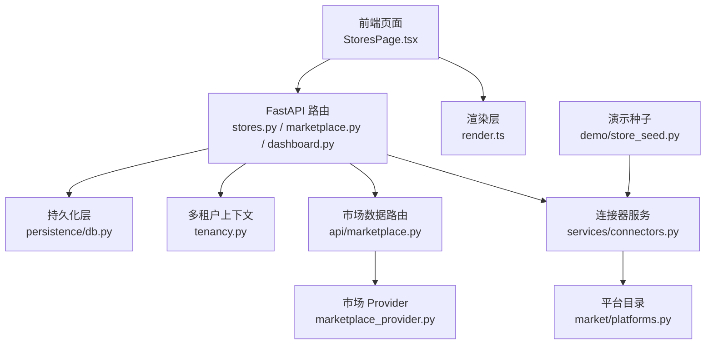

**图表来源**
- [StoresPage.tsx:1-120](file://frontend/src/features/stores/StoresPage.tsx#L1-L120)
- [stores.py:1-80](file://backend/surge/api/stores.py#L1-L80)
- [marketplace.py:1-80](file://backend/surge/api/marketplace.py#L1-L80)
- [connectors.py:1-60](file://backend/surge/services/connectors.py#L1-L60)
- [marketplace_provider.py:1-40](file://backend/surge/market/marketplace_provider.py#L1-L40)
- [platforms.py:1-40](file://backend/surge/market/platforms.py#L1-L40)
- [tenancy.py:1-40](file://backend/surge/tenancy.py#L1-L40)
- [db.py:1-40](file://backend/surge/persistence/db.py#L1-L40)
- [store_seed.py:1-30](file://backend/surge/demo/store_seed.py#L1-L30)

**章节来源**
- [StoresPage.tsx:1-120](file://frontend/src/features/stores/StoresPage.tsx#L1-L120)
- [stores.py:1-80](file://backend/surge/api/stores.py#L1-L80)
- [marketplace.py:1-80](file://backend/surge/api/marketplace.py#L1-L80)
- [connectors.py:1-60](file://backend/surge/services/connectors.py#L1-L60)
- [marketplace_provider.py:1-40](file://backend/surge/market/marketplace_provider.py#L1-L40)
- [platforms.py:1-40](file://backend/surge/market/platforms.py#L1-L40)
- [tenancy.py:1-40](file://backend/surge/tenancy.py#L1-L40)
- [db.py:1-40](file://backend/surge/persistence/db.py#L1-L40)
- [store_seed.py:1-30](file://backend/surge/demo/store_seed.py#L1-L30)

## 核心组件

### 平台适配协议：Platform Connector 抽象

`StoreConnector` 是店铺连接的核心协议。它把“平台差异”封装成统一方法：状态检查、连接测试、数据同步、商品列表和订单列表。当前有两个实现：

| 实现 | mode | 行为 | 适用阶段 |
|---|---:|---|---|
| `MockStoreConnector` | mock | 用固定随机种子生成确定性商品和订单，带 `is_mock=True` | F1–F4 演示与开发 |
| `LiveStoreConnector` | live | 构造时不降级；未接入时抛错，禁止伪造数据 | G 阶段真实 SP-API 接入 |

这种设计的关键纪律是：**可以模拟数据，但不能伪造能力**。真实连接器在未配置时不会静默回退到 Mock，避免用户误把示例当成真实经营结果。

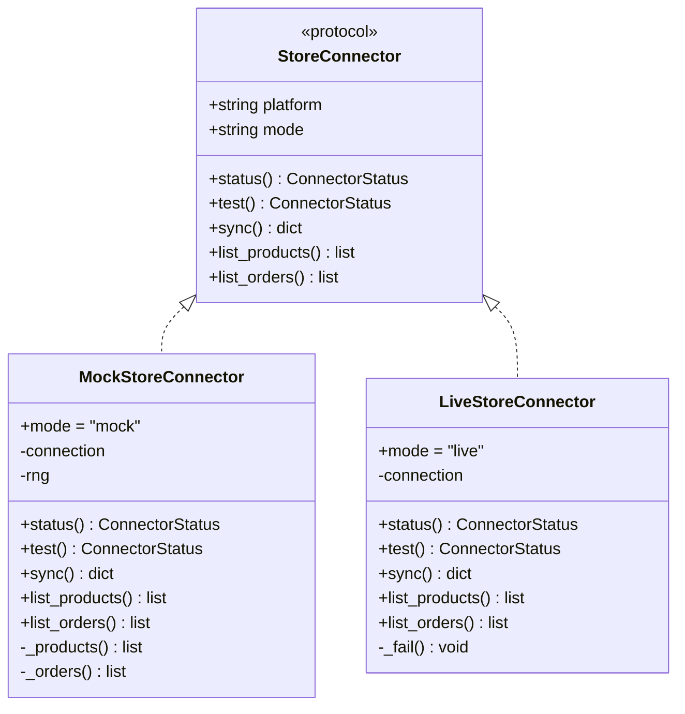

**图表来源**
- [connectors.py:60-220](file://backend/surge/services/connectors.py#L60-L220)

**章节来源**
- [connectors.py:1-60](file://backend/surge/services/connectors.py#L1-L60)
- [connectors.py:60-220](file://backend/surge/services/connectors.py#L60-L220)

### 平台清单与能力声明

`platforms.py` 不是调用平台接口的代码，而是平台元数据目录。它为每个平台定义：

- 平台键值，例如 `amazon`、`ebay`、`walmart`
- 显示名称、区域、站点列表
- 平台侧商品主键字段，如 ASIN、item_id、sku
- 能力标签：`products`、`orders`、`ads`、`metrics`、`fees`
- 认证方式：OAuth2、client_credentials、app_secret
- 真实接入点文档链接
- OAuth 端点（仅用于拼装授权 URL）

新增平台只需修改该文件，不需要改动 API 或连接器服务。这是典型的“配置驱动扩展点”。

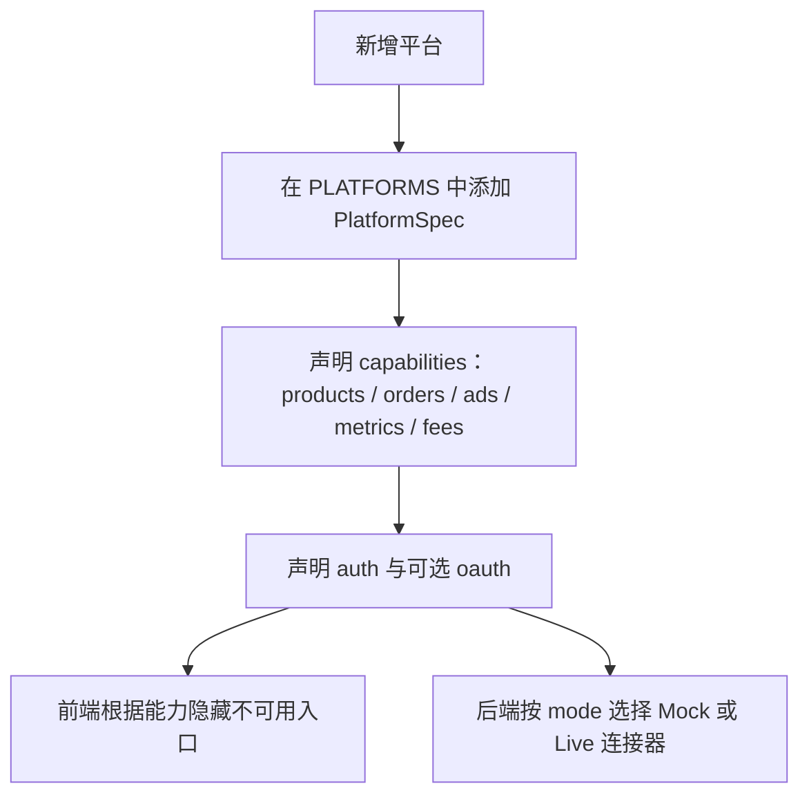

**图表来源**
- [platforms.py:1-120](file://backend/surge/market/platforms.py#L1-L120)

**章节来源**
- [platforms.py:1-120](file://backend/surge/market/platforms.py#L1-L120)

### Marketplace Provider 与 Competitor Provider 的区别

这是两个容易混淆但刻意分离的 Provider：

| 维度 | Marketplace Provider | Competitor Provider |
|---|---|---|
| 数据域 | 店铺经营数据：stores、products、orders、ads、metrics、inventory、returns、account health | 竞品分析用的竞品列表 |
| 主要用途 | 看店铺卖得怎么样、广告花多少、库存健康度如何 | 做竞品价格、卖点、评论对比分析 |
| 核心协议 | `MarketplaceDataProvider` | `CompetitorProvider` |
| 当前可用实现 | `MockMarketplaceProvider` | `ImportedCompetitorProvider` |
| 真实实现状态 | `LiveMarketplaceProvider` 骨架存在，未配置即报错 | `LiveCompetitorProvider` 未接入，禁止返回导入数据冒充真实 |
| 关键约束 | “数据可以假，接口必须真” | “拿不到真实数据就返回空 + 说明，不编造竞品” |

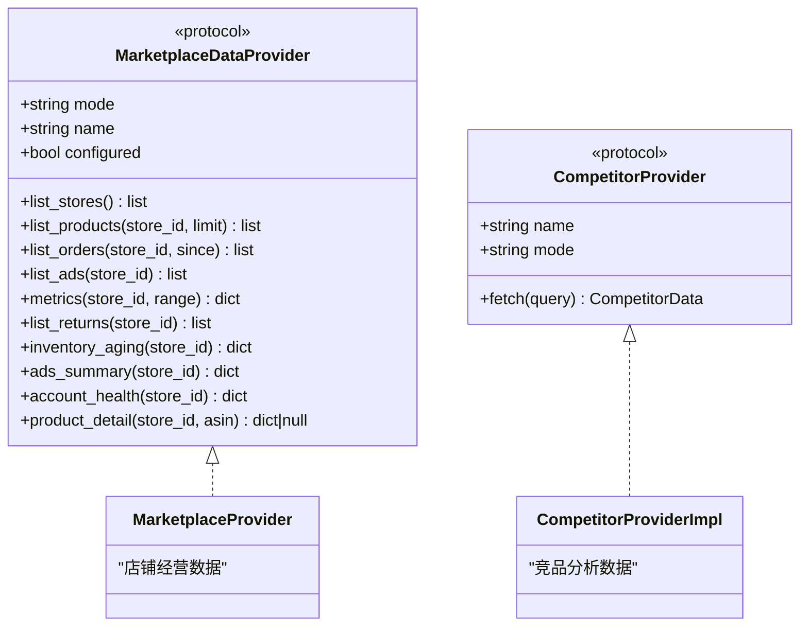

**图表来源**
- [marketplace_provider.py:120-220](file://backend/surge/market/marketplace_provider.py#L120-L220)
- [competitor_provider.py:60-160](file://backend/surge/market/competitor_provider.py#L60-L160)

**章节来源**
- [marketplace_provider.py:1-120](file://backend/surge/market/marketplace_provider.py#L1-L120)
- [marketplace_provider.py:120-220](file://backend/surge/market/marketplace_provider.py#L120-L220)
- [competitor_provider.py:1-120](file://backend/surge/market/competitor_provider.py#L1-L120)
- [competitor_provider.py:120-232](file://backend/surge/market/competitor_provider.py#L120-L232)

## 架构总览

从用户操作角度看，店铺经营的完整流程如下：

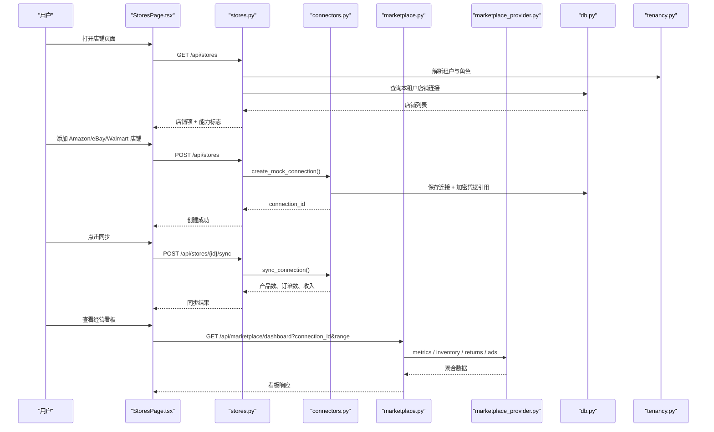

**图表来源**
- [stores.py:20-120](file://backend/surge/api/stores.py#L20-L120)
- [connectors.py:220-410](file://backend/surge/services/connectors.py#L220-L410)
- [marketplace.py:200-300](file://backend/surge/api/marketplace.py#L200-L300)
- [marketplace_provider.py:120-220](file://backend/surge/market/marketplace_provider.py#L120-L220)
- [db.py:360-420](file://backend/surge/persistence/db.py#L360-L420)
- [tenancy.py:40-131](file://backend/surge/tenancy.py#L40-L131)

## 详细组件分析

### 一、Platform Connector 抽象与平台适配协议

#### 1.1 StoreConnector 协议

`StoreConnector` 是一个运行时可检查的 Protocol，要求实现以下能力：

| 方法 | 输入 | 输出 | 语义 |
|---|---|---|---|
| `status()` | 无 | `ConnectorStatus` | 描述平台、模式、是否已连接 |
| `test()` | 无 | `ConnectorStatus` | 验证凭据是否可用 |
| `sync()` | 无 | `dict` | 拉取并汇总商品、订单等数据 |
| `list_products()` | 无 | `list[dict]` | 返回商品档案 |
| `list_orders()` | 无 | `list[dict]` | 返回订单明细 |

`build_connector(connection)` 根据连接的 `mode` 决定使用 Mock 还是 Live 实现。当前真实连接器会直接抛出错误，而不是假装已连接。

#### 1.2 MockStoreConnector 的数据生成策略

Mock 连接器使用基于连接的哈希种子生成确定性数据。同一店铺每次同步得到相同商品和订单，避免刷新导致数字跳动。商品默认 6 条，订单默认 8 条，金额、评分、数量、状态都来自伪随机数，并附带：

- `is_mock=True`
- `source=mock_connector`
- 平台相关的 product_id、ASIN/SKU
- 时间戳分布在前 30 天内

如果店铺名匹配演示目录，则优先返回品牌化的演示商品和订单，否则退回通用 Mock 数据。

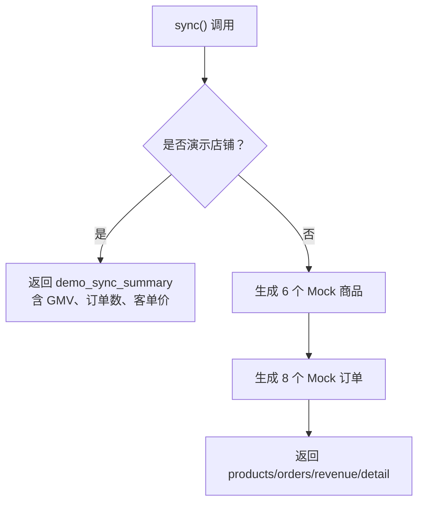

**图表来源**
- [connectors.py:120-220](file://backend/surge/services/connectors.py#L120-L220)

**章节来源**
- [connectors.py:1-60](file://backend/surge/services/connectors.py#L1-L60)
- [connectors.py:60-220](file://backend/surge/services/connectors.py#L60-L220)

### 二、Marketplace Provider 与 Competitor Provider 的区别

#### 2.1 MarketplaceDataProvider

`MarketplaceDataProvider` 是市场数据层的唯一协议。应用层只依赖这个接口，不关心数据来自 Mock 还是真实平台。当前重点能力包括：

- 商品列表
- 订单列表
- 广告活动
- 周期指标
- 库存库龄
- 退货列表
- 账户健康
- 单品详情

`MockMarketplaceProvider` 提供确定性示例数据；`LiveMarketplaceProvider` 目前只有骨架，未配置时抛 `ProviderNotConfigured`，绝不降级为 Mock。

#### 2.2 CompetitorProvider

竞品 Provider 负责竞品分析请求。它接收 `CompetitorQuery`，返回 `CompetitorData`，每条结果都带来源标记：

| source | 含义 |
|---|---|
| manual | 调用方直接传入行 |
| import | 从本租户导入批次读取 |
| live | 真实竞品数据源（当前未接入） |

`ImportedCompetitorProvider` 优先级是“显式行 > 导入批次”，并且校验批次属于当前租户，防止跨租户串数据。

**章节来源**
- [marketplace_provider.py:1-120](file://backend/surge/market/marketplace_provider.py#L1-L120)
- [marketplace_provider.py:120-220](file://backend/surge/market/marketplace_provider.py#L120-L220)
- [competitor_provider.py:1-120](file://backend/surge/market/competitor_provider.py#L1-L120)
- [competitor_provider.py:120-232](file://backend/surge/market/competitor_provider.py#L120-L232)

### 三、Dashboard 如何聚合订单、销量、业绩

#### 3.1 工作台 Dashboard

`/api/dashboard` 是系统级工作台聚合接口，统计任务、报告、Listing、店铺数量和 14 天任务趋势。它通过 `api.db.connect()` 复用数据库连接，减少远端建连成本。

#### 3.2 店铺经营看板

店铺经营看板由 `/api/marketplace/dashboard` 提供，一次返回一个店铺的全部看板数据，包括：

| 字段 | 数据来源 | 解读 |
|---|---|---|
| `metrics.days` | 市场 Provider | 当前时间范围的天数 |
| `metrics.currency` | 市场 Provider | 币种 |
| `metrics.salesTrend` | 订单聚合 | 销售额走势 |
| `metrics.unitCount` | 订单聚合 | 销量走势 |
| `metrics.orderCount` | 订单聚合 | 订单量走势 |
| `orders` | `list_orders(since)` | 近 N 天订单明细，最多 200 行 |
| `ads` | `ads_summary()` | 广告汇总 |
| `inventory` | `inventory_aging()` | 库存库龄分档 |
| `returns` | `list_returns()` | 售后退货明细 |
| `health` | `account_health()` | 账户健康指标 |

前端切换概览、订单、广告、库存、售后分段时只在本地切换视图，滑动时间范围时才重新请求接口，降低交互延迟。

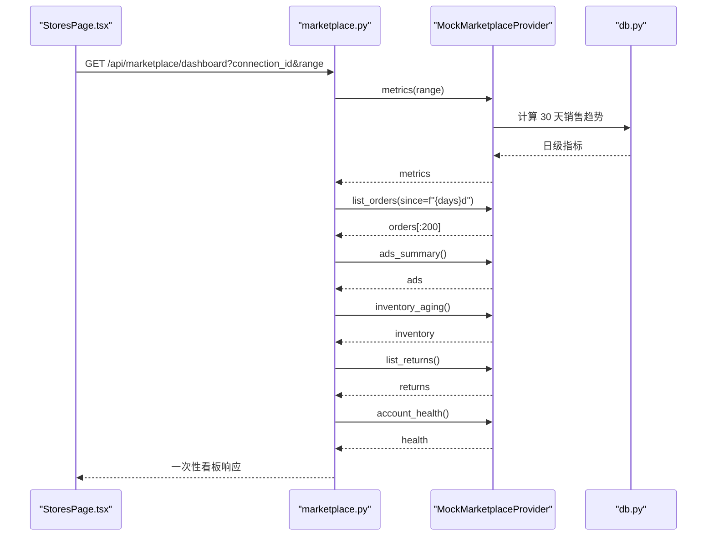

**图表来源**
- [marketplace.py:200-270](file://backend/surge/api/marketplace.py#L200-L270)
- [marketplace_provider.py:120-220](file://backend/surge/market/marketplace_provider.py#L120-L220)

**章节来源**
- [dashboard.py:1-99](file://backend/surge/api/dashboard.py#L1-L99)
- [marketplace.py:200-270](file://backend/surge/api/marketplace.py#L200-L270)
- [marketplace_provider.py:120-220](file://backend/surge/market/marketplace_provider.py#L120-L220)

### 四、StoresPage 的店铺列表、商品管理和数据刷新机制

#### 4.1 页面分区

StoresPage 包含四个子视图：

| 视图 | 路径 | 主要功能 |
|---|---|---|
| 店铺授权 | `/stores/authorize` | 添加店铺、查看数据源状态 |
| 经营看板 | `/stores` | 概览、订单、广告、库存、售后 |
| 单品分析 | `/stores/product` | 商品列表、ASIN 详情、单品趋势 |
| 经营明细 | `/stores/ledger` | Listing、订单列表、售后订单、FBA 库存明细 |

#### 4.2 店铺列表加载

页面初始化时调用 `/api/stores`，拿到店铺列表后自动选中第一个店铺。如果没有店铺，渲染三步引导：“选择店铺 → 确认站点 → 开始同步”。

#### 4.3 数据刷新机制

| 触发条件 | 动作 | 请求 |
|---|---|---|
| 页面加载 | 拉取店铺列表 | `GET /api/stores` |
| 切换到看板且 storeId 变化 | 拉取看板数据 | `GET /api/marketplace/dashboard?connection_id&range` |
| 切换到单品页 | 拉取商品列表 | `GET /api/marketplace/products?limit=100&connection_id` |
| 单品 ASIN 变化 | 拉取单品详情 | `GET /api/marketplace/products/{asin}/detail?connection_id` |
| 切换到经营明细 | 拉取明细 | `GET /api/marketplace/ledger?kind&connection_id` |
| 切换授权页 | 拉取数据源状态 | `GET /api/marketplace/sources` |

URL 状态通过 `history.replaceState` 同步，刷新浏览器可恢复筛选条件，而不会重挂路由。

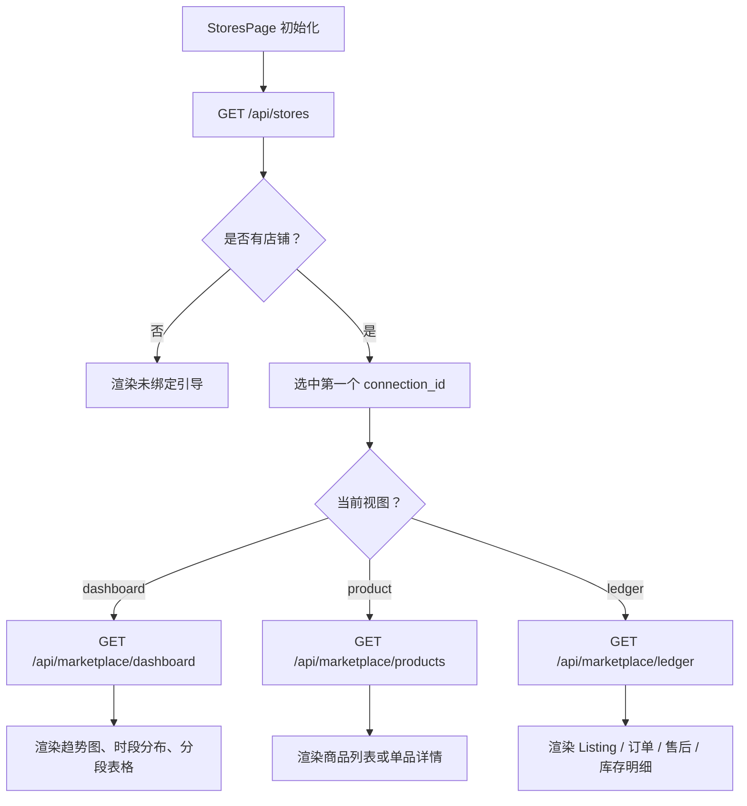

**图表来源**
- [StoresPage.tsx:1-200](file://frontend/src/features/stores/StoresPage.tsx#L1-L200)
- [StoresPage.tsx:200-400](file://frontend/src/features/stores/StoresPage.tsx#L200-L400)
- [render.ts:1-120](file://frontend/src/features/stores/render.ts#L1-L120)

**章节来源**
- [StoresPage.tsx:1-200](file://frontend/src/features/stores/StoresPage.tsx#L1-L200)
- [StoresPage.tsx:200-400](file://frontend/src/features/stores/StoresPage.tsx#L200-L400)
- [render.ts:1-120](file://frontend/src/features/stores/render.ts#L1-L120)

### 五、多租户下的店铺隔离和权限控制

#### 5.1 租户解析

`resolve_tenant` 从已认证用户解析出 `TenantContext`：

- 如果客户端传了 `X-Tenant-Id`，必须校验用户确实属于该租户；
- 没有传时使用用户最早加入的租户；
- 历史用户没有成员关系时会创建个人空间；
- 不传租户 ID 的场景对单用户体验透明。

#### 5.2 角色权限

| 最低角色 | 允许操作 |
|---|---|
| `viewer` | 查看店铺、看板、商品、订单 |
| `editor` | 创建运行任务、编辑 Listing、上传数据 |
| `admin` | 管理成员、数据源、店铺、模型配置 |
| `owner` | 全部，含删除租户 |

店铺连接的生命周期中：

- 列出店铺需要 `ROLE_READ`；
- 创建连接、同步、断开需要写权限；
- 保存凭据需要 `ROLE_MANAGE`。

#### 5.3 数据隔离

持久化层所有查询都优先使用 `tenant_id`，其次才回退到 `user_id`。例如报告、Listing、导入批次、任务等查询都会带上租户过滤。竞品 Provider 在读取导入批次时也强制校验 `tenant_id`。

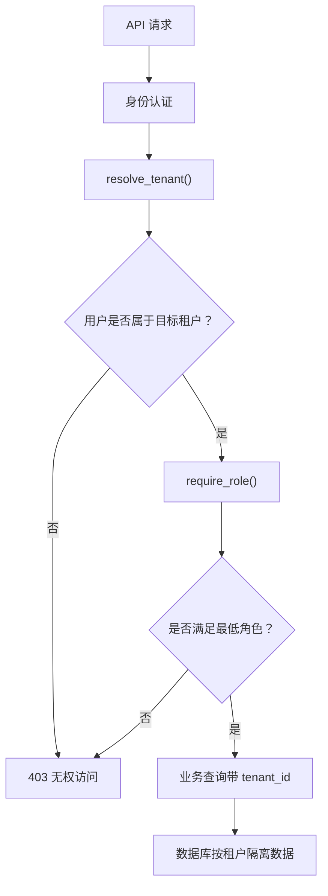

**图表来源**
- [tenancy.py:1-131](file://backend/surge/tenancy.py#L1-L131)
- [db.py:600-760](file://backend/surge/persistence/db.py#L600-L760)
- [competitor_provider.py:120-200](file://backend/surge/market/competitor_provider.py#L120-L200)

**章节来源**
- [tenancy.py:1-131](file://backend/surge/tenancy.py#L1-L131)
- [db.py:600-760](file://backend/surge/persistence/db.py#L600-L760)
- [competitor_provider.py:120-200](file://backend/surge/market/competitor_provider.py#L120-L200)

### 六、示例：连接 Amazon/eBay/Walmart 店铺 → 同步 → 看板 → 单品分析

#### 6.1 连接店铺

用户在“店铺授权”页选择平台，例如 Amazon、eBay 或 Walmart。后端调用 `create_mock_connection`，将连接信息写入数据库，凭据以密文引用形式存储，接口只返回掩码和引用，不回传明文。

#### 6.2 同步商品和订单

点击同步后，后端调用 `sync_connection`，Mock 连接器返回产品数、订单数和总收入。由于是 Mock，所有记录带 `is_mock=True`，前端会在收据页脚标注“示例数据”。

#### 6.3 查看经营看板

进入“经营看板”后，前端调用 `/api/marketplace/dashboard`，一次性获取指标、订单、广告、库存、售后和账户健康数据。用户可在概览、订单、广告、库存、售后之间秒切；改变时间范围时才重新拉取。

#### 6.4 分析单品表现

在“单品分析”页，用户从商品列表中选择 ASIN，前端调用 `/api/marketplace/products/{asin}/detail`，展示单品趋势、价格和指标。如果 ASIN 不在当前店铺，接口返回 404。

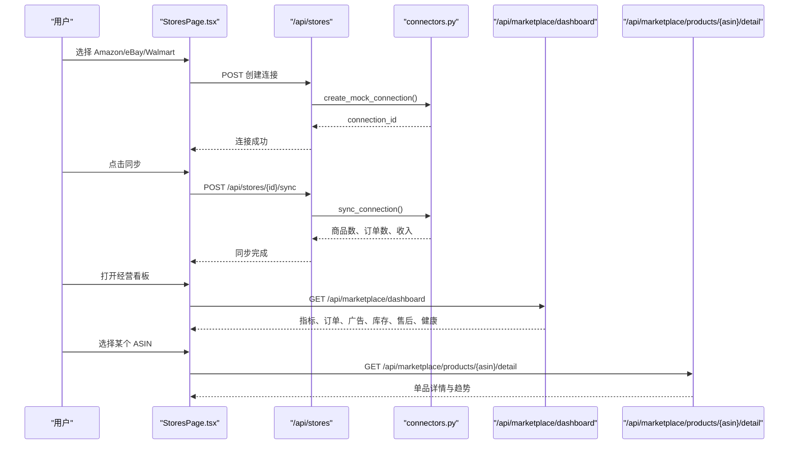

**图表来源**
- [stores.py:40-120](file://backend/surge/api/stores.py#L40-L120)
- [connectors.py:120-220](file://backend/surge/services/connectors.py#L120-L220)
- [marketplace.py:200-300](file://backend/surge/api/marketplace.py#L200-L300)

**章节来源**
- [stores.py:20-120](file://backend/surge/api/stores.py#L20-L120)
- [connectors.py:120-220](file://backend/surge/services/connectors.py#L120-L220)
- [marketplace.py:200-300](file://backend/surge/api/marketplace.py#L200-L300)

### 七、与 Market 模块、Services、持久化层的集成

#### 7.1 与 Market 模块的关系

- `market/platforms.py` 定义平台元数据和能力。
- `market/marketplace_provider.py` 定义市场数据 Provider 协议和 Mock/Live 实现。
- `market/competitor_provider.py` 定义竞品 Provider，与经营数据解耦。
- `api/marketplace.py` 是市场数据 API 路由，负责参数校验、租户权限、Provider 选择和响应组装。

#### 7.2 与 Services 的关系

`services/connectors.py` 是店铺连接的业务服务，封装：

- 创建、获取、测试、同步、断开连接
- 附加加密凭据引用
- 列出商品和订单
- 构建 Mock 或 Live 连接器

#### 7.3 与持久化层的关系

`persistence/db.py` 负责：

- PostgreSQL 连接池
- 租户、成员、任务、报告、Listing、导入批次等表结构
- 多租户迁移
- 按 `tenant_id` 过滤的查询

演示种子 `demo/store_seed.py` 会为租户幂等创建演示店铺，并对未同步过的店铺补一次同步，保证“店铺存在但没有数据”的半成品状态能自动修复。

**章节来源**
- [platforms.py:1-200](file://backend/surge/market/platforms.py#L1-L200)
- [marketplace_provider.py:1-220](file://backend/surge/market/marketplace_provider.py#L1-L220)
- [competitor_provider.py:1-160](file://backend/surge/market/competitor_provider.py#L1-L160)
- [marketplace.py:1-200](file://backend/surge/api/marketplace.py#L1-L200)
- [connectors.py:1-220](file://backend/surge/services/connectors.py#L1-L220)
- [db.py:360-420](file://backend/surge/persistence/db.py#L360-L420)
- [store_seed.py:1-75](file://backend/surge/demo/store_seed.py#L1-L75)

## 依赖关系分析

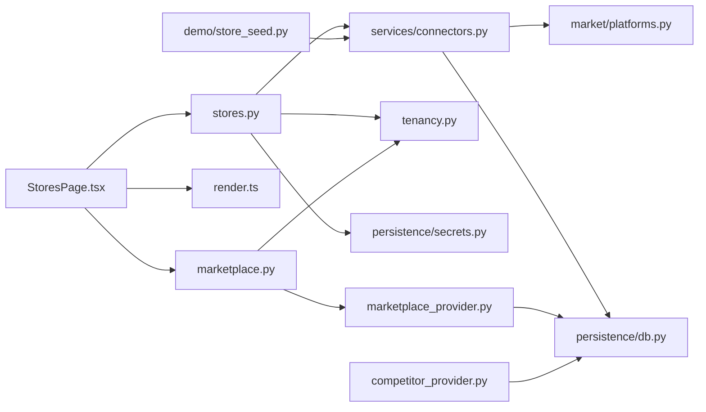

**图表来源**
- [StoresPage.tsx:1-120](file://frontend/src/features/stores/StoresPage.tsx#L1-L120)
- [stores.py:1-80](file://backend/surge/api/stores.py#L1-L80)
- [marketplace.py:1-80](file://backend/surge/api/marketplace.py#L1-L80)
- [connectors.py:1-60](file://backend/surge/services/connectors.py#L1-L60)
- [marketplace_provider.py:1-40](file://backend/surge/market/marketplace_provider.py#L1-L40)
- [competitor_provider.py:1-40](file://backend/surge/market/competitor_provider.py#L1-L40)
- [platforms.py:1-40](file://backend/surge/market/platforms.py#L1-L40)
- [db.py:1-40](file://backend/surge/persistence/db.py#L1-L40)
- [store_seed.py:1-30](file://backend/surge/demo/store_seed.py#L1-L30)

**章节来源**
- [StoresPage.tsx:1-120](file://frontend/src/features/stores/StoresPage.tsx#L1-L120)
- [stores.py:1-80](file://backend/surge/api/stores.py#L1-L80)
- [marketplace.py:1-80](file://backend/surge/api/marketplace.py#L1-L80)
- [connectors.py:1-60](file://backend/surge/services/connectors.py#L1-L60)
- [marketplace_provider.py:1-40](file://backend/surge/market/marketplace_provider.py#L1-L40)
- [competitor_provider.py:1-40](file://backend/surge/market/competitor_provider.py#L1-L40)
- [platforms.py:1-40](file://backend/surge/market/platforms.py#L1-L40)
- [db.py:1-40](file://backend/surge/persistence/db.py#L1-L40)
- [store_seed.py:1-30](file://backend/surge/demo/store_seed.py#L1-L30)

## 性能与扩展性

### 性能特征

1. **数据库连接复用**：Dashboard 接口通过 `api.db.connect()` 复用同一次请求中的数据库连接，避免每个查询单独建连。
2. **看板一次性返回**：经营看板一次返回指标、订单、广告、库存、售后和健康数据，前端本地分段切换，减少网络往返。
3. **订单行数限制**：订单列表默认最多返回 200 行，防止窗口过大导致响应膨胀。
4. **Mock 数据确定性**：商品和订单使用固定种子生成，避免频繁计算带来的抖动。
5. **连接池**：PostgreSQL 使用 `psycopg_pool` 的连接池，缺少池时降级为直连，并给出性能警告。

### 扩展点

| 扩展方向 | 需要改动的地方 | 注意事项 |
|---|---|---|
| 新增平台 | `market/platforms.py` | 补充 `PlatformSpec`，不要改动 API |
| 接入真实 Amazon SP-API | 新增 `LiveStoreConnector` 实现 | 不能静默回退到 Mock |
| 接入真实 eBay/Walmart 数据 | 新增 `LiveMarketplaceProvider` 实现 | 未配置时抛 `ProviderNotConfigured` |
| 新增看板指标 | 扩展 `MarketplaceDataProvider.metrics` 和相关 Provider | 保持 is_mock 标记一致 |
| 新增明细类型 | 扩展 `LEDGER_KINDS` 和 Provider 对应方法 | 前端 render 层需同步支持 |
| 新增竞品数据源 | 新增 `CompetitorProvider` 实现 | 不得返回导入数据冒充真实 |

**章节来源**
- [dashboard.py:20-99](file://backend/surge/api/dashboard.py#L20-L99)
- [marketplace.py:200-300](file://backend/surge/api/marketplace.py#L200-L300)
- [marketplace_provider.py:1-120](file://backend/surge/market/marketplace_provider.py#L1-L120)
- [connectors.py:1-60](file://backend/surge/services/connectors.py#L1-L60)
- [db.py:360-420](file://backend/surge/persistence/db.py#L360-L420)
- [platforms.py:1-120](file://backend/surge/market/platforms.py#L1-L120)

## 故障排查

### 常见问题

| 现象 | 可能原因 | 处理建议 |
|---|---|---|
| 添加店铺后提示“真实 API 未接入” | 当前只有 Mock 连接器可用 | 使用示例数据继续体验 |
| 看板数据为空 | 还没有添加店铺，或选择了未同步的店铺 | 先添加店铺并点击同步 |
| 单品详情 404 | ASIN 不在当前店铺 | 切换店铺或选择有效 ASIN |
| 数据源状态 501 | Live Provider 未配置 | 等待真实平台接入，不要期望 Mock 数据冒充 live |
| 竞品数据为空 | 没有传入行也没有指定导入批次 | 上传 CSV/JSON 或显式传入竞品行 |
| 无法跨租户查看竞品批次 | 批次不属于当前租户 | 使用当前租户拥有的批次 |
| 首屏慢 | 缺少 psycopg_pool 或远端数据库建连成本高 | 安装连接池依赖，复用数据库连接 |

### 错误分类

| 异常类型 | 含义 | HTTP 状态 |
|---|---|---:|
| `StoreNotFound` | 店铺连接不存在 | 404 |
| `StoreConflict` | 店铺冲突，通常因唯一约束失败 | 409 |
| `ConnectorError` | 连接器操作失败 | 400 |
| `TenantError` | 租户解析或权限失败 | 403 |
| `ProviderNotConfigured` | 真实 Provider 未配置 | 501 |
| `DatabaseError` | 数据库不可用或连接失败 | 应用层统一处理 |

**章节来源**
- [stores.py:40-200](file://backend/surge/api/stores.py#L40-L200)
- [marketplace.py:1-80](file://backend/surge/api/marketplace.py#L1-L80)
- [marketplace.py:200-300](file://backend/surge/api/marketplace.py#L200-L300)
- [connectors.py:1-60](file://backend/surge/services/connectors.py#L1-L60)
- [marketplace_provider.py:1-120](file://backend/surge/market/marketplace_provider.py#L1-L120)
- [competitor_provider.py:60-120](file://backend/surge/market/competitor_provider.py#L60-L120)
- [db.py:360-420](file://backend/surge/persistence/db.py#L360-L420)

## 结论

店铺经营功能在当前版本以 Mock 连接器为核心，完成了“店铺连接 → 数据同步 → 看板分析 → 单品表现 → 明细查看”的端到端闭环，同时严格区分示例数据与真实数据。它的价值不仅在于演示流程，更在于建立了清晰的扩展边界：

1. `StoreConnector` 抽象让平台接入与上层 API 解耦；
2. `MarketplaceDataProvider` 让市场数据聚合与数据源解耦；
3. `CompetitorProvider` 把竞品分析从店铺经营数据中剥离；
4. `platforms.py` 把平台差异集中为可配置的元数据；
5. `tenancy.py` 与 `db.py` 共同保证多租户隔离和角色权限。

未来接入更多平台时，开发者应遵循现有纪律：不伪造已连接状态、不静默降级、不混入示例数据、所有新增能力先声明再实现。这样可以在保持用户体验一致的前提下，逐步把 Mock 数据替换为 Amazon、eBay、Walmart 等平台的真实经营数据。