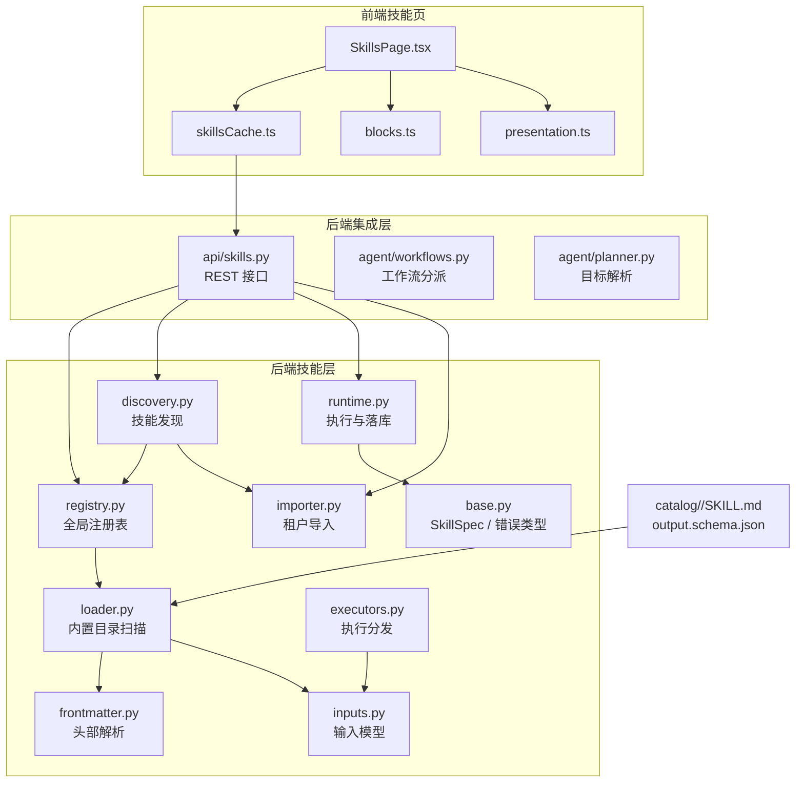
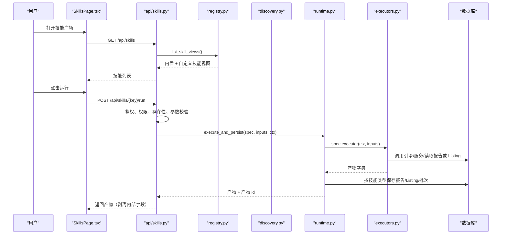
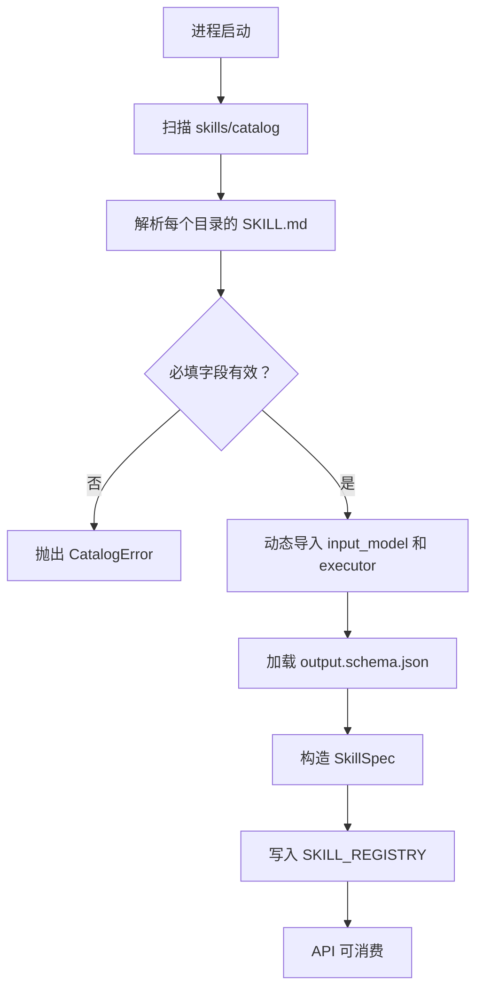
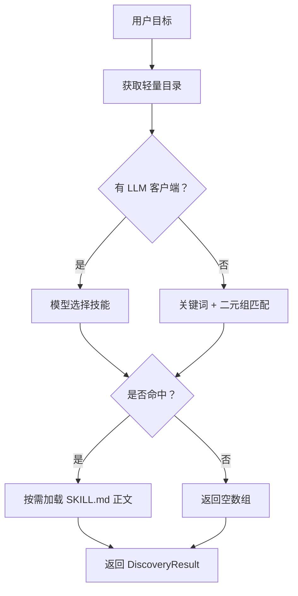
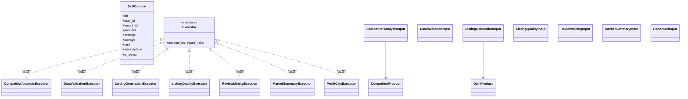
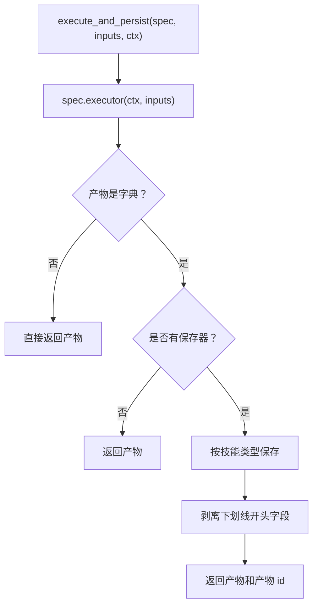
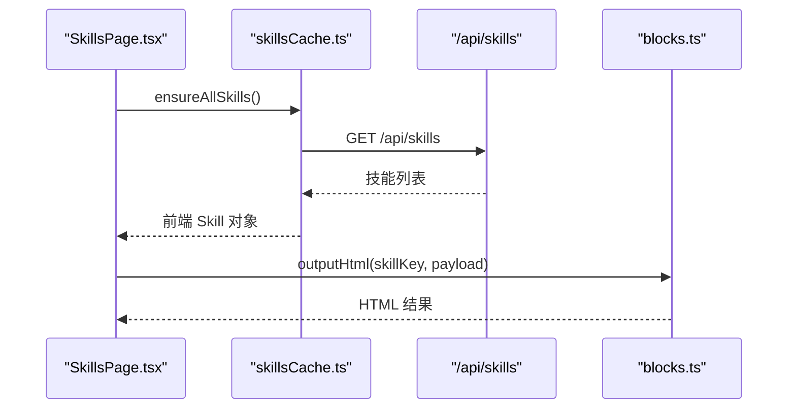
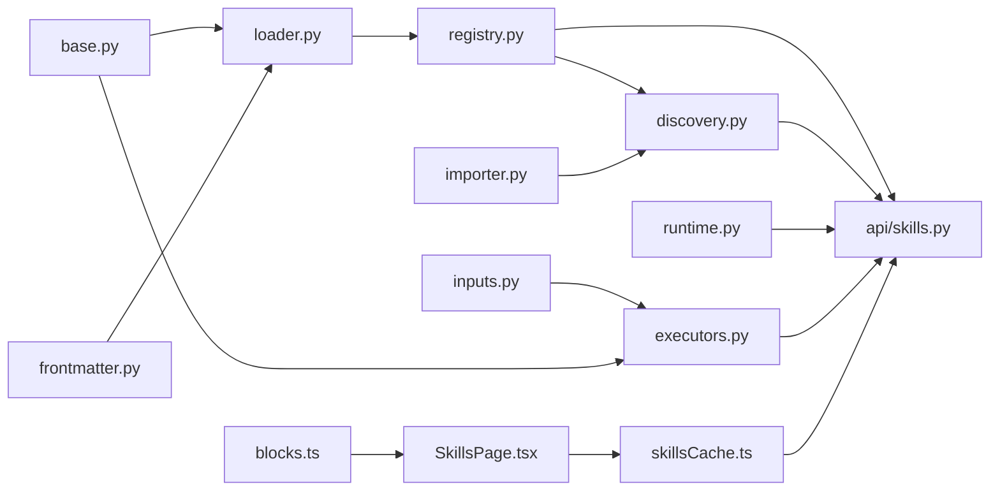

# 技能系统

<cite>
**本文引用的文件**   
- [backend/surge/skills/discovery.py](file://backend/surge/skills/discovery.py)
- [backend/surge/skills/loader.py](file://backend/surge/skills/loader.py)
- [backend/surge/skills/registry.py](file://backend/surge/skills/registry.py)
- [backend/surge/skills/executors.py](file://backend/surge/skills/executors.py)
- [backend/surge/skills/frontmatter.py](file://backend/surge/skills/frontmatter.py)
- [backend/surge/skills/runtime.py](file://backend/surge/skills/runtime.py)
- [backend/surge/skills/importer.py](file://backend/surge/skills/importer.py)
- [backend/surge/skills/inputs.py](file://backend/surge/skills/inputs.py)
- [backend/surge/api/skills.py](file://backend/surge/api/skills.py)
- [frontend/src/features/skills/SkillsPage.tsx](file://frontend/src/features/skills/SkillsPage.tsx)
- [frontend/src/features/skills/presentation.ts](file://frontend/src/features/skills/presentation.ts)
- [frontend/src/features/skills/blocks.ts](file://frontend/src/features/skills/blocks.ts)
- [frontend/src/features/skills/skillsCache.ts](file://frontend/src/features/skills/skillsCache.ts)
- [backend/surge/agent/workflows.py](file://backend/surge/agent/workflows.py)
- [backend/surge/agent/planner.py](file://backend/surge/agent/planner.py)
- [backend/surge/skills/base.py](file://backend/surge/skills/base.py)
- [backend/surge/skills/catalog/data_validation/output.schema.json](file://backend/surge/skills/catalog/data_validation/output.schema.json)
- [backend/surge/skills/catalog/competitor_analysis/output.schema.json](file://backend/surge/skills/catalog/competitor_analysis/output.schema.json)
- [backend/surge/skills/catalog/profit_calc/output.schema.json](file://backend/surge/skills/catalog/profit_calc/output.schema.json)
- [backend/surge/skills/catalog/review_mining/output.schema.json](file://backend/surge/skills/catalog/review_mining/output.schema.json)
- [backend/surge/skills/catalog/listing_generation/output.schema.json](file://backend/surge/skills/catalog/listing_generation/output.schema.json)
- [backend/surge/skills/catalog/listing_quality/output.schema.json](file://backend/surge/skills/catalog/listing_quality/output.schema.json)
- [backend/surge/skills/catalog/market_summary/output.schema.json](file://backend/surge/skills/catalog/market_summary/output.schema.json)
</cite>

## 目录
1. [引言](#引言)
2. [项目结构](#项目结构)
3. [核心组件](#核心组件)
4. [架构总览](#架构总览)
5. [详细组件分析](#详细组件分析)
6. [依赖关系分析](#依赖关系分析)
7. [性能与扩展性](#性能与扩展性)
8. [故障排查](#故障排查)
9. [结论](#结论)
10. [附录：自定义技能开发指南](#附录自定义技能开发指南)

## 引言
技能系统是 Surger（激浪）中把“能力”从业务代码里解耦出来的统一协议层。它负责：
- 用 `SKILL.md` 的 frontmatter 描述技能的元数据、输入模型、执行器和输出结构；
- 启动时扫描内置技能目录，生成全局注册表；
- 提供租户导入能力，让租户上传说明型技能；
- 通过 API 暴露技能列表、发现接口和统一执行入口；
- 将前端参数表单、后端 Pydantic 校验、实际执行器、结果渲染串联起来；
- 与 Agent 工作流、LLM 客户端、API 层以及持久化层协作。

这套设计的目标是：**新增一个能力只需新增一个目录**，而不是到处复制任务记录、限流、审计、落库逻辑。

## 项目结构
技能相关代码集中在后端 `backend/surge/skills` 目录，并配合前端 `frontend/src/features/skills` 展示。

**图示来源**
- [backend/surge/skills/loader.py:1-165](file://backend/surge/skills/loader.py#L1-L165)
- [backend/surge/skills/registry.py:1-159](file://backend/surge/skills/registry.py#L1-L159)
- [backend/surge/api/skills.py:1-200](file://backend/surge/api/skills.py#L1-L200)
- [frontend/src/features/skills/SkillsPage.tsx:1-200](file://frontend/src/features/skills/SkillsPage.tsx#L1-L200)

**章节来源**
- [backend/surge/skills/loader.py:1-165](file://backend/surge/skills/loader.py#L1-L165)
- [backend/surge/skills/registry.py:1-159](file://backend/surge/skills/registry.py#L1-L159)
- [backend/surge/api/skills.py:1-200](file://backend/surge/api/skills.py#L1-L200)
- [frontend/src/features/skills/SkillsPage.tsx:1-200](file://frontend/src/features/skills/SkillsPage.tsx#L1-L200)

## 核心组件
| 组件 | 职责 | 关键行为 |
|---|---|---|
| `frontmatter.py` | 解析 `SKILL.md` 头部 | 只支持扁平键值、行内列表和块列表，拒绝嵌套映射 |
| `loader.py` | 扫描内置技能目录 | 校验必填字段、动态导入 `input_model` 和 `executor`、加载 `output.schema.json` |
| `registry.py` | 维护 `SKILL_REGISTRY` | 启动时扫描、提供视图、兼容租户导入行 |
| `discovery.py` | 给 Agent 提供轻量技能目录 | 先按关键词命中，再回退二元组重叠匹配，必要时调用 LLM |
| `executors.py` | 七个内置技能的分发函数 | 只做参数拼装和已有实现调用，不写算法 |
| `runtime.py` | 执行与产出落库 | 剥离内部字段、识别 demo、按技能保存报告/Listing/批次 |
| `importer.py` | 解析租户上传的 `SKILL.md` | 禁止 `executor`、`input_model`、`output_schema` 等危险字段 |
| `inputs.py` | 所有技能的 Pydantic 输入模型 | 同时用于表单生成和运行时校验 |
| `base.py` | 协议定义 | `SkillSpec`、`SkillContext`、技能错误类型、渲染器白名单 |
| `api/skills.py` | REST 接口 | 列表、详情、发现、导入、删除、统一执行 |
| `SkillsPage.tsx` | 前端技能广场与详情 | 卡片展示、参数表单、运行、结果渲染 |

**章节来源**
- [backend/surge/skills/frontmatter.py:1-136](file://backend/surge/skills/frontmatter.py#L1-L136)
- [backend/surge/skills/loader.py:1-165](file://backend/surge/skills/loader.py#L1-L165)
- [backend/surge/skills/registry.py:1-159](file://backend/surge/skills/registry.py#L1-L159)
- [backend/surge/skills/discovery.py:1-200](file://backend/surge/skills/discovery.py#L1-L200)
- [backend/surge/skills/executors.py:1-200](file://backend/surge/skills/executors.py#L1-L200)
- [backend/surge/skills/runtime.py:1-146](file://backend/surge/skills/runtime.py#L1-L146)
- [backend/surge/skills/importer.py:1-116](file://backend/surge/skills/importer.py#L1-L116)
- [backend/surge/skills/inputs.py:1-200](file://backend/surge/skills/inputs.py#L1-L200)
- [backend/surge/skills/base.py:1-153](file://backend/surge/skills/base.py#L1-L153)
- [backend/surge/api/skills.py:1-200](file://backend/surge/api/skills.py#L1-L200)
- [frontend/src/features/skills/SkillsPage.tsx:1-200](file://frontend/src/features/skills/SkillsPage.tsx#L1-L200)

## 架构总览
技能系统分为四层：**协议层 → 注册与发现层 → 执行层 → 集成层**。

**图示来源**
- [backend/surge/api/skills.py:1-200](file://backend/surge/api/skills.py#L1-L200)
- [backend/surge/skills/registry.py:1-159](file://backend/surge/skills/registry.py#L1-L159)
- [backend/surge/skills/runtime.py:1-146](file://backend/surge/skills/runtime.py#L1-L146)
- [backend/surge/skills/executors.py:1-200](file://backend/surge/skills/executors.py#L1-L200)

## 详细组件分析

### SKILL.md frontmatter 与 output.schema.json 规范

#### frontmatter 规范
`SKILL.md` 必须以第一行的分隔符开始，前部分为元数据，后部分为正文。解析器只接受受控子集：
- 扁平键值；
- 行内列表 `[a, b]`；
- 块列表 `- item`；
- 不支持嵌套映射，避免复杂 YAML 语义。

内置目录中的必填字段包括 `name`、`title`、`description`、`input_model`、`executor`。可选字段包括 `category`、`summary`、`renderer`、`requires`、`keywords`、`uses_llm`、`credits`、`status`、`output_schema`、`executor_type`、`version`。

关键字段约束如下：
- `name` 必须与目录名一致；
- `input_model` 必须是形如 `模块:属性` 的可导入 Pydantic 模型；
- `executor` 必须是可调用对象；
- `renderer` 必须在允许集合中；
- `requires` 和 `keywords` 必须是列表；
- `uses_llm` 必须是布尔值；
- `credits` 会转为整数；
- `output_schema` 指向同目录下 JSON 文件，必须是对象。

租户导入时，`executor`、`input_model`、`output_schema`、`executor_type` 被显式拒绝，因此导入技能只能是“说明型能力”，不能直接执行。

#### output.schema.json 规范
每个内置技能目录可以附带 `output.schema.json`，用于描述该技能产出的结构化字段。它不是严格运行时校验 schema，而是：
- 作为能力的契约文档；
- 随 `GET /api/skills` 返回，供前端预览；
- 由 `loader.py` 在启动时加载进 `SkillSpec.output_schema`；
- 前端渲染器根据 `renderer` 字段选择呈现方式，但具体字段渲染逻辑仍由 `blocks.ts` 决定。

当前内置技能的输出结构约定如下：

| 技能 | 主要输出字段 | 用途 |
|---|---|---|
| 竞品分析 | `product_name`、`price_analysis`、`review_insights`、`differentiation_opportunities`、`data_provenance` | 分析报告 |
| Listing 生成 | `title`、`bullets`、`description`、`fact_ledger`、`quality_check` | Listing 草稿 |
| Listing 质检 | `passed`、`errors`、`warnings`、`pending_confirmations` | 质检结果 |
| 数据校验 | `ok`、`total_rows`、`valid_rows`、`errors` | 导入校验 |
| 评论挖掘 | `total_samples`、`pain_points`、`needs`、`concerns` | 评论主题归纳 |
| 市场总结 | `headline`、`points`、`data_is_demo`、`limitations` | 机会判断 |
| 利润计算 | `cost_breakdown`、`break_even`、`pricing_tiers`、`sensitivity` | 成本与定价测算 |

**章节来源**
- [backend/surge/skills/frontmatter.py:1-136](file://backend/surge/skills/frontmatter.py#L1-L136)
- [backend/surge/skills/loader.py:1-165](file://backend/surge/skills/loader.py#L1-L165)
- [backend/surge/skills/importer.py:1-116](file://backend/surge/skills/importer.py#L1-L116)
- [backend/surge/skills/catalog/data_validation/output.schema.json:1-9](file://backend/surge/skills/catalog/data_validation/output.schema.json#L1-L9)
- [backend/surge/skills/catalog/competitor_analysis/output.schema.json:1-10](file://backend/surge/skills/catalog/competitor_analysis/output.schema.json#L1-L10)
- [backend/surge/skills/catalog/profit_calc/output.schema.json:1-9](file://backend/surge/skills/catalog/profit_calc/output.schema.json#L1-L9)
- [backend/surge/skills/catalog/review_mining/output.schema.json:1-9](file://backend/surge/skills/catalog/review_mining/output.schema.json#L1-L9)
- [backend/surge/skills/catalog/listing_generation/output.schema.json:1-10](file://backend/surge/skills/catalog/listing_generation/output.schema.json#L1-L10)
- [backend/surge/skills/catalog/listing_quality/output.schema.json:1-9](file://backend/surge/skills/catalog/listing_quality/output.schema.json#L1-L9)
- [backend/surge/skills/catalog/market_summary/output.schema.json:1-9](file://backend/surge/skills/catalog/market_summary/output.schema.json#L1-L9)

### Registry：内置与自定义技能注册表

`SKILL_REGISTRY` 是平台能力的唯一真源。它由 `loader.load_builtin_catalog()` 在模块加载时扫描 `skills/catalog` 构建。`registry.reload()` 可用于开发期重新扫描，而不会替换外部已持有的引用。

注册表对外暴露三类视图：
1. **内置技能视图**：包含完整元数据、`input_schema`、`output_schema`、`executor_type`、`instructions`，并且当 `executable` 为真时可运行；
2. **租户导入技能视图**：只有说明、没有执行器，`runnable` 始终为假；
3. **种子行**：用于向 Agent 注册表同步扁平化的输入输出 schema。

租户导入的技能不会进入 `SKILL_REGISTRY`，而是通过 `db.list_skill_definitions(tenant_id)` 合并到返回列表中。如果某个内置 key 已从目录移除，则视为下线，不再出现在列表中。

**图示来源**
- [backend/surge/skills/loader.py:1-165](file://backend/surge/skills/loader.py#L1-L165)
- [backend/surge/skills/registry.py:1-159](file://backend/surge/skills/registry.py#L1-L159)

**章节来源**
- [backend/surge/skills/registry.py:1-159](file://backend/surge/skills/registry.py#L1-L159)
- [backend/surge/skills/loader.py:1-165](file://backend/surge/skills/loader.py#L1-L165)
- [backend/surge/skills/base.py:1-153](file://backend/surge/skills/base.py#L1-L153)

### Loader：技能目录扫描与解析

Loader 的核心规则是：**一个技能 = 一个目录，目录中至少有一份 `SKILL.md`**。新增内置技能不需要修改 `registry.py`，只需要新增目录和 `SKILL.md`。

Loader 的职责边界很清晰：
- 只处理内置目录；
- 对租户导入内容复用 `frontmatter.split_document`，但不走 Python 导入；
- 任何一处非法都会抛 `CatalogError`，不允许静默丢技能；
- 目录为空时会报错，防止部署后“没有技能可用”。

`executor_type` 默认是 `function`，表示一次调用；未来可扩展为 `graph`，表示多步子图。当前内置技能都是函数型执行器。

**章节来源**
- [backend/surge/skills/loader.py:1-165](file://backend/surge/skills/loader.py#L1-L165)

### Discovery：Agent 如何发现技能

Discovery 采用三层渐进披露：
1. **目录层**：只返回 `key`、`name`、`description`、`category`、`source`、`runnable`；
2. **正文层**：选中技能后才加载 `SKILL.md` 正文；
3. **执行层**：真正执行不属于本模块职责。

选择策略是“模型优先，确定性兜底”：
- 如果有 LLM 客户端，会把目录交给模型做路由；
- 否则使用关键词召回词匹配，并以名称和描述的二元组重叠作为排序和兜底条件；
- 兜底阈值经过调整，避免“分析”“定位”等通用词导致所有技能都被选中；
- 降级时必须标注 `degraded=True` 并给出人类可读原因，不允许静默降级。

**图示来源**
- [backend/surge/skills/discovery.py:1-200](file://backend/surge/skills/discovery.py#L1-L200)

**章节来源**
- [backend/surge/skills/discovery.py:1-200](file://backend/surge/skills/discovery.py#L1-L200)

### Executors：执行分发与业务隔离

`executors.py` 是一个薄分发层。它不负责算法，只负责：
- 从 `SkillContext` 和输入模型取值；
- 调用已有实现，例如 `agent.tools`、`agent.skills`、`engine.profit`、`ingest.importers`；
- 把 Pydantic 对象序列化为 dict。

这种纪律保证“技能页”“工作台”“旧七节点图”走同一代码路径，避免结果分叉。

当前七个内置执行器如下：

| 技能 | 执行器 | 主要逻辑 |
|---|---|---|
| 竞品分析 | `competitor_analysis` | 从表单或导入批次读取竞品，调用竞品分析工具 |
| 评论挖掘 | `review_mining` | 从已有报告中挖掘评论痛点 |
| 市场总结 | `market_summary` | 从报告中归纳市场机会 |
| Listing 生成 | `listing_generation` | 基于商品事实生成 Listing 草稿 |
| Listing 质检 | `listing_quality` | 对已有 Listing 草稿做事实对齐检查 |
| 数据校验 | `data_validation` | base64 解码、大小限制、导入校验、错误汇总 |
| 利润计算 | `profit_calc` | 调用利润引擎计算成本与定价 |

**图示来源**
- [backend/surge/skills/executors.py:1-200](file://backend/surge/skills/executors.py#L1-L200)
- [backend/surge/skills/inputs.py:1-200](file://backend/surge/skills/inputs.py#L1-L200)
- [backend/surge/skills/base.py:1-153](file://backend/surge/skills/base.py#L1-L153)

**章节来源**
- [backend/surge/skills/executors.py:1-200](file://backend/surge/skills/executors.py#L1-L200)
- [backend/surge/skills/inputs.py:1-200](file://backend/surge/skills/inputs.py#L1-L200)

### Runtime：执行、产物清洗与落库

Runtime 区分两种用法：
- `execute`：只执行，不落库；
- `execute_and_persist`：执行并按技能类型落库，返回 `(产物, 产物 id)`。

产物中以下划线开头的键被视为内部字段，会在出接口前被剥离，避免把仅用于落库的数据泄露到响应中。例如数据校验产物的 `_batch` 用于保存可复用批次。

需要落库的技能通过 `ARTIFACT_SAVERS` 声明：
- `competitor_analysis`：保存分析报告；
- `listing_generation`：保存 Listing 草稿；
- `data_validation`：保存导入批次。

Demo 数据检测会递归检查 `is_demo`、`data_is_demo`、`data_provenance.is_demo`，确保示例数据不会被误认为真实经营数据。

**图示来源**
- [backend/surge/skills/runtime.py:1-146](file://backend/surge/skills/runtime.py#L1-L146)

**章节来源**
- [backend/surge/skills/runtime.py:1-146](file://backend/surge/skills/runtime.py#L1-L146)

### API 层：技能读取、导入与统一执行

`api/skills.py` 把技能的生命周期收敛成一组 REST 接口：
- `GET /api/skills`：列出可运行或全量技能；
- `GET /api/skills/catalog`：给 Agent 的轻量目录；
- `POST /api/skills/discover`：按自然语言目标选择技能；
- `GET /api/skills/{skill_key}`：获取详情，包含正文；
- `POST /api/skills/import`：导入租户 `SKILL.md`；
- `POST /api/skills/{skill_key}/run`：统一执行入口。

统一执行入口的判定顺序是固定且有意设计的：登录 → 角色 → 技能存在 → 参数校验 → 依赖检查 → 限流 → 执行。这样参数错误会先于缺少 LLM Key 的错误暴露，减少用户困惑。

**章节来源**
- [backend/surge/api/skills.py:1-200](file://backend/surge/api/skills.py#L1-L200)

### 前端 SkillsPage：展示与运行

前端技能页承担三个职责：
1. 展示技能卡片；
2. 根据后端返回的 `input_schema` 生成参数表单；
3. 根据 `skill_key` 渲染不同结果区块。

关键行为：
- 技能清单来自 `skillsCache.ensureSkills()`，并发请求去重，失败返回空数组；
- 精选位固定为竞品分析、Listing 生成、利润计算；
- 只有 `AGENT_RUNNABLE` 中的技能可以从助手直接接管；
- 慢技能如竞品分析和 Listing 生成走后台任务轮询；
- 导入按钮在前端做 64KB 限制，再调用 `/api/skills/import`；
- 结果渲染委托给 `blocks.ts`，其中竞品分析和 Listing 复用通用报告与 Listing 渲染器。

**图示来源**
- [frontend/src/features/skills/SkillsPage.tsx:1-200](file://frontend/src/features/skills/SkillsPage.tsx#L1-L200)
- [frontend/src/features/skills/skillsCache.ts:1-146](file://frontend/src/features/skills/skillsCache.ts#L1-L146)
- [frontend/src/features/skills/blocks.ts:1-200](file://frontend/src/features/skills/blocks.ts#L1-L200)

**章节来源**
- [frontend/src/features/skills/SkillsPage.tsx:1-200](file://frontend/src/features/skills/SkillsPage.tsx#L1-L200)
- [frontend/src/features/skills/skillsCache.ts:1-146](file://frontend/src/features/skills/skillsCache.ts#L1-L146)
- [frontend/src/features/skills/presentation.ts:1-58](file://frontend/src/features/skills/presentation.ts#L1-L58)
- [frontend/src/features/skills/blocks.ts:1-200](file://frontend/src/features/skills/blocks.ts#L1-L200)

## 依赖关系分析

**图示来源**
- [backend/surge/skills/base.py:1-153](file://backend/surge/skills/base.py#L1-L153)
- [backend/surge/skills/loader.py:1-165](file://backend/surge/skills/loader.py#L1-L165)
- [backend/surge/skills/registry.py:1-159](file://backend/surge/skills/registry.py#L1-L159)
- [backend/surge/skills/executors.py:1-200](file://backend/surge/skills/executors.py#L1-L200)
- [backend/surge/api/skills.py:1-200](file://backend/surge/api/skills.py#L1-L200)
- [frontend/src/features/skills/skillsCache.ts:1-146](file://frontend/src/features/skills/skillsCache.ts#L1-L146)
- [frontend/src/features/skills/SkillsPage.tsx:1-200](file://frontend/src/features/skills/SkillsPage.tsx#L1-L200)
- [frontend/src/features/skills/blocks.ts:1-200](file://frontend/src/features/skills/blocks.ts#L1-L200)

**章节来源**
- [backend/surge/skills/base.py:1-153](file://backend/surge/skills/base.py#L1-L153)
- [backend/surge/api/skills.py:1-200](file://backend/surge/api/skills.py#L1-L200)
- [frontend/src/features/skills/skillsCache.ts:1-146](file://frontend/src/features/skills/skillsCache.ts#L1-L146)

## 性能与扩展性

### 性能特性
- 内置技能在进程启动时扫描一次，运行时只读注册表；
- 前端 `ensureSkills` 和 `ensureAllSkills` 使用单飞 Promise，并发请求去重；
- 大产物如竞品分析和 Listing 生成在后端标记为重型输出，前端通常通过异步任务轮询；
- 数据校验对 base64 内容做大小限制，避免内存膨胀；
- 技能发现默认限制最多返回几个候选，避免把整个目录交给模型。

### 扩展点
- 新增内置技能：新增 `skills/catalog/<key>/SKILL.md`，可选 `output.schema.json`；
- 新增租户自定义说明型技能：通过 `/api/skills/import` 上传 `SKILL.md`；
- 新增执行器：在 `executors.py` 增加函数，并在 `SKILL.md` 中声明；
- 新增输入模型：在 `inputs.py` 增加 Pydantic 模型；
- 新增前端渲染块：在 `blocks.ts` 中为 `skill_key` 添加分支。

### 版本管理
- 技能注册表有 `VERSION`，与 Agent 定义版本分开演进；
- Agent 工作流有独立的 `WORKFLOW_VERSION`，节点结构变化时必须升级；
- 工作流指纹排除自然语言目标和会话 id，避免同义改写导致重复计算；
- 技能目录扫描不允许 key 重复，防止覆盖。

**章节来源**
- [backend/surge/skills/registry.py:1-159](file://backend/surge/skills/registry.py#L1-L159)
- [backend/surge/agent/workflows.py:1-200](file://backend/surge/agent/workflows.py#L1-L200)
- [backend/surge/agent/planner.py:1-200](file://backend/surge/agent/planner.py#L1-L200)
- [frontend/src/features/skills/skillsCache.ts:1-146](file://frontend/src/features/skills/skillsCache.ts#L1-L146)

## 故障排查

| 现象 | 可能原因 | 处理建议 |
|---|---|---|
| 启动时报 `CatalogError` | 内置 `SKILL.md` 缺失必填字段、`input_model` 不可导入、`output.schema.json` 不存在或不是 JSON 对象 | 检查对应目录的 `SKILL.md` 和 `output.schema.json` |
| 导入技能失败 | 文件超过 64KB、`executor` 等保留字段出现、`name` 不符合正则 | 精简文件，删除危险字段，修正 key 格式 |
| 运行技能报 422 | Pydantic 输入校验失败或语义校验失败 | 查看前端表单提示或后端 `SkillInputError` |
| 运行技能报 404 | 引用报告、Listing 或批次不存在 | 确认资源属于当前租户且 id 正确 |
| 运行技能报 413 | 上传内容超过配置上限 | 拆分文件或降低文件大小 |
| 发现结果异常 | 模型不可用或返回不合规 | 检查 LLM 客户端，确认降级信息不为空 |
| 列表中没有已下线技能 | 内置目录已移除该 key | 这是预期行为，下线技能不应可见 |
| 前端显示无技能 | 接口失败被吞错 | 检查网络、鉴权和缓存失效逻辑 |

**章节来源**
- [backend/surge/skills/loader.py:1-165](file://backend/surge/skills/loader.py#L1-L165)
- [backend/surge/skills/importer.py:1-116](file://backend/surge/skills/importer.py#L1-L116)
- [backend/surge/skills/base.py:1-153](file://backend/surge/skills/base.py#L1-L153)
- [backend/surge/skills/discovery.py:1-200](file://backend/surge/skills/discovery.py#L1-L200)
- [frontend/src/features/skills/skillsCache.ts:1-146](file://frontend/src/features/skills/skillsCache.ts#L1-L146)

## 结论
技能系统通过 `SKILL.md`、Pydantic 输入模型、注册表和统一执行入口，把电商运营中的竞品分析、数据校验、利润计算、Listing 生成与质检等能力标准化。它既支持平台内置执行器，也允许租户上传说明型技能；既服务于前端技能广场，也服务于 Agent 的自然语言发现。其关键设计原则是：协议与实现分离、安全边界明确、降级可观测、产物可追踪、前端不硬编码能力清单。

## 附录：自定义技能开发指南

### 一、开发内置技能
适合由平台发布、具备真实执行器的能力。

步骤：
1. 在 `backend/surge/skills/catalog` 下新建目录，目录名即技能 key；
2. 创建 `SKILL.md`，填写 `name`、`title`、`description`、`input_model`、`executor`；
3. 在 `backend/surge/skills/inputs.py` 中定义 Pydantic 输入模型；
4. 在 `backend/surge/skills/executors.py` 中实现执行函数；
5. 可选创建 `output.schema.json`，描述产出结构；
6. 如需前端特殊渲染，在 `blocks.ts` 中添加对应 `skill_key` 分支；
7. 重启服务或调用注册表重载逻辑验证。

注意：
- `name` 必须等于目录名；
- `input_model` 必须是 Pydantic 模型类；
- `executor` 必须可调用；
- `renderer` 必须在允许集合中；
- 不要在执行器中写业务算法，应复用 `engine`、`ingest`、`agent.tools`。

### 二、开发租户自定义技能
适合平台不想提供执行器、但希望租户通过 `SKILL.md` 沉淀说明的场景。

步骤：
1. 编写 `SKILL.md`，包含 `name`、`title`、`description`、`category`、`version`；
2. 确保不包含 `executor`、`input_model`、`output_schema`、`executor_type`；
3. 在前端或通过 API 调用 `/api/skills/import` 上传；
4. 在技能广场查看说明；
5. 注意：自定义技能 `runnable` 为假，不能通过 `/api/skills/{key}/run` 直接执行。

### 三、与 Agent 工作流集成
Agent 工作流并不直接调用技能执行器，而是：
- 通过 `planner.py` 把自然语言目标解析为结构化参数；
- 通过 `workflows.py` 选择竞品分析、组合流程或 Listing 生成工作流；
- 通过 `/api/skills/discover` 和 `/api/skills/catalog` 了解有哪些能力；
- 最终执行仍落到统一的技能执行路径或原有工作流图。

### 四、与 LLM 客户端集成
- 技能发现阶段可能调用 LLM 客户端进行技能路由；
- 某些技能通过 `uses_llm` 标记会调用模型，但非硬依赖；
- 若 LLM 不可用，系统应降级并标注 `degraded`；
- 工作流版本和指纹机制确保重试时不混用旧中间结果。

### 五、租户隔离
- 租户导入的技能按 `tenant_id` 存储；
- 列表接口按租户过滤；
- 执行时通过 `SkillContext.tenant_id` 和 `user_id` 访问数据库；
- 资源缺失时抛出 `SkillResourceMissing`，避免跨租户数据泄漏；
- 内置技能和导入技能在视图中合并，但来源、可执行性和生命周期不同。

**章节来源**
- [backend/surge/skills/loader.py:1-165](file://backend/surge/skills/loader.py#L1-L165)
- [backend/surge/skills/importer.py:1-116](file://backend/surge/skills/importer.py#L1-L116)
- [backend/surge/skills/executors.py:1-200](file://backend/surge/skills/executors.py#L1-L200)
- [backend/surge/skills/inputs.py:1-200](file://backend/surge/skills/inputs.py#L1-L200)
- [backend/surge/api/skills.py:1-200](file://backend/surge/api/skills.py#L1-L200)
- [backend/surge/agent/workflows.py:1-200](file://backend/surge/agent/workflows.py#L1-L200)
- [backend/surge/agent/planner.py:1-200](file://backend/surge/agent/planner.py#L1-L200)
- [frontend/src/features/skills/SkillsPage.tsx:1-200](file://frontend/src/features/skills/SkillsPage.tsx#L1-L200)
- [frontend/src/features/skills/blocks.ts:1-200](file://frontend/src/features/skills/blocks.ts#L1-L200)