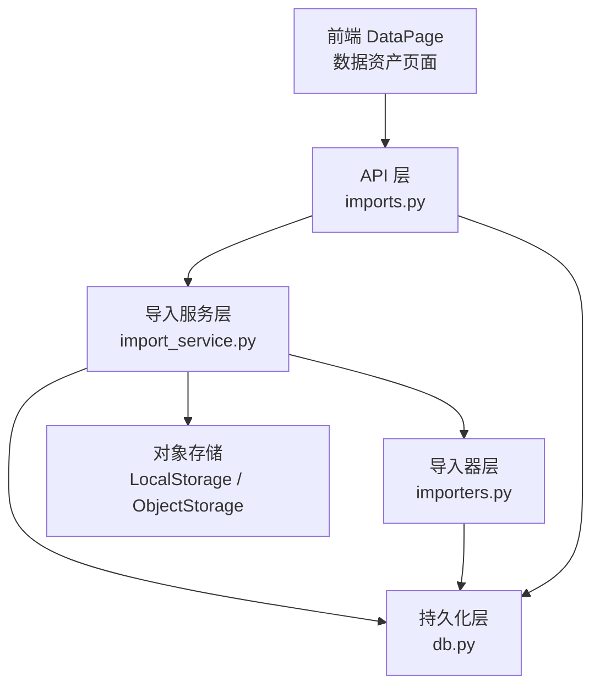
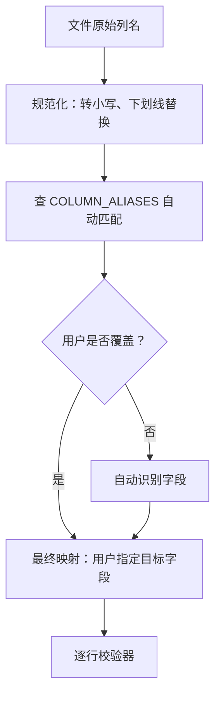
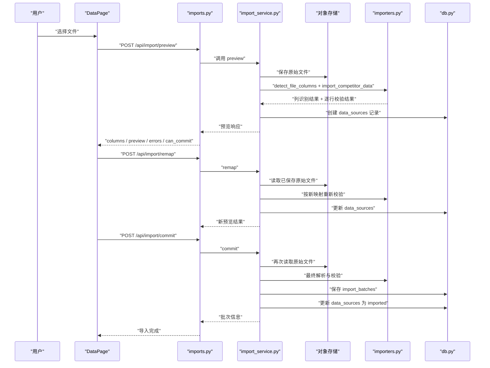
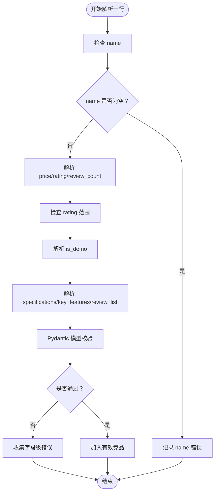
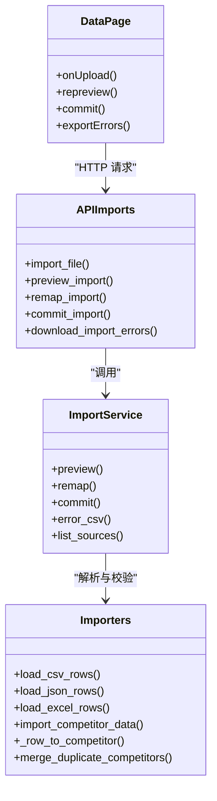
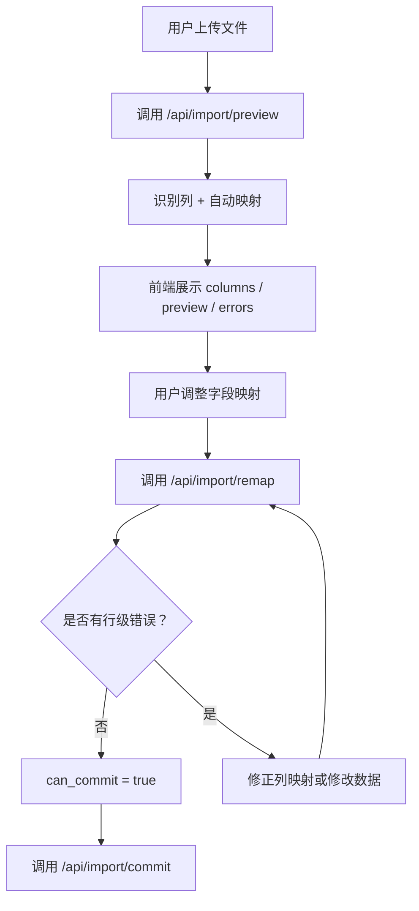
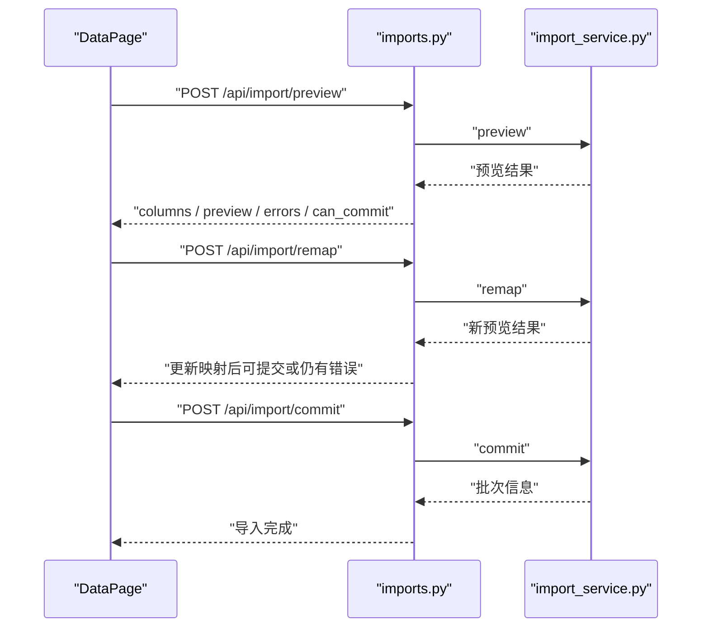
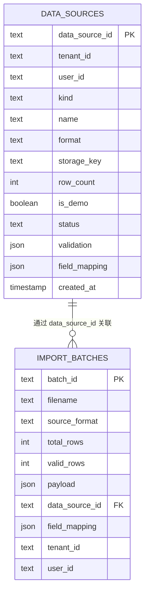
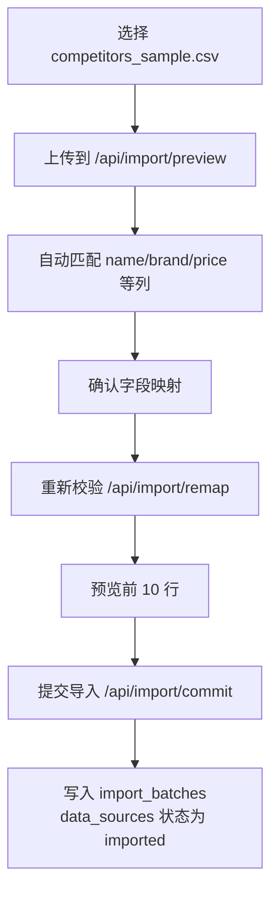

# 数据导入导出

<cite>
**本文引用的文件**   
- [imports.py](file://backend/surge/api/imports.py)
- [importers.py](file://backend/surge/ingest/importers.py)
- [import_service.py](file://backend/surge/services/import_service.py)
- [DataPage.tsx](file://frontend/src/features/data-assets/DataPage.tsx)
- [competitors_sample.csv](file://examples/competitors_sample.csv)
- [competitors_sample.json](file://examples/competitors_sample.json)
- [db.py](file://backend/surge/persistence/db.py)
</cite>

## 目录
1. [引言](#引言)
2. [项目结构与职责划分](#项目结构与职责划分)
3. [支持的格式与字段映射机制](#支持的格式与字段映射机制)
4. [导入生命周期：上传、解析、预览、提交、落盘](#导入生命周期上传解析预览提交落盘)
5. [逐行校验流程与错误分类](#逐行校验流程与错误分类)
6. [不同导入器的实现差异与扩展方式](#不同导入器的实现差异与扩展方式)
7. [预览能力与用户交互](#预览能力与用户交互)
8. [导出报告与错误下载](#导出报告与错误下载)
9. [前端 DataPage 与后端 API 的交互关系](#前端-datapage-与后端-api-的交互关系)
10. [持久化层与数据模型](#持久化层与数据模型)
11. [大文件与异常场景处理](#大文件与异常场景处理)
12. [完整示例：上传竞品 CSV → 字段映射确认 → 预览数据 → 导入完成](#完整示例上传竞品-csv--字段映射确认--预览数据--导入完成)
13. [故障排查清单](#故障排查清单)
14. [结论](#结论)

## 引言
本文件面向“数据导入导出”功能，覆盖以下目标：
- 说明支持的文件格式：**CSV、JSON、Excel（.xlsx）**。
- 解释字段映射机制、自动匹配策略和手动覆盖规则。
- 说明逐行校验流程、错误分类和用户提示方式。
- 描述文件上传、解析、预览、提交、落盘的完整生命周期。
- 说明导出报告的格式及触发方式。
- 分析后端 API、导入器、服务层、持久化层与前端 DataPage 的职责边界。
- 给出大文件和异常场景的处理建议。

该功能的核心思想是：**先预览、再确认、最后提交**。预览阶段只保存原始文件和列识别结果，不写入业务数据；只有用户确认字段映射且逐行校验通过后，才真正生成导入批次并更新数据源状态。

## 项目结构与职责划分
数据导入导出涉及四个主要层次：

| 层次 | 主要文件 | 职责 |
|---|---|---|
| API 层 | `backend/surge/api/imports.py` | 暴露 `/api/import`、`/api/import/preview`、`/api/import/remap`、`/api/import/commit`、数据源查询和错误 CSV 下载接口 |
| 导入器层 | `backend/surge/ingest/importers.py` | 解析 CSV/JSON/Excel、字段规范化、逐行校验、合并重复竞品、构造导入结果 |
| 导入服务层 | `backend/surge/services/import_service.py` | 管理两步导入流程：预览、重新映射、提交；负责原始文件落盘和导入批次落库 |
| 前端页面 | `frontend/src/features/data-assets/DataPage.tsx` | 文件选择、上传、字段映射、预览展示、错误导出、数据集列表 |
| 持久化层 | `backend/surge/persistence/db.py` | 提供 `data_sources`、`import_batches`、任务记录等数据库操作 |

**图示来源**
- [imports.py:1-286](file://backend/surge/api/imports.py#L1-L286)
- [import_service.py:1-348](file://backend/surge/services/import_service.py#L1-L348)
- [importers.py:1-779](file://backend/surge/ingest/importers.py#L1-L779)
- [DataPage.tsx:1-782](file://frontend/src/features/data-assets/DataPage.tsx#L1-L782)
- [db.py:1101-2273](file://backend/surge/persistence/db.py#L1101-L2273)

**章节来源**
- [imports.py:1-286](file://backend/surge/api/imports.py#L1-L286)
- [import_service.py:1-348](file://backend/surge/services/import_service.py#L1-L348)
- [importers.py:1-779](file://backend/surge/ingest/importers.py#L1-L779)
- [DataPage.tsx:1-782](file://frontend/src/features/data-assets/DataPage.tsx#L1-L782)
- [db.py:1101-2273](file://backend/surge/persistence/db.py#L1101-L2273)

## 支持的格式与字段映射机制

### 支持格式
| 格式 | 扩展名 | 解析入口 | 特殊行为 |
|---|---|---|---|
| CSV | `.csv` | `load_csv_rows` | 支持 UTF-8 BOM；表头为空行跳过；多评论列可合并为 `review_list` |
| JSON | `.json` | `load_json_rows` | 顶层数组或含 `competitors`/`products` 的对象；支持可选 `keywords` |
| Excel | `.xlsx` | `load_excel_rows` | 使用 openpyxl；需要二进制上传；密码保护文件会报错 |

CSV 示例来自仓库中的 `examples/competitors_sample.csv`，包含商品名称、品牌、ASIN、价格、币种、评分、评论数、卖点、规格、评论内容、评论星级、评论标题和示例标记。JSON 示例来自 `examples/competitors_sample.json`，结构更丰富，可直接表达竞品数组和关键词数组。

### 字段映射表结构
字段映射由三层组成：

1. **文件原始列名**：例如 CSV 表头 `name`、`商品名称`、`竞品名称`。
2. **规范化目标字段**：例如 `name`、`price`、`rating`、`review_count`、`key_features`、`specifications`、`is_demo`、`source_ref` 等。
3. **用户覆盖映射**：前端允许用户把某一列映射到目标字段，或选择“忽略此列”。

**图示来源**
- [importers.py:41-110](file://backend/surge/ingest/importers.py#L41-L110)
- [importers.py:120-200](file://backend/surge/ingest/importers.py#L120-L200)
- [DataPage.tsx:18-50](file://frontend/src/features/data-assets/DataPage.tsx#L18-L50)

### 自动匹配策略
- 列名先做规范化：去掉首尾空白、转为小写、空格和连字符统一为下划线。
- 若传入用户映射，则优先使用用户映射。
- 否则查 `COLUMN_ALIASES`，将多种中文、英文、简写列名归一为目标字段。
- 无法识别的列保留 `field=None`，前端显示为“需映射”，不会自动丢弃。

必要字段方面，系统要求至少存在一个能映射到 `name` 的列；其他字段多为非必填，缺失时保持空值。

**章节来源**
- [importers.py:41-110](file://backend/surge/ingest/importers.py#L41-L110)
- [importers.py:120-200](file://backend/surge/ingest/importers.py#L120-L200)
- [DataPage.tsx:18-50](file://frontend/src/features/data-assets/DataPage.tsx#L18-L50)

## 导入生命周期：上传、解析、预览、提交、落盘

### 整体流程

**图示来源**
- [imports.py:60-286](file://backend/surge/api/imports.py#L60-L286)
- [import_service.py:60-348](file://backend/surge/services/import_service.py#L60-L348)
- [importers.py:680-779](file://backend/surge/ingest/importers.py#L680-L779)

### 关键节点说明
| 阶段 | 行为 | 是否写业务数据 |
|---|---|---|
| 上传预览 | 保存原始文件、识别列、校验前 10 行 | 不写业务数据，只写 `data_sources` |
| 重新映射 | 用新字段映射重新校验 | 不写业务数据，更新 `data_sources` |
| 提交导入 | 从存储读取原始文件、最终解析、写入批次 | 写 `import_batches` 和 `data_sources` |
| 错误下载 | 根据 `data_sources.validation.errors` 生成 CSV | 仅读取已有错误 |

**章节来源**
- [imports.py:60-286](file://backend/surge/api/imports.py#L60-L286)
- [import_service.py:60-348](file://backend/surge/services/import_service.py#L60-L348)

## 逐行校验流程与错误分类

### 校验范围
逐行校验针对每个竞品行，核心包括：
- 必填字段：`name` 不能为空。
- 数值字段：`price`、`rating`、`review_count` 必须可解析为数字。
- 取值范围：`rating` 必须在 0.0 到 5.0 之间。
- 布尔字段：`is_demo` 支持常见真值/假值写法。
- 复杂字段：`specifications`、`key_features`、`review_list`。
- 模型约束：最终通过 Pydantic 模型校验。

**图示来源**
- [importers.py:240-400](file://backend/surge/ingest/importers.py#L240-L400)

### 错误分类
错误主要分为以下几类：

| 类别 | 典型场景 | 错误定位 | 用户提示 |
|---|---|---|---|
| 文件格式错误 | JSON 语法错误、不支持的扩展名、Excel 打不开 | 第 1 行、file 字段 | 明确说明文件格式问题 |
| 列定义错误 | CSV/Excel 缺少必需列 name、重复列 | 第 1 行、header/name 字段 | 列出可用列名 |
| 字段类型错误 | 价格不是数字、评分超出范围 | 具体行号 + 字段名 | 给出原值和原因 |
| 模型校验错误 | 结构不符合 `CompetitorProduct` | 路径字段，如 `reviews[0].text` | 使用人类可读消息 |
| 业务限制错误 | 评论样本超过上限 | review_list | 截断并警告 |
| 重复行合并 | 同一 ASIN 或名称出现多次 | warnings | 提示已合并 |

所有行级错误都携带 `row`、`field`、`message`、`value`，便于前端表格展示和 CSV 导出。

**章节来源**
- [importers.py:110-200](file://backend/surge/ingest/importers.py#L110-L200)
- [importers.py:240-400](file://backend/surge/ingest/importers.py#L240-L400)
- [importers.py:680-779](file://backend/surge/ingest/importers.py#L680-L779)

## 不同导入器的实现差异与扩展方式

### CSV 导入器
- 使用 Python 标准库 `csv.DictReader`。
- 自动去除 UTF-8 BOM。
- 支持多列合并到 `key_features`、`review_text`、`review_rating`、`review_title`、`review_date`。
- 如果未映射到 `name`，直接抛出结构化错误，而不是静默失败。
- 空行会被跳过，但整表无数据行时会报错。

### JSON 导入器
- 支持两种根结构：
  - 顶层数组：直接作为竞品列表。
  - 顶层对象：从 `competitors` 或 `products` 取竞品，从 `keywords` 取关键词。
- 对 `key_features` 兼容字符串和数组。
- 对 `specifications` 直接透传。
- 对 `reviews` 或 `review_list` 直接映射为评论列表。
- 对 `keywords` 支持字符串或对象；对象字段通过 `KEYWORD_ALIASES` 映射。

### Excel 导入器
- 使用 openpyxl，以只读模式打开工作簿。
- 首行作为表头，后续每行视为一条竞品。
- 目前对 Excel 的支持比 CSV/JSON 简单：主要支持通用列和 `key_features`、`review_text`。
- 如果环境未安装 openpyxl，返回明确的安装提示。

### 扩展方式
要新增一种导入格式，推荐遵循现有模式：
1. 在导入器层新增解析函数，例如 `load_xxx_rows`。
2. 将中间行标准化为目标字段集合。
3. 在 `import_competitor_data` 中按扩展名分派。
4. 在 `detect_file_columns` 中增加列识别逻辑。
5. 在前端 `TARGET_FIELDS` 中补充目标字段。
6. 在 API 层增加必要的权限校验和任务记录。

**图示来源**
- [importers.py:1-779](file://backend/surge/ingest/importers.py#L1-L779)
- [import_service.py:1-348](file://backend/surge/services/import_service.py#L1-L348)
- [imports.py:1-286](file://backend/surge/api/imports.py#L1-L286)
- [DataPage.tsx:1-782](file://frontend/src/features/data-assets/DataPage.tsx#L1-L782)

**章节来源**
- [importers.py:201-500](file://backend/surge/ingest/importers.py#L201-L500)
- [importers.py:501-779](file://backend/surge/ingest/importers.py#L501-L779)

## 预览能力与用户交互

预览阶段返回以下关键信息：
- `data_source_id`：本次上传的数据源标识。
- `status`：`needs_mapping`、`validated`、`rejected`。
- `columns`：文件列及其自动识别结果。
- `field_mapping`：当前字段映射。
- `total_rows`：总行数。
- `valid_rows`：有效竞品数。
- `preview`：最多 10 条已解析竞品。
- `errors`：逐行错误。
- `warnings`：警告信息。
- `can_commit`：是否存在行级错误或映射不完整。

前端 DataPage 将这些信息渲染为：
- 五步工序条：选文件、上传校验、字段映射、逐行校验、入库确认。
- 结果卡片：文件名、格式、总行数、有效竞品、错误行、识别字段。
- 数据预览表格：名称、价格、评论样本数、来源。
- 逐行错误表格：行、字段、原因、原值。
- 字段映射面板：每列下拉选择目标字段。

**图示来源**
- [import_service.py:60-180](file://backend/surge/services/import_service.py#L60-L180)
- [DataPage.tsx:50-638](file://frontend/src/features/data-assets/DataPage.tsx#L50-L638)

**章节来源**
- [import_service.py:60-180](file://backend/surge/services/import_service.py#L60-L180)
- [DataPage.tsx:50-638](file://frontend/src/features/data-assets/DataPage.tsx#L50-L638)

## 导出报告与错误下载

### 错误 CSV 下载
系统提供专门的错误 CSV 下载接口：`GET /api/data-sources/{data_source_id}/errors.csv`。

该接口：
- 校验租户权限和数据源存在性。
- 从 `data_sources.validation.errors` 中提取错误。
- 输出带 BOM 的 UTF-8 CSV，方便 Excel 直接打开。
- 列顺序为：`row`、`field`、`message`、`value`。

前端 DataPage 也实现了本地错误导出：当后端返回错误列表时，可在浏览器内生成 `import-errors.csv`，无需额外请求。

### 导出报告格式
当前仓库中“导入导出”相关的主要导出形式是：
- **错误 CSV**：用于逐行定位问题。
- **预览 JSON**：API 返回的预览结构，供前端渲染。
- **导入批次 payload**：持久化层保存的完整导入结果，包含 `competitors`、`keywords`、`errors`、`warnings` 等。

仓库中没有独立的“分析报告导出为 md/json/csv”的业务导出接口；如需导出分析报告，应基于 `ImportResult.as_dict()` 或 `import_result_to_request_payload()` 的结果扩展新的导出接口。

**章节来源**
- [imports.py:230-286](file://backend/surge/api/imports.py#L230-L286)
- [import_service.py:320-348](file://backend/surge/services/import_service.py#L320-L348)
- [DataPage.tsx:201-240](file://frontend/src/features/data-assets/DataPage.tsx#L201-L240)
- [importers.py:160-200](file://backend/surge/ingest/importers.py#L160-L200)

## 前端 DataPage 与后端 API 的交互关系

### API 路由与职责
| 路由 | 方法 | 职责 |
|---|---|---|
| `/api/import` | POST | 一步导入，适合脚本或旧调用方 |
| `/api/import/preview` | POST | 上传文件、保存原始数据、识别列、逐行校验、返回预览 |
| `/api/import/remap` | POST | 使用新字段映射重新校验，不重传文件 |
| `/api/import/commit` | POST | 按映射写入批次，更新数据源状态 |
| `/api/data-sources` | GET | 列出数据源 |
| `/api/data-sources/{id}` | GET | 查询单个数据源 |
| `/api/data-sources/{id}/errors.csv` | GET | 下载错误 CSV |

### DataPage 交互要点
- 上传后调用 `/api/import/preview`，并把返回结果保存到本地状态。
- 用户修改字段映射后，调用 `/api/import/remap` 重新校验。
- 点击“提交导入”时调用 `/api/import/commit`。
- 有错误时提供“下载错误 CSV”按钮。
- 页面加载时拉取最近 10 个数据源，展示名称、记录数、更新时间、数据来源、状态。
- 导入成功后提供跳转到工作台的入口，以便在 AI 助手中使用该批次数据。

**图示来源**
- [imports.py:60-286](file://backend/surge/api/imports.py#L60-L286)
- [import_service.py:60-348](file://backend/surge/services/import_service.py#L60-L348)
- [DataPage.tsx:50-638](file://frontend/src/features/data-assets/DataPage.tsx#L50-L638)

**章节来源**
- [imports.py:60-286](file://backend/surge/api/imports.py#L60-L286)
- [DataPage.tsx:50-638](file://frontend/src/features/data-assets/DataPage.tsx#L50-L638)

## 持久化层与数据模型

### 主要表
- `data_sources`：记录每次上传的数据源，包括租户、用户、文件名、格式、存储键、行数、状态、字段映射、验证结果、时间戳。
- `import_batches`：记录成功提交的导入批次，包含文件名、格式、总行数、有效行数、payload、数据源 ID、字段映射。
- `tasks` 和 `task_steps`：记录导入任务的执行步骤，便于追踪上传、解析、保存等过程。

### 关键字段
| 表 | 关键字段 | 用途 |
|---|---|---|
| `data_sources` | `data_source_id`、`tenant_id`、`storage_key`、`status`、`validation` | 跟踪预览和重新映射状态 |
| `import_batches` | `batch_id`、`payload`、`data_source_id`、`field_mapping` | 保存实际导入结果 |
| `tasks` | `task_id`、`kind`、`origin`、`payload` | 记录导入任务上下文 |

**图示来源**
- [db.py:2222-2273](file://backend/surge/persistence/db.py#L2222-L2273)
- [db.py:1101-1109](file://backend/surge/persistence/db.py#L1101-L1109)

**章节来源**
- [db.py:1101-1109](file://backend/surge/persistence/db.py#L1101-L1109)
- [db.py:2222-2273](file://backend/surge/persistence/db.py#L2222-L2273)

## 大文件与异常场景处理

### 文件大小限制
API 层在一步导入和预览接口中都检查文件大小：
- 超过配置上限返回 413。
- 空文件返回 422。
- 正常流程继续读取并交给导入器。

### 编码异常
- CSV/JSON 文本内容使用 UTF-8-SIG 解码，以兼容带 BOM 的 Excel 导出文件。
- 非 UTF-8 文件会返回明确的编码错误提示。

### Excel 依赖
- Excel 解析依赖 openpyxl。
- 如果运行环境未安装，导入器会抛出明确错误，提示安装命令。
- 预览阶段的 Excel 打开失败会返回“打不开”的可操作错误。

### 权限与租户隔离
- 导入接口要求写权限。
- 数据源查询接口要求读权限。
- 所有数据库操作均附带 `tenant_id`，避免跨租户访问。

### 重复提交保护
- 数据源一旦状态变为 `imported`，再次预览、重新映射或提交都会拒绝。
- 这防止同一个原始数据源被重复导入。

### 内存与性能建议
- 预览只返回前 10 行，避免前端渲染大量数据。
- 解析 CSV/JSON/Excel 时使用流式迭代器（如 Excel 的只读迭代）。
- 对于超大文件，建议：
  - 调大服务器上传大小限制前先评估内存。
  - 使用异步任务队列记录长耗时导入。
  - 分批写入数据库，避免单次事务过大。
  - 对预览和错误导出做分页或流式下载。

**章节来源**
- [imports.py:40-120](file://backend/surge/api/imports.py#L40-L120)
- [importers.py:201-240](file://backend/surge/ingest/importers.py#L201-L240)
- [importers.py:501-620](file://backend/surge/ingest/importers.py#L501-L620)
- [import_service.py:60-180](file://backend/surge/services/import_service.py#L60-L180)

## 完整示例：上传竞品 CSV → 字段映射确认 → 预览数据 → 导入完成

### 输入数据
以 `examples/competitors_sample.csv` 为例，该文件包含：
- 商品名称：`Demo Bottle A`、`Demo Tumbler B`。
- 品牌：`DemoBrandA`、`DemoBrandB`。
- ASIN：`DEMO-0001`、`DEMO-0002`。
- 价格：`19.99`、`29.50`。
- 币种：`USD`。
- 评分：`4.2`、`4.5`。
- 评论数：`120`、`80`。
- 卖点：管道符分隔的多条卖点。
- 规格：冒号分隔的键值对。
- 评论内容、评论星级、评论标题。
- `is_demo=true`，表示示例数据。

### 步骤一：上传并预览
用户在 DataPage 中选择 CSV 文件后，前端调用 `/api/import/preview`。后端：
1. 保存原始文件到对象存储。
2. 识别 CSV 表头。
3. 使用 `COLUMN_ALIASES` 自动匹配列。
4. 调用 `import_competitor_data` 进行逐行校验。
5. 返回列信息、前 10 行预览、错误列表和 `can_commit`。

### 步骤二：确认字段映射
如果某些列未被自动识别，前端显示“需映射”，用户在下拉框中选择目标字段。例如：
- 把 `name` 映射到 `商品名称`。
- 把 `price` 映射到 `价格`。
- 把 `review_text` 映射到 `评论内容`。
- 把 `is_demo` 映射到 `是否为示例数据`。

用户确认后点击“用新映射重新校验”，前端调用 `/api/import/remap`。后端重新解析文件并校验，更新 `data_sources` 的状态和验证结果。

### 步骤三：预览数据
预览区域显示：
- 文件名、格式、总行数。
- 有效竞品数量。
- 错误行数量。
- 识别字段数量。
- 前几条竞品的名称、价格、评论样本数、来源。
- 逐行错误表格（如有）。
- 警告信息（如重复行合并、关键词指标缺失）。

### 步骤四：提交导入
当 `can_commit` 为真时，用户点击“提交导入”。后端：
1. 校验数据源存在且未提交过。
2. 从对象存储读取原始文件。
3. 使用最终字段映射重新解析。
4. 如果没有行级错误，生成 `batch_id`。
5. 保存 `import_batches`。
6. 更新 `data_sources` 状态为 `imported`。
7. 返回批次信息和任务 ID。

前端更新状态为“已提交”，并显示导入完成的统计信息。

**图示来源**
- [DataPage.tsx:50-638](file://frontend/src/features/data-assets/DataPage.tsx#L50-L638)
- [imports.py:60-286](file://backend/surge/api/imports.py#L60-L286)
- [import_service.py:60-348](file://backend/surge/services/import_service.py#L60-L348)
- [competitors_sample.csv:1-5](file://examples/competitors_sample.csv#L1-L5)

**章节来源**
- [competitors_sample.csv:1-5](file://examples/competitors_sample.csv#L1-L5)
- [competitors_sample.json:1-43](file://examples/competitors_sample.json#L1-L43)
- [DataPage.tsx:50-638](file://frontend/src/features/data-assets/DataPage.tsx#L50-L638)
- [imports.py:60-286](file://backend/surge/api/imports.py#L60-L286)
- [import_service.py:60-348](file://backend/surge/services/import_service.py#L60-L348)

## 故障排查清单

| 现象 | 可能原因 | 排查位置 | 处理建议 |
|---|---|---|---|
| 上传后立即报错“文件超过上传上限” | 文件大于 `max_upload_bytes` | API 层 | 压缩文件或调整配置 |
| JSON 报格式错误 | JSON 括号、引号、逗号不完整 | JSON 解析器 | 修复 JSON 语法 |
| CSV 报缺少必需列 name | 表头没有能映射到 `name` 的列 | CSV 解析器 | 添加 name 列或使用正确别名 |
| Excel 打不开 | 文件损坏、密码保护、openpyxl 未安装 | Excel 解析器 | 取消密码保护、安装 openpyxl |
| 有行级错误但不能提交 | 存在 price/rating/review_count/is_demo 等错误 | 逐行校验器 | 修正数据或修正字段映射 |
| 导入完成后仍看到“需检查” | 历史数据源状态未刷新 | 前端状态 | 刷新数据源列表 |
| 重复提交被拒绝 | 数据源状态已是 `imported` | 提交服务 | 重新上传新文件 |
| 错误 CSV 打开乱码 | 未使用带 BOM 的 UTF-8 | 错误导出 | 使用后端错误 CSV 或前端带 BOM 导出 |
| 关键词报告不计算机会分 | 关键词缺少搜索量或排名 | 关键词构建器 | 补充指标或接受纯关键词报告 |

**章节来源**
- [imports.py:40-120](file://backend/surge/api/imports.py#L40-L120)
- [importers.py:201-500](file://backend/surge/ingest/importers.py#L201-L500)
- [importers.py:680-779](file://backend/surge/ingest/importers.py#L680-L779)
- [import_service.py:320-348](file://backend/surge/services/import_service.py#L320-L348)

## 结论
数据导入导出功能采用清晰的四层架构：API 层负责接口和权限，导入服务层负责两步流程和原始文件落盘，导入器层负责格式解析与逐行校验，前端 DataPage 负责用户交互与可视化。其设计优势在于：
- 预览阶段不写业务数据，降低脏数据风险。
- 字段映射支持自动识别和手动覆盖，适配中英文、自定义表头。
- 错误始终定位到“行 + 字段”，并提供 CSV 下载。
- 提交阶段严格校验，禁止重复导入。
- 支持 CSV、JSON、Excel 三种主流格式，便于竞品数据批量接入。

未来可扩展的方向包括：
- 增加更多文件格式或模板导入。
- 增加分析报告导出接口（md/json/csv）。
- 对超大文件引入分片上传和异步导入任务。
- 增加字段映射模板保存和复用。
- 增加导入结果的历史版本对比。