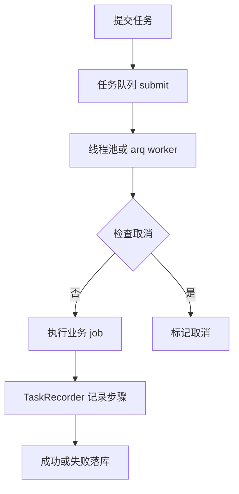
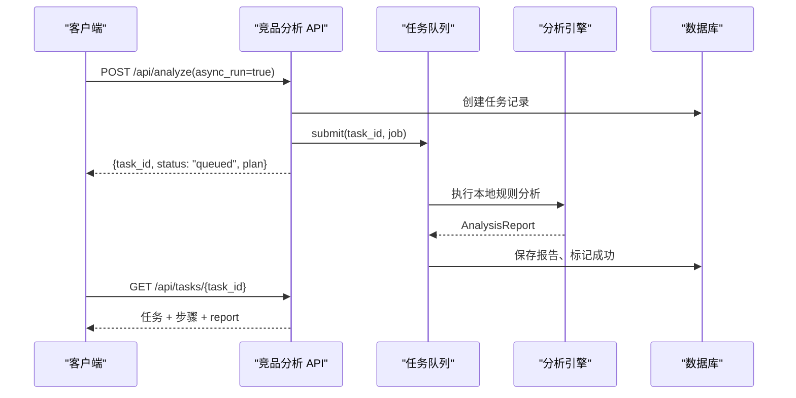
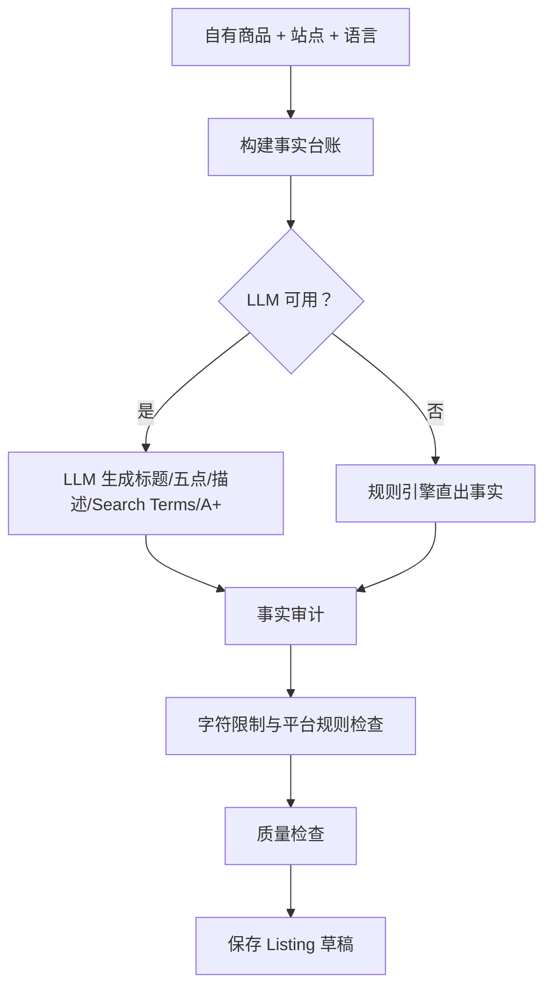
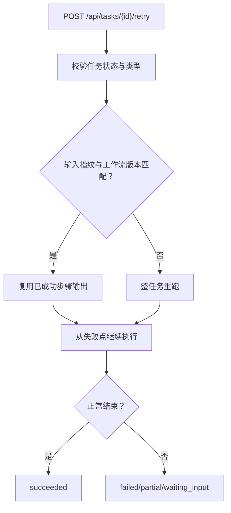
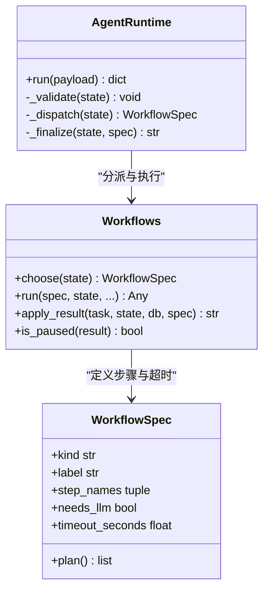
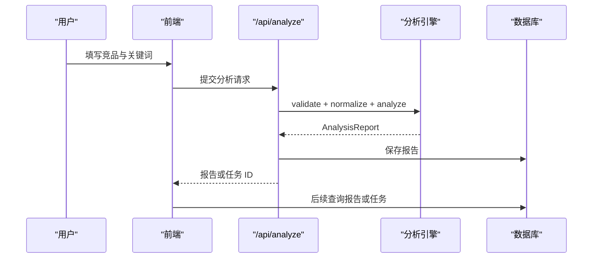
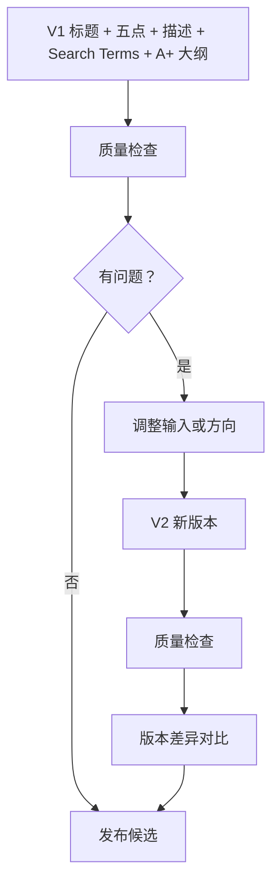
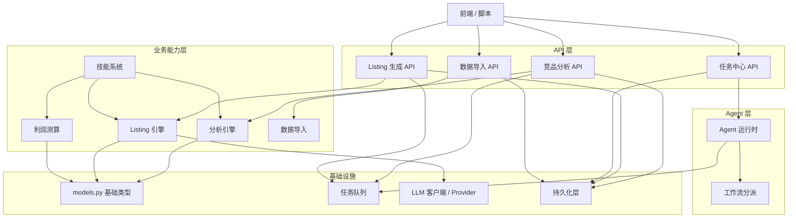

# 核心功能

<cite>
**本文引用的文件**   
- [models.py](file://backend/surge/models.py)
- [analyses.py](file://backend/surge/api/analyses.py)
- [listings.py](file://backend/surge/api/listings.py)
- [tasks.py](file://backend/surge/api/tasks.py)
- [queue.py](file://backend/surge/services/queue.py)
- [analysis.py](file://backend/surge/engine/analysis.py)
- [listing.py](file://backend/surge/engine/listing.py)
- [listing_llm.py](file://backend/surge/engine/listing_llm.py)
- [imports.py](file://backend/surge/api/imports.py)
- [import_service.py](file://backend/surge/services/import_service.py)
- [workflows.py](file://backend/surge/agent/workflows.py)
- [runtime.py](file://backend/surge/agent/runtime.py)
- [schemas.py](file://backend/surge/agent/schemas.py)
- [loader.py](file://backend/surge/skills/loader.py)
- [executors.py](file://backend/surge/skills/executors.py)
- [profit.py](file://backend/surge/engine/profit.py)
</cite>

## 目录
1. [总览](#总览)
2. [共同数据与依赖](#共同数据与依赖)
3. [竞品分析](#竞品分析)
4. [Listing 生成](#listing-生成)
5. [数据导入导出](#数据导入导出)
6. [任务管理](#任务管理)
7. [Agent 工作流](#agent-工作流)
8. [技能系统与店铺经营](#技能系统与店铺经营)
9. [典型用户工作流](#典型用户工作流)
10. [架构总图](#架构总图)
11. [性能与可靠性约束](#性能与可靠性约束)
12. [常见问题排查](#常见问题排查)
13. [结论](#结论)

## 总览
Surge 的核心能力围绕跨境电商运营中的“数据 → 分析 → 文案 → 执行”展开：

| 能力 | 输入 | 主要处理阶段 | 输出位置 | 是否支持异步 |
|---|---|---|---|---|
| 竞品分析 | 商品名、平台、站点、竞品列表、关键词、自有规格 | 输入校验、数据规范化、价格统计、评论洞察、关键词机会分、差异化对比、结构化报告 | 分析报告表，任务结果块附带 `report` | 是，前端通过任务队列轮询 |
| Listing 生成 | 自有商品信息、目标语言、站点、可选关联分析报告 | 事实台账构建、LLM 或规则引擎生成标题/五点/描述/Search Terms/A+ 大纲、事实审计、字符限制检查、质量检查 | Listing 草稿表，任务结果块附带 `listing` | 是，前端唯一路径；同步路径仅用于脚本和降级测试 |
| 数据导入导出 | CSV/Excel 文件、字段映射 | 列识别、逐行校验、预览、提交、错误定位与下载 | 数据源记录、导入批次、错误 CSV | 一步导入同步；两步预览不写业务数据，提交可结合任务记录 |
| 任务管理 | 任务 ID | 查询、步骤时间线、结果聚合、取消、重试（断点复用） | 任务表、步骤表、结果 JSON、关联 report/listing | 是，统一由任务中心暴露 |
| Agent 工作流 | 自然语言目标或结构化参数 | 校验、路由到竞品分析子图或组合子图、中断确认、恢复续跑 | 任务状态、`pending` 待确认内容、计划骨架 | 是 |
| 技能系统 | SKILL.md + executor + output.schema.json | 目录加载、输入模型校验、executor 调用、产出 schema 校验 | 技能运行结果、渲染器、示例标记 | 可异步 |
| 店铺经营 | 售价、成本、佣金、退货率、履约方式等 | 单件经济模型、盈亏平衡、定价反算、敏感性分析 | 利润测算结果 | 通常同步；技能中可通过任务队列封装 |

所有能力共享以下基础设施：
- `models.py` 的基础数据类型，如 `CompetitorProduct`、`KeywordMetric`、`EvidenceKind`、`QualityIssue`、`ListingDraft`。
- `ApiContext` 提供的依赖注入：数据库、存储、LLM 客户端、模型配置、设置、审计、速率限制、任务队列。
- 任务队列抽象 `TaskQueue`，默认线程池实现，可选 arq 后端。
- LLM 客户端与 Provider 抽象，失败时按策略降级为规则引擎。
- 持久化层负责任务、步骤、报告、Listing、数据源、秘密等落库。

**章节来源**
- [models.py:1-120](file://backend/surge/models.py#L1-L120)
- [queue.py:1-40](file://backend/surge/services/queue.py#L1-L40)

## 共同数据与依赖
### 基础数据类型
`models.py` 定义跨模块复用的 Pydantic 模型，承担三件事：对外接口契约、输入校验、领域实体结构。

| 类型 | 用途 | 关键约束 |
|---|---|---|
| `Platform` | 销售平台枚举 | 出现在接口文档与表单提示中 |
| `EvidenceKind` | 结论证据性质 | 只能取 `fact` / `statistic` / `inference` / `assumption` |
| `Severity` / `IssueCode` | 质检问题等级与代码 | 用于 Listing 质量检查 |
| `CompetitorProduct` | 竞品商品 | 名称必填、价格非负、卖点按 `\|` 或换行拆分、图片不计入完整度 |
| `ReviewSample` | 评论样本 | 评论内容必填且清洗空白 |
| `KeywordMetric` | 关键词指标 | 搜索量、排名、相关性、竞争度、转化率全部可选，缺值不得编造 |
| `ListingDraft` / `QualityCheck` | Listing 草稿与质检 | 包含待确认项、问题列表、长度分段、来源追踪 |

这些模型不是纯 DTO：它们用 `Field`、`field_validator`、`model_validator` 做字段级约束，例如评论不能为空、关键词不能为空、价格必须非负。

**章节来源**
- [models.py:1-200](file://backend/surge/models.py#L1-L200)

### ApiContext 与依赖注入
API 层通过 FastAPI 的 `Depends` 获取 `ApiContext`，它把以下依赖集中起来：
- 数据库访问：保存报告、保存 Listing、读取任务、列出报告、保存导入批次等。
- 存储：上传原始导入文件、读取已保存文件。
- LLM 客户端与 Provider：解析模型配置、选择 provider、构造 client。
- 设置：速率限制、是否强制同步任务、最大上传大小、引擎版本。
- 审计：记录用户操作、任务运行、取消。
- 任务队列：提交后台 job、取消任务。
- 模型服务：按用户和设置决定生效的模型配置。

这种设计让 API 只负责鉴权、限流、请求建模、错误转换和任务编排，真实业务逻辑下沉到 engine、services、agent、skills 层。

**章节来源**
- [analyses.py:1-60](file://backend/surge/api/analyses.py#L1-L60)
- [listings.py:1-40](file://backend/surge/api/listings.py#L1-L40)

### 任务队列
`queue.py` 定义 `TaskQueue` 协议，包含 `submit`、`cancel`、`is_active`、`is_cancelled`、`shutdown`。当前有两个实现：

| 后端 | 行为 | 适用场景 |
|---|---|---|
| 线程池 `ThreadTaskQueue` | 进程内线程执行，每个任务一个取消事件，按槽位限制并发 | 默认实现，单机、免费实例、测试 |
| arq 后端 | 把 task_id 投递给独立 worker 进程，依赖 Redis | 扩展部署，需要外部消息队列 |

取消语义是“检查点取消”：任务不会打断已经发出的 LLM 请求，而是在当前步骤结束后检查取消标志，避免状态不一致。

**图表来源**
- [queue.py:40-160](file://backend/surge/services/queue.py#L40-L160)
- [analyses.py:70-140](file://backend/surge/api/analyses.py#L70-L140)
- [listings.py:60-130](file://backend/surge/api/listings.py#L60-L130)

**章节来源**
- [queue.py:1-200](file://backend/surge/services/queue.py#L1-L200)

## 竞品分析
### 输入
- 商品名
- 平台与站点
- 竞品列表：名称、品牌、ASIN、价格、评分、评论数、类目、核心卖点、规格、评论样本、图片来源、数据来源
- 关键词及可选指标：搜索量、排名、相关性、竞争度、转化率
- 自有商品规格、卖点、认证、价格、目标人群
- 数据来源标识

### 处理阶段
1. **输入校验**：至少一个竞品；评论文本非空；同名竞品警告；无评论样本时给出警告；关键词无指标时不做机会打分。
2. **数据规范化**：清洗卖点、规格、评论文本；去重关键词；保留首个重复项并提示。
3. **价格统计与差异分析**：基于真实价格计算均值、中位数、价差；缺失价格的竞品被排除在价格分析外。
4. **评论洞察**：高频需求、痛点、负面反馈、购买顾虑；带证据引用。
5. **关键词机会分**：仅在存在搜索量/排名等指标时计算，没有数据则输出“无数据”，不编数字。
6. **差异化对比**：自有商品与竞品在卖点、价格、规格上的差异。
7. **结构化报告**：组装 `AnalysisReport`，每条结论标注 `EvidenceKind`。

### 输出
- 同步返回 `AnalysisResponse`，含报告、持久化标记、耗时、任务 ID。
- 异步返回 `{task_id, status: "queued", plan}`，最终结果从任务详情取得。
- 报告保存到数据库，并写入任务步骤。

### 异步执行
当 `async_run=true` 且未强制同步时，API 立即创建任务、进入队列；后台 job 执行本地确定性分析并保存报告。由于分析本身不调 LLM，同步与异步路径结果一致。Provider 不可用时，同步路径会尝试构造 Provider 并捕获 `ProviderError`，转为 503 或可读 502。

**图表来源**
- [analyses.py:60-200](file://backend/surge/api/analyses.py#L60-L200)
- [analysis.py:1-80](file://backend/surge/engine/analysis.py#L1-L80)

**章节来源**
- [analyses.py:1-200](file://backend/surge/api/analyses.py#L1-L200)
- [analysis.py:1-200](file://backend/surge/engine/analysis.py#L1-L200)

## Listing 生成
### 输入
- 自有商品：名称、品牌、类目、规格、卖点、材质、认证、价格、币种、目标人群
- 目标语言与站点
- 可选关联分析报告 ID 或分析报告 payload
- 关键词

### 处理阶段
1. **读取关联报告**：若提供 `analysis_report_id`，从数据库读取；不存在则 404。
2. **事实台账构建**：从自有商品抽取事实，缺失关键字段进入 `pending_confirmations`，绝不自动补全。
3. **LLM 生成或规则降级**：优先使用 LLM 生成标题、五点、描述、Search Terms、A+ 大纲；Provider 不可用时退回规则引擎，并在结果中标注实际引擎。
4. **事实审计**：检查模型输出是否越出事实边界，包括数字、认证、功效、绝对化表述、促销词。
5. **字符限制检查**：按站点规则对标题、五点、描述做字符长度裁剪或标记。
6. **质量检查**：生成 `QualityCheck`，包含问题代码、严重级别、待确认项。
7. **持久化**：将 Listing 草稿与请求快照保存到数据库。

### 输出
- 同步返回 `ListingResponse`，含 Listing、持久化标记、耗时、任务 ID。
- 异步返回 `{task_id, status: "queued", plan, engine}`，最终结果从任务详情取得。
- 任务结果中包含 `listing_id`、`quality_passed`、问题数量、待确认数量、实际引擎。

### 版本链
Listing 生成不是覆盖式更新，而是“版本链”：每次生成产生新的 Listing 草稿，前端可查看历史、比较差异、复检。这与竞品分析报告的持久化形成上下游关系：分析报告可作为 Listing 的事实依据。

**图表来源**
- [listings.py:40-200](file://backend/surge/api/listings.py#L40-L200)
- [listing.py:1-120](file://backend/surge/engine/listing.py#L1-L120)
- [listing_llm.py:1-80](file://backend/surge/engine/listing_llm.py#L1-L80)

**章节来源**
- [listings.py:1-200](file://backend/surge/api/listings.py#L1-L200)
- [listing.py:1-200](file://backend/surge/engine/listing.py#L1-L200)
- [listing_llm.py:1-200](file://backend/surge/engine/listing_llm.py#L1-L200)

## 数据导入导出
### 两种路径
- **一步导入**：上传文件后直接解析、校验、保存导入批次，适合脚本或旧调用方。
- **两步导入**：先预览列识别、字段映射、前 10 行预览与逐行错误；确认后再提交。这是页面实际使用的路径。

### 处理阶段
1. **文件读取与大小限制**：超过 `max_upload_bytes` 返回 413。
2. **列识别**：检测 CSV/Excel 列名与编码。
3. **字段映射**：允许用户把原始列映射到标准字段。
4. **逐行校验**：每行都有行号、字段、错误信息，可导出错误 CSV。
5. **预览状态**：`needs_mapping`、`validated`、`rejected`、`imported`。
6. **提交规则**：只要有行级错误就不允许提交；已提交的数据源不允许重复提交。
7. **持久化**：原始文件存入对象存储，元数据与校验结果写入数据库。

### 输入与输出
| 阶段 | 输入 | 输出 |
|---|---|---|
| 预览 | 文件、可选字段映射 | 列、映射、预览、错误、警告、是否可提交 |
| 重新映射 | 已上传数据源、新映射 | 重新校验后的预览 |
| 提交 | 数据源 ID、映射 | 导入批次、有效行数、错误数 |
| 一步导入 | 文件 | 批次 ID、行列统计、错误列表 |

**章节来源**
- [imports.py:1-200](file://backend/surge/api/imports.py#L1-L200)
- [import_service.py:1-200](file://backend/surge/services/import_service.py#L1-L200)

## 任务管理
任务中心是 Surges 所有长耗时能力的统一入口之一，职责包括：
- 列出任务，支持按状态、关键词过滤。
- 获取任务详情：包含 `plan`、`summary`、`checks`、`quality`、`degraded`、`engine`、`report`、`listing`、`skill`、`pending`。
- 取消任务：running 任务先进入 `cancelling`，下一个检查点落终态。
- 重试任务：仅支持 Agent 工作流任务；支持断点续跑，复用已成功步骤的输出。

### 断点续跑
重试时：
- 新建任务，`retry_of` 指向原任务。
- 若 `resume=true`，复用原任务已成功步骤的输出，但会校验输入指纹和工作流版本。
- 若 `resume=false`，从头重跑。
- 可补充或修改资料类字段；改了资料会导致指纹变化，不再复用旧中间结果。

**图表来源**
- [tasks.py:1-200](file://backend/surge/api/tasks.py#L1-L200)
- [workflows.py:1-120](file://backend/surge/agent/workflows.py#L1-L120)

**章节来源**
- [tasks.py:1-200](file://backend/surge/api/tasks.py#L1-L200)

## Agent 工作流
### 工作流类型
Agent 工作流主图只做三件事：校验、分派、收尾。真实业务在子图中：

| 类型 | 触发条件 | 说明 |
|---|---|---|
| 竞品分析 | `with_listing=false` | 独立竞品分析路径 |
| 组合工作流 | `with_listing=true` | 竞品分析 → 部分确认 → Listing 生成 |
| Listing 生成 | `listing_only=true` | 不要求竞品，直接用商品事实写文案 |

### 分派策略
分派发生在“图级”，而不是某个节点内部。原因是 LangGraph 恢复时会从头重放到中断点，如果把带中断的组合子图当普通节点，父图的校验与分析会重复执行，既违反“恢复不重复执行竞品分析”，也可能导致 LLM 费用重复支付。

### 生命周期
- 校验：检查商品名、竞品（非 listing_only 模式）。
- 分派：选择工作流规格，记录步骤。
- 执行：调用具体子图。
- 收尾：根据结局写入任务状态；暂停任务不收尾，留给确认接口。

**图表来源**
- [runtime.py:1-200](file://backend/surge/agent/runtime.py#L1-L200)
- [workflows.py:1-200](file://backend/surge/agent/workflows.py#L1-L200)

**章节来源**
- [runtime.py:1-200](file://backend/surge/agent/runtime.py#L1-L200)
- [workflows.py:1-200](file://backend/surge/agent/workflows.py#L1-L200)
- [schemas.py:1-200](file://backend/surge/agent/schemas.py#L1-L200)

## 技能系统与店铺经营
### 技能系统
技能以目录形式组织，每个技能至少包含：
- `SKILL.md`：frontmatter 描述参数、执行器、渲染器、是否使用 LLM、积分消耗等。
- `output.schema.json`：可选，描述产出结构。

内置技能目录启动时扫描，任何一处不合法都抛 `CatalogError`，不静默丢弃。新增内置技能只需新增目录，不需要改注册表。

#### 核心组件
| 组件 | 职责 |
|---|---|
| `loader.py` | 加载 SKILL.md、校验 frontmatter、导入 input_model 与 executor、加载 output.schema.json |
| `executors.py` | 七个技能的 executor：只负责参数拼装与调用既有实现，不写算法 |
| `base.py`、`registry.py`、`runtime.py`、`inputs.py` | 技能上下文、注册、运行时、输入模型 |

#### 内置技能
- 竞品分析
- 评论痛点挖掘
- 市场机会总结
- Listing 生成
- Listing 质检
- 数据校验
- 成本与利润测算

#### 约束
- executor 只读 SkillContext、inputs，调用既有实现，最后 dump 为 JSON。
- 输入模型必须是 Pydantic BaseModel。
- executor 必须可调用。
- renderer 必须在允许列表中。
- output.schema.json 必须是合法 JSON 对象。

**章节来源**
- [loader.py:1-165](file://backend/surge/skills/loader.py#L1-L165)
- [executors.py:1-200](file://backend/surge/skills/executors.py#L1-L200)

### 店铺经营：利润测算
利润测算是典型的“卖家自己的账”：
- 输入包括售价、采购成本、头程运费、包装费、履约费、广告摊销、平台佣金率、退货率、退货处理成本、一次性投入、目标毛利率等。
- 输出包括单件成本、毛利、ROI、盈亏平衡价格、盈亏平衡销量、推荐价格、价格上下限、敏感性分析。
- 平台佣金率等是参考占位值，不是事实；缺失项进 warnings，不猜、不补零。
- 每个结果都带公式或推导口径，便于人工复核。

**章节来源**
- [profit.py:1-200](file://backend/surge/engine/profit.py#L1-L200)
- [executors.py:180-205](file://backend/surge/skills/executors.py#L180-L205)

## 典型用户工作流
### 工作流一：“一句话进，结构化结果出”的竞品分析
1. 用户在界面填写商品名、平台、站点、竞品、关键词、自有规格。
2. 点击分析：
   - 同步：返回结构化报告，可直接查看价格统计、评论洞察、关键词机会分、差异化建议。
   - 异步：返回任务 ID，前端轮询任务详情，得到报告。
3. 报告持久化后可再次导出或作为 Listing 生成的输入。

这条链路的关键约束：
- 结论必须有出处：每条结论携带 `EvidenceKind`。
- 价格统计、关键词机会分由规则引擎完成，不调模型。
- 没有数据时输出“无数据”，不编数字。

**图表来源**
- [analyses.py:60-200](file://backend/surge/api/analyses.py#L60-L200)
- [analysis.py:1-200](file://backend/surge/engine/analysis.py#L1-L200)

### 工作流二：Listing 生成的版本链
用户可以从“标题 → 五点描述 → A+ 大纲 → Search Terms → 事实台账”逐步演进：

1. 第一次生成：LLM 基于事实清单生成标题、五点、描述、Search Terms、A+ 大纲。
2. 质量检查：发现字符超限、绝对化表述、认证无依据等问题。
3. 用户修正：调整自有规格、关键词或 Prompt 方向，重新生成新版本。
4. 版本对比：查看新旧 Listing 的差异，保留高质量段落，淘汰违规内容。
5. 导出或发布：最终版本进入生产流程。

关键点：
- 模型输出必须经过 schema 校验与事实审计。
- 缺失字段进入待确认，不自动补全。
- 字符限制与平台规则由规则层完成。
- 每次生成都是新版本，不是原地覆盖。

**图表来源**
- [listings.py:40-200](file://backend/surge/api/listings.py#L40-L200)
- [listing_llm.py:1-200](file://backend/surge/engine/listing_llm.py#L1-L200)
- [listing.py:1-200](file://backend/surge/engine/listing.py#L1-L200)

## 架构总图

**图表来源**
- [analyses.py:1-200](file://backend/surge/api/analyses.py#L1-L200)
- [listings.py:1-200](file://backend/surge/api/listings.py#L1-L200)
- [tasks.py:1-200](file://backend/surge/api/tasks.py#L1-L200)
- [imports.py:1-200](file://backend/surge/api/imports.py#L1-L200)
- [workflows.py:1-200](file://backend/surge/agent/workflows.py#L1-L200)
- [runtime.py:1-200](file://backend/surge/agent/runtime.py#L1-L200)
- [queue.py:1-200](file://backend/surge/services/queue.py#L1-L200)

## 性能与可靠性约束
- **异步优先**：Listing 生成因 LLM 耗时较长，前端唯一路径是异步；竞品分析虽可同步，但也支持异步。
- **Serverless 兼容**：当 `force_sync_tasks=true` 时，即使请求带 `async_run=true` 也走同步路径，避免实例冻结后后台线程无法继续。
- **并发控制**：线程队列通过有界信号量限制同时执行的任务数，防止免费实例 OOM。
- **取消安全**：取消只在检查点生效，不打断正在进行的 LLM 请求。
- **降级策略**：LLM 不可用时，Listing 生成退回规则引擎，并在结果中标注实际引擎和降级原因。
- **任务可观测性**：每个任务有真实步骤、耗时、计划、结果块、状态、取消与重试历史。
- **输入指纹与版本**：工作流输入指纹和工作流版本共同保证断点续跑不会复用“旧答案回答新问题”。

[本节为通用指导，不直接分析特定源码片段]

## 常见问题排查
| 现象 | 可能原因 | 排查方向 |
|---|---|---|
| 竞品分析返回 422 | 缺少竞品、评论为空、关键词重复或无指标 | 检查 `validate_request` 的错误与警告 |
| Listing 生成返回 503 | LLM Provider 不可用 | 检查模型配置、API Key、Provider 连接 |
| Listing 生成返回 502 | Provider 调用抛出异常 | 查看异常类型与消息，确认模型响应格式 |
| 导入文件预览报错 | 列识别失败、编码错误、字段映射无效 | 检查 `detect_file_columns` 与字段映射 JSON |
| 导入提交失败 | 存在行级错误、数据源已提交、原始文件丢失 | 查看 validation.errors、source.status、storage_key |
| 任务一直 queued | Serverless 环境强制同步、队列无空闲槽位 | 检查 `force_sync_tasks`、队列 max_jobs |
| 重试后结果不对 | 输入指纹变化、工作流版本升级、复用了旧中间结果 | 检查 `input_fingerprint`、`workflow_version`、resume 参数 |
| 技能加载失败 | SKILL.md 字段缺失、executor 不可调用、schema 不合法 | 查看 CatalogError 与目录结构 |

**章节来源**
- [analysis.py:60-120](file://backend/surge/engine/analysis.py#L60-L120)
- [listings.py:100-200](file://backend/surge/api/listings.py#L100-L200)
- [imports.py:60-200](file://backend/surge/api/imports.py#L60-L200)
- [import_service.py:120-348](file://backend/surge/services/import_service.py#L120-L348)
- [tasks.py:120-200](file://backend/surge/api/tasks.py#L120-L200)
- [loader.py:60-165](file://backend/surge/skills/loader.py#L60-L165)

## 结论
Surge 的核心功能以“数据可信、结论可溯、过程可观察、执行可恢复”为主线：

- 竞品分析强调本地确定性计算与证据分级，价格统计、评论主题、关键词机会分都由业务代码完成。
- Listing 生成强调“事实先行、模型辅助、规则兜底”，模型输出必须通过 schema 校验与事实审计，字符限制与平台规则由规则层保障。
- 数据导入导出强调“用户可见错误”，错误永远定位到行与字段，并可导出 CSV。
- 任务管理提供统一状态、步骤、取消、重试与断点续跑能力。
- Agent 工作流把竞品分析与 Listing 生成串联起来，并通过中断确认机制处理缺事实场景。
- 技能系统以声明式目录组织能力，executor 与算法解耦，便于扩展与测试。
- 店铺经营的利润测算坚持“不编数字、可手算复核、缺失即提示”。

这些能力共同依赖 `models.py` 的基础类型、`ApiContext` 的依赖注入、任务队列、LLM 客户端与持久化层，从而在多个业务入口下保持一致的行为与数据结构。

[本节为总结，不直接分析特定源码片段]