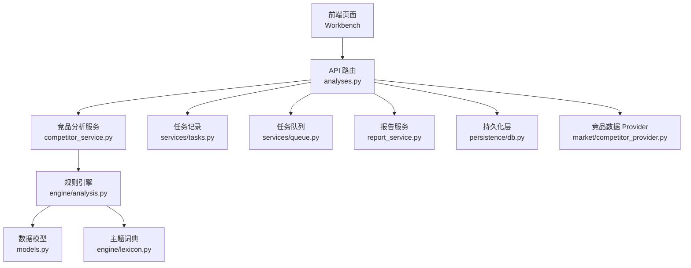
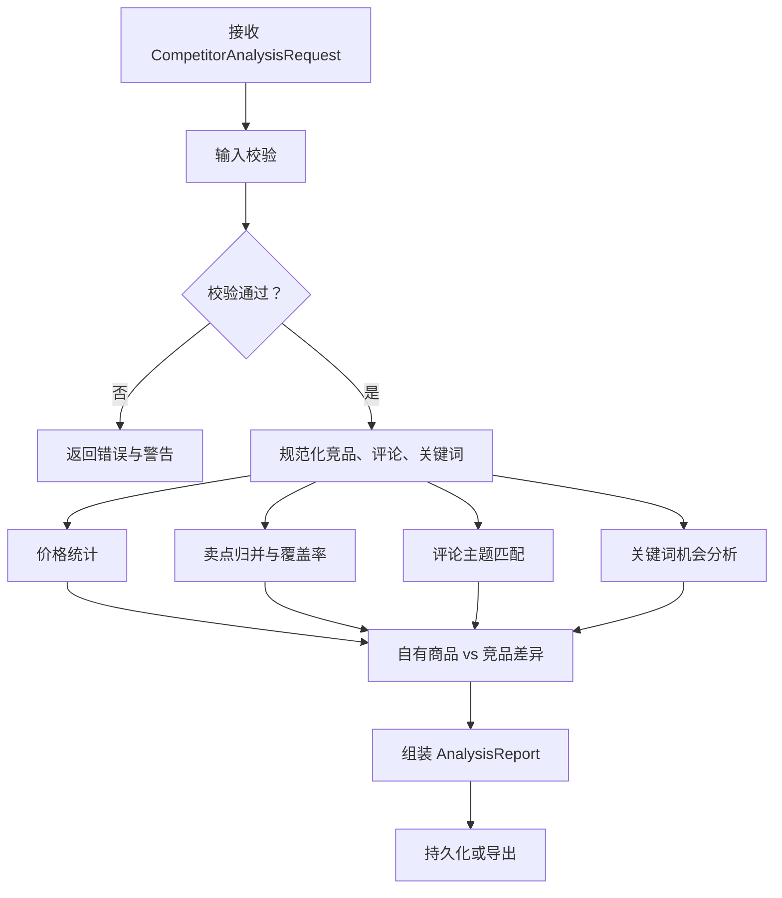
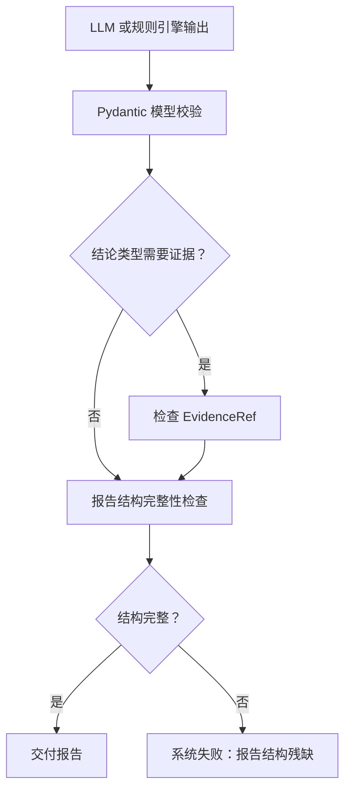
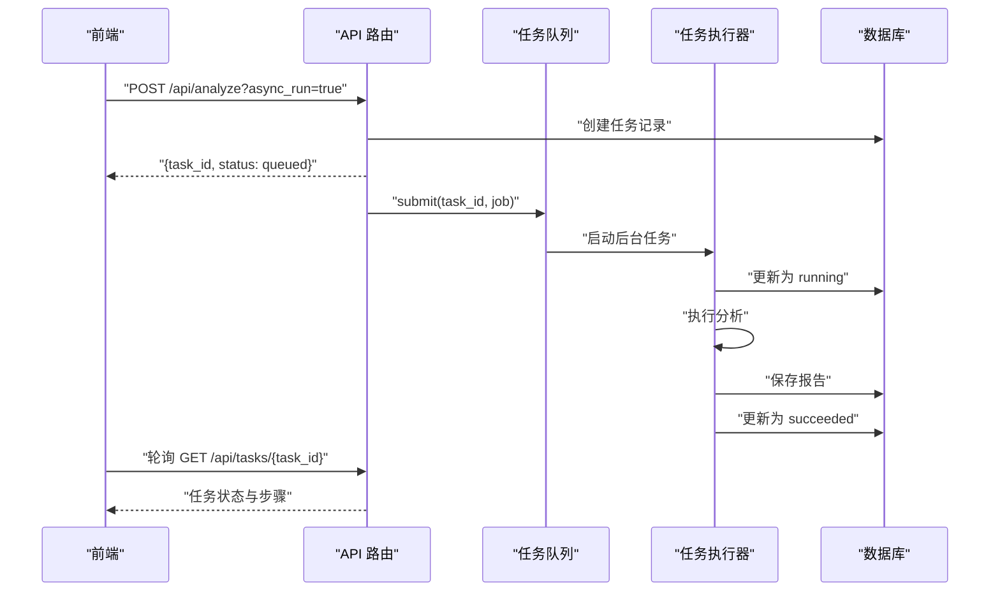
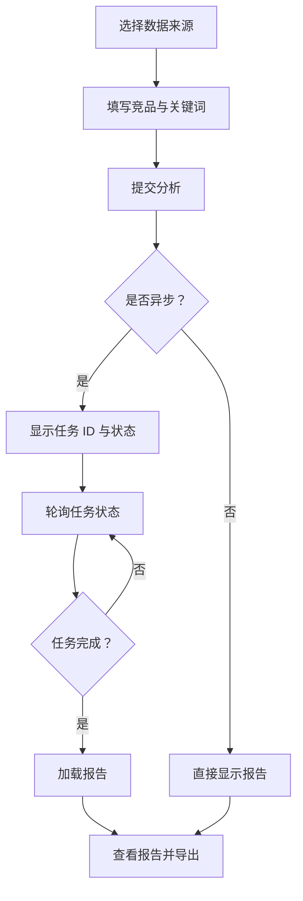
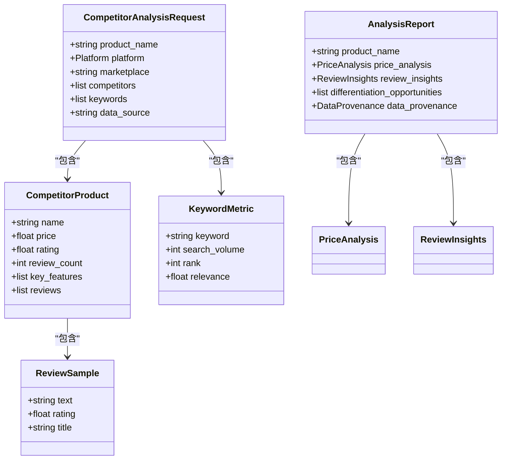

# 竞品分析

<cite>
**本文引用的文件**   
- [backend/surge/api/analyses.py](file://backend/surge/api/analyses.py)
- [backend/surge/engine/analysis.py](file://backend/surge/engine/analysis.py)
- [backend/surge/models.py](file://backend/surge/models.py)
- [backend/surge/services/competitor_service.py](file://backend/surge/services/competitor_service.py)
- [backend/surge/services/competitor_facts.py](file://backend/surge/services/competitor_facts.py)
- [backend/surge/market/competitor_provider.py](file://backend/surge/market/competitor_provider.py)
- [backend/surge/services/report_service.py](file://backend/surge/services/report_service.py)
- [backend/surge/services/tasks.py](file://backend/surge/services/tasks.py)
- [backend/surge/services/queue.py](file://backend/surge/services/queue.py)
- [backend/surge/persistence/db.py](file://backend/surge/persistence/db.py)
- [backend/surge/skills/catalog/competitor_analysis/output.schema.json](file://backend/surge/skills/catalog/competitor_analysis/output.schema.json)
- [examples/competitors_sample.csv](file://examples/competitors_sample.csv)
- [examples/competitors_sample.json](file://examples/competitors_sample.json)
- [frontend/src/lib/async-run/useTaskPolling.ts](file://frontend/src/lib/async-run/useTaskPolling.ts)
- [frontend/src/lib/async-run/poller.ts](file://frontend/src/lib/async-run/poller.ts)
- [frontend/src/lib/async-run/tasks-api.ts](file://frontend/src/lib/async-run/tasks-api.ts)
</cite>

## 目录
1. [简介](#简介)
2. [项目结构中的位置](#项目结构中的位置)
3. [输入数据模型与校验规则](#输入数据模型与校验规则)
4. [处理流水线](#处理流水线)
5. [指标计算逻辑](#指标计算逻辑)
6. [LLM 输出校验与事实审计](#llm-输出校验与事实审计)
7. [异步执行与进度追踪](#异步执行与进度追踪)
8. [前端 Workbench 交互流程](#前端-workbench-交互流程)
9. [报告导出](#报告导出)
10. [依赖关系图](#依赖关系图)
11. [与其他核心功能的复用点](#与其他核心功能的复用点)
12. [故障排查](#故障排查)
13. [完整示例](#完整示例)
14. [结论](#结论)

## 简介
竞品分析功能接收竞品商品数据（用户导入 CSV、JSON，或通过 Provider 从导入批次读取；真实平台同步目前为预留接口），经过以下阶段生成结构化分析报告：

1. **输入校验**：检查必填字段、空评论、重复竞品等。
2. **数据规范化**：清理卖点、规格、评论文本，去重关键词。
3. **价格统计**：计算最低价、最高价、均值、中位数及自有商品价格定位。
4. **卖点覆盖**：归并竞品卖点，统计覆盖率，识别自有商品独有卖点。
5. **评论痛点挖掘**：基于主题词典匹配痛点、需求、购买顾虑，并给出样本引用。
6. **关键词机会分析**：仅在存在搜索量/排名等指标时计算机会分。
7. **差异化机会识别**：综合价格、卖点、评论洞察生成差异化建议。
8. **报告组装与持久化**：输出 `AnalysisReport`，支持 md/json/csv 导出。

该实现的核心特点是：**默认使用本地确定性规则引擎**，不调用 LLM；同时保留 Skill Schema 和 Provider 抽象，以便未来扩展 LLM 增强路径。

## 项目结构中的位置
竞品分析横跨 API 层、引擎层、服务层、Provider 层、任务队列层和持久化层：

**图表来源**
- [backend/surge/api/analyses.py:1-256](file://backend/surge/api/analyses.py#L1-L256)
- [backend/surge/services/competitor_service.py:1-34](file://backend/surge/services/competitor_service.py#L1-L34)
- [backend/surge/engine/analysis.py:1-200](file://backend/surge/engine/analysis.py#L1-L200)
- [backend/surge/services/tasks.py:1-200](file://backend/surge/services/tasks.py#L1-L200)
- [backend/surge/services/queue.py:1-200](file://backend/surge/services/queue.py#L1-L200)
- [backend/surge/persistence/db.py:1-200](file://backend/surge/persistence/db.py#L1-L200)
- [backend/surge/market/competitor_provider.py:1-200](file://backend/surge/market/competitor_provider.py#L1-L200)

**章节来源**
- [backend/surge/api/analyses.py:1-256](file://backend/surge/api/analyses.py#L1-L256)
- [backend/surge/services/competitor_service.py:1-34](file://backend/surge/services/competitor_service.py#L1-L34)

## 输入数据模型与校验规则

### 请求模型
请求由 `CompetitorAnalysisRequest` 描述，核心字段如下：

| 字段 | 类型 | 是否必填 | 说明 |
|---|---|---:|---|
| `product_name` | 字符串 | 是 | 待分析商品名称 |
| `platform` | 枚举 | 否 | 销售平台，默认 Amazon |
| `marketplace` | 字符串 | 否 | 站点，如 US/DE/JP，默认 US |
| `category` | 字符串 | 否 | 类目 |
| `own_specs` | 键值对 | 否 | 自有商品规格 |
| `own_key_features` | 字符串数组 | 否 | 自有商品卖点 |
| `own_price` | 浮点数 | 否 | 自有商品价格 |
| `competitors` | 竞品数组 | 是 | 至少 1 个竞品 |
| `keywords` | 关键词数组 | 否 | 可选关键词及指标 |
| `data_source` | 字符串 | 否 | 数据来源标记 |
| `locale` | 字符串 | 否 | 报告语言，默认 zh-CN |

**章节来源**
- [backend/surge/models.py:240-310](file://backend/surge/models.py#L240-L310)

### 竞品商品模型
每个竞品由 `CompetitorProduct` 描述：

| 字段 | 类型 | 是否必填 | 说明 |
|---|---|---:|---|
| `name` | 字符串 | 是 | 竞品名称 |
| `brand` | 字符串 | 否 | 品牌 |
| `asin` | 字符串 | 否 | 商品标识 |
| `price` | 浮点数 | 否 | 价格，非负 |
| `currency` | 字符串 | 否 | 币种，默认 USD |
| `rating` | 浮点数 | 否 | 评分，范围 0–5 |
| `review_count` | 整数 | 否 | 评论数，非负 |
| `key_features` | 字符串数组 | 否 | 核心卖点 |
| `specifications` | 键值对 | 否 | 规格参数 |
| `reviews` | 评论数组 | 否 | 评论样本 |
| `image` | 字符串 | 否 | 商品图地址，仅展示 |
| `is_demo` | 布尔值 | 否 | 是否为示例数据 |
| `source_ref` | 字符串 | 否 | 原始数据出处 |

**章节来源**
- [backend/surge/models.py:120-200](file://backend/surge/models.py#L120-L200)

### 评论样本模型
每条评论由 `ReviewSample` 描述，`text` 必填且不能为空，其余字段缺失时不推断。

**章节来源**
- [backend/surge/models.py:80-120](file://backend/surge/models.py#L80-L120)

### 关键词模型
关键词由 `KeywordMetric` 描述，指标全部可选；没有数据时不得编造数字。

| 字段 | 类型 | 是否必填 | 说明 |
|---|---|---:|---|
| `keyword` | 字符串 | 是 | 关键词 |
| `search_volume` | 整数 | 否 | 搜索量 |
| `rank` | 整数 | 否 | 排名 |
| `relevance` | 浮点数 | 否 | 相关性 |
| `competition` | 枚举 | 否 | 竞争程度 |
| `conversion_share` | 浮点数 | 否 | 转化份额 |
| `source` | 字符串 | 否 | 指标来源 |

**章节来源**
- [backend/surge/models.py:200-240](file://backend/surge/models.py#L200-L240)

### 校验规则
`validate_request` 会收集错误和警告：

- **错误**：
  - 未提供竞品。
  - 某竞品的任意评论文本为空。
- **警告**：
  - 竞品缺少价格，价格分析将排除该竞品。
  - 竞品缺少评分与评论数，可信度对比不完整。
  - 竞品无核心卖点，卖点对比不完整。
  - 竞品无评论样本，评论洞察不覆盖该竞品。
  - 存在同名竞品。
  - 没有任何评论样本。
  - 未填写自有商品规格，差异化分析只基于卖点与价格。
  - 关键词均无搜索量/排名指标，不做关键词机会打分。

此外，`normalize` 还会忽略空卖点、空评论，并对重复关键词去重。

**章节来源**
- [backend/surge/engine/analysis.py:40-120](file://backend/surge/engine/analysis.py#L40-L120)
- [backend/surge/engine/analysis.py:120-200](file://backend/surge/engine/analysis.py#L120-L200)

### 输入数据格式
仓库提供了两个示例输入：

- **CSV**：列包括 `name, brand, asin, price, currency, rating, review_count, key_features, specifications, review_text, review_rating, review_title, is_demo`。
- **JSON**：顶层包含 `competitors` 数组与 `keywords` 数组。

**章节来源**
- [examples/competitors_sample.csv:1-5](file://examples/competitors_sample.csv#L1-L5)
- [examples/competitors_sample.json:1-43](file://examples/competitors_sample.json#L1-L43)

## 处理流水线

**图表来源**
- [backend/surge/engine/analysis.py:1-200](file://backend/surge/engine/analysis.py#L1-L200)
- [backend/surge/engine/analysis.py:200-592](file://backend/surge/engine/analysis.py#L200-L592)
- [backend/surge/engine/analysis.py:592-1127](file://backend/surge/engine/analysis.py#L592-L1127)

**章节来源**
- [backend/surge/engine/analysis.py:1-200](file://backend/surge/engine/analysis.py#L1-L200)
- [backend/surge/engine/analysis.py:200-592](file://backend/surge/engine/analysis.py#L200-L592)
- [backend/surge/engine/analysis.py:592-1127](file://backend/surge/engine/analysis.py#L592-L1127)

## 指标计算逻辑

### 价格定位
`analyze_prices` 按以下步骤计算：

1. 过滤出有价格的竞品。
2. 若无价格，直接返回 `PriceAnalysis` 并标注“没有可用的竞品价格”。
3. 排序所有价格，计算最小值、最大值、均值和中位数。
4. 若提供自有价格：
   - 计算低于自有价格的竞品数量，据此估算百分位。
   - 若自有价格低于最低价，标记为 `below_range`。
   - 若高于最高价，标记为 `above_range`。
   - 否则标记为 `within_range`。
5. 所有数值结论都以 `EvidenceKind.STATISTIC` 形式附带证据引用。

**章节来源**
- [backend/surge/engine/analysis.py:480-592](file://backend/surge/engine/analysis.py#L480-L592)
- [backend/surge/models.py:460-520](file://backend/surge/models.py#L460-L520)

### 卖点覆盖率
`analyze_features` 的归类顺序为：

1. **完全相同卖点**：直接归并到同一 `feature`，统计提及竞品集合与覆盖率。
2. **词级共性**：提取卖点中的英文单词，若多个竞品共享同一关键词且未被精确卖点覆盖，则新增一条 `(关键词)` 条目。
3. **自有商品独有卖点**：如果自有卖点没有被任何已有特征覆盖，则新增 `[自有] ...` 条目，覆盖率记为 0。

覆盖率计算公式为：

\[
\text{coverage\_ratio} = \frac{\text{提及该特征的竞品数量}}{\text{竞品总数}}
\]

**章节来源**
- [backend/surge/engine/analysis.py:360-480](file://backend/surge/engine/analysis.py#L360-L480)
- [backend/surge/models.py:520-540](file://backend/surge/models.py#L520-L540)

### 评论痛点与需求
评论分析基于主题词典，分为三类：

- **痛点**：负面体验，如尺寸不符、质量差、耐用性不足、安装困难、渗漏、异味、噪音、续航问题、包装损坏、缺配件、颜色不符、操作不便、描述不符。
- **需求**：用户希望获得的功能，如易清洁、节省空间、送礼场景等。
- **购买顾虑**：消费者下单前的担忧。

处理逻辑：

1. 拆分评论句子。
2. 按主题正则匹配。
3. 对痛点启用否定/转折上下文判断，避免把“不漏”误判为渗漏问题。
4. 按主题分组，统计频次与占比。
5. 每条主题结论携带 `Claim`，证据引用来自具体评论。

**章节来源**
- [backend/surge/engine/lexicon.py:1-200](file://backend/surge/engine/lexicon.py#L1-L200)
- [backend/surge/engine/analysis.py:200-360](file://backend/surge/engine/analysis.py#L200-L360)
- [backend/surge/models.py:540-600](file://backend/surge/models.py#L540-L600)

### 关键词机会分
`analyze_keywords` 只在存在量化指标时进行打分：

- 若有关键词但无指标，仅列出关键词并说明“无搜索量/排名数据”。
- 若存在指标，机会分基于真实存在的字段计算，缺失项不参与且不补零假设。
- 结果必须满足约束：`has_metrics=false` 时不得携带 `search_volume`、`rank`、`opportunity_score` 等数值。

**章节来源**
- [backend/surge/engine/analysis.py:592-1127](file://backend/surge/engine/analysis.py#L592-L1127)
- [backend/surge/models.py:600-646](file://backend/surge/models.py#L600-L646)

## LLM 输出校验与事实审计

当前默认分析路径是**本地确定性规则引擎**，不调用 LLM。但代码保留了 Skill 契约、Provider 抽象和 Schema 校验能力，便于未来扩展 LLM 增强。

### Skill 契约与 Schema
Skill 定义层区分“声明”和“可执行状态”，并通过 Pydantic 模型统一输入契约与输出 Schema。竞品分析的 Skill 输出 Schema 要求报告至少包含：

- `product_name`
- `price_analysis`
- `review_insights`
- `differentiation_opportunities`
- `data_provenance`

**章节来源**
- [backend/surge/agent/contracts.py:1-200](file://backend/surge/agent/contracts.py#L1-L200)
- [backend/surge/skills/catalog/competitor_analysis/output.schema.json:1-10](file://backend/surge/skills/catalog/competitor_analysis/output.schema.json#L1-L10)

### 事实审计机制
系统通过三层保证 LLM 或规则输出的可信度：

1. **类型与业务约束校验**：Pydantic 模型强制 `EvidenceKind`、`Claim.evidence`、`KeywordOpportunity.has_metrics` 等约束。
2. **证据引用**：所有事实类结论必须附带 `EvidenceRef`，指向竞品、字段、原文摘录和数据来源。
3. **报告结构完整性检查**：`competitor_facts.validate_report` 检查报告是否缺少必要块，结构残缺属于系统问题而非业务“数据不足”。

**图表来源**
- [backend/surge/models.py:400-460](file://backend/surge/models.py#L400-L460)
- [backend/surge/engine/analysis.py:1-200](file://backend/surge/engine/analysis.py#L1-L200)
- [backend/surge/services/competitor_facts.py:1-106](file://backend/surge/services/competitor_facts.py#L1-L106)

**章节来源**
- [backend/surge/models.py:400-460](file://backend/surge/models.py#L400-L460)
- [backend/surge/services/competitor_facts.py:1-106](file://backend/surge/services/competitor_facts.py#L1-L106)

## 异步执行与进度追踪

### 同步与异步两种模式
`POST /api/analyze` 支持两种执行方式：

| 模式 | 行为 | 适用场景 |
|---|---|---|
| 同步（默认） | 立即执行分析并返回 `AnalysisResponse` | 脚本、测试、简单调用 |
| 异步（`async_run=true`） | 立即返回 `task_id`、`status=queued` 和执行计划，前端轮询任务详情 | Workbench、长耗时任务 |

在 Serverless 部署下，若 `force_sync_tasks=true`，即使传入 `async_run=true`，也会走同步路径。

**章节来源**
- [backend/surge/api/analyses.py:1-200](file://backend/surge/api/analyses.py#L1-L200)

### 任务记录与状态
任务记录由 `TaskRecorder` 管理，关键状态包括：

| 状态 | 含义 |
|---|---|
| `queued` | 已入队 |
| `running` | 正在执行 |
| `cancelling` | 已请求取消 |
| `cancelled` | 已取消 |
| `waiting_for_input` | 缺少关键事实，等待补充 |
| `waiting_for_review` | 工作流中断，等待人工确认 |
| `partial` | 部分完成，未通过质量门禁 |
| `succeeded` | 成功 |
| `failed` | 失败 |

任务步骤由真实执行过程产生，每个 `with task.step(...)` 都会记录起止时间和耗时，因此时间线可信。

**章节来源**
- [backend/surge/services/tasks.py:1-200](file://backend/surge/services/tasks.py#L1-L200)

### 任务队列
当前支持两种队列后端：

| 后端 | 特点 |
|---|---|
| 线程队列（默认） | 进程内线程池，无外部依赖，适合单机和免费实例 |
| arq 队列（可选） | 基于 Redis 的独立 worker 进程，需额外安装依赖 |

队列接口统一为按 `task_id` 提交、取消、查询活跃状态。

**章节来源**
- [backend/surge/services/queue.py:1-200](file://backend/surge/services/queue.py#L1-L200)

### 异步执行流程图

**图表来源**
- [backend/surge/api/analyses.py:60-200](file://backend/surge/api/analyses.py#L60-L200)
- [backend/surge/services/tasks.py:100-200](file://backend/surge/services/tasks.py#L100-L200)
- [backend/surge/services/queue.py:60-160](file://backend/surge/services/queue.py#L60-L160)

## 前端 Workbench 交互流程

### 轮询机制
前端通过 `useTaskPolling` Hook 管理任务轮询生命周期：

- 组件卸载时停止轮询。
- `taskId` 变化时重建轮询器。
- `enabled=false` 时暂停轮询。
- 轮询器内部使用 `createPoller`，默认每秒轮询一次，首次立即执行。
- 连续失败达到上限后触发 `onGiveUp`，界面应明确提示“状态获取失败”，而不是静默卡住。

**章节来源**
- [frontend/src/lib/async-run/useTaskPolling.ts:1-51](file://frontend/src/lib/async-run/useTaskPolling.ts#L1-L51)
- [frontend/src/lib/async-run/poller.ts:1-133](file://frontend/src/lib/async-run/poller.ts#L1-L133)

### 任务 API 绑定
`fetchTaskDetail` 封装了 `/api/tasks/{taskId}`，`cancelTask` 封装了取消接口。

**章节来源**
- [frontend/src/lib/async-run/tasks-api.ts:1-20](file://frontend/src/lib/async-run/tasks-api.ts#L1-L20)

### Workbench 典型交互
虽然当前仓库未包含完整的 Workbench 页面实现，但根据 API 与轮询机制，典型流程应为：

1. 用户选择数据来源（手动输入、CSV、JSON、导入批次）。
2. 填写商品名称、平台、站点、竞品列表、关键词等。
3. 点击“开始分析”。
4. 若选择异步模式，前端立即显示任务 ID 和状态。
5. 前端轮询任务详情，展示步骤进度。
6. 任务成功后，加载报告并渲染价格、卖点、评论、关键词、差异化机会。
7. 用户可选择导出 Markdown、JSON 或 CSV。

[本图为概念流程，不直接映射具体页面组件，因此不提供图表来源]

## 报告导出

报告导出由 `report_service` 统一实现，支持三种格式：

| 格式 | 媒体类型 | 内容说明 |
|---|---|---|
| md / markdown | text/markdown | 可读报告，包含价格、竞品快照、评论痛点、差异化机会、关键词、限制与提示 |
| json | application/json | 原始结构化报告 |
| csv | text/csv | 竞品快照表，包含字段完整度、缺失字段、卖点列表 |

导出端点为 `GET /api/reports/{report_id}/export?format=md|json|csv`，需要读权限，并记录审计日志。

**章节来源**
- [backend/surge/services/report_service.py:1-200](file://backend/surge/services/report_service.py#L1-L200)
- [backend/surge/api/analyses.py:200-256](file://backend/surge/api/analyses.py#L200-L256)

## 依赖关系图

**图表来源**
- [backend/surge/models.py:80-646](file://backend/surge/models.py#L80-L646)

**章节来源**
- [backend/surge/models.py:80-646](file://backend/surge/models.py#L80-L646)

## 与其他核心功能的复用点

| 功能 | 复用点 | 说明 |
|---|---|---|
| 任务队列 | `TaskRecorder`、`TaskQueue` | 竞品分析与其他 Agent 技能共用任务记录与队列抽象 |
| LLM Provider | `provider.analyze()` | 当前默认使用规则引擎，但接口兼容 LLM Provider 增强 |
| 持久化层 | `Database.save_report` | 报告统一落库，供 Listing 生成、报告查询、导出复用 |
| Skill 注册表 | `SkillDefinition`、Schema | 竞品分析作为 Skill 暴露输入/输出契约 |
| 审计 | `audit_user`、`audit_context` | 任务运行与报告导出均记录审计日志 |
| 租户隔离 | `TenantContext` | 所有数据按租户隔离，导入批次、报告、任务均带 `tenant_id` |
| Listing 生成 | `ListingGenerationRequest.analysis_report` | Listing 生成可直接复用竞品分析报告 |

**章节来源**
- [backend/surge/services/tasks.py:1-200](file://backend/surge/services/tasks.py#L1-L200)
- [backend/surge/services/queue.py:1-200](file://backend/surge/services/queue.py#L1-L200)
- [backend/surge/persistence/db.py:1-200](file://backend/surge/persistence/db.py#L1-L200)
- [backend/surge/models.py:310-380](file://backend/surge/models.py#L310-L380)

## 故障排查

| 现象 | 可能原因 | 处理建议 |
|---|---|---|
| 上传 CSV 后提示“至少需要 1 个竞品” | 未解析出竞品行 | 检查 CSV 列名与数据是否为空 |
| 评论相关分析为空 | 所有评论文本为空或无星级 | 补充评论文本，必要时提供星级 |
| 价格分析为空 | 所有竞品价格为空 | 填写 `price` 字段 |
| 关键词机会分为空 | 关键词无搜索量/排名指标 | 补充指标或接受“无指标数据”提示 |
| 异步任务一直停在 `queued` | Serverless 部署启用 `force_sync_tasks` | 改用同步模式或调整部署配置 |
| 任务被取消但未立即停止 | 取消在检查点生效 | 等待当前步骤结束 |
| 轮询突然停止 | 网络抖动导致单次失败 | 轮询器会自动重试；连续失败达上限才放弃 |
| 报告导出 400 | 不支持的格式 | 使用 `md`、`json` 或 `csv` |
| 报告导出 404 | 报告不存在或不属于当前租户 | 检查 `report_id` 与租户上下文 |

**章节来源**
- [backend/surge/engine/analysis.py:40-120](file://backend/surge/engine/analysis.py#L40-L120)
- [backend/surge/services/queue.py:100-200](file://backend/surge/services/queue.py#L100-L200)
- [frontend/src/lib/async-run/poller.ts:40-133](file://frontend/src/lib/async-run/poller.ts#L40-L133)
- [backend/surge/api/analyses.py:200-256](file://backend/surge/api/analyses.py#L200-L256)

## 完整示例

### 场景：上传竞品 CSV → 选择分析维度 → 查看报告 → 导出 md/json/csv

#### 步骤一：准备竞品数据
示例 CSV 包含两行 Demo Bottle A 和 Demo Tumbler B，分别带有卖点、规格和两条评论。

**章节来源**
- [examples/competitors_sample.csv:1-5](file://examples/competitors_sample.csv#L1-L5)

#### 步骤二：构造请求
请求包含：

- `product_name`：例如“自有保温杯”
- `platform`：amazon
- `marketplace`：US
- `competitors`：从 CSV 或 JSON 解析出的竞品列表
- `own_price`：自有商品价格
- `own_key_features`：自有卖点
- `keywords`：可选关键词及指标
- `data_source`：user_input、csv、json 或 demo

**章节来源**
- [backend/surge/models.py:240-310](file://backend/surge/models.py#L240-L310)

#### 步骤三：调用分析接口
- 同步调用：直接返回 `AnalysisResponse`，包含 `report`、`persisted`、`duration_ms`、`task_id`。
- 异步调用：返回 `task_id`、`status=queued`、`plan=["analyze", "persist"]`，前端轮询任务。

**章节来源**
- [backend/surge/api/analyses.py:1-200](file://backend/surge/api/analyses.py#L1-L200)

#### 步骤四：查看报告
报告对象 `AnalysisReport` 包含：

- `product_name`、`platform`、`marketplace`
- `data_provenance`：数据来源、是否示例、竞品数、评论样本数、关键词数
- `competitor_snapshots`：竞品快照
- `price_analysis`：价格区间、中位数、自有价格定位
- `feature_comparison`：卖点覆盖率
- `review_insights`：痛点、需求、购买顾虑
- `keyword_analysis`：关键词机会分析
- `differentiation_opportunities`：差异化机会
- `limitations`、`warnings`

**章节来源**
- [backend/surge/models.py:400-646](file://backend/surge/models.py#L400-L646)

#### 步骤五：导出报告
- Markdown：人类可读报告。
- JSON：原始结构化数据。
- CSV：竞品快照表格。

**章节来源**
- [backend/surge/services/report_service.py:1-200](file://backend/surge/services/report_service.py#L1-L200)
- [backend/surge/api/analyses.py:200-256](file://backend/surge/api/analyses.py#L200-L256)

## 结论
竞品分析功能在当前实现中以**本地确定性规则引擎**为核心，优先保证数据质量、可解释性和可追溯性。其优势在于：

- 输入字段清晰，校验严格。
- 价格、卖点、评论、关键词各阶段都有明确指标和证据引用。
- 默认不调用 LLM，可在无 Key 环境下运行。
- 支持同步与异步执行，具备任务记录、队列和取消能力。
- 报告统一持久化，支持 md/json/csv 导出。
- 通过 Provider、Skill Schema 和 Task 抽象，为后续 LLM 增强、平台数据接入和多技能编排预留扩展点。

未来若引入 LLM，应继续遵循现有约束：**不编造指标、不跳过证据引用、不掩盖数据不足**。真正的增量价值应体现在更丰富的语义推断、差异化机会生成和可解释理由上，而不是替代当前已经稳健的统计与规则层。