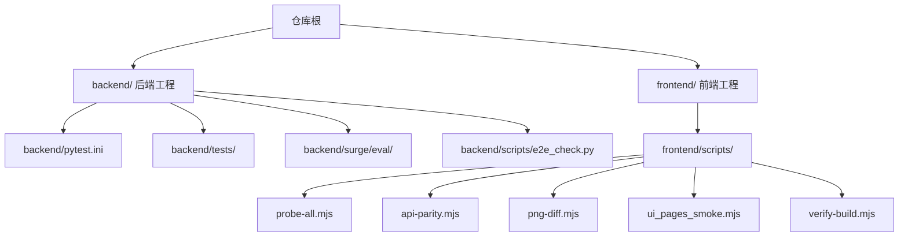
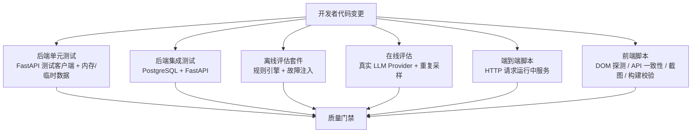
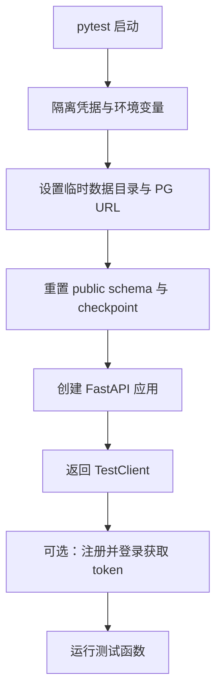
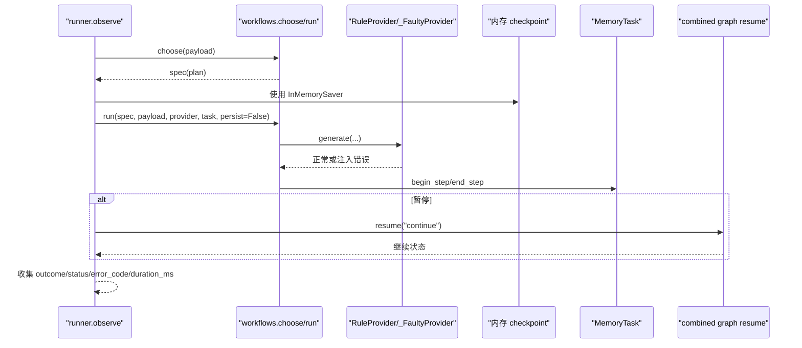
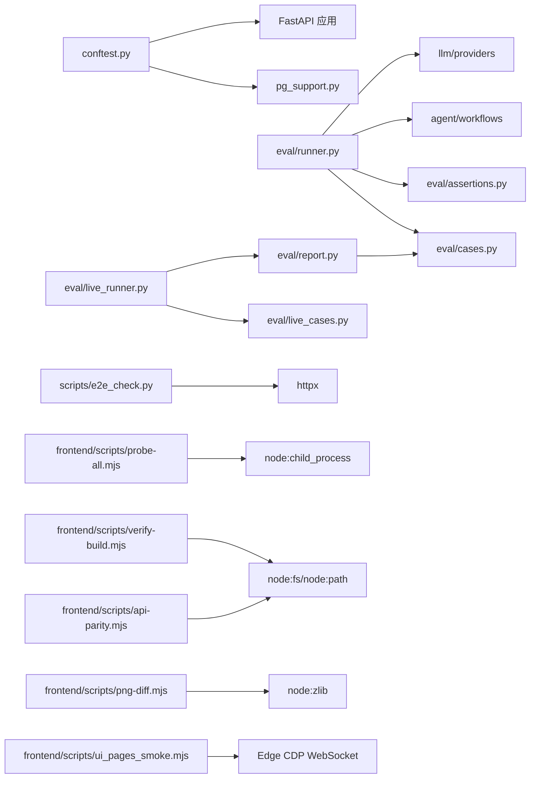

# 测试与质量

<cite>
**本文引用的文件**   
- [pytest.ini](file://backend/pytest.ini)
- [pyproject.toml](file://pyproject.toml)
- [conftest.py](file://backend/tests/conftest.py)
- [pg_support.py](file://backend/tests/pg_support.py)
- [cases.py](file://backend/surge/eval/cases.py)
- [assertions.py](file://backend/surge/eval/assertions.py)
- [runner.py](file://backend/surge/eval/runner.py)
- [live_runner.py](file://backend/surge/eval/live_runner.py)
- [report.py](file://backend/surge/eval/report.py)
- [e2e_check.py](file://backend/scripts/e2e_check.py)
- [probe-all.mjs](file://frontend/scripts/probe-all.mjs)
- [api-parity.mjs](file://frontend/scripts/api-parity.mjs)
- [png-diff.mjs](file://frontend/scripts/png-diff.mjs)
- [ui_pages_smoke.mjs](file://frontend/scripts/ui_pages_smoke.mjs)
- [verify-build.mjs](file://frontend/scripts/verify-build.mjs)
</cite>

## 目录
1. [引言](#引言)
2. [项目结构](#项目结构)
3. [核心组件](#核心组件)
4. [架构总览](#架构总览)
5. [详细组件分析](#详细组件分析)
6. [依赖分析](#依赖分析)
7. [性能考虑](#性能考虑)
8. [故障排查指南](#故障排查指南)
9. [结论](#结论)
10. [附录：新增测试与评估用例操作清单](#附录新增测试与评估用例操作清单)

## 引言
本文件说明 Surge 的测试与质量保障体系，覆盖后端 pytest 测试、评估套件（eval）、端到端脚本以及前端探测与构建验证脚本。目标是帮助读者理解：
- 测试策略分层：单元测试、集成测试、评估套件、端到端脚本。
- 如何运行和扩展后端测试，以及如何模拟 LLM 与数据库。
- 如何编写、运行并比较评估用例结果。
- 如何使用前端脚本做 UI 探测、截图对比、API 一致性检查和构建产物校验。
- 推荐的质量门禁：覆盖率、lint、CI 集成、发布前冒烟。

## 项目结构
Surge 采用 monorepo 组织：后端 Python 工程位于 `backend/`，前端静态站点位于 `frontend/`，根目录提供 Vercel 部署入口等配置。测试与质量相关内容主要分布在以下位置：

**图表来源**
- [pytest.ini:1-5](file://backend/pytest.ini#L1-L5)
- [pyproject.toml:1-16](file://pyproject.toml#L1-L16)
- [e2e_check.py:1-129](file://backend/scripts/e2e_check.py#L1-L129)
- [probe-all.mjs:1-79](file://frontend/scripts/probe-all.mjs#L1-L79)

**章节来源**
- [pytest.ini:1-5](file://backend/pytest.ini#L1-L5)
- [pyproject.toml:1-16](file://pyproject.toml#L1-L16)

## 核心组件
本节从测试层级出发，列出关键组件及其职责。

### 后端测试层
- **pytest 配置**：定义测试路径为 `tests`，默认使用 `-q` 静默输出，忽略弃用警告。
- **公共夹具**：隔离凭据、临时数据目录、PostgreSQL 连接、FastAPI TestClient、已登录客户端。
- **PG 支持**：读取测试数据库 URL、清空并重建 `public` schema、重置 LangGraph checkpoint。

**章节来源**
- [pytest.ini:1-5](file://backend/pytest.ini#L1-L5)
- [conftest.py:1-112](file://backend/tests/conftest.py#L1-L112)
- [pg_support.py:1-40](file://backend/tests/pg_support.py#L1-L40)

### 评估框架
- **用例集**：按工具调用正确性、事实一致性、完成率、恢复能力、技能路由五个维度生成确定性用例。
- **断言器**：对观测结果逐项检查，不重跑逻辑，失败要给出人类可读原因。
- **执行器**：内存 checkpoint、内存任务记录、故障注入、流程编排观察。
- **在线评测**：构造真实 Provider、重复采样、统计均值/波动/延迟/Token 消耗。
- **报告模块**：汇总通过率、耗时百分位、错误分类、与基线 diff、Markdown 渲染。

**章节来源**
- [cases.py:1-690](file://backend/surge/eval/cases.py#L1-L690)
- [assertions.py:1-291](file://backend/surge/eval/assertions.py#L1-L291)
- [runner.py:1-299](file://backend/surge/eval/runner.py#L1-L299)
- [live_runner.py:1-199](file://backend/surge/eval/live_runner.py#L1-L199)
- [report.py:1-279](file://backend/surge/eval/report.py#L1-L279)

### 端到端与前端脚本
- **端到端脚本**：通过 HTTP 访问运行中的服务，覆盖健康检查、认证、模型配置、竞品分析、Listing 生成、市场平台、导入、登出。
- **前端探针**：串行启动 Edge headless，探测 DOM 契约。
- **API 一致性检查**：对比旧版 `frontend/js/api.js` 与新版 `src/lib/api.ts` 的错误语义。
- **PNG 像素比对**：无第三方依赖，解析 PNG IDAT 数据计算差异像素与包围盒。
- **页面冒烟**：针对已迁移到 React 的页面做结构与交互断言。
- **构建产物校验**：验证 `dist/` 顶层形状、CSS 引用、JS 入口、媒体资源路径。

**章节来源**
- [e2e_check.py:1-129](file://backend/scripts/e2e_check.py#L1-L129)
- [probe-all.mjs:1-79](file://frontend/scripts/probe-all.mjs#L1-L79)
- [api-parity.mjs:1-182](file://frontend/scripts/api-parity.mjs#L1-L182)
- [png-diff.mjs:1-119](file://frontend/scripts/png-diff.mjs#L1-L119)
- [ui_pages_smoke.mjs:1-200](file://frontend/scripts/ui_pages_smoke.mjs#L1-L200)
- [verify-build.mjs:1-141](file://frontend/scripts/verify-build.mjs#L1-L141)

## 架构总览
Surge 的质量保障由四层组成：单元测试、集成测试、评估套件、端到端脚本；前端侧有 API 一致性、UI 探测、截图比对和构建校验。

**图表来源**
- [conftest.py:1-112](file://backend/tests/conftest.py#L1-L112)
- [runner.py:1-299](file://backend/surge/eval/runner.py#L1-L299)
- [live_runner.py:1-199](file://backend/surge/eval/live_runner.py#L1-L199)
- [e2e_check.py:1-129](file://backend/scripts/e2e_check.py#L1-L129)
- [probe-all.mjs:1-79](file://frontend/scripts/probe-all.mjs#L1-L79)

## 详细组件分析

### 后端测试配置与夹具
pytest 通过 `testpaths = tests` 把测试定位在 `backend/tests/`，默认启用 `-q` 减少噪声，并通过 `filterwarnings` 忽略弃用警告，适合持续集成。

公共夹具承担三项关键职责：
1. **凭据隔离**：在每个测试进程清空 DeepSeek/OpenAI 相关环境变量，并将 `SURGE_ENV_FILE` 指向空 `.env`，防止开发机真实 Key 影响“缺 Key 应降级”类断言。
2. **测试数据库**：通过 `temp_settings` 设置 `SURGE_DATA_DIR`、`SURGE_DATABASE_URL`、固定 `SURGE_SECRET_KEY`，再调用 `pg_support.reset_schema` 清理 `public` schema 并重建 LangGraph checkpoint。
3. **应用客户端**：`client` 基于 FastAPI `TestClient` 创建应用实例；`auth_client` 注册用户并携带 Bearer token，用于需要认证的接口测试。

**图表来源**
- [conftest.py:1-112](file://backend/tests/conftest.py#L1-L112)
- [pg_support.py:1-40](file://backend/tests/pg_support.py#L1-L40)

**章节来源**
- [pytest.ini:1-5](file://backend/pytest.ini#L1-L5)
- [conftest.py:1-112](file://backend/tests/conftest.py#L1-L112)
- [pg_support.py:1-40](file://backend/tests/pg_support.py#L1-L40)

### PostgreSQL 支持
PG 支持模块负责：
- 读取 `SURGE_TEST_DATABASE_URL` 或 `SURGE_DATABASE_URL`，未设置时直接退出测试进程。
- 使用 psycopg 连接数据库，删除并重建 `public` schema。
- 重置 LangGraph checkpoint saver，避免 checkpoint 表被 DROP 后写入报 `UndefinedTable`。

这使集成测试可以复用同一 Postgres 实例，但必须确保每次测试前 schema 是干净的。

**章节来源**
- [pg_support.py:1-40](file://backend/tests/pg_support.py#L1-L40)

### 评估框架：用例、断言、执行、在线评测、报告
评估框架把“行为一致性”和“模型稳定性”分开管理。

#### 用例集
用例集按五个维度生成：
- 工具调用正确性：是否选对工作流、计划骨架是否正确、步骤顺序是否在计划内。
- Listing 事实一致性：要点数字必须有出处，禁止绝对化用语，示例数据需标记来源。
- 完成率：完成、暂停、拦下、失败的结局是否符合输入矩阵。
- 恢复能力：注入限流、网络、鉴权、分析错误、质检失败、超时等故障后的错误分类与产物洁净度。
- 技能路由：目标到技能的决策，required/forbidden 集合与工作流开关一致。

用例使用固定产品资料、竞品集合与期望推导函数，保证可复现。

**章节来源**
- [cases.py:1-690](file://backend/surge/eval/cases.py#L1-L690)

#### 断言器
断言器遵循三条原则：只读观测结果、每条失败给出理由、不确定就不判。它实现：
- `_check_tool_call`：校验分派、计划、步骤顺序、产出物。
- `_check_fact_consistency`：提取要点文本与支持事实，检查数字出处与禁用词。
- `_check_completion`：校验暂停与待确认状态，禁止 partial 被静默转 succeeded。
- `_check_recovery`：校验错误分类、失败不留草稿、失败必须有可读消息。
- `_check_routing`：校验 required/forbidden 技能集合与 with_listing/listing_only 开关。

**章节来源**
- [assertions.py:1-291](file://backend/surge/eval/assertions.py#L1-L291)

#### 执行器
执行器重点解决三个约束：不落库、checkpoint 用内存 saver、故障注入必须还原。
- `MemoryTask`：满足 StepRunner 的最小接口，收集 begin_step/end_step 形成步骤序列。
- `_FaultyProvider`：包装 Provider，仅在 `generate` 抛出带 kind 的 `LLMError`。
- `injected`：上下文管理器替换分析、质检、剩余时间等实现，finally 中恢复。
- `observe`：选择工作流、记录 plan/steps/outcome/error_code/duration_ms，并在异常时分类为 agent error。

**图表来源**
- [runner.py:1-299](file://backend/surge/eval/runner.py#L1-L299)

**章节来源**
- [runner.py:1-299](file://backend/surge/eval/runner.py#L1-L299)

#### 在线评测
在线评测面向真实 LLM，要求：
- Provider 必须是真模型，不能是规则引擎；否则抛出 `LiveEvalError`。
- 单次结果不可靠，通过 `repeats` 多次运行，统计 mean/min/max/spread/p50_ms/tokens/errors。
- 全程 `persist=False`，不写业务表。

它还支持 dry-run 模式，用 RuleProvider 走完整链路，仅验证评测本身没有写坏。

**章节来源**
- [live_runner.py:1-199](file://backend/surge/eval/live_runner.py#L1-L199)

#### 报告模块
报告模块负责：
- 将逐条用例结果汇总成可比较的 JSON，包含通过率、耗时百分位、错误分类、维度统计。
- 支持已知问题列表，命中的用例不计入通过率，也不阻断门禁。
- 与基线 diff，输出回归与修复的用例 ID。
- 渲染 Markdown，区分离线评测与模型质量说明。

**章节来源**
- [report.py:1-279](file://backend/surge/eval/report.py#L1-L279)

### 端到端脚本
端到端脚本通过 httpx 访问运行中的服务，覆盖：
- 健康检查与健康字段。
- 认证状态与受保护接口 401。
- 注册与登录。
- 每用户模型配置，且断言不会回显完整 Key。
- 健康检查是否反映已登录用户配置。
- 竞品分析、报告持久化。
- Listing 生成、fact_ledger、降级标志。
- 市场平台语言配置。
- CSV 导入去重与评论合并。
- 登出后恢复 401。

该脚本适合 CI 中在启动后端服务后运行，作为发布前 smoke test。

**章节来源**
- [e2e_check.py:1-129](file://backend/scripts/e2e_check.py#L1-L129)

### 前端脚本
前端脚本围绕“无第三方依赖的 Node 脚本”理念设计，便于在 CI 中快速运行。

#### UI 探测
`probe-all.mjs` 串行运行一组 UI 探针，接受 base URL 与 filter，过滤不存在文件时会提示。它使用 `child_process.spawn` 启动每个探针，并以非零退出码表示失败。

**章节来源**
- [probe-all.mjs:1-79](file://frontend/scripts/probe-all.mjs#L1-L79)

#### API 一致性检查
`api-parity.mjs` 把旧实现与新实现放在同一个伪造 fetch 环境下，比较返回值、错误消息、status、detail、全局 401 触发次数。若没有旧实现目录则跳过，而不是报错。

**章节来源**
- [api-parity.mjs:1-182](file://frontend/scripts/api-parity.mjs#L1-L182)

#### 截图像素比对
`png-diff.mjs` 手动解析 PNG IHDR/IDAT/IEND，解压并还原滤波，逐像素比较 RGBA/RGB 通道，输出差异像素数、占比、最大通道差、包围盒。退出码 0 表示完全一致，1 表示有差异，2 表示用法错误。

**章节来源**
- [png-diff.mjs:1-119](file://frontend/scripts/png-diff.mjs#L1-L119)

#### 页面冒烟
`ui_pages_smoke.mjs` 启动 Edge headless，通过 CDP WebSocket 导航页面、注册账号、发起异步任务，并断言工作台 KPI、趋势图、任务表、数据来源提示条等。它会捕获 Runtime exception 与 console error，适合检测 React 渲染期问题。

**章节来源**
- [ui_pages_smoke.mjs:1-200](file://frontend/scripts/ui_pages_smoke.mjs#L1-L200)

#### 构建产物校验
`verify-build.mjs` 校验 `dist/index.html` 存在，顶层只有 `index.html/css/js/assets`，CSS link 带 `?v=0`，所有 CSS/JS 文件真实存在，不含未挂载 `/assets/` 或 `/src/` 路径，至少一个 module script，并观察体积。

**章节来源**
- [verify-build.mjs:1-141](file://frontend/scripts/verify-build.mjs#L1-L141)

## 依赖分析
测试与质量组件之间的依赖关系如下：

**图表来源**
- [conftest.py:1-112](file://backend/tests/conftest.py#L1-L112)
- [pg_support.py:1-40](file://backend/tests/pg_support.py#L1-L40)
- [runner.py:1-299](file://backend/surge/eval/runner.py#L1-L299)
- [cases.py:1-690](file://backend/surge/eval/cases.py#L1-L690)
- [assertions.py:1-291](file://backend/surge/eval/assertions.py#L1-L291)
- [live_runner.py:1-199](file://backend/surge/eval/live_runner.py#L1-L199)
- [report.py:1-279](file://backend/surge/eval/report.py#L1-L279)
- [e2e_check.py:1-129](file://backend/scripts/e2e_check.py#L1-L129)
- [probe-all.mjs:1-79](file://frontend/scripts/probe-all.mjs#L1-L79)
- [api-parity.mjs:1-182](file://frontend/scripts/api-parity.mjs#L1-L182)
- [png-diff.mjs:1-119](file://frontend/scripts/png-diff.mjs#L1-L119)
- [ui_pages_smoke.mjs:1-200](file://frontend/scripts/ui_pages_smoke.mjs#L1-L200)
- [verify-build.mjs:1-141](file://frontend/scripts/verify-build.mjs#L1-L141)

**章节来源**
- [conftest.py:1-112](file://backend/tests/conftest.py#L1-L112)
- [runner.py:1-299](file://backend/surge/eval/runner.py#L1-L299)
- [live_runner.py:1-199](file://backend/surge/eval/live_runner.py#L1-L199)
- [e2e_check.py:1-129](file://backend/scripts/e2e_check.py#L1-L129)
- [probe-all.mjs:1-79](file://frontend/scripts/probe-all.mjs#L1-L79)

## 性能考虑
- 评估执行器使用内存 checkpoint 与内存任务记录，避免共享数据库污染与线程干扰，适合在单进程中跑大量用例。
- 在线评测通过 repeats 统计 p50_ms 与 score_spread，用来衡量模型稳定性和波动，不应只看一次结果。
- 端到端脚本使用 httpx 统一 base URL 与超时，适合在 CI 中串行执行，不宜并行打同一服务。
- 前端探针使用 Node 原生 WebSocket 与 Edge headless，应避免同时启动多个实例抢占调试端口。

[无需章节来源：本节为通用建议]

## 故障排查指南

### 无法找到 PostgreSQL
现象：测试启动即退出，提示需要设置测试数据库 URL。  
排查：
- 确认设置了 `SURGE_TEST_DATABASE_URL` 或 `SURGE_DATABASE_URL`。
- 确认 Postgres 可连接，`public` schema 允许读写。
- 如果 LangGraph checkpoint 报错，确认 `reset_schema` 后 checkpoint 已重建。

**章节来源**
- [pg_support.py:1-40](file://backend/tests/pg_support.py#L1-L40)

### 测试读到真实 LLM Key
现象：“缺 Key 应降级”类断言失败，或出现真实计费请求。  
排查：
- 不要依赖仓库根 `.env`，`conftest` 会清空凭据并指向空 env 文件。
- 如需显式配置，请在测试内使用 monkeypatch 设置对应环境变量。
- 确认 `SURGE_REQUIRE_API_KEY` 符合预期。

**章节来源**
- [conftest.py:1-112](file://backend/tests/conftest.py#L1-L112)

### 评估用例不稳定或误报
现象：评估通过率波动，或断言认为结果不正确。  
排查：
- 先确认是离线评估还是在线评估。离线评估使用规则引擎，应稳定；在线评估要看 pass_rate、score_spread、errors。
- 检查 `fault` 字段是否导致故障注入未还原。
- 检查断言维度：tool_call/fact_consistency/completion/recovery/routing。
- 如确属已知问题，更新 known_issues，而不是放宽断言。

**章节来源**
- [runner.py:1-299](file://backend/surge/eval/runner.py#L1-L299)
- [assertions.py:1-291](file://backend/surge/eval/assertions.py#L1-L291)
- [live_runner.py:1-199](file://backend/surge/eval/live_runner.py#L1-L199)
- [report.py:1-279](file://backend/surge/eval/report.py#L1-L279)

### 在线评测被降级为规则引擎
现象：在线评测报告说 Provider 降级，或测出来的不是模型质量。  
排查：
- 确认提供了有效的 provider、model、api_key、base_url。
- 确认 `engine_label` 返回的是 llm，而不是 rule。
- 使用 `--dry-run` 先验证评测链路，但不要把它当作模型质量结果。

**章节来源**
- [live_runner.py:1-199](file://backend/surge/eval/live_runner.py#L1-L199)

### 端到端脚本失败
现象：E2E 脚本报告 health、auth、analyze、listing、import 等失败。  
排查：
- 确认服务地址、端口、健康检查可达。
- 确认认证接口能注册/登录，受保护接口返回 401/403。
- 确认模型配置不会回显完整 Key。
- 确认 demo dataset、marketplaces、import 接口可用。

**章节来源**
- [e2e_check.py:1-129](file://backend/scripts/e2e_check.py#L1-L129)

### 前端探针失败
现象：UI 探针、API parity、截图比对或构建校验失败。  
排查：
- UI 探针：确认 Edge 可启动、CDP 端口可用、base URL 正确。
- API parity：确认旧实现目录是否存在；若已删除，脚本会跳过。
- PNG diff：确认两张图片尺寸一致，颜色类型与位深合法。
- 构建校验：确认先执行构建，dist 顶层形状、CSS/JS 引用、media 资源路径正确。

**章节来源**
- [probe-all.mjs:1-79](file://frontend/scripts/probe-all.mjs#L1-L79)
- [api-parity.mjs:1-182](file://frontend/scripts/api-parity.mjs#L1-L182)
- [png-diff.mjs:1-119](file://frontend/scripts/png-diff.mjs#L1-L119)
- [verify-build.mjs:1-141](file://frontend/scripts/verify-build.mjs#L1-L141)

## 结论
Surge 的质量保障体系以 pytest 为基础，结合 PostgreSQL 集成测试、确定性评估套件、真实模型在线评测、端到端脚本和前端探测脚本，形成从代码到页面的多层防护。评估框架的核心价值在于把“编排与规则一致性”和“模型稳定性”分开；测试夹具的核心价值在于隔离凭据、数据和外部依赖。建议在 CI 中按优先级运行：后端单元与集成测试、离线评估、构建校验、前端 API 一致性、UI 冒烟、端到端 smoke。

[无需章节来源：本节为总结]

## 附录：新增测试与评估用例操作清单

### 新增后端测试
- 在 `backend/tests/` 下新增 `test_xxx.py`。
- 优先使用 `client` 或 `auth_client` 夹具；需要数据库时使用 `temp_settings`。
- 如需切换环境或密钥，使用 monkeypatch 设置环境变量，不要依赖仓库根 `.env`。
- 如果涉及 LangGraph checkpoint，确保 `reset_schema` 后 checkpoint 可用。

**章节来源**
- [conftest.py:1-112](file://backend/tests/conftest.py#L1-L112)
- [pg_support.py:1-40](file://backend/tests/pg_support.py#L1-L40)

### 模拟 LLM 与数据库
- LLM 模拟：评估执行器使用 RuleProvider 并可通过 `_FaultyProvider` 注入限流、网络、鉴权错误；也可用 `unittest.mock.patch` 替换 `surge.agent.checkpoint.get_checkpointer` 使用内存 saver。
- 数据库模拟：集成测试直接使用真实 PostgreSQL，但通过 `reset_schema` 保持干净；纯逻辑测试应避免落库。

**章节来源**
- [runner.py:1-299](file://backend/surge/eval/runner.py#L1-L299)
- [pg_support.py:1-40](file://backend/tests/pg_support.py#L1-L40)

### 新增评估用例
- 在 `cases.py` 中增加新的维度、产品资料、竞品集合或路由金标。
- 在 `assertions.py` 中新增断言函数，并把其加入 `_CHECKERS`。
- 在 `runner.py` 中补充对应的故障注入或观测字段。
- 在 `report.py` 中确认新维度会出现在汇总与 Markdown 报告中。

**章节来源**
- [cases.py:1-690](file://backend/surge/eval/cases.py#L1-L690)
- [assertions.py:1-291](file://backend/surge/eval/assertions.py#L1-L291)
- [runner.py:1-299](file://backend/surge/eval/runner.py#L1-L299)
- [report.py:1-279](file://backend/surge/eval/report.py#L1-L279)

### 运行测试与评估
- 后端测试：在 `backend/` 目录下运行 pytest，测试路径自动为 `tests`。
- 评估套件：离线评估使用规则引擎，在线评估需要提供真实 Provider 参数并设置 repeats。
- 端到端脚本：启动后端服务后，运行 `backend/scripts/e2e_check.py`，可传入 base URL。
- 前端脚本：在 `frontend/scripts/` 下分别运行探针、API parity、PNG diff、页面冒烟、构建校验。

**章节来源**
- [pytest.ini:1-5](file://backend/pytest.ini#L1-L5)
- [e2e_check.py:1-129](file://backend/scripts/e2e_check.py#L1-L129)
- [probe-all.mjs:1-79](file://frontend/scripts/probe-all.mjs#L1-L79)

### 质量门禁建议
- 覆盖率：对后端核心模块（agent、engine、services、eval）设定最低覆盖率阈值。
- Lint：为 Python 和 TypeScript/JavaScript 添加 lint 规则，并在 CI 中失败即中断。
- CI 集成：
  - 后端：安装依赖、启动 PostgreSQL、运行 pytest、运行离线评估、运行在线评估（可选）。
  - 前端：构建、验证构建产物、运行 API parity、运行 UI 探针。
  - 端到端：启动后端服务，运行 E2E 脚本。
- 发布前 smoke test：必须包含 E2E 脚本与前端页面冒烟，确保认证、模型配置、分析、Listing、导入、市场平台、登出等关键路径可用。

[无需章节来源：本节为通用建议]