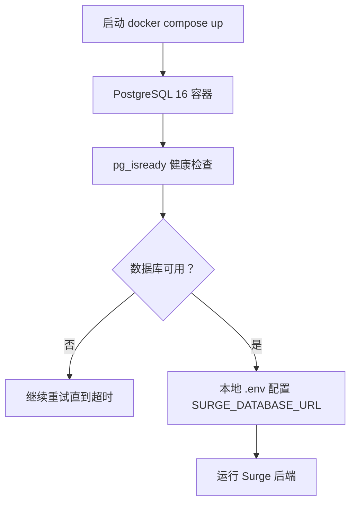
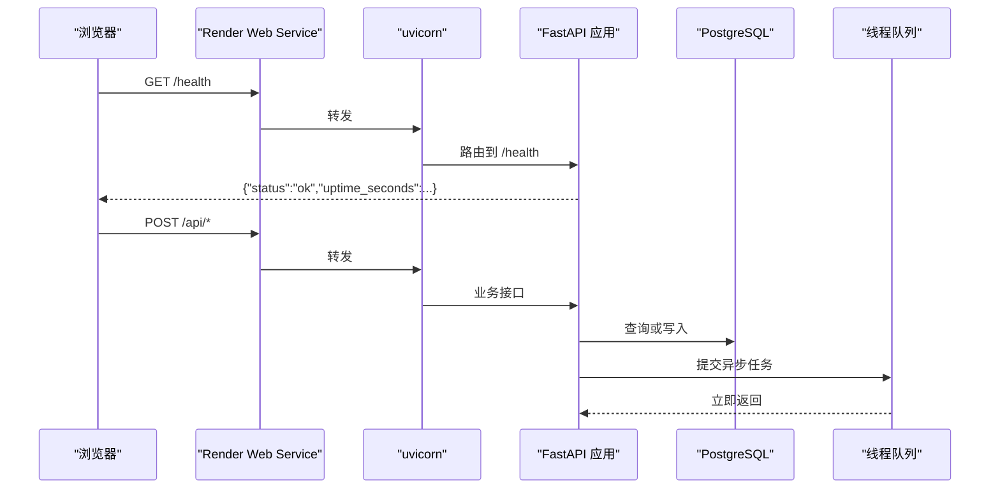
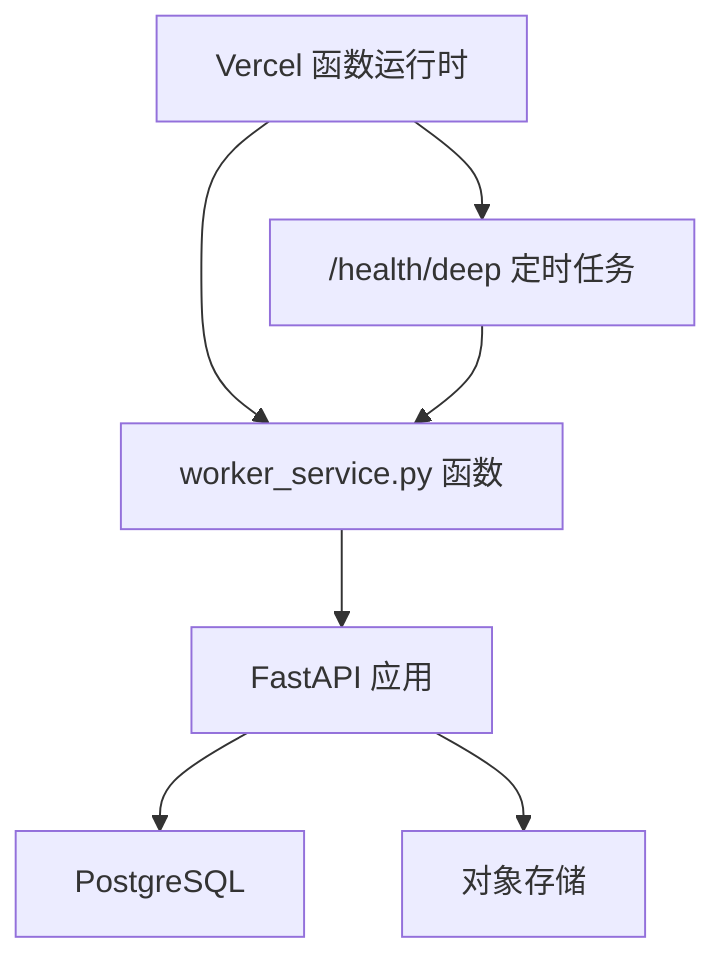
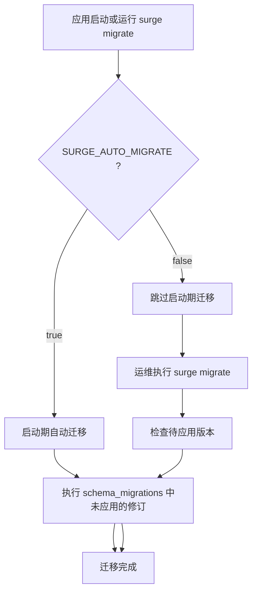
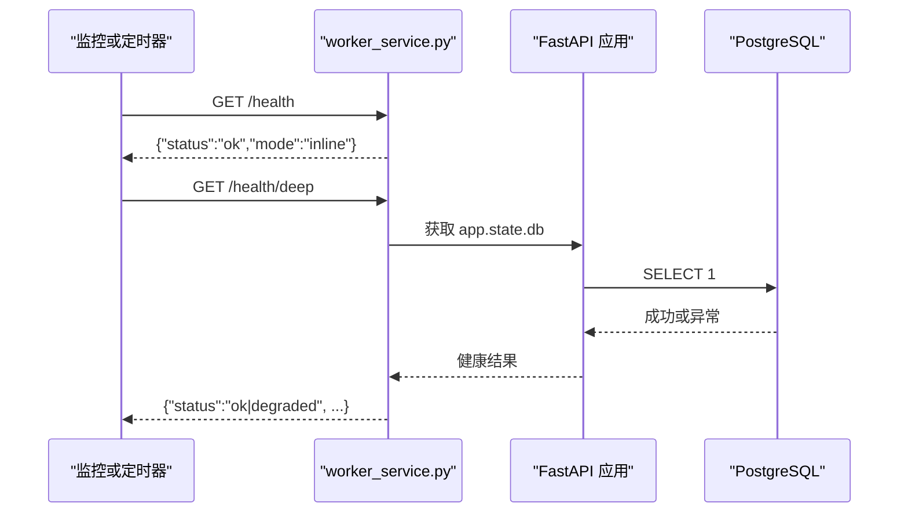
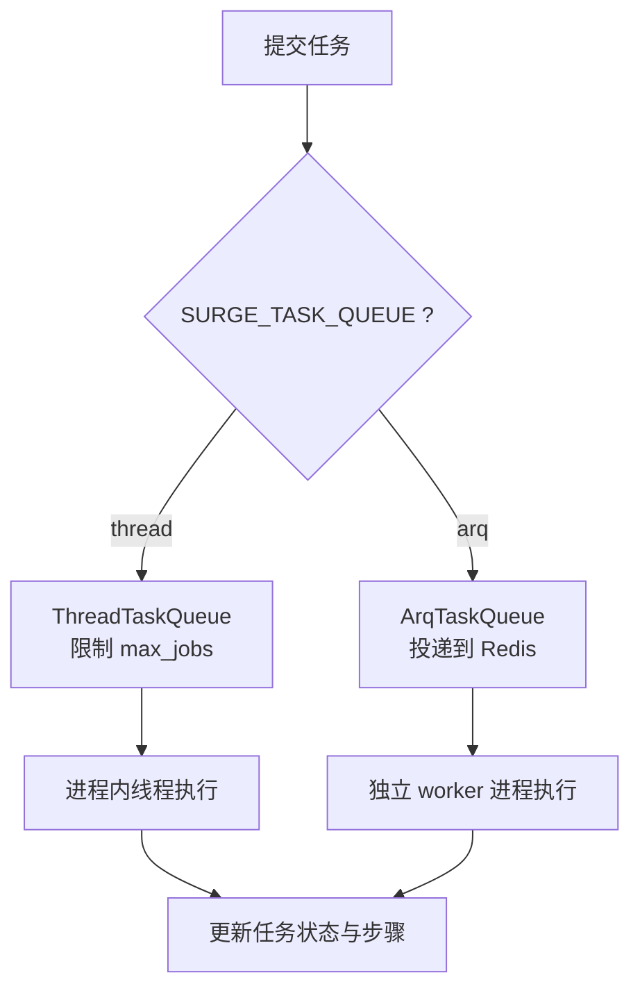

# 部署与运维

<cite>
**本文引用的文件**
- [README.md](file://README.md)
- [docker-compose.yml](file://docker-compose.yml)
- [render.yaml](file://render.yaml)
- [vercel.json](file://vercel.json)
- [pyproject.toml](file://backend/pyproject.toml)
- [requirements.txt](file://requirements.txt)
- [backend/surge/config.py](file://backend/surge/config.py)
- [backend/surge/app.py](file://backend/surge/app.py)
- [backend/surge/worker_service.py](file://backend/surge/worker_service.py)
- [backend/surge/cli.py](file://backend/surge/cli.py)
- [backend/surge/persistence/db.py](file://backend/surge/persistence/db.py)
- [backend/surge/persistence/migrations.py](file://backend/surge/persistence/migrations.py)
- [backend/surge/services/queue.py](file://backend/surge/services/queue.py)
- [backend/surge/auth.py](file://backend/surge/auth.py)
- [backend/surge/persistence/storage.py](file://backend/surge/persistence/storage.py)
- [backend/surge/api/deps.py](file://backend/surge/api/deps.py)
</cite>

## 目录
1. [简介](#简介)
2. [生产环境要求](#生产环境要求)
3. [环境变量配置说明](#环境变量配置说明)
4. [部署方式](#部署方式)
5. [数据库迁移与备份恢复](#数据库迁移与备份恢复)
6. [监控、日志与健康检查](#监控日志与健康检查)
7. [性能调优](#性能调优)
8. [故障排除清单](#故障排除清单)
9. [结论](#结论)

## 简介
Surge 是跨境电商 AI 运营工作台，后端使用 FastAPI + PostgreSQL 16，前端为 Vite 构建产物。它支持线程执行器与可选的 arq 队列、本地或 Supabase Storage 对象存储，并提供 Render 与 Vercel 两种云平台部署路径。本文面向生产运维人员，重点说明运行要求、`.env` 变量、多种部署方式、迁移策略、监控与常见问题排查。

## 生产环境要求
- Python ≥ 3.10（仓库 `backend/pyproject.toml` 声明 `requires-python = ">=3.10"`）。
- PostgreSQL 16：应用唯一数据库后端，不再支持 SQLite。
- 可选 Redis：仅当 `SURGE_TASK_QUEUE=arq` 时需要，用于独立 worker 任务队列。
- 可选对象存储：`local` 默认写入 `backend/data/uploads`；`supabase` 走 Supabase Storage REST API。
- 推荐在 HTTPS 反向代理后运行，并设置 Cookie 安全选项。

**章节来源**
- [pyproject.toml:1-49](file://backend/pyproject.toml#L1-L49)
- [backend/surge/persistence/db.py:1-30](file://backend/surge/persistence/db.py#L1-L30)
- [backend/surge/persistence/storage.py:1-25](file://backend/surge/persistence/storage.py#L1-L25)

## 环境变量配置说明
所有配置统一以 `SURGE_` 前缀读取，由 Pydantic Settings 加载 `.env` 文件。最小必要项是 `SURGE_DATABASE_URL`；其余变量控制安全、跨域、上传大小、任务队列和存储后端。

| 变量 | 默认值 | 说明与部署建议 |
|---|---|---|
| `SURGE_DATABASE_URL` | 空 | PostgreSQL 连接串；未设置时应用拒绝启动。 |
| `SURGE_MIGRATION_DATABASE_URL` | 空 | 迁移专用直连串；为空则回退到 `SURGE_DATABASE_URL`。Supabase 直连端口 5432 更适合 DDL。 |
| `SURGE_HOST` / `SURGE_PORT` | `127.0.0.1` / `8000` | uvicorn 监听地址与端口；容器或云托管通常设为 `0.0.0.0`。 |
| `SURGE_SECRET_KEY` | 留空时回退到 `backend/data/.secret_key` | API Key 加密主密钥；一旦设定不要修改，否则已保存的旧 Key 无法解密。Serverless 部署必须显式设置。 |
| `SURGE_REQUIRE_API_KEY` | `true` | BYOK 强制；本地调试可关闭，生产建议保持开启。 |
| `SURGE_PROVIDER` | `rule` | 进程级默认模型 Provider；无用户配置时的兜底行为。 |
| `SURGE_RATE_LIMIT_ENABLED` | `true` | 是否启用限流。 |
| `SURGE_RATE_LIMIT_TASKS_PER_HOUR` | `10` | 每账号每小时任务数限制。 |
| `SURGE_RATE_LIMIT_KEY_TESTS_PER_HOUR` | `5` | 每账号每小时模型 Key 测试次数限制。 |
| `SURGE_ALLOW_OPEN_REGISTRATION` | `true` | 关闭后除首个用户外需邀请令牌。演示站通常关闭。 |
| `SURGE_TASK_QUEUE` | `thread` | `thread` 为进程内线程池；`arq` 需要 Redis 与独立 worker。 |
| `SURGE_REDIS_URL` | `redis://127.0.0.1:6379/0` | arq 队列使用的 Redis 连接串。 |
| `SURGE_AUTO_MIGRATE` | `true` | 启动时自动迁移；生产建议设为 `false`，改用显式 `surge migrate`。 |
| `SURGE_COOKIE_SECURE` | `false` | HTTPS 部署时必须设为 `true`，否则浏览器可能拒绝发送 Cookie。 |
| `SURGE_STORAGE_BACKEND` | `local` | `local` 使用本地文件系统；`supabase` 使用 Supabase Storage。 |
| `SURGE_SUPABASE_URL` | 空 | Supabase 项目 URL。 |
| `SURGE_SUPABASE_SERVICE_KEY` | 空 | Supabase Storage 所需 service role key。 |
| `SURGE_SUPABASE_BUCKET` | `surge` | Supabase Storage bucket 名称。 |
| `SURGE_ALLOWED_ORIGINS` | 空 | CORS 允许来源，逗号分隔；空表示仅同源。 |
| `SURGE_MAX_UPLOAD_BYTES` | 5 MB | 请求体上传大小上限。 |
| `SURGE_WEB_DIR` | `frontend/dist` | 前端静态资源目录；Render 示例中设为 `../frontend/dist`。 |
| `SURGE_ENV_FILE` | `backend/.env` | 指定配置文件路径；CLI 可通过 `--env` 简写。 |
| `SURGE_WORKER_MODE` | 未设置时按环境变量推断 | 健康检查返回当前 worker 模式，Render 示例中设为 `inline`。 |
| `SURGE_MAX_JOBS` | `4` | 线程执行器最大同时任务数；免费实例建议设为 `2`。 |
| `SURGE_FORCE_SYNC_TASKS` | `false` | Serverless 场景下强制同步执行任务，避免后台线程被冻结。 |
| `SURGE_PROFILE` | `false` | 打开后响应头带性能观测信息，并输出结构化日志。 |
| `SURGE_DB_POOL_SIZE` | `8` | 每个 DSN 的连接池大小。 |
| `SURGE_CHECKPOINT_BACKEND` | `auto` | 工作流检查点后端：`auto`、`postgres`、`memory`。 |

配置定位规则：
- 默认使用 `backend/.env`。
- CLI 的 `--env local` 等价于不传参，即指向 `backend/.env`。
- `--env cloud` 会查找 `backend/.env.cloud`；找不到文件直接报错，不会静默回退。
- 也可通过 `SURGE_ENV_FILE` 传入绝对路径。

CORS 与安全 Cookie：
- 只有显式配置 `SURGE_ALLOWED_ORIGINS` 时才添加 CORS 中间件，默认同源访问。
- HTTPS 部署必须设置 `SURGE_COOKIE_SECURE=true`，否则会话 Cookie 不会被浏览器发送。

**章节来源**
- [backend/surge/config.py:1-264](file://backend/surge/config.py#L1-L264)
- [backend/surge/app.py:120-160](file://backend/surge/app.py#L120-L160)
- [backend/surge/worker_service.py:1-40](file://backend/surge/worker_service.py#L1-L40)
- [README.md:130-190](file://README.md#L130-L190)

## 部署方式

### 本地开发
适合首次安装、联调与测试。

步骤：
1. 安装依赖：进入 `backend/`，创建虚拟环境并安装 `requirements.txt`。
2. 准备 PostgreSQL 16：可直接用仓库 `docker-compose.yml` 启动，或使用系统自带 PG。
3. 复制并编辑 `.env`，至少填写 `SURGE_DATABASE_URL`。
4. 启动服务：
   - 已安装包：`python -m surge serve --port 8000`。
   - 未安装包：设置 `PYTHONPATH=.` 后执行 `python -m surge serve --port 8000`。
   - 直接 uvicorn：`uvicorn surge.worker_service:app --host 127.0.0.1 --port 8000`。
5. 首次访问 `http://127.0.0.1:8000/` 引导创建管理员账号。

本地常用命令：
- `python -m surge check`：检查依赖、规则文件、数据库连通性。
- `python -m surge migrate`：查看并应用迁移版本。
- `python -m surge demo`：终端验证竞品分析与 Listing 生成流程。

**章节来源**
- [README.md:90-170](file://README.md#L90-L170)
- [backend/surge/cli.py:1-120](file://backend/surge/cli.py#L1-L120)
- [docker-compose.yml:1-22](file://docker-compose.yml#L1-L22)

### Docker Compose
仓库根提供 `docker-compose.yml`，主要作用是快速拉起 PostgreSQL 16：
- 镜像：`postgres:16-alpine`。
- 容器名：`cp-pg`。
- 数据库：`surge`，用户 `postgres`，密码 `postgres`。
- 端口映射：`5432:5432`。
- 数据卷：`cp-pg-data` 持久化到宿主机。
- 健康检查：使用 `pg_isready`，间隔 5 秒，最多重试 10 次。

部署时还需自行运行 Surge 后端；该 Compose 不包含应用服务。

**图示来源**
- [docker-compose.yml:1-22](file://docker-compose.yml#L1-L22)

**章节来源**
- [docker-compose.yml:1-22](file://docker-compose.yml#L1-L22)

### Render 云平台
`render.yaml` 定义了一个常驻 Python Web Service，API 与线程任务队列同进程运行：
- 运行时：Python，根目录 `backend`。
- 构建命令：`pip install -r requirements.txt`。
- 启动命令：`uvicorn surge.worker_service:app --host 0.0.0.0 --port $PORT --workers 1`。
- 健康检查路径：`/health`。
- 区域：新加坡，与 Supabase 示例项目同区域以降低延迟。
- 队列：`SURGE_TASK_QUEUE=thread`，无需 Redis。
- 自动迁移：`SURGE_AUTO_MIGRATE=false`，由外部显式迁移。
- 存储：`SURGE_STORAGE_BACKEND=supabase`，bucket 示例为 `jilang`。
- 前端：通过 `SURGE_WEB_DIR=../frontend/dist` 提供静态站点。
- 注册：演示站关闭开放注册，只允许邀请或演示账号。
- 敏感变量：数据库连接串、SecretKey、Supabase 凭据等标记为 `sync: false`，需在 Dashboard 手工填入。

注意事项：
- 免费实例 15 分钟无访问会休眠，冷启动约 30–60 秒。
- 建议用外部定时任务每 10 分钟访问 `/health/deep`，既保活又避免 Supabase 免费项目长期无活动暂停。

**图示来源**
- [render.yaml:1-74](file://render.yaml#L1-L74)
- [backend/surge/worker_service.py:1-94](file://backend/surge/worker_service.py#L1-L94)
- [backend/surge/app.py:40-160](file://backend/surge/app.py#L40-L160)

**章节来源**
- [render.yaml:1-74](file://render.yaml#L1-L74)
- [backend/surge/worker_service.py:1-94](file://backend/surge/worker_service.py#L1-L94)

### Vercel 静态站点与函数
仓库提供两套与 Vercel 相关的配置：
- 根 `pyproject.toml` 将 Vercel 入口指向 `backend.surge.worker_service:app`。
- 根 `vercel.json` 定义函数、定时任务与通用响应头。

关键行为：
- `backend/surge/worker_service.py` 作为 Vercel Python Function，最长执行时间 300 秒。
- 定时任务每天凌晨 3 点调用 `/health/deep`，用于深度健康检查与保活。
- CSS、JS、媒体资源设置缓存头；其他路径设置安全响应头。
- Serverless 平台不支持常驻进程内后台线程，因此应配合 `SURGE_FORCE_SYNC_TASKS=true`，让任务在当前请求内同步完成，避免任务永远停留在 running 状态。
- 由于 Vercel 文件系统只读，`SURGE_SECRET_KEY` 必须显式设置，不能依赖自动生成的密钥文件。
- 若前端也托管在 Vercel，应通过环境变量注入后端域名，并通过 `SURGE_ALLOWED_ORIGINS` 放行前端来源。

**图示来源**
- [vercel.json:1-27](file://vercel.json#L1-L27)
- [pyproject.toml:1-16](file://pyproject.toml#L1-L16)
- [backend/surge/worker_service.py:1-94](file://backend/surge/worker_service.py#L1-L94)

**章节来源**
- [vercel.json:1-27](file://vercel.json#L1-L27)
- [pyproject.toml:1-16](file://pyproject.toml#L1-L16)
- [backend/surge/worker_service.py:1-94](file://backend/surge/worker_service.py#L1-L94)

## 数据库迁移与备份恢复

### 迁移策略
应用使用轻量版本化迁移机制，不在 `schema_migrations` 表中的修订会按顺序执行；已执行版本永不重跑。核心原则：
- 迁移只增不改：不删除表、不删列、不改已有列类型。
- 每个修订幂等：重复执行不报错。
- 历史修订不可覆盖，需要变更时应新增修订版本。
- 迁移与建表在同一事务中执行，失败会回滚，不留半套结构。

运行时行为：
- 默认 `SURGE_AUTO_MIGRATE=true`，应用启动时自动迁移。
- 生产建议 `SURGE_AUTO_MIGRATE=false`，由 CI 或运维手动执行 `surge migrate`。
- 迁移优先使用 `SURGE_MIGRATION_DATABASE_URL`；若为空则回退到 `SURGE_DATABASE_URL`。
- CLI 会打印每个 revision 的状态、名称和应用时间，未应用的迁移会导致命令退出码非零。

**图示来源**
- [backend/surge/app.py:40-80](file://backend/surge/app.py#L40-L80)
- [backend/surge/cli.py:150-210](file://backend/surge/cli.py#L150-L210)
- [backend/surge/persistence/migrations.py:1-40](file://backend/surge/persistence/migrations.py#L1-L40)

**章节来源**
- [backend/surge/persistence/migrations.py:1-40](file://backend/surge/persistence/migrations.py#L1-L40)
- [backend/surge/cli.py:150-210](file://backend/surge/cli.py#L150-L210)
- [backend/surge/app.py:40-80](file://backend/surge/app.py#L40-L80)

### 备份与恢复建议
- 数据库：使用 PostgreSQL 原生工具备份整个 `surge` 库，包括会话、审计日志、任务记录、Listing 与报告数据。
- 对象存储：
  - `local` 模式：备份 `backend/data/uploads` 与 `backend/data/.secret_key`。
  - `supabase` 模式：通过 Supabase 控制台或 S3 兼容工具备份对应 bucket。
- 密钥：`SURGE_SECRET_KEY` 必须与备份一致；更换 SecretKey 会导致已加密的用户 API Key 无法解密。
- 恢复顺序：先恢复数据库，再恢复对象存储，最后确认 `SURGE_SECRET_KEY` 与线上一致。

**章节来源**
- [backend/surge/persistence/storage.py:1-120](file://backend/surge/persistence/storage.py#L1-L120)
- [backend/surge/config.py:180-264](file://backend/surge/config.py#L180-L264)

## 监控、日志与健康检查

### 健康检查端点
- `/health`：进程存活探针，返回状态、运行时间与 worker 模式，不查数据库，适合快速保活。
- `/health/deep`：深度健康检查，包含数据库连通、任务队列名称、Provider 名称、存储后端名称；数据库异常时返回 `degraded` 状态及错误信息。

**图示来源**
- [backend/surge/worker_service.py:40-94](file://backend/surge/worker_service.py#L40-L94)

### 日志
- 基础日志格式由 `logging.basicConfig` 配置，级别由 `SURGE_LOG_LEVEL` 控制，默认 `INFO`。
- 启动时会记录队列后端、存储后端、演示账号开关、是否要求 API Key、是否自动迁移。
- 数据库不可用时记录警告，而不是把驱动堆栈暴露给前端。
- 可选性能观测：`SURGE_PROFILE=true` 时输出 `Server-Timing`、`X-Perf` 头，并把分段耗时写入日志。

**章节来源**
- [backend/surge/worker_service.py:20-94](file://backend/surge/worker_service.py#L20-L94)
- [backend/surge/app.py:60-120](file://backend/surge/app.py#L60-L120)

## 性能调优

### 线程执行器 vs arq
| 特性 | `thread` | `arq` |
|---|---|---|
| 依赖 | 无额外依赖 | 需 `arq` 与 `redis` |
| 进程模型 | 与 API 同进程 | 独立 worker 进程 |
| 取消机制 | 线程事件对象，检查点中断 | 通过数据库状态协作 |
| 适用场景 | 单机、Render 常驻进程、小并发 | 多 worker、高并发、需要进程隔离 |
| 风险 | 内存受进程限制，需限制 `max_jobs` | 需要维护 Redis 可用性 |

默认 `SURGE_TASK_QUEUE=thread`。线程执行器通过 `BoundedSemaphore` 限制同时执行任务数，超出上限的任务在各自线程排队，API 仍“提交即返回”。免费实例内存较小，建议 `SURGE_MAX_JOBS=2`。

**图示来源**
- [backend/surge/services/queue.py:1-120](file://backend/surge/services/queue.py#L1-L120)
- [backend/surge/services/queue.py:120-250](file://backend/surge/services/queue.py#L120-L250)

**章节来源**
- [backend/surge/services/queue.py:1-250](file://backend/surge/services/queue.py#L1-L250)
- [backend/surge/config.py:120-200](file://backend/surge/config.py#L120-L200)

### 限流
- `SURGE_RATE_LIMIT_ENABLED=true` 时启用限流。
- 任务限流：`SURGE_RATE_LIMIT_TASKS_PER_HOUR`。
- Key 测试限流：`SURGE_RATE_LIMIT_KEY_TESTS_PER_HOUR`。
- 演示账号按 IP 限流：`rate_limit_guest_per_hour`。
- 超限返回 429，并携带 `Retry-After` 响应头。

**章节来源**
- [backend/surge/config.py:100-140](file://backend/surge/config.py#L100-L140)
- [backend/surge/api/deps.py:120-200](file://backend/surge/api/deps.py#L120-L200)

### 上传大小限制
- `SURGE_MAX_UPLOAD_BYTES` 默认 5 MB。
- 超过限制的请求会在 FastAPI 层校验失败，返回 422。
- 生产环境应根据导入文件大小调整该值，但应避免过大导致内存压力。

**章节来源**
- [backend/surge/config.py:80-100](file://backend/surge/config.py#L80-L100)
- [README.md:160-190](file://README.md#L160-L190)

## 故障排除清单

| 现象 | 可能原因 | 排查与处理 |
|---|---|---|
| 数据库连接失败 | PostgreSQL 未启动、连接串错误、网络不通 | 检查 `SURGE_DATABASE_URL`；本地先用 `docker compose up -d`；远程检查 SSL、防火墙与 pooler 端口。 |
| 端口占用 | 本机 8000 或其他端口已被占用 | 使用 `--port` 指定新端口，或终止占用进程。 |
| `ModuleNotFoundError` | Python 依赖未安装或包未安装 | 进入 `backend/` 执行 `pip install -r requirements.txt`；或 `pip install -e .`。 |
| `No module named surge` | 在仓库根而非 `backend/` 下执行命令 | 回到 `backend/`，或设置 `PYTHONPATH=.`。 |
| SecretKey 变更后旧 Key 失效 | `SURGE_SECRET_KEY` 改变导致已加密 API Key 无法解密 | 不要随意更换 SecretKey；如需轮换，需重新录入用户 API Key。 |
| CORS 跨域失败 | 前端域名与 API 域名不同且未配置允许来源 | 设置 `SURGE_ALLOWED_ORIGINS`，注意逗号分隔，生产建议精确列出域名。 |
| HTTPS 下 Cookie 无效 | 未设置 `SURGE_COOKIE_SECURE=true` | 在 HTTPS 反向代理后部署时启用 Cookie Secure。 |
| 迁移一直提示未应用 | 使用了 pooler 或非直连连接串 | 使用 `SURGE_MIGRATION_DATABASE_URL` 指向 Supabase 直连 5432，然后执行 `surge migrate`。 |
| 渲染平台任务永远 running | Serverless 平台冻结了进程内后台线程 | 设置 `SURGE_FORCE_SYNC_TASKS=true`，让任务在当前请求内同步完成。 |
| 存储读写失败 | 本地权限不足或 Supabase 凭据错误 | 检查 `data/uploads` 目录权限；核对 `SURGE_SUPABASE_URL`、`SERVICE_KEY`、`BUCKET`。 |
| 登录频繁掉线 | Cookie 过期或会话哈希不一致 | 检查会话 TTL、数据库会话表、是否因 SecretKey 变化导致鉴权异常。 |
| 健康检查正常但业务接口报 503 | 数据库瞬时不可用或连接池耗尽 | 查看 `/health/deep` 中 database 字段；适当增大 `db_pool_size` 或优化慢查询。 |

常见错误来源定位：
- 数据库连接参数由 `_connect_kwargs` 与 `_pool_kwargs` 处理，含 `connect_timeout`、`sslmode`、`prepare_threshold`。
- 认证会话令牌采用随机 token 并存储其 SHA-256，密码使用 scrypt 哈希。
- 存储后端对 key 做路径安全检查，拒绝 `..` 与越界路径。

**章节来源**
- [backend/surge/persistence/db.py:60-120](file://backend/surge/persistence/db.py#L60-L120)
- [backend/surge/auth.py:1-120](file://backend/surge/auth.py#L1-L120)
- [backend/surge/persistence/storage.py:60-120](file://backend/surge/persistence/storage.py#L60-L120)
- [README.md:150-200](file://README.md#L150-L200)

## 结论
Surge 的生产部署应以 PostgreSQL 16 为核心，结合 `.env` 明确配置数据库、SecretKey、CORS、Cookie 安全与对象存储。本地开发可使用 Docker Compose 快速起库；Render 适合常驻进程与线程队列；Vercel 适合函数式部署，但需开启同步任务模式并注意 SecretKey 必须显式设置。生产环境建议关闭自动迁移、启用限流、合理限制上传大小与并发任务数，并通过 `/health` 与 `/health/deep` 建立稳定监控。遇到数据库、跨域、Cookie、迁移与存储问题时，按本文清单逐项核对环境变量与后端状态。