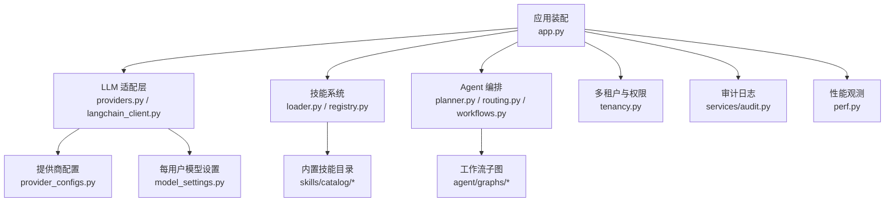
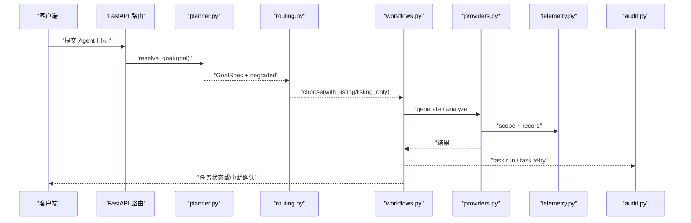
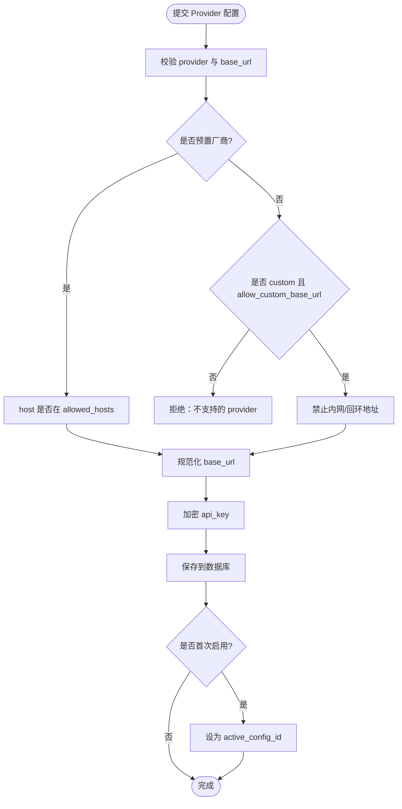
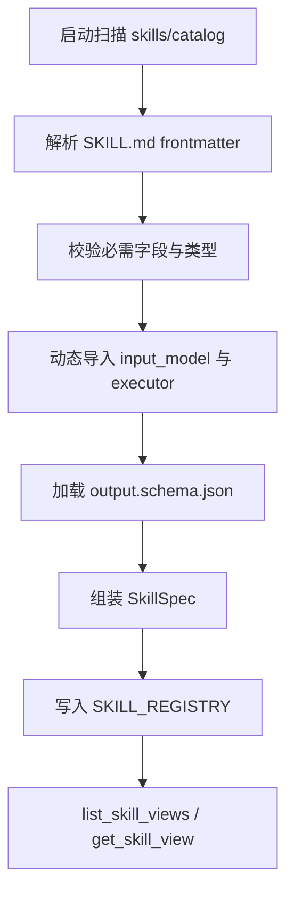
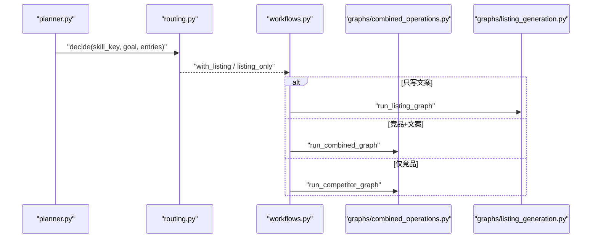
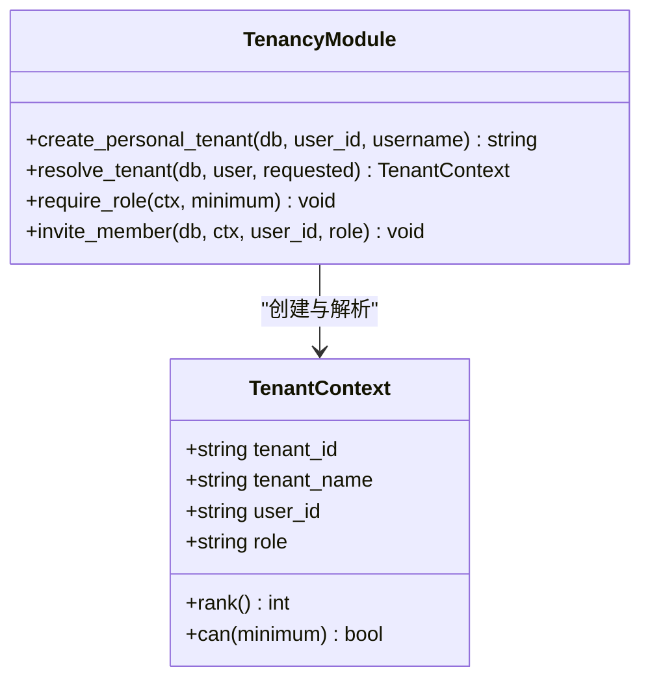
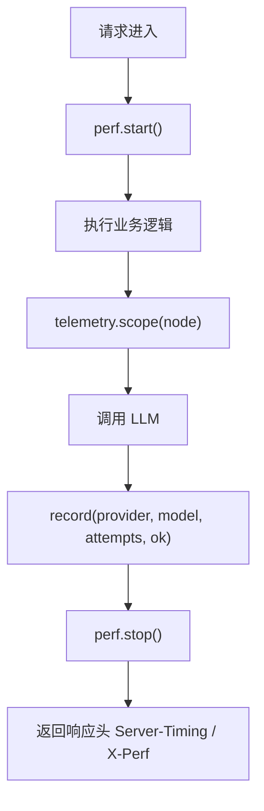
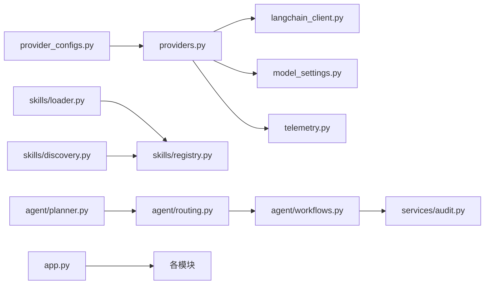

# 高级主题

<cite>
**本文引用的文件**   
- [backend/surge/llm/provider_configs.py](file://backend/surge/llm/provider_configs.py)
- [backend/surge/llm/providers.py](file://backend/surge/llm/providers.py)
- [backend/surge/llm/model_settings.py](file://backend/surge/llm/model_settings.py)
- [backend/surge/llm/langchain_client.py](file://backend/surge/llm/langchain_client.py)
- [backend/surge/llm/telemetry.py](file://backend/surge/llm/telemetry.py)
- [backend/surge/skills/loader.py](file://backend/surge/skills/loader.py)
- [backend/surge/skills/registry.py](file://backend/surge/skills/registry.py)
- [backend/surge/skills/frontmatter.py](file://backend/surge/skills/frontmatter.py)
- [backend/surge/skills/discovery.py](file://backend/surge/skills/discovery.py)
- [backend/surge/agent/planner.py](file://backend/surge/agent/planner.py)
- [backend/surge/agent/routing.py](file://backend/surge/agent/routing.py)
- [backend/surge/agent/workflows.py](file://backend/surge/agent/workflows.py)
- [backend/surge/perf.py](file://backend/surge/perf.py)
- [backend/surge/app.py](file://backend/surge/app.py)
- [backend/surge/auth.py](file://backend/surge/auth.py)
- [backend/surge/services/audit.py](file://backend/surge/services/audit.py)
- [backend/surge/tenancy.py](file://backend/surge/tenancy.py)
</cite>

## 目录
1. [引言](#引言)
2. [项目结构](#项目结构)
3. [核心组件](#核心组件)
4. [架构总览](#架构总览)
5. [详细组件分析](#详细组件分析)
6. [依赖关系分析](#依赖关系分析)
7. [性能与观测](#性能与观测)
8. [故障排查](#故障排查)
9. [结论](#结论)

## 引言
本文面向需要深度使用 Surge 的高级用户，聚焦六个专题：自定义 LLM 提供商接入、Skill 扩展开发、Agent 工作流进阶、多租户与权限模型、性能观测与安全考虑。每个专题给出代码路径、关键行为说明、配置要点和常见陷阱，帮助你在不改动前端的情况下安全地扩展后端能力。

## 项目结构
Surge 的后端以 `backend/surge` 为核心包，按能力分层组织：
- `llm/`：LLM 客户端、厂商配置、遥测；
- `skills/`：技能目录加载、注册表、发现与执行；
- `agent/`：目标解析、路由、工作流分派与子图；
- `services/`：审计、任务队列、导入等横切服务；
- `persistence/`：数据库、加密存储、迁移；
- `api/`：FastAPI 路由层，统一由 `app.py` 装配。

**图示来源**
- [backend/surge/app.py:1-100](file://backend/surge/app.py#L1-L100)
- [backend/surge/llm/providers.py:1-80](file://backend/surge/llm/providers.py#L1-L80)
- [backend/surge/llm/langchain_client.py:1-60](file://backend/surge/llm/langchain_client.py#L1-L60)
- [backend/surge/skills/loader.py:1-40](file://backend/surge/skills/loader.py#L1-L40)
- [backend/surge/agent/planner.py:1-40](file://backend/surge/agent/planner.py#L1-L40)
- [backend/surge/agent/workflows.py:1-60](file://backend/surge/agent/workflows.py#L1-L60)
- [backend/surge/tenancy.py:1-40](file://backend/surge/tenancy.py#L1-L40)
- [backend/surge/services/audit.py:1-40](file://backend/surge/services/audit.py#L1-L40)
- [backend/surge/perf.py:1-40](file://backend/surge/perf.py#L1-L40)

**章节来源**
- [backend/surge/app.py:1-100](file://backend/surge/app.py#L1-L100)

## 核心组件
- **LLM 提供商**：OpenAI 兼容协议通过 `base_url + model` 复用同一实现；Anthropic/Gemini 走 LangChain 原生适配；规则引擎作为离线降级。
- **技能系统**：平台内置 7 个 Skill 以目录形式存在，SKILL.md frontmatter 描述元数据，output.schema.json 描述输出结构，`loader.py` 启动扫描，`registry.py` 暴露清单。
- **Agent 工作流**：planner 负责把自然语言目标解析为结构化参数；routing 决定本次要调用哪些技能；workflows 只负责选图并分派到竞品、组合或 Listing 子图。
- **多租户**：`X-Tenant-Id` 表示切换目标租户，必须校验成员关系；个人空间自动创建；viewer/editor/admin/owner 四级角色控制操作。
- **性能观测**：`perf.py` 提供请求级分段计时；LLM 遥测记录节点、耗时、token 与重试次数；任务重试与断点续跑由工作流版本与输入指纹共同保护。
- **安全**：SURGE_SECRET_KEY 不可随意更换；BYOK 强制校验 base_url 白名单与内网拦截；审计日志脱敏；CORS 仅当显式配置允许来源时启用。

**章节来源**
- [backend/surge/llm/providers.py:1-120](file://backend/surge/llm/providers.py#L1-L120)
- [backend/surge/llm/langchain_client.py:1-60](file://backend/surge/llm/langchain_client.py#L1-L60)
- [backend/surge/skills/loader.py:1-40](file://backend/surge/skills/loader.py#L1-L40)
- [backend/surge/agent/planner.py:1-40](file://backend/surge/agent/planner.py#L1-L40)
- [backend/surge/agent/workflows.py:1-60](file://backend/surge/agent/workflows.py#L1-L60)
- [backend/surge/tenancy.py:1-40](file://backend/surge/tenancy.py#L1-L40)
- [backend/surge/perf.py:1-40](file://backend/surge/perf.py#L1-L40)
- [backend/surge/services/audit.py:1-40](file://backend/surge/services/audit.py#L1-L40)

## 架构总览
下图展示一次 Agent 运行的主路径：请求进入 FastAPI 后，由 planner 解析目标、routing 选择技能，workflows 再根据 `with_listing` / `listing_only` 分派到不同子图；Provider 在生成 Listing 时调用 LLM，遥测与审计贯穿全过程。

**图示来源**
- [backend/surge/agent/planner.py:1-120](file://backend/surge/agent/planner.py#L1-L120)
- [backend/surge/agent/routing.py:1-120](file://backend/surge/agent/routing.py#L1-L120)
- [backend/surge/agent/workflows.py:201-360](file://backend/surge/agent/workflows.py#L201-L360)
- [backend/surge/llm/providers.py:201-375](file://backend/surge/llm/providers.py#L201-L375)
- [backend/surge/llm/telemetry.py:1-120](file://backend/surge/llm/telemetry.py#L1-L120)
- [backend/surge/services/audit.py:1-80](file://backend/surge/services/audit.py#L1-L80)

## 详细组件分析

### 自定义 LLM 提供商接入
#### 设计要点
- OpenAI 兼容厂商（DeepSeek、OpenAI、Moonshot、智谱、通义、硅基流动、OpenRouter、Ollama）共用 `DeepSeekProvider`，差异只在 `base_url` 与 `model`。
- Anthropic 与 Google Gemini 是原生协议，通过 `langchain_client.py` 包装成统一的聊天客户端契约。
- 每用户可保存多套 Provider 配置，`active_config_id` 决定默认；首次激活会自动选择首套可用配置。
- `base_url` 做白名单校验：预置厂商 host 必须匹配，`custom` 需显式允许且拒绝内网回环地址，防止 SSRF。
- SURGE_SECRET_KEY 用于加密 API Key，Key 落库前做格式检查，接口只返回掩码。

#### 关键流程

**图示来源**
- [backend/surge/llm/provider_configs.py:1-120](file://backend/surge/llm/provider_configs.py#L1-L120)
- [backend/surge/llm/provider_configs.py:201-420](file://backend/surge/llm/provider_configs.py#L201-L420)
- [backend/surge/llm/providers.py:201-375](file://backend/surge/llm/providers.py#L201-L375)

#### 实际代码路径
- 预置厂商与白名单校验：[backend/surge/llm/provider_configs.py:1-200](file://backend/surge/llm/provider_configs.py#L1-L200)、[backend/surge/llm/provider_configs.py:201-250](file://backend/surge/llm/provider_configs.py#L201-L250)
- 多套配置与服务：[backend/surge/llm/provider_configs.py:251-574](file://backend/surge/llm/provider_configs.py#L251-L574)
- 每用户生效配置与进程默认值合并：[backend/surge/llm/model_settings.py:1-200](file://backend/surge/llm/model_settings.py#L1-L200)
- OpenAI 兼容 Provider 构建与降级：[backend/surge/llm/providers.py:201-375](file://backend/surge/llm/providers.py#L201-L375)
- 原生协议适配：[backend/surge/llm/langchain_client.py:1-256](file://backend/surge/llm/langchain_client.py#L1-L256)

#### 配置示例
- 环境变量默认值（进程级）：
  - `deepseek_api_key`、`openai_api_key`：作为默认 Key 来源。
  - `deepseek_base_url`、`openai_base_url`：作为默认接口地址。
  - `deepseek_model`、`openai_model`：作为默认模型名。
  - `deepseek_timeout`、`deepseek_max_retries`、`deepseek_temperature`、`deepseek_thinking`、`deepseek_reasoning_effort`：运行时参数。
- 每用户覆盖值：通过设置页提交 `provider`、`model`、`base_url`、`api_key`、`temperature`、`max_tokens`、`timeout`、`max_retries`、`thinking`、`reasoning_effort`，缺失字段回退到进程默认值。
- SURGE_PROVIDER：若业务侧仍通过进程级 settings 选择默认 Provider，则对应字段会被 `build_provider` 读取；新增自定义厂商时务必同时出现在 `PRESET_BY_KEY` 中，否则构建阶段会报“不支持的模型厂商”。

#### 连通性测试与模型列表
- `ping()` 发极小请求验证连通性；`list_models()` 通过 OpenAI 兼容 `/models` 或原生 SDK 拉取当前账号可用模型。
- 模型列表失败时会抛出可分类的 `LLMError`，上层转为 `ProviderConfigError`，提示先填 Key 或安装依赖。

#### 常见陷阱
- 自定义 base_url 未勾选 `allow_custom_base_url`：白名单直接拒绝。
- 自定义地址指向内网或云元数据地址：被 `_is_private_host` 拦截。
- Ollama 没有 API Key：Provider 允许空 Key，但 LangChain 客户端构造时需要占位值。
- 改了 `provider` 却忘了加进 `PRESET_BY_KEY`：`build_provider` 会在运行时抛错。
- 频繁更换 SURGE_SECRET_KEY：已加密 Key 将无法解密，用户会看到解密警告，相当于所有 Key 失效。

**章节来源**
- [backend/surge/llm/provider_configs.py:1-250](file://backend/surge/llm/provider_configs.py#L1-L250)
- [backend/surge/llm/provider_configs.py:251-574](file://backend/surge/llm/provider_configs.py#L251-L574)
- [backend/surge/llm/model_settings.py:1-200](file://backend/surge/llm/model_settings.py#L1-L200)
- [backend/surge/llm/providers.py:201-375](file://backend/surge/llm/providers.py#L201-L375)
- [backend/surge/llm/langchain_client.py:1-256](file://backend/surge/llm/langchain_client.py#L1-L256)

### 扩展 Skill 开发
#### 平台内置 7 个 Skill 的结构
仓库中 `backend/surge/skills/catalog` 下包含多个技能目录，典型结构为：
- `competitor_analysis/`
- `data_validation/SKILL.md` 与 `output.schema.json`
- `listing_generation/output.schema.json`
- `listing_quality/output.schema.json`
- `market_summary/output.schema.json`
- `profit_calc/output.schema.json`
- `review_mining/output.schema.json`

其中 `data_validation` 提供了 SKILL.md 示例，其余多数以 output schema 为主；`loader.py` 要求每个目录至少有一份 SKILL.md，否则启动即失败。

#### SKILL.md frontmatter
frontmatter 采用受控 YAML 子集，支持：
- 扁平键值对；
- 行内列表 `[a, b]`；
- 块列表 `- item`；
- 不支持嵌套映射，复杂结构用 Python 模块引用或独立 JSON。

必需字段包括 `name`、`title`、`description`、`input_model`、`executor`；可选字段包括 `category`、`summary`、`output_schema`、`renderer`、`requires`、`keywords`、`uses_llm`、`credits`、`status`、`executor_type`。

#### 加载与注册流程

**图示来源**
- [backend/surge/skills/loader.py:1-165](file://backend/surge/skills/loader.py#L1-L165)
- [backend/surge/skills/registry.py:1-159](file://backend/surge/skills/registry.py#L1-L159)
- [backend/surge/skills/frontmatter.py:1-136](file://backend/surge/skills/frontmatter.py#L1-L136)

#### 实际代码路径
- 目录扫描与 SkillSpec 构建：[backend/surge/skills/loader.py:1-165](file://backend/surge/skills/loader.py#L1-L165)
- 注册表与视图导出：[backend/surge/skills/registry.py:1-159](file://backend/surge/skills/registry.py#L1-L159)
- frontmatter 解析器：[backend/surge/skills/frontmatter.py:1-136](file://backend/surge/skills/frontmatter.py#L1-L136)
- 技能发现与目录条目：[backend/surge/skills/discovery.py:1-200](file://backend/surge/skills/discovery.py#L1-L200)

#### 常见陷阱
- SKILL.md 不是以第一行 `---` 开头或缺少结尾分隔符：解析报错。
- `name` 与目录名不一致：加载器拒绝。
- `input_model` 不是 Pydantic 模型子类：启动即失败。
- `executor` 不可调用：catalog 错误。
- `output_schema` 指定了不存在或非对象 JSON：catalog 错误。
- 新增 Skill 后忘记重启：`SKILL_REGISTRY` 只在启动时扫描，开发期可通过 `reload()` 刷新，但生产环境仍需部署。
- 租户导入的技能没有执行器：`runnable=False`，只能看说明，不能直接运行。

**章节来源**
- [backend/surge/skills/loader.py:1-165](file://backend/surge/skills/loader.py#L1-L165)
- [backend/surge/skills/registry.py:1-159](file://backend/surge/skills/registry.py#L1-L159)
- [backend/surge/skills/frontmatter.py:1-136](file://backend/surge/skills/frontmatter.py#L1-L136)
- [backend/surge/skills/discovery.py:1-200](file://backend/surge/skills/discovery.py#L1-L200)

### Agent 工作流进阶
#### planner 目标解析
- LLM 只负责把自然语言翻译成 `GoalSpec`，计划本身是确定性的。
- 如果 client 为空、调用失败或 pydantic 校验失败，一律降级为 `rule_resolve`，并在 `GoalResolution.degraded=True` 中保留原因。
- 市场与语言映射有确定性兜底：例如美国默认英文、日本默认日文，无法识别时保留用户原文片段。

#### routing 路由
- 优先级：显式 `skill_key` → 显式 `with_listing` / `listing_only` → 自动路由。
- 自动路由基于 `discovery.py` 从目录中选技能，命中后才加载正文。
- 只有 `competitor_analysis`、`listing_generation`、`market_summary`、`review_mining` 能直接进入 Agent 图；利润测算、数据校验等需要专属参数，不会默默退回默认组合流程。

#### graphs 组合操作与工作流节点编排
- `workflows.py` 只做三件事：校验、分派、收尾；具体业务在 `graphs/combined_operations.py`、`graphs/listing_generation.py` 等子图中。
- 分派不在图内节点中，而是图级选择，避免 LangGraph 恢复时重复执行竞品分析。
- 工作流版本 `WORKFLOW_VERSION` 与输入指纹 `fingerprint()` 共同决定断点续跑能否复用中间结果。

**图示来源**
- [backend/surge/agent/planner.py:120-261](file://backend/surge/agent/planner.py#L120-L261)
- [backend/surge/agent/routing.py:1-176](file://backend/surge/agent/routing.py#L1-L176)
- [backend/surge/agent/workflows.py:201-550](file://backend/surge/agent/workflows.py#L201-L550)

#### 实际代码路径
- 目标解析与规则降级：[backend/surge/agent/planner.py:1-261](file://backend/surge/agent/planner.py#L1-L261)
- 能力路由：[backend/surge/agent/routing.py:1-176](file://backend/surge/agent/routing.py#L1-L176)
- 工作流分派、版本与断点续跑：[backend/surge/agent/workflows.py:1-550](file://backend/surge/agent/workflows.py#L1-L550)
- 技能发现：[backend/surge/skills/discovery.py:1-200](file://backend/surge/skills/discovery.py#L1-L200)

#### 常见陷阱
- 传入 `skill_key` 但该技能需要专属参数：routing 直接拒绝，不会走默认图。
- 自然语言目标改写后触发旧缓存：`fingerprint()` 排除了 `goal`，因此同义改写仍可复用中间结果；若语义变化应重新提交。
- 工作流内部步骤拆分后重试拿到旧输出：必须升级 `WORKFLOW_VERSION`，否则 `can_reuse` 可能误判。
- 把组合子图当成普通节点塞进父图：LangGraph 恢复时会重放，导致费用翻倍或状态不一致。

**章节来源**
- [backend/surge/agent/planner.py:1-261](file://backend/surge/agent/planner.py#L1-L261)
- [backend/surge/agent/routing.py:1-176](file://backend/surge/agent/routing.py#L1-L176)
- [backend/surge/agent/workflows.py:201-550](file://backend/surge/agent/workflows.py#L201-L550)
- [backend/surge/skills/discovery.py:1-200](file://backend/surge/skills/discovery.py#L1-L200)

### 多租户与权限模型
- `X-Tenant-Id` 只是客户端提出的目标租户；服务端必须校验该用户是否属于该租户，否则返回 403。
- 未传 `X-Tenant-Id` 时，使用用户最早加入的租户；历史用户若无成员关系，自动创建个人空间，并把当前用户设为 owner。
- 角色等级：`viewer=1`、`editor=2`、`admin=3`、`owner=4`；读操作最低 viewer，写操作最低 editor，管理操作最低 admin，删除租户为 owner。
- `TenantContext.can(minimum)` 是统一判断入口，`require_role` 封装常见最小角色检查。

**图示来源**
- [backend/surge/tenancy.py:1-131](file://backend/surge/tenancy.py#L1-L131)

#### 实际代码路径
- 角色与上下文解析：[backend/surge/tenancy.py:1-131](file://backend/surge/tenancy.py#L1-L131)
- 应用层租户错误统一 403：[backend/surge/app.py:150-200](file://backend/surge/app.py#L150-L200)

#### 常见陷阱
- 客户端伪造 `X-Tenant-Id`：服务端必须查成员关系，不能信任该头。
- 新注册用户无成员关系：兜底逻辑会补建个人空间，但若业务强依赖已有租户，应在注册流程中显式处理。
- 角色字符串拼写错误：`ROLE_RANK` 中没有的角色 rank 为 0，几乎一定被拒绝。

**章节来源**
- [backend/surge/tenancy.py:1-131](file://backend/surge/tenancy.py#L1-L131)
- [backend/surge/app.py:150-200](file://backend/surge/app.py#L150-L200)

### 性能观测
#### 请求级分段耗时
- `perf.py` 通过 `ContextVar` 维护单次请求的 segments、counters 与 events。
- 开关为 `SURGE_PROFILE=1`；开启后中间件记录 `Server-Timing` 与 `X-Perf`，并输出结构化日志。
- events 上限为 200，防止 SQL 明细撑爆日志。

#### LLM 遥测
- `telemetry.py` 用 `ContextVar` 记录每次底层模型调用的 node、provider、model、latency_ms、prompt/completion tokens、attempts、ok/error_code。
- 不记录 prompt 与响应正文，避免泄露租户数据。
- `scope(node)` 开收集窗口，`drain()` 取出缓冲，`summarize()` 聚合 calls/attempts/tokens/failures。

#### 任务耗时、重试策略与断点续跑
- LLM 客户端内部实现指数退避重试；`LangChainChatClient.chat` 与 `chat_json` 共享重试与 JSON 解析逻辑。
- 工作流通过 `WORKFLOW_VERSION` 与 `fingerprint(payload)` 控制断点续跑：版本不同或输入指纹不同，不复用旧中间结果。
- `apply_result` 统一把工作流结局映射为任务状态，暂停时不收尾。

**图示来源**
- [backend/surge/perf.py:1-109](file://backend/surge/perf.py#L1-L109)
- [backend/surge/llm/telemetry.py:1-156](file://backend/surge/llm/telemetry.py#L1-L156)
- [backend/surge/agent/workflows.py:201-550](file://backend/surge/agent/workflows.py#L201-L550)

#### 实际代码路径
- 请求级性能采集：[backend/surge/perf.py:1-109](file://backend/surge/perf.py#L1-L109)
- LLM 调用遥测：[backend/surge/llm/telemetry.py:1-156](file://backend/surge/llm/telemetry.py#L1-L156)
- 工作流断点续跑与版本保护：[backend/surge/agent/workflows.py:201-550](file://backend/surge/agent/workflows.py#L201-L550)
- FastAPI 中间件集成：[backend/surge/app.py:60-140](file://backend/surge/app.py#L60-L140)

#### 常见陷阱
- 给 `perf.state` 重新赋值：`ContextVar` 只保存 dict 引用，重新赋值会导致线程间丢失采集。
- 在生产打开 `SURGE_PROFILE=1`：会增加 CPU 与日志压力，应仅在诊断场景使用。
- 依赖 `telemetry` 写入失败：`record` 明确不抛异常，但不应依赖它保证业务正确性。
- 把 ping 探活误计入统计：没有 scope 时 `record` 是空操作，但仍需注意 scope 边界。

**章节来源**
- [backend/surge/perf.py:1-109](file://backend/surge/perf.py#L1-L109)
- [backend/surge/llm/telemetry.py:1-156](file://backend/surge/llm/telemetry.py#L1-L156)
- [backend/surge/agent/workflows.py:201-550](file://backend/surge/agent/workflows.py#L201-L550)
- [backend/surge/app.py:60-140](file://backend/surge/app.py#L60-L140)

### 安全考虑
#### SURGE_SECRET_KEY 与 BYOK
- API Key 通过 `SecretBox` 加密落库；解密失败会记录警告并清空 Key，而不是静默假装可用。
- Provider 配置保存时会对 API Key 做基本格式检查，拒绝明显非法值。
- base_url 白名单禁止云元数据与私有 IP，custom 模式必须显式确认。

#### 审计日志脱敏
- 所有审计 detail 写入前经过 `scrub`，凭据不进审计日志。
- 审计写入失败不阻断业务，只记录应用日志。

#### CORS 与 Cookie
- CORS 仅在 `settings.origin_list` 非空时启用，默认同源；启用时允许 credentials。
- 会话令牌支持 Bearer 与 `cp_session` Cookie；Cookie 更安全，适合 HTML 页面。

#### 实际代码路径
- 加密与密钥检查：[backend/surge/llm/provider_configs.py:251-574](file://backend/surge/llm/provider_configs.py#L251-L574)
- base_url 白名单与内网拦截：[backend/surge/llm/provider_configs.py:1-250](file://backend/surge/llm/provider_configs.py#L1-L250)
- 审计日志脱敏与动作常量：[backend/surge/services/audit.py:1-149](file://backend/surge/services/audit.py#L1-L149)
- CORS 装配：[backend/surge/app.py:120-200](file://backend/surge/app.py#L120-L200)
- 会话与 Cookie：[backend/surge/auth.py:1-200](file://backend/surge/auth.py#L1-L200)

#### 常见陷阱
- 随意更换 SURGE_SECRET_KEY：所有历史加密 Key 失效，用户会看到解密失败。
- 把审计 detail 原样打印：应先经 `scrub`，否则会泄漏 Key、Token、商品资料。
- 在公网部署却未配置 CORS：前端跨域请求会被浏览器拦截。
- 在 HTTPS 反向代理后仍让 Cookie 不安全：应确保上游转发 Secure、SameSite 等策略，Surge 本身通过 `allow_credentials=True` 配合 CORS 使用。

**章节来源**
- [backend/surge/llm/provider_configs.py:1-574](file://backend/surge/llm/provider_configs.py#L1-L574)
- [backend/surge/services/audit.py:1-149](file://backend/surge/services/audit.py#L1-L149)
- [backend/surge/app.py:120-200](file://backend/surge/app.py#L120-L200)
- [backend/surge/auth.py:1-200](file://backend/surge/auth.py#L1-L200)

## 依赖关系分析

**图示来源**
- [backend/surge/llm/provider_configs.py:1-200](file://backend/surge/llm/provider_configs.py#L1-L200)
- [backend/surge/llm/providers.py:1-120](file://backend/surge/llm/providers.py#L1-L120)
- [backend/surge/llm/langchain_client.py:1-60](file://backend/surge/llm/langchain_client.py#L1-L60)
- [backend/surge/llm/model_settings.py:1-120](file://backend/surge/llm/model_settings.py#L1-L120)
- [backend/surge/llm/telemetry.py:1-60](file://backend/surge/llm/telemetry.py#L1-L60)
- [backend/surge/skills/loader.py:1-80](file://backend/surge/skills/loader.py#L1-L80)
- [backend/surge/skills/registry.py:1-80](file://backend/surge/skills/registry.py#L1-L80)
- [backend/surge/skills/discovery.py:1-120](file://backend/surge/skills/discovery.py#L1-L120)
- [backend/surge/agent/planner.py:1-80](file://backend/surge/agent/planner.py#L1-L80)
- [backend/surge/agent/routing.py:1-80](file://backend/surge/agent/routing.py#L1-L80)
- [backend/surge/agent/workflows.py:1-120](file://backend/surge/agent/workflows.py#L1-L120)
- [backend/surge/services/audit.py:1-80](file://backend/surge/services/audit.py#L1-L80)
- [backend/surge/app.py:1-120](file://backend/surge/app.py#L1-L120)

**章节来源**
- [backend/surge/llm/provider_configs.py:1-200](file://backend/surge/llm/provider_configs.py#L1-L200)
- [backend/surge/llm/providers.py:1-120](file://backend/surge/llm/providers.py#L1-L120)
- [backend/surge/skills/loader.py:1-80](file://backend/surge/skills/loader.py#L1-L80)
- [backend/surge/agent/workflows.py:1-120](file://backend/surge/agent/workflows.py#L1-L120)
- [backend/surge/app.py:1-120](file://backend/surge/app.py#L1-L120)

## 性能与观测
- 优先用 `perf.py` 回答“一次请求的时间花在哪”，再用 LLM telemetry 回答“哪个节点、哪个模型、多少 token、几次重试”。
- 不要盲目提高 `max_retries`：重试会增加延迟与成本，应结合 `telemetry.summarize().failures` 判断是否值得重试。
- 断点续跑是“复用中间结果”的安全机制，不是无限重试：工作流版本与输入指纹变化会阻止复用。
- 建议在生产关闭 `SURGE_PROFILE`，仅在定位慢查询或长耗时节点时临时开启。

[本节为通用指导，不直接分析具体代码文件]

## 故障排查
- Provider 配置保存成功但一生成就 500：检查 `provider` 是否出现在 `PRESET_BY_KEY`，custom/base_url 是否通过白名单，是否有有效 Key。
- 模型列表为空：可能是厂商限制、Key 无效或未安装原生适配包；先看 `last_test_detail`，再试 `list_models`。
- 目标解析总是降级：LLM 不可用、返回非 JSON 或字段校验失败都会触发 `degraded=True`，检查 planner 的 reason 与 missing。
- 工作流重试拿到旧答案：确认 `WORKFLOW_VERSION` 是否升级、`fingerprint` 字段是否变更。
- 多租户访问 403：检查 `X-Tenant-Id` 是否真实属于当前用户，角色是否满足最小权限。
- 审计日志看不到敏感信息：这是预期行为，detail 已被 scrub；如需调试，请查看应用日志 trace_id。

**章节来源**
- [backend/surge/llm/provider_configs.py:251-574](file://backend/surge/llm/provider_configs.py#L251-L574)
- [backend/surge/agent/planner.py:120-261](file://backend/surge/agent/planner.py#L120-L261)
- [backend/surge/agent/workflows.py:201-550](file://backend/surge/agent/workflows.py#L201-L550)
- [backend/surge/tenancy.py:1-131](file://backend/surge/tenancy.py#L1-L131)
- [backend/surge/services/audit.py:1-149](file://backend/surge/services/audit.py#L1-L149)

## 结论
Surge 的高级用法围绕“可配置、可观测、可审计、可恢复”展开：LLM 通过白名单与多套配置安全接入，Skill 以目录化 frontmatter 扩展，Agent 以 planner-routing-workflows 三层解耦，多租户以成员关系与四级角色约束，性能与重试以 ContextVar 与版本指纹保障可解释性。实践中最需要注意的是：不要绕过 base_url 白名单、不要随意更换 SURGE_SECRET_KEY、不要把工作流版本与输入指纹视为无关配置，也不要让租户 ID 成为客户端可自由伪造的标识。