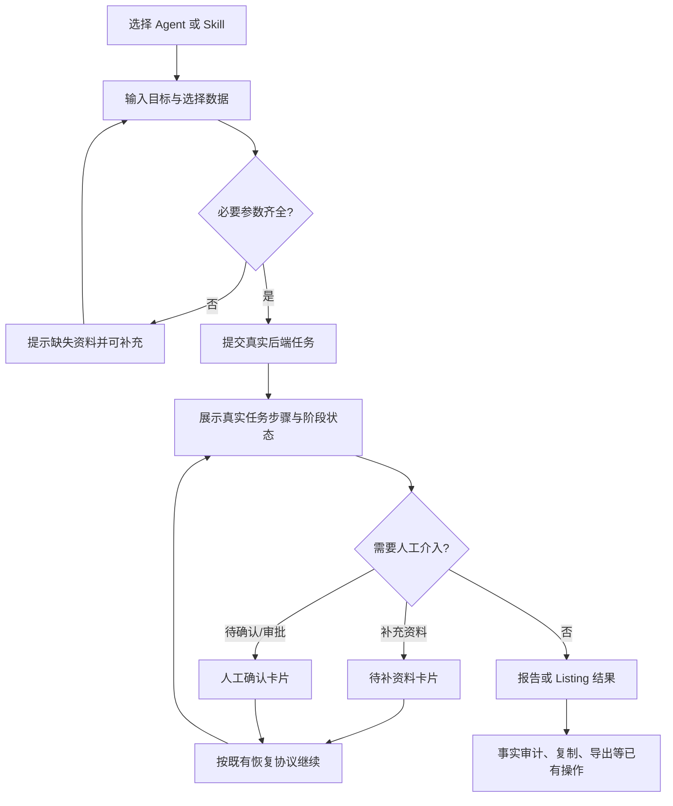
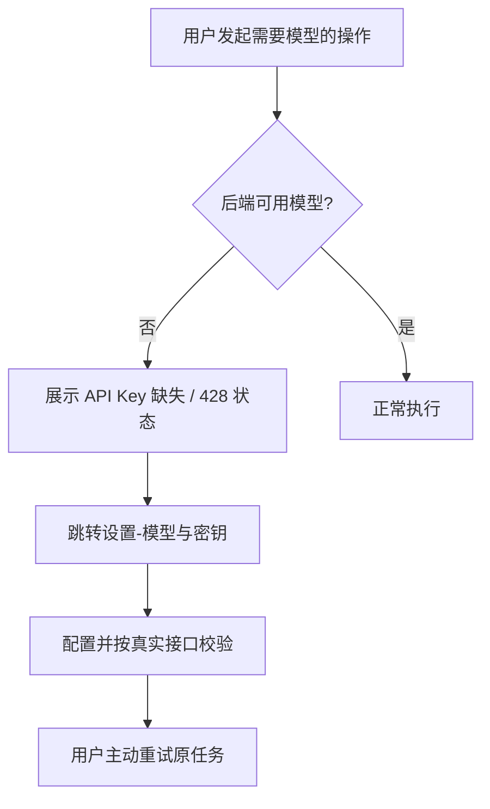
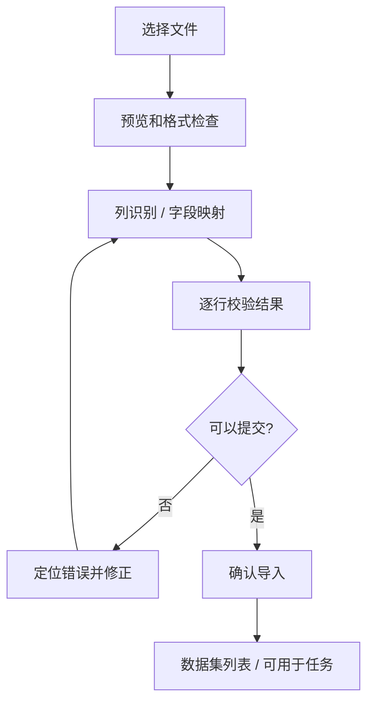

# 激浪（jilang）前端 UI/UX 改造设计规范（design.md）

> Version: 1.0 · 2026-10-30  
> 项目：https://github.com/yong04ux/jilang  
> 目标：在**保持原有 Logo、品牌主色、业务功能和数据真实性**的前提下，基于 **React + TypeScript + Vite + Tailwind CSS + shadcn/ui**，统一打造现代 B2B SaaS 风格的跨境电商 AI Agent 运营工作台。  
> 实施方：Codex。先审查代码，按阶段增量实现、测试、提交；不得直接覆盖 `main`。

---

## 0. 阅读方式与优先级

本文件属于**可执行的 UI/UX 设计规格**，不是要求重写业务系统。优先级：

1. **P0 保证业务正确性**：认证、多租户、API、真实状态机、审批、BYOK、证据分级和 Mock 标识不得回归。
2. **P0 品牌不变**：保留当前 Logo、favicon、名称“激浪”和品牌蓝 `#1B6EF3`；其他已有品牌变量以代码实值为准。
3. **P0 视觉一致**：所有页面统一导航、排版、间距、表格、按钮、状态反馈、空状态。
4. **P1 工作流体验**：清楚呈现用户目标 → 参数准备 → Agent/Skill 执行 → 人工确认 → 报告 / Listing 产物。
5. **P1 性能与可访问性**：改善工作台和设置页的首屏体验；支持响应式、键盘和屏幕阅读器。

**事实边界**：用户提供的页面截图是当前 UI 的视觉依据；此前生成的效果图是目标风格参考，不是产品能力或真实数据的证明。仓库当前 README 指出前端已采用 React + TypeScript + Vite，因此默认**增量重构**，不得无条件重建项目；实际以当前检出的分支代码为准。

---

## 1. 产品定位与设计原则

**产品定位**：激浪是跨境电商 AI 运营工作台，不是单纯聊天机器人。核心价值是“接收目标和数据 → 执行可追踪业务流程 → 提交有证据的结果 → 必要时由人确认”。

设计关键词：**清晰、专业、克制、可追踪、可信任、高信息密度**。

### 1.1 必须遵循的业务事实

- 商品规格、材质、认证等缺失时展示缺失项和人工补充入口，禁止编造。
- 区分 `fact`、`statistic`、`inference`、`assumption`；可用时展示来源/证据。
- 区分“示例数据”“Mock 数据”“真实计算”“未连接”“未配置”，禁止用假数据粉饰空白页面。
- LangGraph / 任务步骤只展示服务端真实状态；**不得伪造进度百分比、耗时、执行成功或生成记录**。
- 缺少 LLM Key 时依据真实后端状态展示配置入口，不要将规则推断呈现为模型生成。
- 继续保留任务暂停、待补充资料、待审批、待确认、错误、取消和恢复等实际状态。
- Preview 图片中的 Agent 数量、运行记录、分析图表、价格等均只是视觉示意，绝不能据此新增虚构数据。

### 1.2 改造边界

**包含**：布局、设计 Token、组件复用、信息架构、可视化、交互状态、响应式和性能优化。  
**不包含**：重写 FastAPI / LangGraph、修改数据库业务模型、改变后端状态流转、接入未经授权的店铺 API、添加未实现的服务端能力。

如需新增功能（例如全局搜索、历史 Agent 记录、额外 Agent、图表数据、导出），先检查后端是否已有数据源；没有就只保留明确的扩展点，**不要放置看似可用的假按钮**。

---

## 2. 信息架构与全局布局

### 2.1 当前页面范围

| 路由（以实际代码校验） | 页面 | 关键任务 | 视觉优先级 |
|---|---|---|---|
| `/dashboard` | 工作台首页 | 总览、任务入口、经营概况、最近产物 | P1 |
| `/workbench` | AI 助手 | 对话、Agent/专家/技能、执行步骤、结果/确认 | **P0** |
| `/tasks` | 任务中心 | 检索、筛选、状态追踪、任务详情 | **P0** |
| `/agents` | Agent 市场 | Agent 列表、能力说明、启动业务流程 | P1 |
| 技能广场对应路由 | 技能广场 | 单项技能检索、分类、调用 | P1 |
| `/data` | 数据资产 | 文件导入、校验、预览、字段映射、数据集 | **P0** |
| 店铺与渠道对应路由 | 店铺与渠道 | 连接状态、示例/真实来源区分 | P1 |
| `/settings` | 设置 | 账号、模型与密钥、数据源、角色、审计 | **P0** |

不在表中的既有页面也需要继承同一设计系统，不得隐藏或删除。

### 2.2 应用 Shell

桌面端推荐：

```text
┌──────────────────┬────────────────────────────────────────────────────────────┐
│ 品牌 / Logo      │ 面包屑               [现有能力]       通知 / 用户       │
│                  ├────────────────────────────────────────────────────────────┤
│ 工作台           │ 页面标题、说明                         主操作按钮         │
│ AI 助手          │                                                            │
│ 任务中心         │ 页面内容：统计 / 筛选 / 数据 / 结果 / 操作                │
│ ─────────────    │                                                            │
│ Agent 市场       │                                                            │
│ 技能广场         │                                                            │
│ ─────────────    │                                                            │
│ 店铺与渠道       │                                                            │
│ 数据资产         │                                                            │
│ 设置             │                                                            │
│                  │                                                            │
│ 用户 / 租户      │                                                            │
└──────────────────┴────────────────────────────────────────────────────────────┘
```

- `Sidebar` 展开宽度建议 **224–240px**；收起宽度 **64–72px**；保留 Logo 的原始宽高比。
- 顶栏高度建议 **56–64px**；统一面包屑和用户操作区域。
- 页面内容默认使用 `max-width: 1440–1600px`、水平 padding 24–32px；**AI 助手的双栏执行视图允许占满可用空间**。
- 背景以低对比度冷白灰区分页面与卡片；不使用大面积炫光或强渐变。
- 左栏分组保留“工作空间 / Agent 平台 / 数据与系统”。
- 宽度不足时 Sidebar 收成图标模式或 Sheet；页面不能出现横向整体滚动。
- 全局搜索、通知等若无对应功能，不因效果图而新增虚假的可点击入口。

### 2.3 两种导航密度

当前部分页面显示图标窄栏、部分显示宽栏。应统一为**同一个可折叠 Sidebar 组件**；用户切换后在路由间保持折叠状态，避免每页风格突然改变。

---

## 3. 品牌与设计 Token

### 3.1 品牌资产保护

- 从仓库找到并复用现有 SVG/PNG Logo、favicon 与品牌名称，禁止重新画一个“类似 Logo”。
- 品牌主色固定参考：**`#1B6EF3`**。其它原有颜色、Logo 轮廓和比例以现有资源为准。
- UI 图标使用 Lucide React；品牌图标不使用通用 Lucide 图标替换。
- 中文 UI 为主，保留必要技术专有名词（Agent、Skill、Listing、ASIN、SKU）。

### 3.2 颜色语义

以下为**建议语义映射**，Codex 应先审查当前 tokens，再结合实际项目设置；不要直接覆盖原配色：

| Token | 用途 | 建议 |
|---|---|---|
| `--primary` | 主按钮、选中导航、链接 | 对齐现有 `#1B6EF3` |
| `--primary-foreground` | 主按钮文字 | 对比度达标的白色 |
| `--background` | 页面背景 | 冷白/极浅灰 |
| `--card` | 内容卡片 | 白色 |
| `--muted` | 标签/次级容器背景 | 中性浅灰 |
| `--border` | 边界/分割线 | 低对比中性灰 |
| `--success` | 已完成/校验通过 | 绿色，避免仅靠颜色区分 |
| `--warning` | 待确认/待补资料 | 琥珀色 |
| `--destructive` | 失败/危险操作 | 红色 |
| `--info` | 进行中/信息说明 | 蓝色 |

**状态色不能代替文字**：所有状态必须同时呈现可读标签和图标/描述。

### 3.3 规格约定

- 间距：4px 基准，常用 8 / 12 / 16 / 24 / 32px。
- 圆角：输入框 8–10px；卡片 12–14px；弹窗 14–16px；统一，不随页面变化。
- 边框：常规 1px，主要靠边框、留白和背景区分层级；阴影非常轻。
- 字体：优先系统中文字体栈；标题 24–28px，区块标题 16–18px，正文 14px，辅助文字 12–13px。
- 控件高度：标准 36–40px；紧凑过滤器 32–36px；点击热区尽量 ≥ 40px。
- 表格行高：适度紧凑，约 52–64px；标签不会换行挤乱表格。
- 空状态：图标 + 明确原因 + 唯一下一步操作；不要占据大面积空白。
- 暗色主题：可以支持，但**优先实现高质量浅色主题**。暗色 Token 必须重新校验对比度。

---

## 4. UI 组件库与工程规范

### 4.1 使用方式

沿用实际项目中的 React + TypeScript + Vite，按 shadcn/ui 官方 **Existing Project** 文档接入；如果已经集成，不重复初始化。确认 Tailwind 版本和现有 CSS 变量后再修改 `components.json` 与样式入口。

### 4.2 组件映射

| 需求 | shadcn/ui 基础组件 | 业务封装建议 |
|---|---|---|
| 侧栏、导航 | Sidebar, Breadcrumb, Sheet | `AppShell`, `MainNav` |
| 总览指标 | Card, Badge, Separator | `MetricCard` |
| 筛选/搜索 | Tabs, Input, Select, Popover | `FilterBar`, `SearchField` |
| 任务列表 | Table / Data Table, DropdownMenu, Pagination | `TaskTable`, `TaskStatusBadge` |
| 执行步骤 | Card, Collapsible, ScrollArea | `ExecutionTimeline`, `TaskStep` |
| 人工确认 | Alert, Dialog, AlertDialog, Form | `HumanReviewPanel` |
| AI 对话 | Textarea, Button, Tabs, ScrollArea | `ChatThread`, `ChatComposer` |
| 产物区 | Tabs, Card, Table, ScrollArea | `ArtifactPanel`, `ListingEditor` |
| 导入 | Input, Table, Tabs, Alert, Progress | `UploadDropzone`, `ImportPreview` |
| 模型配置 | Dialog, Form, Input, Select, Switch | `ModelProviderCard`, `SecretInput` |
| 骨架/通知 | Skeleton, Sonner | `PageSkeleton`, `AppToast` |

仅将 shadcn/ui 作为**基础组件代码**使用，复杂业务模块自行封装，不将 Agent 业务逻辑塞进 `components/ui`。

### 4.3 推荐前端目录（按真实仓库调整）

```text
frontend/src/
├── app/                   # AppShell、路由、Providers
├── components/
│   ├── ui/                # shadcn/ui 基础组件
│   ├── layout/            # Sidebar、Header、PageHeader
│   └── shared/            # Badge、Empty、Skeleton、Error 等
├── features/
│   ├── dashboard/
│   ├── workbench/
│   ├── tasks/
│   ├── agents/
│   ├── skills/
│   ├── data-assets/
│   ├── stores/
│   └── settings/
├── lib/                   # API Client、utils、类型工具
├── hooks/
├── styles/                # 全局设计 Tokens
└── assets/                # 既有品牌资源
```

不得为追求目录一致性而做大规模无意义搬迁。保留已实现的 API hooks、状态管理、路由结构和测试。

---

## 5. 页面设计规格

### 5.1 工作台首页 `/dashboard`

**目标**：进入系统 5 秒内知道“现在有什么任务、有什么需要处理、可以从哪里开始”。

**页面结构**：

1. PageHeader：标题、简介、主要入口“新建任务 / AI 助手”（以现有路由为准）。
2. Key 缺失提示：单条紧凑 Warning Alert，突出“去设置”，不得重复刷屏。
3. 任务概览：任务总数、运行中、报告、Listing、待审核等已有指标。
4. 经营概览：展示真实 API 已返回的数据及来源标记；无数据则 Empty，不生成销售额和假折线。
5. 最近任务、最近报告、最近 Listing：有内容用紧凑行列表；无内容显示引导操作。

**规则**：所有指标仅绑定服务端数据。没有时间序列时不画走势图；可显示“暂无趋势数据”。

### 5.2 AI 助手 `/workbench`（核心）

分为两个大状态，不应始终使用同一居中页面。

#### A. 新会话 / 空状态

- 简短欢迎语：“跨境电商 AI 运营助手”。
- 三个明确入口：业务 Agent / 专家 / 技能。给出各自能力说明，避免概念混淆。
- 技能区域：分类 Tabs + 统一卡片（图标、名称、一句话用途、必要输入、调用入口）。
- 最近会话：若存在则显示少量，支持“查看全部”；无会话不造假。
- Chat Composer：输入目标、上传/选择数据（仅在已有功能支持时）、技能、模型/Agent 选择、发送。

推荐页面最大正文宽度 1080–1240px，欢迎内容上移，缩短无效纵向留白。

#### B. 已开始会话 / 执行或结果态

桌面双栏：**左侧对话 52–58%，右侧任务/产物 42–48%**，右侧可通过分隔条调整（视实现成本）；两个面板滚动独立。移动端改 Tabs 或 Sheet。

```text
┌───────────────────────────────┬────────────────────────────────┐
│ 对话                          │ 任务 / 结果                     │
│ 用户目标                       │ [步骤] [数据] [报告/Listing]   │
│ AI 响应与提示                  │ 状态：待补资料 / 待确认 ...      │
│                               │ 执行时间线                       │
│ 紧凑计划摘要（可展开）          │ 可追溯的数据 / 产物 / 审核动作   │
│                               │                                │
│ ───────────────────────────   │                                │
│ 输入框（固定于左栏底部）        │                                │
└───────────────────────────────┴────────────────────────────────┘
```

**避免重复**：截图中左侧“执行计划”与右侧“步骤”完整重复。建议左侧仅保留**摘要卡片（当前阶段、当前状态、查看完整步骤）**；右侧才是唯一完整执行时间线。用户展开历史消息时可只读查看当时摘要。

**步骤组件要求**：每步状态 `pending / running / completed / failed / waiting_input / waiting_approval / cancelled` 等以实际枚举映射；描述、真实耗时、输入/输出摘要、错误原因、关联报告。默认折叠已完成细节，展开查看证据或参数，敏感字段脱敏。

**状态含义**：`已完成` 是任务生命周期真实完成；若只是“编排完成、但还需补资料”必须突出 `待补充资料` / `已暂停`，避免同时显示“已完成”导致误解。

**人工介入**：

- 缺少 `size/material/capacity/color/weight/quantity` 等事实，明确字段和为什么需要；按服务端返回结果动态显示，绝不把这些字段固定视为每个品类的必填。
- 提交前复核，保留确认令牌/状态校验和 409 恢复失败提示等既有机制。
- 用户可以补充资料、确认、取消、查看原始依据；只能暴露后端支持的操作。
- 如果没有可用模型，显示“需要配置 API Key”，并给出设置入口。规则推断内容标注“规则推断”，不能写成“AI 模型已分析”。

**结果产物**：右侧有数据、报告、Listing 草稿等标签；从真实接口或已保存的任务结果读取。Listing 字段按服务端结构显示，复制/编辑/审计/导出仅在后端能力真实存在时开放。

### 5.3 任务中心 `/tasks`

**当前问题**：只有单行表格、上方过滤按钮，页面下方留白巨大，任务详情入口不突出。

**建议结构**：

1. 页面标题、简介、主按钮（发起已有业务流程）。
2. 轻量状态总览：全部、运行中、待确认、待补资料、已完成（真实统计；无必要不强行展示五张大卡）。
3. 筛选栏：状态 Tabs / Select、搜索框、时间排序；筛选数量真实可追溯。
4. Data Table：任务名称、类型、来源、当前状态、创建/更新时间、操作；小屏隐藏次要列。
5. 点击行打开**任务详情 Sheet**或任务详情路由（以现有能力为准）：摘要、真实步骤时间线、参数摘要、关联报告/Listing、错误/等待原因。
6. 0 条时展示“暂无任务”及进入 AI 助手的 CTA；1 条时不必为填满屏幕复制数据或留巨型空卡。

**状态文案应一致**：待补充资料、等待审批、等待确认、运行中、已完成、失败、已取消等映射为同一 `TaskStatusBadge`。严禁仅以颜色表达。

### 5.4 Agent 市场 `/agents`

**当前问题**：Agent 卡片被摆在页面顶部，留白很多；卡片文字偏细密，“用此 Agent 运行”缺少上下文。

**设计**：

- 页面标题 + 简短价值说明；筛选和搜索仅对应实际可用字段。
- 真实可用 Agent 卡片采用自适应 2–3 列 Grid，内容包括：图标、名称、角色定位、2 行能力简介、真实可执行的技能标签、前置条件、CTA。
- 卡片主按钮统一“使用此 Agent”，点击后进入 `/workbench` 并正确预选 Agent；没有配置 Key 时提前提示而非假执行。
- 具体详情可放 Sheet，展示支持的任务类型、输入要求、可调用 Skills、限制和数据来源。
- **不得将效果图中出现但仓库没有的“广告优化专家”等额外角色当作已上线 Agent**；不伪造“20+ 技能”“运行完成记录”等。
- 若仅有 3 个 Agent，就优雅地显示 3 个，不为填补空间而添加虚假卡片。

### 5.5 技能广场（对应实际路由）

- 和 Agent 市场共享卡片语言，但明确：**Agent 是执行角色，Skill 是可复用的具体能力**。
- 分类以业务领域为主：竞品与 Listing、产品运营、数据分析、财务等（仅展示真实能力）。
- Skill 卡片：名称、输入条件、产出类型、是否依赖 Key/数据、调用入口。
- 点击进入工作台并带入 Skill；若需要结构化参数，可用 Dialog/Sheet 配置，不仅是向输入框插入 Skill 名称。
- 不改变原有 Skill 调度协议；保留对缺失数据、待审批、错误提示的处理。

### 5.6 数据资产 `/data`

**目标**：把“上传文件”升级为清晰的**导入 → 校验 → 字段映射 → 预览 → 确认 → 可用于任务**流程。

**布局**：顶部标题 + 简短说明；第二行状态指标（仅有后端数据时显示）；下面左右双栏：左侧上传、右侧预览/校验；下方数据集列表。

**交互流程**：

1. 选择 CSV/JSON/Excel（以实际支持格式和大小上限为准）。
2. 显示文件名、大小、上传状态；输入非法时就地说明。
3. 上传后展示识别列、类型和前几行预览。
4. 字段映射：展示推荐匹配，并允许按现有 API 可支持的范围修正。
5. 校验结果：成功/警告/失败数量、行号、列名和原因；有真实下载接口时显示错误 CSV 下载。
6. 用户确认导入，成功后数据集出现在列表，显示真实来源/记录数/更新时间。
7. `用于任务` 必须绑定实际数据集选择流程，不新增虚假链路。

**Empty**：没导入时右侧显示“上传后预览识别结果”，底部数据集列表显示“暂无数据集”；不伪造 3 条示例数据。若用户显式加载示例数据，则标注“示例”。

### 5.7 设置 `/settings`

**当前问题**：账号、模型与密钥、数据源叠在长页面，顶部 Tabs 的信息层级不够明显；模型配置为空时的说明不够操作化。

**改造**：

- 设置页固定标题和说明；子导航使用 Tabs 或左侧 SettingsNav，包含现有“账号、模型与密钥、数据源、团队与角色、审计日志”。
- 通过 URL query `?section=...` 保持当前分区，支持刷新与浏览器前进后退。
- 单个分区按需加载；不要进入账号页就无条件请求所有模型、店铺和审计数据。
- 账号：简洁信息卡，不因视觉参考增加不存在的编辑能力。
- 模型与密钥：优先显示**当前激活模型**、配置状态和“新增配置”；厂商选项按实际兼容列表展现，不代表已配置。
- API Key 输入默认隐藏、不会明文回显；测试连接状态按实际服务端反馈，不存浏览器明文日志。
- 未配置时：简洁 Empty + 明确主 CTA；不要显示“DeepSeek 已配置”等假状态。
- 数据源：严格区分“已连接”“示例数据”“未接入”；不可将模拟店铺显示为真实授权。
- 右侧安全说明面板可选，移动端下移；内容必须符合真实密钥存储及权限实现，未经核实不得承诺加密方案。

### 5.8 店铺与渠道

以当前真实页面和 API 为准，沿用页面标题、渠道卡片、连接状态、同步时间、商品/店铺数据列表的通用样式。明确分层：真实连接、Mock 提供器、示例数据、未接入；禁止未连接状态出现“已同步真实订单”。

---

## 6. 关键业务流程（前端状态设计）

### 6.1 Agent + Listing 综合流程



**注意**：这只是 UI 状态编排示意；实际步骤、分支、恢复 API 和是否可以继续，必须来自当前 LangGraph 与后端任务接口。不能把所有 Skill 都强行套成相同步骤。

### 6.2 BYOK 缺失流程



不得自动替用户创建密钥、记录明文，或无提示地切换为规则模式。

### 6.3 文件导入流程



---

## 7. 视觉状态规范

| UI 状态 | 视觉形式 | 用户操作 |
|---|---|---|
| `loading` | Skeleton；必要时 Spinner | 避免白屏 |
| `empty` | 低对比图标 + 说明 + 明确 CTA | 创建任务 / 上传数据 |
| `success` | 绿色标志与文字 | 查看产物 |
| `running` | 蓝色标志与步骤状态 | 查看步骤；可取消时才展示取消 |
| `waiting_input` | 琥珀提示 + 缺失字段表单 | 补充资料 |
| `waiting_approval` | 琥珀提示 + 确认内容 | 审核/确认 |
| `failed` | 红色状态 + 可读错误原因 | 按后端能力重试 |
| `cancelled` | 中性状态标签 | 查看历史 |
| `mock` / `demo` | 明确“Mock”或“示例”Badge | 避免误判成真实业务数据 |
| `not_configured` | Warning/Empty | 去配置 Key / 连接器 |

所有失败态保留后端错误分类和可操作建议；不得用“出错了，请重试”覆盖有用信息。前端日志须脱敏。

---

## 8. 响应式、可访问性与性能

### 8.1 响应式

- ≥ 1280px：完整 Sidebar，任务详情可双栏。
- 768–1279px：可收起 Sidebar；表格隐藏低优先列；工作台双栏按空间调整。
- < 768px：导航 Sheet；工作台切换对话/结果 Tabs；输入框在可视区底部，适配安全区域；表格可局部横向滚动但页面不得溢出。

以上断点为设计建议，不与当前 Tailwind 配置冲突。

### 8.2 可访问性

- 键盘可操作菜单、对话框、上传器、Tabs、Sheet 和 Data Table。
- 确保 focus ring 可见；弹窗正确聚焦和恢复焦点。
- 表单 Label、错误描述和 aria 状态完整。
- 状态不能只靠红绿颜色区分；文字对比度按 WCAG AA 尽量满足。
- 尊重 `prefers-reduced-motion`，不依赖动画传达状态。

### 8.3 性能

1. 先用浏览器 Performance / Network 记录**改造前**工作台和设置页的请求数、首屏耗时与 bundle 体积。
2. 路由按需加载 `React.lazy` 或现有等效机制。
3. 如果已有服务端状态缓存，复用；否则视需要引入 TanStack Query，避免同一资源重复拉取。
4. 设置分区按需请求，尤其不能在“账号”页加载不相关模型/审计数据。
5. 长会话/长列表需要时使用虚拟化，避免无谓全量 DOM。
6. 订阅式任务状态 / 轮询只在可见且任务活动时启动；退出和卸载时清理。
7. 图表和重型编辑器按需加载，图标按需引入。
8. 测量后再给出真实的前后对比；**禁止编造“快了 60%”之类指标**。

---

## 9. 分阶段执行计划（Codex）

### Phase 0 — 基线审查（必须先完成）

- `git status`、当前分支、`frontend/package.json`、路由、CSS、组件目录、静态资产、测试与构建脚本。
- 核对前端已经完成的 React 迁移情况与 shadcn/ui/Tailwind 版本。
- 记录各页面现有 API、权限、错误、空态、分页、查询参数和交互功能清单。
- 建立改造前截图与可重复的操作测试基线。
- 创建专用分支如 `feature/ui-design-system`；不直接推送或覆盖 `main`。

### Phase 1 — 统一基础设计系统

- 保留品牌资产；建立 semantic tokens 和 UI 字体/间距/边框/圆角规范。
- 统一 Sidebar、Header、PageHeader、ContentContainer、StatusBadge、EmptyState、ErrorState、LoadingState。
- 确保页面间导航、租户信息与布局持久一致。
- 每项功能验证通过后小步提交。

### Phase 2 — 核心体验

1. `/workbench`：新会话与任务态双布局；去除步骤冗余；完整状态与人工介入。
2. `/tasks`：任务筛选、Data Table 和详情视图；来源于真实任务列表。
3. `/settings`：分区组织与按需请求；密钥安全提示、空状态。
4. `/data`：文件校验、字段映射、预览与错误反馈。

### Phase 3 — 其他业务页面

1. `/agents` 与技能广场：统一卡片、能力分层、正确启动流程。
2. `/dashboard`：真实指标、最近活动、没有数据时的优雅空态。
3. 店铺与渠道：连接状态、来源标识和列表规范。

### Phase 4 — 回归与部署

- TypeScript、Lint、构建及项目已有测试全部执行。
- 核验关键链路：启动 Agent、缺 Key、补资料、审批、任务恢复、文件导入、数据集使用、切换租户、查看报告。
- 验证 Vercel 静态构建的 SPA 路由回退、Render API 环境变量、CORS/鉴权连接。
- 测试桌面和移动端；检查 Console / Network 错误。
- 汇报改造前后真实指标、截图、未覆盖能力和遗留风险。

---

## 10. 验收标准（DoD）

### 品牌与设计

- [ ] Logo、favicon、品牌名称与现有主蓝色未改变。
- [ ] 所有页面统一 Sidebar、顶部、标题、Token、控件尺寸、圆角、状态 Badge。
- [ ] 浅色主题完整，支持必要屏宽；无明显截断、溢出和无意义巨型留白。
- [ ] 不将效果图的虚构指标、Agent、任务或数据集写进真实 UI。

### 业务兼容

- [ ] 现有路由、鉴权、多租户与权限保持正常。
- [ ] Agent、Skill、任务步骤、错误分类和人工审核完全基于真实 API。
- [ ] 等待补资料、未配置 Key、暂停与完成在视觉上明确区分。
- [ ] Mock / 示例 / 未接入 / 真实数据仍被准确标识。
- [ ] 竞品报告、Listing、数据导入、任务详情的既有功能未丢失。
- [ ] 模型配置不在前端日志或网络错误文案中泄漏密钥。

### 工程质量

- [ ] TypeScript / Lint / 构建通过；必要回归测试通过。
- [ ] 工作台和设置页加载不再有明显不必要的请求和重复渲染。
- [ ] API 路径与响应契约、后端业务代码保持不变。
- [ ] Render / Vercel 现有部署链路经过验证。
- [ ] 提交变更摘要、主要文件清单、页面截图、测试命令/结果和真实已知风险。

---

## 11. 交给 Codex 的执行指令（可直接复制）

> 请阅读仓库根目录的 `design.md`，并以它作为此次前端 UI/UX 重构的唯一设计基线。先检查当前分支、React/Vite/Tailwind/shadcn/ui 的实际配置、品牌资源、路由、API 与任务状态协议，然后创建独立分支、按 Phase 0 → 4 增量实施。保留激浪原 Logo 与 `#1B6EF3` 品牌蓝，不修改 FastAPI/LangGraph 业务逻辑，不凭效果图伪造数据或功能。优先完成设计系统、AI 助手、任务中心、设置和数据资产；每阶段执行构建及关键流程回归。必要时更新本设计文件记录与既有代码不一致之处，报告真实进度、测试结果和残留风险。不要一次性推翻现有前端，更不要直接合并 `main`。

---

## 12. 参考资料

- 项目仓库：https://github.com/yong04ux/jilang
- shadcn/ui Vite 现有项目集成：https://ui.shadcn.com/docs/installation/vite
- shadcn/ui Theme：https://ui.shadcn.com/docs/theming
- shadcn/ui Components：https://ui.shadcn.com/docs/components

**说明**：本文件是根据用户提供的各页面截图、此前确认的视觉方向和仓库公开 README 编制。功能是否已经完整实现、文件路径、状态枚举和 API 接口，必须在 Codex 的 Phase 0 中以当前检出的代码验证后执行。
